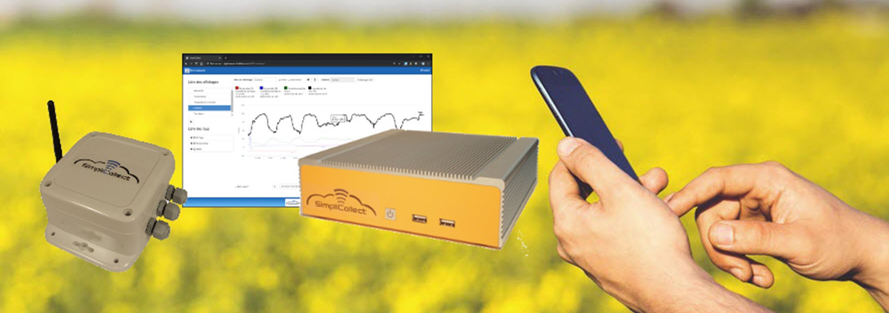

# Simplicollect – Manuals

{ width=960 }

This space contains the installation and user instructions for the Simplicollect technology. It is also meant to be a link with our customers and partners. Do not hesitate to share your ideas with us: there is always room for improvement.

## Sections

- [Installation and Commissioning Manual](manuel-d-installation-et-de-mise-en-service/index.md): gateway, modules, MaestrEau module and irrigation
- [User Manual](manuel-d-utilisation/index.md): configuration, MaestrEau, Dataview, configuration utilities, password change, SimpliWeather

## How to navigate

1.  Open a section in the sidebar to browse its pages.
2.  Use the search field at the top of the page to find a topic.
