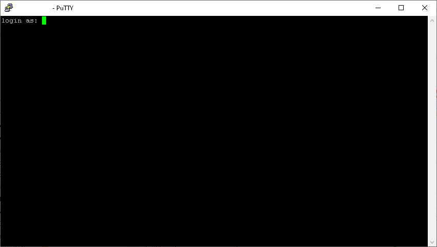
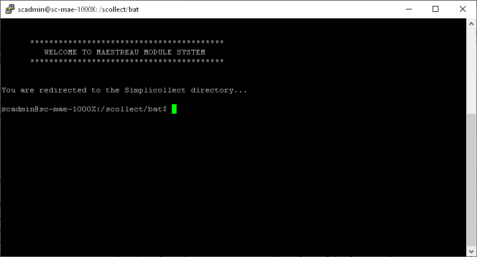
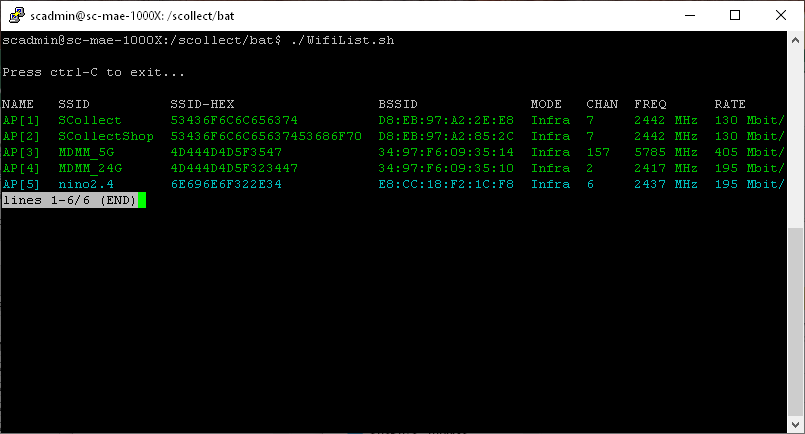
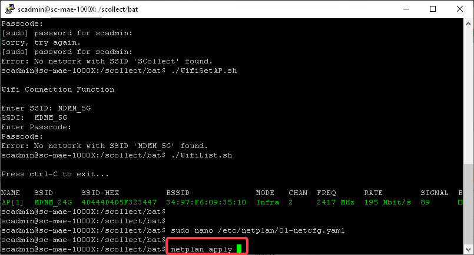

# Configuring the Wi-Fi Connection and IP Address

The MaestrEau module, when communicating over Wi-Fi, can connect to one of your access points located near the module.

!!! info

    WARNING: Using this utility requires firmware qualifications and may affect the operation of the Yoctopuce board.

## Prerequisites

The communication is configured through the module's Ethernet port, which connects to the Ethernet port of a PC.

!!! info

    If your equipment has no network cable connector, you can get an "adapter" that plugs into a USB port on your PC or laptop.  For example, you can search Amazon for "USB Ethernet adapter".

The default IP address of the MaestrEau module's Ethernet connection is **192.168.0.100**.  You must therefore configure your PC's Ethernet connection to be on the same address segment. For example, configure your PC with the address 192,168.0.20.

In addition, you must install the Putty software on your PC in order to open a session on the MaestrEau module's processor.  Go to [www.putty.org](http://www.putty.org) to download the version of Putty that suits your PC.

## Opening an SSH Session

As mentioned previously, you must open a session on the MaestrEau module in order to configure its Wi-Fi connection.

1.  Remove the protective cover from the port and connect an Ethernet cable between the module and your PC;

2.  Start the Putty software on your PC;

3.  Start an "**ssh"** session in Putty with the IP address of the MaestrEau module, which is 192.168.0.100: { width=350 }

4.  An SSH session window will open and let you enter the account name and password: { width=500 }

    !!! info

        The software may ask you to confirm that you accept the connection to this new address.  Answer by clicking Yes.

5.  Enter the account **scadmin**, press Enter, and enter the password **&lt;password&gt;**: { width=500 }

    !!! info

        The account may also be **root** with the password **&lt;password&gt;**

6.  A welcome banner is displayed and you are ready to do the configuration. { width=500 }

## Wi-Fi Connection

1.  In the SSH session window, type the command **./WifiList.sh** and &lt;Enter&gt; to view the Wi-Fi access points that are reachable from the MaestrEau module: { width=500 }

    !!! info

        The system may ask you to enter the password again.  Type **&lt;password&gt; **and the &lt;Enter&gt; key.

2.  Identify the access point you want to use and note down its SSID;

    !!! info

        You must also know the access point's "password" in order to

3.  Press the &lt;Ctrl&gt; and C keys to exit the function;

4.  Type the command **./WifiSetAP.sh** to start the connection configuration;

5.  Enter the SSID you noted down and press &lt;Enter&gt;, then type the password and press &lt;Enter&gt;: { width=500 }

6.  The connection takes a while to establish... The system responds with a success message confirming your connection to the Wi-Fi access point.

## Changing the IP Address

You must change the IP address of the Wi-Fi connection in order to join your computer network, the same one the Simplicollect gateway is connected to.

1.  Type the command **sudo nano /etc/netplan/01-netcfg.yaml** and press the &lt;Enter&gt; key.  A file opens for editing on the screen: { width=500 }

2.  To change the IP address of the Wi-Fi connection, change the parameters under the line **w1p1s0: **

    !!! info

        Do not change the nameservers and dhcp4 parameters, and make sure the IP address is not used by another device/computer.

3.  Press the &lt;Ctrl&gt; and X keys to finish and save the file (answer "yes" and press &lt;Enter&gt; to confirm the save);

4.  To apply the new configuration, type the command **netplan apply**: { width=500 }

5.  To confirm that the address change took place, type the command **ifconfig** to display the configuration of the various connections.  The Wi-Fi connection's address is found under **w1p1s0**: { width=500 }

## Using the Wired Ethernet Connection

You can use the Ethernet connection, the same one you used to connect the PC to the MaestrEau module, to connect the module to the computer network by cable.

The steps are the same as for the Wi-Fi connection, with the following differences:

1.  After step 1, move the **addresses**, **gateway4** and **nameservers** lines from under w1pi1s0 to enp2s0 as shown below: { width=550 }
2.  Be sure to change the Ethernet connection's address so that it matches your computer network;
3.  Save the file and type the command **netplan apply**;
4.  After the command, you will lose the connection to the MaestrEau module because the Ethernet connection's address has changed;
5.  Reconnect by changing the PC's address to a compatible one (e.g.: 192.168.1.20), and reopen an SSH session with the MaestrEau module to confirm the new address;
6.  Then, to connect the MaestrEau module to your network, unplug the cable from the module's connector and plug in the cable from your computer network;
7.  You can verify that the new module is present on your network by typing the **ping** command on one of the PCs of your computer network;

- [Modules](../../manuel-d-utilisation/configuration/modules.md)
- [Configuration](../../manuel-d-utilisation/configuration/index.md)
- [Tags](../../manuel-d-utilisation/configuration/tags.md)
- [Replacing the SIM in MaestrEau](remplacement-sim-sur-maestreau.md)
- [Configuring the Wi-Fi Connection and IP Address](configuration-de-la-connexion-wifi-et-de-l-adresse-ip.md)
