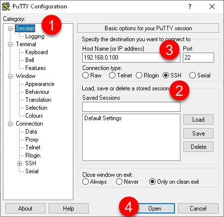
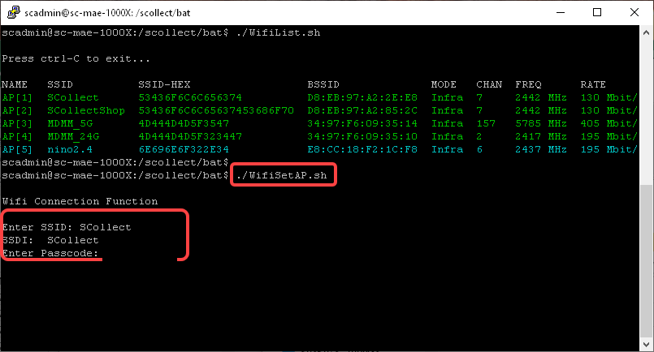
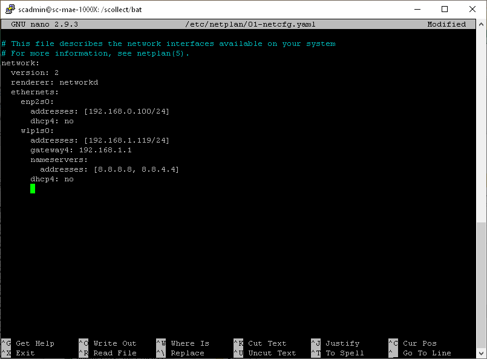
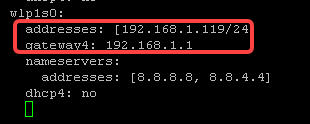
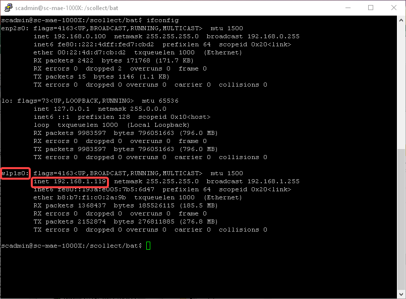
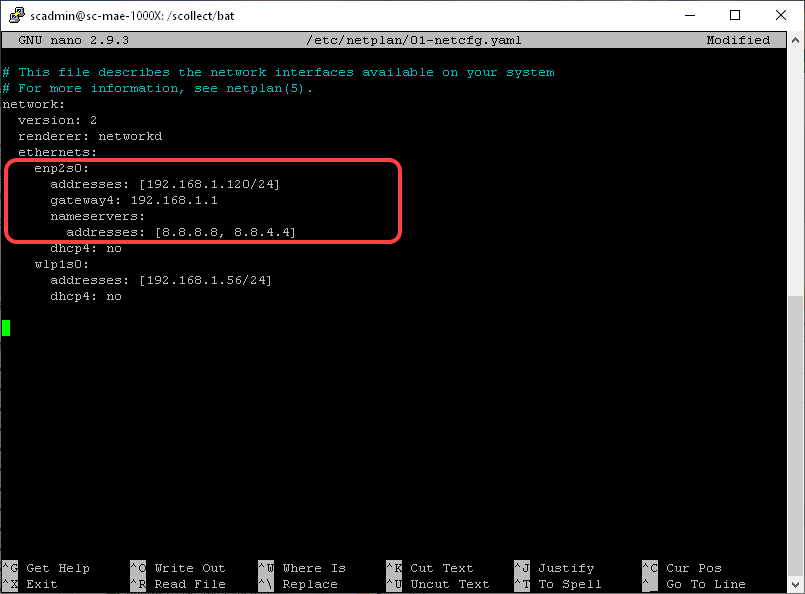

# Configuration de la connexion Wifi et de l'adresse IP

Le module MaestrEau en communication Wifi, peut se connecter à une de vos antennes à proximité du module.

!!! info

    ATTENTION: L’utilisation de cet utilitaire demande des qualifications en micrologiciel et ceci peut altérer l’utilisation de la carte Yoctopuce.

## Pré requis

La configuration de la communication se fait au travers le port Ethernet du module qui se connecte au port Ethernet d'un ordinateur PC.

!!! info

    Si votre équipement ne possède pas de connecteur de câble de réseau, vous pouvez vous procurer un "adaptateur" avec branchement sur un port USB de votre PC ou laptop.  Par exemple, vous pouvez faire une recherche sur Amazon avec la mention "adaptateur usb Ethernet".

L'adresse IP par défaut de la connexion Ethernet du module MaestrEau est **192.168.0.100**.  Donc, il faut configurer la connexion Ethernet de votre PC  pour se connecter sur le même segment d'adresse. Par exemple, configurer votre PC avec l'adresse 192,168.0.20.

De plus, il faut installer le logiciel Putty sur votre PC afin de pouvoir ouvrir une session sur le processeur du module MaestrEau.  Allez sur le site [www.putty.org](http://www.putty.org) pour télécharger la version de Putty qui convient à votre PC.

## Ouvrir une session SSH

Tel que mentionné précédemment, il faut ouvrir une session sur le module MaestrEau afin de configurer sa connexion Wifi.

1.  Retirer le couvercle de protection du port et connecter un câble Ethernet entre le module et votre PC;

2.  Démarrer le logiciel Putty sur votre PC;

3.  Démarrer une session "**ssh"** sur Putty avec l'adresse IP du module MaestrEau, soit 192.168.0.100: { width=350 }

4.  Une fenêtre de session SSH va s'ouvrir et vous permettra d'entrer le nom du compte d'accès et le mot de passe: { width=500 }

    !!! info

        Il se peut que le logiciel demande de confirmer que vous acceptez la connexion vers cette nouvelle adresse.  Répondre en cliquant sur Oui.

5.  Entrer le compte **scadmin**, presser Enter, et entrer le mot de passe **&lt;mot de passe&gt;**: { width=500 }

    !!! info

        Il est également possible que le compte soit **root** et le mot de passe **&lt;mot de passe&gt;**

6.  Une bannière de bienvenue est affichée et vous êtes prêt à faire les configurations. { width=500 }

## Connexion Wifi

1.  Dans la fenêtre de session SSH, taper la commande **./WifiList.sh** et &lt;Enter&gt; afin de visualiser les antennes Wifi qui sont accessibles du module MaestrEau: { width=500 }

    !!! info

        Il se peut que le système demande d'entrer le mot de passe à nouveau.  Tapez **&lt;mot de passe&gt; **et la touche &lt;Enter&gt;.

2.  Identifier l'antenne que vous voulez utiliser et prendre son SSID en note;

    !!! info

        Il faut également connaitre le "mot de passe" de l'antenne pour

3.  Presser les touches &lt;Ctrl&gt; et C pour sortir de la fonction;

4.  Taper la fonction **./WifiSetAP.sh** pour lancer la configuration de la connexion;

5.  Entrer le SSID que vous avez pris en note et faire &lt;Enter&gt; et taper le mot de passe et faire &lt;Enter&gt;: { width=500 }

6.  La connexion prend un certain temps à s'établir... Le système répond par un message de succès qui confirme votre connexion à l'antenne Wifi.

## Changement de l'adresse IP

Il faut changer l'adresse IP de la connexion Wifi afin de rejoindre votre réseau informatique, le même sur lequel est connectée la passerelle Simplicollect

1.  Taper la commande **sudo nano /etc/netplan/01-netcfg.yaml** et presser la touche &lt;Enter&gt;.  Un fichier en édition apparait à l'écran: { width=500 }

2.  Pour changer l'adresse IP de la connexion Wifi, changer les paramètres sous la ligne **w1p1s0: **

    !!! info

        Ne changez pas les paramètres nameservers et dhcp4 et assurez-vous que l'adresse IP n'est pas utilisée par un autre appareil/ordinateur.

3.  Presser les touches &lt;Ctrl&gt; et X pour terminer et sauvegarder le fichier (répondre "yes" et presser &lt;Enter&gt; pour confirmer la sauvegarde);

4.  Pour appliquer la nouvelle configuration, taper la commande **netplan apply**: { width=500 }

5.  Afin de confirmer que le changement d'adresse à bien eu lieu, taper la commande **ifconfig** afin d'afficher la configuration des différentes connexions.  L'adresse de la connexion Wifi se trouve sous **w1p1s0**: { width=500 }

## Utilisation de la connexion câblée Ethernet

Il est possible d'utiliser la connexion Ethernet, la même que vous avez utilisée pour connecter le PC au module MaestrEau, afin de connecter le module par câble au réseau informatique.

Les étapes sont les mêmes que pour la connexion Wifi, avec les différences suivantes:

1.  Après l'étape 1, déplacer les lignes **addresses**, **gateway4** et **nameservers** de sous w1pi1s0 vers enp2s0 tel que ci-dessous: { width=550 }
2.  Prendre soin de changer l'adresse de la connexion Ethernet afin de s'agencer avec votre réseau informatique;
3.  Sauvegarder le fichier et taper la commande **netplan apply**;
4.  Suite à la commande, vous allez perdre la connexion vers le module MaestrEau car l'adresse de la connexion Ethernet a changé;
5.  Reconnecter vous en changeant l'adresse du PC pour une adresse compatible (ex.: 192.168.1.20), et ré ouvrir une session SSH avec le module MaestrEau afin de bien confirmer la nouvelle adresse;
6.  Par la suite, pour raccorder le module MaestrEau à votre réseau, débrancher le câble du connecteur du module et brancher le câble de votre réseau informatique;
7.  Vous pouvez valider la présence du nouveau module sur votre réseau en tapant la commande **ping** sur l'un des PC de votre réseau informatique;

- [Modules](../../manuel-d-utilisation/configuration/modules.md)
- [Configuration](../../manuel-d-utilisation/configuration/index.md)
- [Tags](../../manuel-d-utilisation/configuration/tags.md)
- [Remplacement SIM sur MaestrEau](remplacement-sim-sur-maestreau.md)
- [Configuration de la connexion Wifi et de l'adresse IP](configuration-de-la-connexion-wifi-et-de-l-adresse-ip.md)
