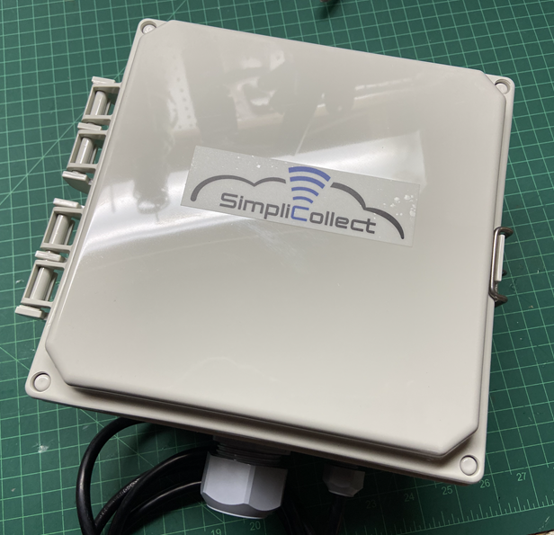
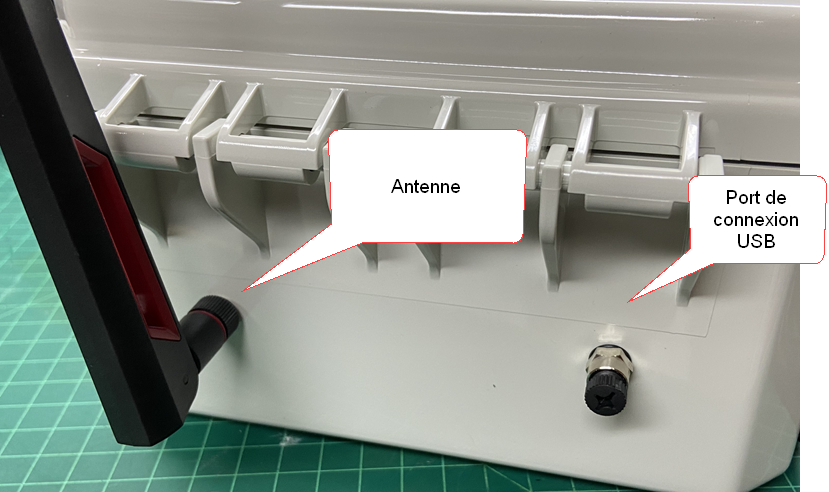
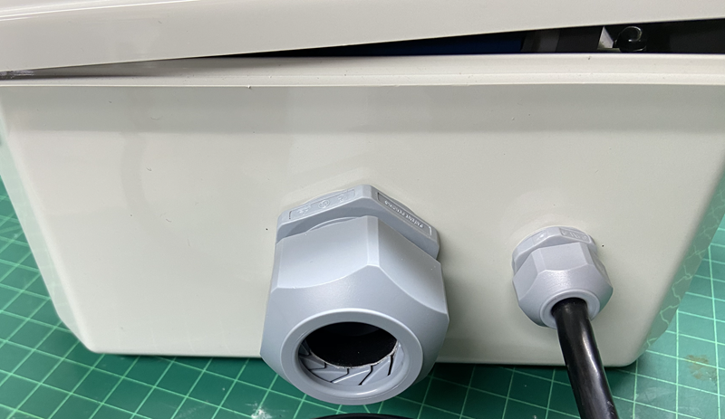
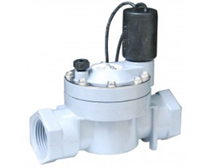
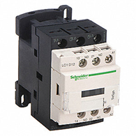

# MaestrEau and Irrigation Module

The MaestrEau module activates various elements (actuators, valves, motors, etc.) for plant growth management and irrigation.

See the [MaestrEau documentation](../../manuel-d-utilisation/maestreau-configuration/index.md) for more details.

## Module Description

The MaestrEau module is available in 3 sizes:  5, 10 and 15 24 VAC outputs.  A 24 VAC output can activate an electric valve or any other 24 VAC relay/contactor.

{ width=350 }

The contents of the enclosure can be accessed to connect the cables coming from the equipment to be operated.  The enclosure door opens with a latch located on the right side of the enclosure.  The enclosure is divided into three parts:

- The power supply
- The communication and relay boards
- The terminal block

{ width=500 }

On the left side of the enclosure are the antenna connector and the USB configuration port with its protective cap.

!!! info

    **Always leave the protective cap screwed onto the USB configuration port when you are not using it.**

Under the enclosure is the cable gland for the cables coming from your equipment and the 110 VAC power cable.

Some models are supplied with a 12 VDC power supply for operation from a battery and solar panel.

## Installation Instructions

The MaestrEau module is simple to install.  It can be attached to a wall, a frame or even a pole using the supplied mounting brackets.

The following guidelines must be observed during installation:

- MaestrEau enclosures can withstand humidity, but are not watertight because of the cable gland
- It is preferable to install the module indoors, for example in the pump building
- Always attach the module to a pole or wall with screws or a U-bolt
- The module should be AT LEAST 36 inches above the ground
- If outdoors, try to install the module under a roof or inside a cabinet
- Make sure the poles or walls are solid and will not be knocked over by the wind
- Make sure the location of the module is not in a "depression" where water or snow could accumulate
- Check that a 110/240 VAC power source is available nearby
- Make sure communication works at this location and that there is no interference

It is important to connect the module to a power source correctly.

- Make sure the electrical outlet is high off the ground and that water + humidity will not reach the outlet
- Also make sure there is no "gutter" or tarp that will direct rain onto the VAC outlet
- Recommend that the customer install a "protective cover" on the electrical outlet (must be done by the customer)
- Make sure the power supplies are securely fastened to the pole or wall where the module is installed
- Use zip ties or fastening straps to secure the cables properly

## Connecting the Valves

Electric valves are powered by 24 VAC from the MaestrEau module; the following installation guidelines apply.

- The valves and their cables are installed by the customer or the piping installation team { width=150 }
- The cables are routed close to the MaestrEau module
- Pass the cables through the cable gland at the bottom of the enclosure
- It is recommended to leave a "2-meter loop" of cable before connecting to the MaestrEau module
- The activation conductor of each valve is connected to one position of the terminal block (i.e., 1, 2, 3 .... 15) 
- The "common" conductor is connected to the common terminal block { width=280 }
- Document the position of each valve in a document that you can keep in the MaestrEau module enclosure

## Connecting Pumps or Actuators

As a general rule, a pump, motor or other type of actuator is activated using a 24 VAC contactor or transfer relay.  { width=150 } For example, this makes it possible to start a pump within an irrigation control area.

!!! info

    **This type of connection must be made by an electrician.**  This type of connection involves a current of more than 110 VAC, which is governed by the Quebec electrical code.

The installation guidelines are as follows.

- Whenever possible, place the contactors or other relays close to the MaestrEau module
- The contactors or other relays must be placed in an electrical cabinet that complies with recognized standards and is separate from the MaestrEau enclosure
- Clearly label the contents of the enclosure as well as the incoming and outgoing cables

## Configuring Areas and Zones in Simplicollect

Once the MaestrEau module is correctly installed and connected to the valves, pumps and other actuators, you must proceed with the configuration in Simplicollect. Have on hand the notes taken during installation and the terminal block position of each piece of equipment.  Also make sure you have the MaestrEau module ID, which is on the identification label inside the enclosure door.  This ID will let you find the module in the module list in the Simplicollect configuration software.

{ width=144 }

See the MaestrEau configuration documentation at the following link: [MaestrEau - Configuration](../../manuel-d-utilisation/maestreau-configuration/index.md)

## Testing Your Installation

When you have finished installing the equipment and completed the configuration of the Areas and Zones in Simplicollect, you can now test the system.

- Using the MaestrEau application, test the opening and closing of each valve
- Also test the starting and stopping of the motors/actuators
- This can be done during installation validation
- Document the tests in a validation checklist

<!-- -->

- [Modules](../../manuel-d-utilisation/configuration/modules.md)
- [Configuration](../../manuel-d-utilisation/configuration/index.md)
- [Tags](../../manuel-d-utilisation/configuration/tags.md)
- [SIM Replacement on MaestrEau](remplacement-sim-sur-maestreau.md)
- [Wifi Connection and IP Address Configuration](configuration-de-la-connexion-wifi-et-de-l-adresse-ip.md)
