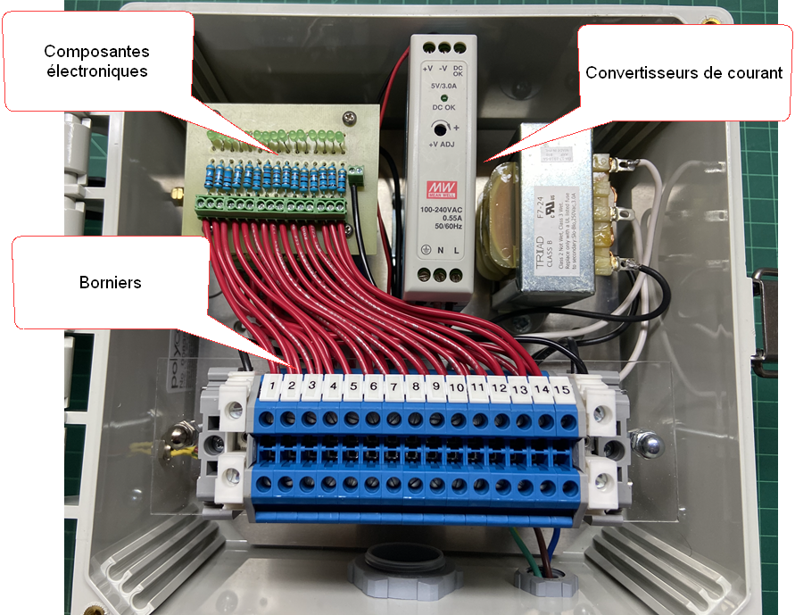
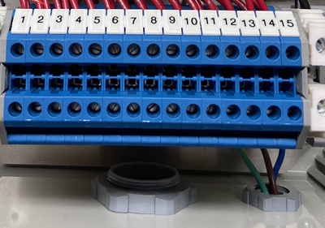
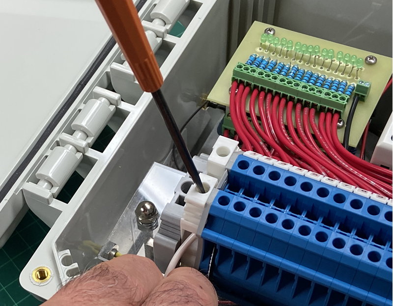
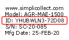

# Module MaestrEau et Irrigation

Le module MaestrEau permet l'activation de différents éléments (actuateurs, valves, moteurs, etc.) pour la gestion de la croissance des végétaux et l'irrigation.

Voir la [documentation MaestrEau](../../manuel-d-utilisation/maestreau-configuration/index.md) pour plus de détails.

## Description des modules

Le module MaestrEau est disponible en 3 formats:  5, 10 et 15 sorties 24 VAC.  Une sortie 24 VAC peut activer une valve électrique ou tout autres relais/contacteur 24 VAC.

{ width=350 }

On peut accéder au contenu du boitier afin de faire les raccordements des câbles provenant des équipements à actionner.  La porte du boitier s'ouvre à l'aide d'un fermoir situé sur le coté droit du boitier.  Le boitier est divisé en trois parties:

- La source d'alimentation
- Les cartes communication et relais
- Le bornier

{ width=500 }

Du côté gauche du boitier, on retrouve le connecteur pour l'antenne et le port de configuration USB avec son capuchon de protection.

!!! info

    **Toujours laisser le capuchon de protection vissé dans le port de configuration USB lorsque vous ne vous en servez pas.**

Sous le boitier, on retrouve le passe-fil pour les câbles provenant de vos équipement et le câble d'alimentation électrique 110 VAC.

Certains modèles sont fournis avec une source d'alimentation 12 VDC pour une alimentation à l'aide de batterie et panneau solaire.

## Instructions d'installation

Le module MaestrEau est simple à installer.  On peut le fixer à un mur, sur un chassis ou même sur un poteau à l'aide des étriers de montage qui sont fournis.

Lors de l'installation, certaines consignes doivent être respectées:

- Les boitiers MaestrEau peuvent résister à l’humidité, mais ne sont pas hermétiques en raison du passe-fil
- Il est préférable d’installer le module à l’intérieur, par exemple le bâtiment des pompes
- Toujours fixer le module à un poteau ou à un mur avec des vis ou une bride en U
- Le module devrait être à AU MOINS 36 pouces du sol
- Si à l’extérieur, essayer d’installer le module sous un toit ou installer dans un cabinet
- S’assurer que les poteaux ou murs sont solides et ne seront pas renversés par le vent
- S’assurer que le lieu où est installé le module n’est pas dans une “depression” où l’eau ou la neige pourrait s’accumuler
- Vérifier qu’une source de courant 110/240 VAC est disponible à proximité
- S’assurer que la communication fonctionne à cet endroit et qu’il n’y a pas d’interférence

Il est important de correctement raccorder le module à une source de courant.

- S’assurer que la prise électrique est loin du sol et que l’eau + humidité n’atteindront pas la prise
- Aussi, s’assurer qu’il n’y à pas une « gouttière » ou une toile qui projettera la pluie sur la prise de courant VAC
- Recommander au client de poser un « couvert de protection » sur la prise électrique (dois être fait par le client)
- S’assurer que les blocs d’alimentation sont solidement arrimés au poteau ou au mur où le module est installé
- Utiliser des tye-wrap ou des brides de fixation pour bien arrimer les câbles

## Raccordement des valves

Les valves électriques ont une alimentation de 24 VAC qui provient du module MaestrEau, les consignes d'installation suivantes s'appliquent.

- L’installation des valves et de leurs câbles est par le client ou l’équipe d’installation de tuyauterie { width=150 }
- Les câbles sont acheminés à proximité du module MaestrEau
- Passez les câbles par le passe-fil situé en base du boitier
- Il est recommandé d’avoir « une boucle de 2 mètres » du câble avant de raccorder au module MaestrEau
- Le conducteur d’activation de chaque valve est raccordé à une position du bornier (c.-à-d. 1, 2, 3 .... 15) 
- Le conducteur « commun » est raccordé au bornier commun { width=280 }
- Documenter la position de chaque valve sur un documentation que vous pourrez ranger dans le boitier du module MaestrEau

## Raccordement de pompes ou actuateurs

En règle général, on active une pompe, un moteur ou un autre type d'actuateur à l'aide d'un contacteur ou d'une relais de transfert de 24 VAC.  { width=150 } Par exemple, ceci permet de pouvoir démarrer une pompe à l'intérieur d'une aire de contrôle d'irrigation.

!!! info

    **Ce type de raccordement doit être fait par un électricien.**  Ce type de raccordement implique un courant de plus de 110 VAC qui est régit par le code électrique du Québec.

Le consignes d'insallation sont les suivantes.

- Dans la mesure du possible, disposer les contacteurs ou autres relais à proximité du module MaestrEau
- Les contacteurs ou autres relais doivent être placés dans un cabinet électrique suivant les normes reconnues et séparé du boitier MaestrEau
- Bien identifier le contenu du boitier ainsi que les câbles entrant et sortant

## Configuration des aires et zones dans Simplicollect

Une fois que le module MaestrEau est correctement installé et raccordé aux valves, pompes et autres actuateur, il faut procéder à la configuration dans Simplicollect. Ayez en main les notes prises durant l'installation et la position, sur le bornier, de chaque équipement.  De plus, assurez-vous d'avoir l'identifiant du module MaestrEau qui se trouve sur l'étiquette d'identification située à l'intérieur de la porte du boitier.  Cet identifiant vous permettra de trouver le module dans la liste des modules dans le logiciel de configuration Simplicollect.

{ width=144 }

Voir la documentation de configuration de MaestrEau au lien suivant: [MaestrEau - Configuration](../../manuel-d-utilisation/maestreau-configuration/index.md)

## Tester votre installation

Lorsque vous avez terminé l'installation des équipements et complété la configuration des aires et zones dans Simplicollect, vous pouvez maintenant tester le système.

- Tester, à l’aide de l’application MaestrEau, l’ouverture et la fermeture de chaque valve
- Tester également le démarrage et l’arrêt des moteurs/actuateurs
- Ceci pourra se faire lors de la validation de l’installation
- Documentés les tests dans un checklist de validation

<!-- -->

- [Modules](../../manuel-d-utilisation/configuration/modules.md)
- [Configuration](../../manuel-d-utilisation/configuration/index.md)
- [Tags](../../manuel-d-utilisation/configuration/tags.md)
- [Remplacement SIM sur MaestrEau](remplacement-sim-sur-maestreau.md)
- [Configuration de la connexion Wifi et de l'adresse IP](configuration-de-la-connexion-wifi-et-de-l-adresse-ip.md)
