# Replacing the SIM in MaestrEau

Modules that use the cellular network to send their data to the Simplicollect gateway use a SIM card to identify themselves. Simplicollect has standardized cellular communication on the Bell Mobility network because of its reliability and the extent of its coverage across Quebec.

!!! warning

    **WARNING: Using this utility requires firmware and cellular communication qualifications**

## Prerequisites

The communication is configured through the module's Ethernet port, which connects to the Ethernet port of a PC.

!!! info

    If your equipment has no network cable connector, you can get an "adapter" that plugs into a USB port on your PC or laptop.  For example, you can search Amazon for "USB Ethernet adapter".

The default IP address of the MaestrEau module's Ethernet connection is 192.168.0.100.  You must therefore configure your PC's Ethernet connection to be on the same address segment. For example, configure your PC with the address 192,168.0.20.

In addition, you must install the Putty software on your PC in order to open a session on the MaestrEau module's processor.  Go to www.putty.org to download the version of Putty that suits your PC.

## Replacing the SIM

The steps to change the SIM card of a Simplicollect module are as follows:

1.  Open the MaestrEau module's enclosure (latch located on the right side of the enclosure).

2.  Locate the processor, which is at the top left of the enclosure.

3.  The Briowireless BP43G1-US-UFL component, which holds the SIM card, is on top of the processor and has two antennas connected to it.

    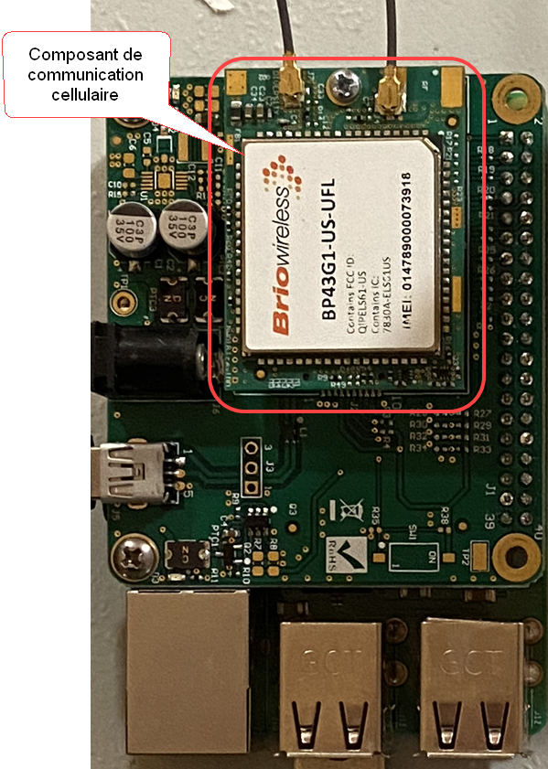{ width=149 }

4.  Unscrew the bolt that holds the Briowireless cellular component in place:

    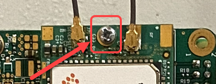{ width=429 }

5.  **Gently** remove the component that is connected to the communication board, **making sure the antenna connectors stay connected.**

    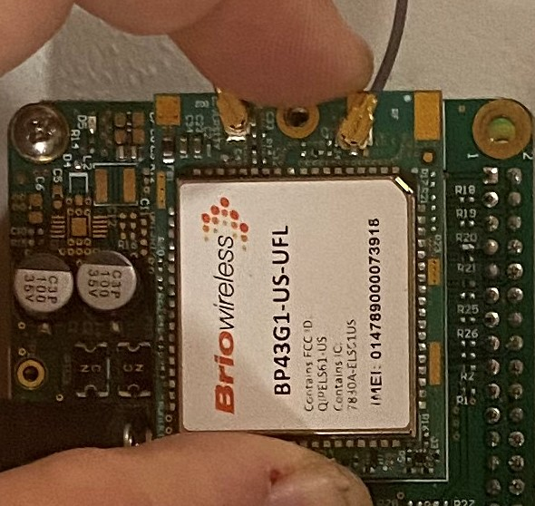{ width=149 }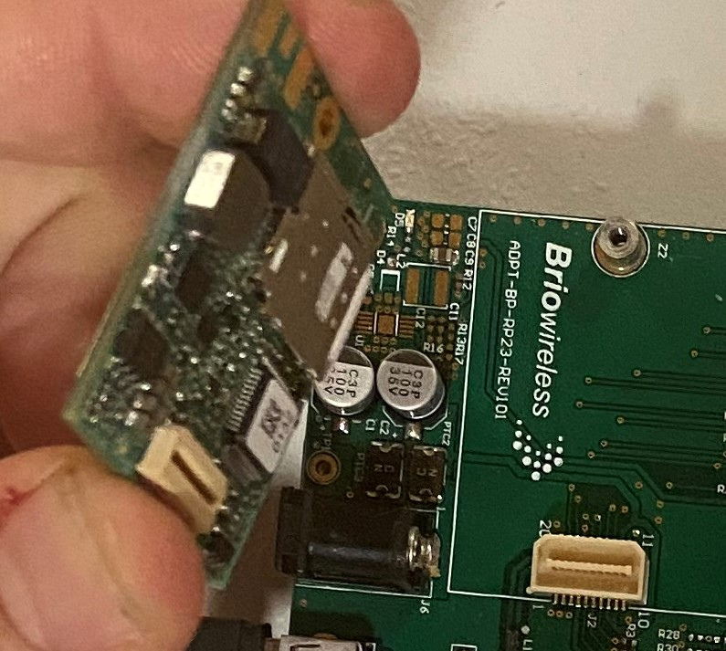{ width=149 }

6.  The tray that holds the SIM card is under the component.

7.  Press on the SIM card and you will feel a "click" as the SIM card pops out:

    { width=149 }

8.  Take the SIM card out of the tray:

    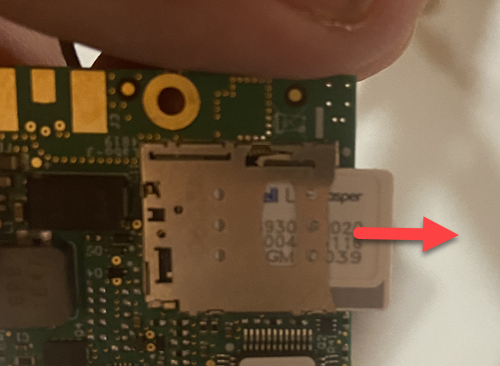{ width=149 }

9.  Insert the new SIM card into the tray and press on it until you feel a "click":

    { width=149 }

10. The card is now inserted: WARNING: The SIM card must be oriented the right way. The printed circuit must face the component.

11. Place the Briowireless component back on the communication board so that the connector is firmly seated.

    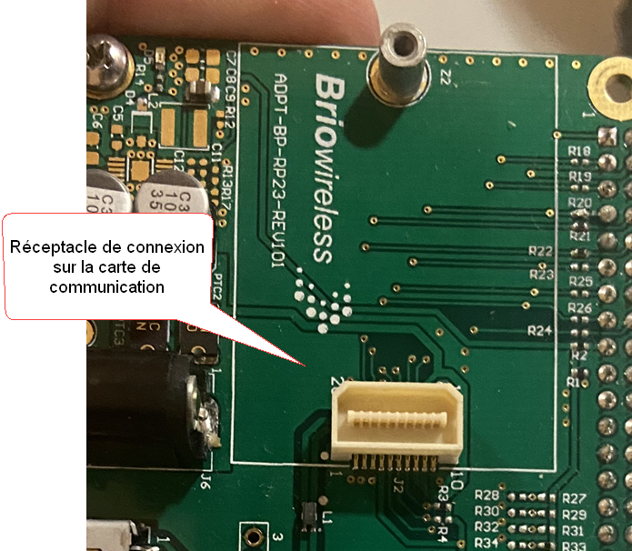{ width=204 }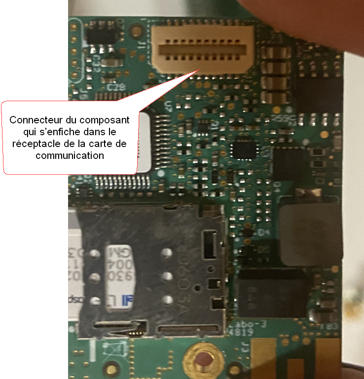{ width=204 }

12. Bolt the component back onto the communication board.

13. You are now ready to change the module's configuration.

Configuration - SIM Card Replacement

After replacing the SIM card, you must change the APN in the configuration file of the Briowireless board driver. To do so, you must open a Linux session on the processor.

## Opening an SSH Session

You must open a session on the MaestrEau module in order to configure the APN parameter for the cellular connection.

1.  Remove the protective cover from the port and connect an Ethernet cable between the module and your PC; **WARNING: Make sure your PC's Ethernet connection is on a 192.168.0.XXX address**

2.  Start the Putty software on your PC;

3.  Start an "ssh" session in Putty with the IP address of the MaestrEau module, which is 192.168.0.100:

    { width=452 }

4.  An SSH session window will open and let you enter the account name and password:

    The software may ask you to confirm that you accept the connection to this new address.  Answer by clicking Yes.

5.  Enter the account **root**, press Enter, and enter the password **&lt;password&gt;**:

    { width=326 }

6.  The session opens on the Linux Ubuntu 18.04 environment:

    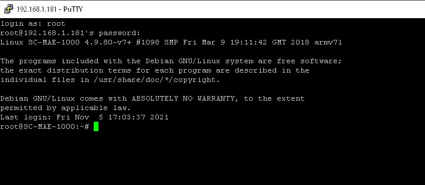{ width=326 }

## Editing the apn File

To edit the contents of the APN file, run the following commands:

!!! info

    The Briowireless driver files may be located in the directory /home/scadmin/brio… Replace the directory /scollect/etc/brio with /home/scadmin/brio

1.  Type the command: *sudo nano /scollect/etc/brio/apn.config*

2.  The file opens in the editor. Type the APN address given by your cellular provider (for example, p[da.bell.ca)](http://pda.bell.ca)

    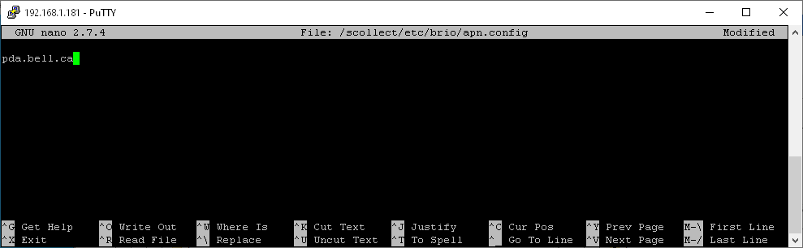{ width=989 }

3.  Press &lt;ctrl&gt;X, press the Y key and press Enter to save and close the file.

4.  Then, type the following command to restart the processor: *sudo reboot*

5.  When the processor has restarted, verify that the Internet connection works by typing the command *ping 8.8.8.8*, which should respond as follows:

    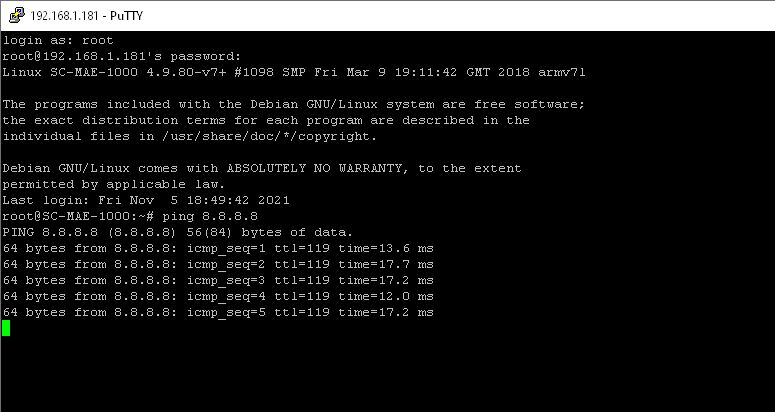{ width=775 }

6.  You can also verify that the PPP (Point to Point Protocol) connection is properly established by typing the command *ifconfig*

    { width=788 }

If the ping does not respond and the PPP link is not established, connection problems may be the cause, such as:

- The APN is not correct

- The SIM card is not properly installed

- There is no cellular coverage where the MaestrEau module is located

- Your cellular provider's LTE protocol is not compatible with the Briowireless board (recommendation: Bell Mobility!)

To work around this situation, you can restart the communication by running a script directly from the console in order to observe the messages it returns.

1.  Start by disconnecting the cellular communication by typing the command /scollect/etc/brio/disconnect_script_ppp

    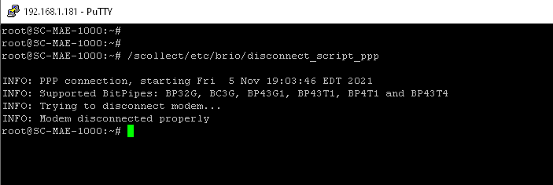{ width=703 }

2.  Then, type the command to restart the cellular communication: /scollect/etc/brio/connect_script_ppp and observe the responses returned by the script:

    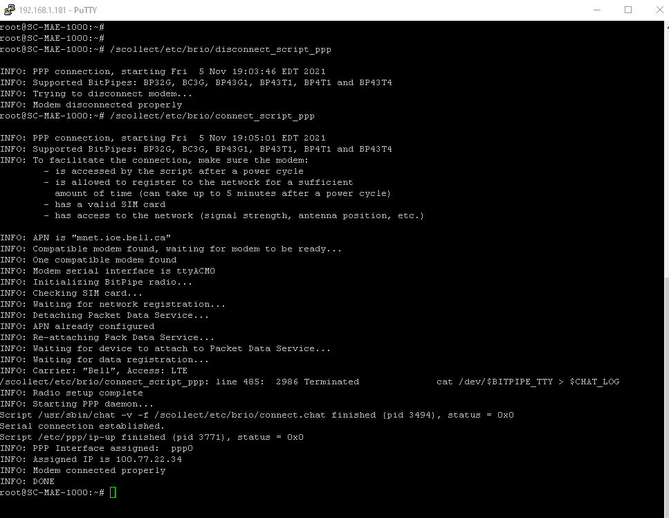{ width=967 }

3.  The script should end with a "positive" connection message as in the example above.

4.  Finally, retest the Internet connection with the command *ping 8.8.8.8*, which should now work correctly.

5.  Restart the module and verify that MaestrEau is working correctly.

## Related Articles

- [Modules](../../manuel-d-utilisation/configuration/modules.md)
- [Configuration](../../manuel-d-utilisation/configuration/index.md)
- [Tags](../../manuel-d-utilisation/configuration/tags.md)
- [Replacing the SIM in MaestrEau](remplacement-sim-sur-maestreau.md)
- [Configuring the Wi-Fi Connection and IP Address](configuration-de-la-connexion-wifi-et-de-l-adresse-ip.md)
