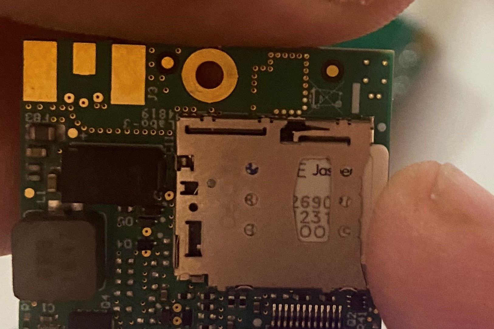
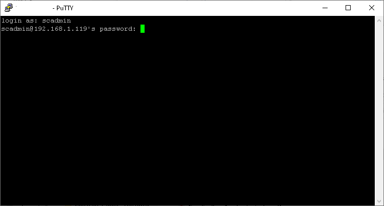
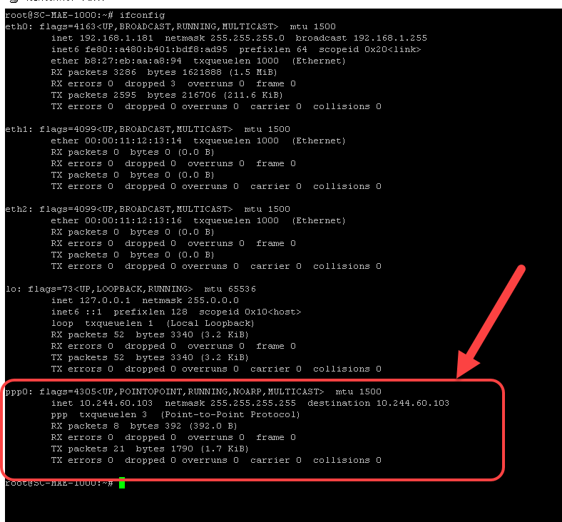

# Remplacement SIM sur MaestrEau

Les modules qui utilisent le réseau cellulaire pour communiquer leurs données à la passerelle Simplicollect utilisent une carte SIM pour s’identifier. Simplicollect a standardisé la communication cellulaire sur le réseau de Bell Mobilité en raison de sa fiabilité et de l'étendue de la couverture sur tout le territoire du Québec.

!!! warning

    **ATTENTION: L’utilisation de cet utilitaire demande des qualifications en micrologiciel et la communication cellulaire**

## Pré requis

La configuration de la communication se fait au travers le port Ethernet du module qui se connecte au port Ethernet d'un ordinateur PC.

!!! info

    Si votre équipement ne possède pas de connecteur de câble de réseau, vous pouvez vous procurer un "adaptateur" avec branchement sur un port USB de votre PC ou laptop.  Par exemple, vous pouvez faire une recherche sur Amazon avec la mention "adaptateur usb Ethernet".

L'adresse IP par défaut de la connexion Ethernet du module MaestrEau est 192.168.0.100.  Donc, il faut configurer la connexion Ethernet de votre PC  pour se connecter sur le même segment d'adresse. Par exemple, configurer votre PC avec l'adresse 192,168.0.20.

De plus, il faut installer le logiciel Putty sur votre PC afin de pouvoir ouvrir une session sur le processeur du module MaestrEau.  Allez sur le site www.putty.org pour télécharger la version de Putty qui convient à votre PC.

## Remplacement de la SIM

Les étapes pour changer la carte SIM d’un module Simplicollect sont les suivantes:

1.  Ouvrez le boitier du module MaestrEau (fermoir situé sur la droite du boitier).

2.  Localisez le processeur qui est situé en haut à gauche du boitier.

3.  Le composant Briowireless BP43G1-US-UFL, qui contient la carte SIM, est sur le dessus du processus et sur lequel sont connectées deux antennes.

    { width=149 }

4.  Dévissez le boulon qui retient le composant cellulaire Briowireless:

    { width=429 }

5.  Avec **délicatesse**, retirez le composant qui est connecté sur la carte de communication en **prenant soin que les connecteurs d’antenne restent connectés.**

    { width=149 }{ width=149 }

6.  Le tiroir qui contient la carte SIM est sous le composant.

7.  Pressez sur la carte SIM et vous allez sentir un “clic” qui va faire retirer la carte SIM:

    { width=149 }

8.  Sortir la carte SIM du tiroir:

    { width=149 }

9.  Entrez la nouvelle carte SIM dans le tiroir et appuyez dessus jusqu'à ce que vous sentez un “clic”:

    { width=149 }

10. La carte est maintenant insérée: ATTENTION: Il faut que la carte SIM soit dans le bon sens. Le circuit imprimé doit faire face au composant.

11. Reposer le composant Briowireless sur la carte de communication afin que le connecteur soit bien enfiché.

    { width=204 }{ width=204 }

12. Reboulonner le composant sur la carte de communication.

13. Vous êtes maintenant prêt à changer la configuration du module.

Configuration - Remplacement de la carte SIM

Suite au remplacement de la carte SIM, il faut changer le APN dans le fichier de configuration du driver de la carte Briowireless. Pour ce faire, il faut ouvrir une session Linux sur le processeur.

## Ouvrir une session SSH

Il faut ouvrir une session sur le module MaestrEau afin de configurer le paramètre APN pour la connexion cellulaire.

1.  Retirer le couvercle de protection du port et connecter un câble Ethernet entre le module et votre PC; **ATTENTION: Assurez-vous que la connexion Ethernet de votre PC est sur une adresse 192.168.0.XXX**

2.  Démarrer le logiciel Putty sur votre PC;

3.  Démarrer une session "ssh" sur Putty avec l'adresse IP du module MaestrEau, soit 192.168.0.100:

    { width=452 }

4.  Une fenêtre de session SSH va s'ouvrir et vous permettra d'entrer le nom du compte d'accès et le mot de passe:

    Il se peut que le logiciel demande de confirmer que vous acceptez la connexion vers cette nouvelle adresse.  Répondre en cliquant sur Oui.

5.  Entrer le compte **root**, presser Enter, et entrer le mot de passe **&lt;mot de passe&gt;**:

    { width=326 }

6.  La session s’ouvre sur l’environnement Linux Ubuntu 18.04:

    { width=326 }

## Modification du fichier apn.

Pour éditer le contenu du fichier APN, exécuter les commandes suivantes:

!!! info

    Il est possible que les fichiers du driver Briowireless se trouvent au répertoire /home/scadmin/brio… Changez le répertoire /scollect/etc/brio par /home/scadmin/brio

1.  Tapez la commande: *sudo nano /scollect/etc/brio/apn.config*

2.  Le fichier se met en mode éditeur. Tapez l’adresse de l’APN donné par votre fournisseur de cellulaire (par exemple, p[da.bell.ca)](http://pda.bell.ca)

    { width=989 }

3.  Faire les touches &lt;ctrl&gt;X, pressez la touche Y est pressez Enter pour sauvegarder et fermer le fichier.

4.  Par la suite, tapez la commande suivante pour redémarrer le processeur: *sudo reboot*

5.  Lorsque le processeur à redémarrer, vérifier que la connexion à Internet fonctionne en tapant la commande *ping 8.8.8.8* qui devrait répondre comme suit:

    { width=775 }

6.  Vous pouvez également valider que la connexion PPP (Point to Point Protocol) est bien établie en tapant la commande *ifconfig*

    { width=788 }

Si le ping ne répond pas et que le lien PPP ne fe fait pas, il se peut que des problèmes de connexion soient la cause de ceci, tel que:

- Le APN n’est pas correct

- La carte SIM est mal installée

- La couverture cellulaire ne se fait pas à l’endroit où se trouve le module MaestrEau

- Le protocole LTE de votre fournisseur cellulaire n’est pas compatible avec la carte Briowireless (recommandations: Bell Mobilité!)

Pour pallier à cette situation, vous pouvez réamorcer la communication en actionnant un script directement à la console afin d’observer les messages qui vous sont retournés.

1.  Commencez pas déconnecter la communication cellulaire en tapant la commande /scollect/etc/brio/disconnect_script_ppp

    { width=703 }

2.  Par la suite, tapez la commande pour réamorcer la communication cellulaire : /scollect/etc/brio/connect_script_ppp et observez les réponses que retournent le script:

    { width=967 }

3.  Le script devrait se terminer par un message “positif” de connexion comme dans l’exemple ci-dessus.

4.  Finalement, resterez la connexion Internet avec la commande *ping 8.8.8.8* qui devrait maintenant fonctionné correctement.

5.  Redémarrer le module et valider que MaestrEau fonctionne correctement.

## Articles reliés

- [Modules](../../manuel-d-utilisation/configuration/modules.md)
- [Configuration](../../manuel-d-utilisation/configuration/index.md)
- [Tags](../../manuel-d-utilisation/configuration/tags.md)
- [Remplacement SIM sur MaestrEau](remplacement-sim-sur-maestreau.md)
- [Configuration de la connexion Wifi et de l'adresse IP](configuration-de-la-connexion-wifi-et-de-l-adresse-ip.md)
