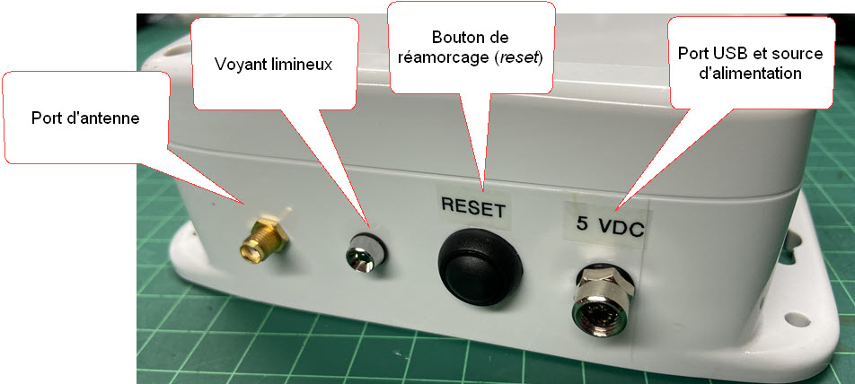
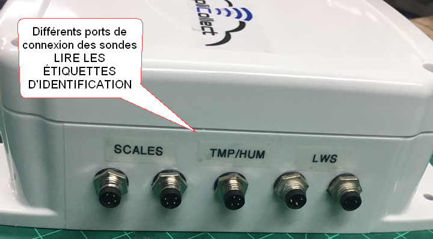
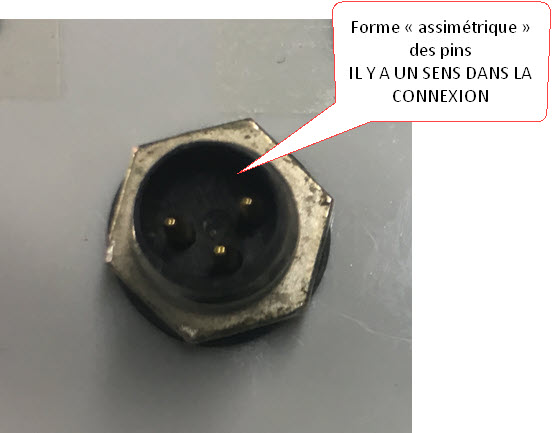
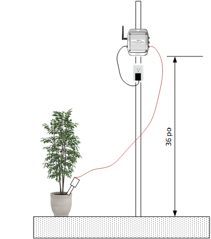
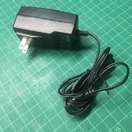
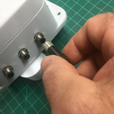
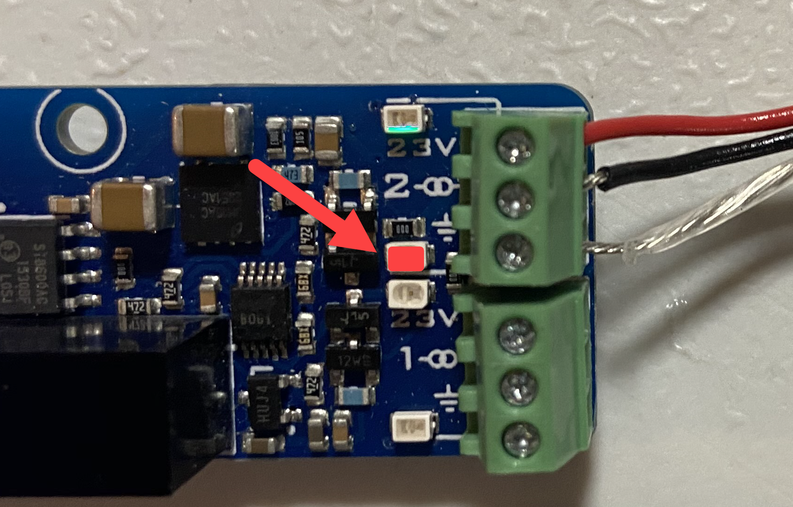

# Simplicollect Modules

The various Simplicollect modules carry communication from the measurement sensors to the Simplicollect Gateway over a Wifi network or the cellular network.

The first step is to physically install the module close to where the sensor will be installed and to connect the module to a communication network.

## Communication Network

As stated in the Gateway commissioning procedure, the communication network is the "foundation" of the system, as illustrated in the following diagrams.

{ width=600 }

The communication network must be "commercial" grade (as opposed to "home" grade), must be properly installed, and must provide sufficient coverage to reach the Simplicollect modules.

The questions to ask when installing the network are:

- Local wind and weather conditions
- Known sources of interference
- List of local network equipment (make and model)
- Internet connection: Provider, bandwidth, connection type (e.g., DSL, wireless, cellular, etc.)

In addition, a precise analysis of the "terrain" is needed to make sure the antennas will cover the modules that must be connected.  Draw a diagram on a mapping platform, such as Google Earth, and establish the coverage radius of the Wifi antennas... as illustrated below.

{ width=600 }

!!! info

    Ideally, hire a specialized firm to install the Wifi network or, at a minimum, consult specialists with your plans and diagrams to confirm your design.

The following guidelines should be followed when installing the communication network.

- Ideally, segment the "Simplicollect" network from the rest of the business network
    - This is essential; we do not want to "inherit" problems caused by the customer's network
    - The Simplicollect Gateway has 2 RJ-45 ports: One for connection to the customer's network, one for the Simplicollect network segment
    - The Gateway "lives up to its name": It bridges the Simplicollect segment and the customer's network
- Never compromise on the quality of the communication equipment
    - The "baseline" standard is commercial-grade or industrial-grade technology
- Always do a good pre-installation analysis (deployment plan with [Info-sol.ca](http://Info-sol.ca)) and, ideally, do a site visit for more complex cases
- Some of the customer's components must be configured (e.g., router for Internet access)
    - Whenever possible, have the work done by the customer or their IT firm... We will give them the settings they need to add to their router

!!! info

    <u>**Take note of terrain features and make sure that vegetation, at maturity, will not obstruct the signal **</u>

An outdoor Wifi network installation must be able to withstand the weather conditions encountered in your region.  Do not compromise on the installation of the equipment.

- Always securely "anchor" the installed equipment
    - Outdoor equipment is exposed to wind and weather
    - A strong wind can break an antenna
- Always secure the antennas and access points (at least WPA2)
    - Choose "complex" keys (not "admin1234")
- Always test the UTP cables and RJ45 connectors
- Run integrated network tests, show the results to the customer and document them in the installation validation sheet

## Cellular Network

Several Simplicollect module models use the 3G or 4G cellular network.  This "simplifies" module installation because you do not have to install and maintain a Wifi network.  In addition, the cellular network is available across almost all of North America.  You can therefore install a Simplicollect module anywhere and use the Internet to send the data to your Simplicollect Gateway.

Before deployment, make sure the cellular signal properly covers the location where you want to install your module.   Follow these guidelines:

- "Walk" the site with your mobile phone and record the signal quality.  At least a 75% signal is needed for adequate coverage
- Take note of terrain features and make sure that vegetation, at maturity, will not obstruct the signal
- Contact your cellular service provider and consult the coverage maps on the Internet to confirm signal availability (e.g.:  <https://www.bell.ca/Mobilite/Le_reseau_coverage>)

When you purchase a Simplicollect-cellular module, we sell you various communication plans that are suited to the agricultural environment and that can be suspended for the winter period.

Simplicollect is a Bell Mobility agent and can sell you plans that are valid anywhere in Canada.

## Description of a Simplicollect Module

Simplicollect modules are made of a polycarbonate-type polymer with the following specifications

<table class="relative-table wrapped confluenceTable" style="width: 46.1165%;">
<colgroup>
<col style="width: 67%" />
<col style="width: 32%" />
</colgroup>
<thead>
<tr class="header">
<th class="confluenceTh"><ul>
<li>Impact-resistant polycarbonate enclosure</li>
<li>Resistant to water and chemicals, meeting NEMA 4, 4x, 6 and 12 standards</li>
<li>Humidity and water resistance meeting the IP68 standard</li>
<li>Mounting flange for any surface or mounting bracket</li>
</ul></th>
<th class="confluenceTh"><h2 id="ModulesSimplicollect-"></h2></th>
</tr>
</thead>
<tbody>
</tbody>
</table>

The module has several connection ports and other features.

One side of the enclosure contains the power port, the antenna port, the reset button and the operating indicator light.

{ width=500 }

The other side of the enclosure contains the sensor ports.

!!! info

    **When connecting the cables to the various ports, take care to properly "align" the pins of the connectors, which are asymmetrical.**

    ****

When installing the modules, follow these guidelines carefully:

- The enclosures and connectors are watertight and meet all NEMA-4 and IP-67/68 specifications
- NEVER OPEN the watertight cover of an enclosure. This will "break" the seal applied to the cover and will "void" the warranty
- Do not install a module on the ground where it could be covered by water or snow
- Always use the power supplies provided with the module OR the USB port of your laptop
- NEVER USE A USB POWER SUPPLY THAT HAS NOT BEEN APPROVED BY SIMPLICOLLECT (e.g.: Apple USB adapter)

When you attach a module to a structure, a wall, a pole, etc., the suggested guidelines are:

- Always attach the module to a pole or wall with screws or a U-bolt
- Ideally, the module should be AT LEAST 36 inches above the ground 
- Make sure the pole or wall is solid and will not be knocked over by the wind
- Make sure the location of the module is not in a "depression" where water or snow could accumulate
- Check that a 110/240 VAC power source is available nearby
- Make sure communication works at this location and that there is no interference

Simplicollect and MaestrEau modules must be powered by a power source in order to operate.

There are 2 types of power supply

- Electrical 110 VAC
- 12 V batteries and solar panel

Electrical connection

- The 110 VAC outlets must always be provided by the customer
- 2 types of power supplies
    - Wall-mount 
    - Wired 
- Make sure the electrical outlet is high off the ground and that water + humidity will not reach the outlet
- Also make sure there is no "gutter" or tarp that will direct rain onto the VAC outlet
- It is recommended to install a "protective cover" on the electrical outlet  
- Make sure the power supplies are securely fastened to the pole or wall where the module is installed
- Use zip ties or fastening straps to secure the cables properly

When connecting the sensors to the enclosure:

- As a general rule, all sensors are connected to Simplicollect modules using an M8 connector (for 12 V and MaestrEau, M12 connectors are used); { width=200 }
- Thermocouples must be connected directly to the board's terminal block and are the only exception
- Connectors must be screwed in BY HAND and all the way DOWN to ensure a watertight connection
- NEVER use pliers or other tools on the M8 and M12 connector { width=200 }

## Protecting and Maintaining Connectors

Particular attention must be paid to protecting and maintaining the connectors.

- If a connector is not used, a protective cap must be fitted on it 
- Make sure there is no corrosion (e.g., verdigris) on the connector pins
- Make sure the threads and watertight seals are in good condition

## Connecting 4-20 mA Sensors

Measurement sensors with a 4-20 mA signal are connected directly to the terminal blocks of the Simplicollect module boards.  The cable from the sensor enters the module enclosure through a cable gland that ensures a watertight seal.

The connection steps are as follows:

1.  Unbolt the cover of the Simplicollect module enclosure (Phillips head);

2.  Pass the cable through the 1.5 cm diameter cable gland;

    !!! info

        Make sure the sensor is not energized during connection.

3.  Connect the wires to the 4-20 mA sensor terminal block according to the diagram below;

4.  Tighten the cable gland seals to ensure a watertight seal;

5.  Energize the sensor;

6.  Test that the signal comes in correctly;

7.  Close the enclosure cover, tightening the bolts enough to ensure a watertight seal;

### Connecting and Powering the 4-20 mA Sensor

To power themselves, many 4..20mA sensors simply draw the energy they need from the  current loop, using the 4mA that is always available. Some sensors require  a little more power, which the module can supply using a regulated 23V power supply between the 23V terminal and the terminal marked with the ground symbol.

Warning: the current available for both sensors combined is 80mA in total, including the current used in the loop. If you exceed this value, the behavior of the 4..20mA sensor will probably be affected and you may even damage the 23V power supply of the Yocto-4-20mA-Rx.

If your sensors require more power to operate, you will therefore have to power them from an independent source (see diagrams below). When the 23V power supply of the Yocto-4-20mA-Rx is in demand, the Yocto-4-20mA-Rx starts to heat up. This is normal behavior, but you must make sure this heat can be dissipated.

{ width=400 }

!!! info

    It is recommended to connect the sensor after first powering off the Yocto-4-20mA-Rx. If this is not possible and you are using a 3-wire sensor, always connect the sensor ground first, otherwise you may cause an overcurrent on the measurement loop and the Yocto-4-20mA-Rx will then go into protection mode.

### The Indicator LED (green)

Each sensor input has a green indicator LED whose intensity gives an indication of the value read on the current loop. This LED is off when the sensor is not properly connected.  See the location of the LED on the 4-20 mA sensor.

### The Overload LED (red)

The sensor is not designed to measure more than 20mA. If a higher current is detected on the current loop, due to a short circuit for example, the corresponding input goes into protection mode and the corresponding red LED lights up. Values above 20mA reported by the sensor must be considered inaccurate.

{ width=240 }

The input impedance of the sensor is only ~100Ω3 , which allows very long wires to be used to place the 4-20mA sensor remotely. However, this low resistance combined with certain sensors equipped with large capacitors can trigger protection mode at power-up: the sudden charging of the capacitors induces a current peak above 20mA, which triggers the protection. This problem can easily be worked around by placing a 100 to 200Ω resistor on the sensor power supply.

## Connecting a Dry Contact

The CNTWG-800 module can monitor 8 dry contacts.  The cable from the contacts enters the module enclosure through a cable gland that ensures a watertight seal.

The connection steps are as follows:

1.  Unbolt the cover of the Simplicollect module enclosure (Phillips head);

2.  Pass the cable through the 1.5 cm diameter cable gland;

3.  Connect the wires to one of the 8 terminal blocks of the module;

4.  Tighten the cable gland seals to ensure a watertight seal;

5.  Energize the sensor;

6.  Test that the signal comes in correctly;

7.  Close the enclosure cover, tightening the bolts enough to ensure a watertight seal;

## Configuring a Module

When the module is correctly installed and the sensors are connected, you can then configure the module to connect it to the Wifi or cellular communication network.

To do so, use the [module configuration](../../manuel-d-utilisation/utilitaire-de-configuration-des-modules.md) application.
