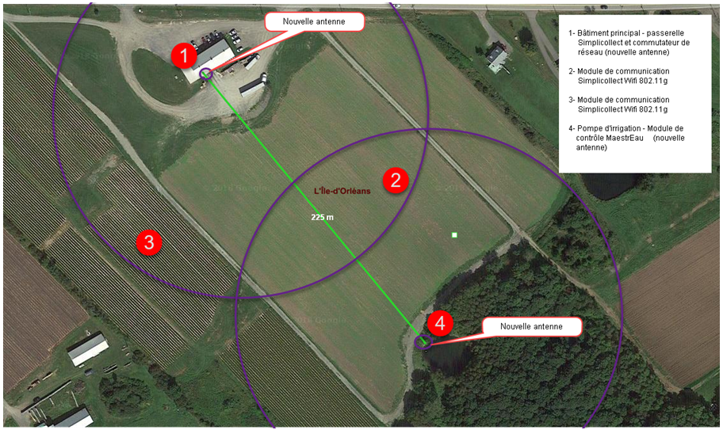
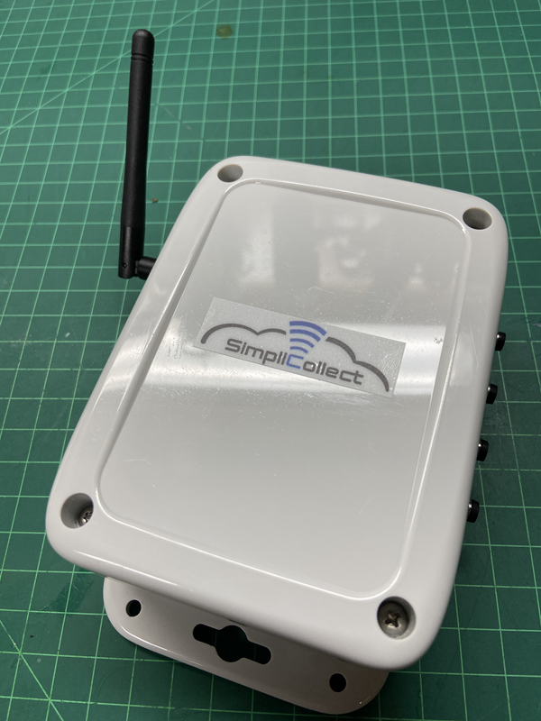
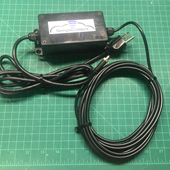
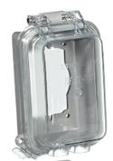
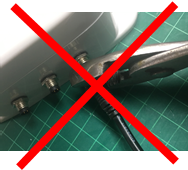
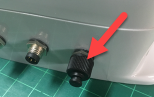
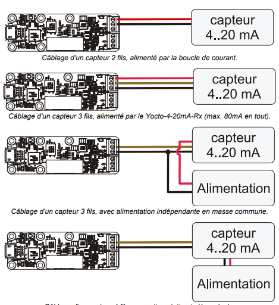
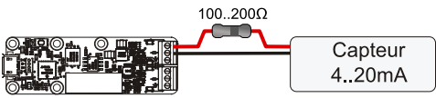

# Modules Simplicollect

Les différents modules Simplicollect permettent la communication des sondes de mesure vers la passerelle Simplicollect par un réseau Wifi ou par le réseau cellulaire.

La première étapes est d'installer physiquement le module à proximité du lieu où la sonde sera installée et de raccorder le module à un réseau de communication.

## Réseau de communication

Tel qu'énoncé dans la procédure de mise en service de la passerelle, le réseau de communocation est "l'assise" du système tel qu'illustré sur les schémas suivant.

{ width=600 }

Le réseau de communication doit être de grade "commercial" (en comparaison avec un réseau de grade "domestique") et doit être correctement installé et offrir une couverture suffisante pour rejoindre les modules Simplicollect.

Les questions à se poser lors de l'installation du réseau sont:

- Conditions de vent local et conditions météo
- Sources d’interférences connues
- Liste des équipements de réseau local (marque et modèle)
- Connexion Internet: Fournisseur, bande passante, type de connexion (ex.: DSL, sans fil, cellulaire, etc.)

De plus, il faut faire une analyse précise du "terrain" pour s'assurer que les antennes vont couvrir les modules qui doivent être connecté.  Faire un schéma sur une plateforme de cartographie, tel que Google Earth, et établir les rayons d'action des antennes Wifi... tel qu'illustré ci-dessous.

{ width=600 }

!!! info

    Idéalement, retenez les services d'une firme spécialisée pour l'installation du réseau Wifi ou, au minimum, consultez des spécialistes avec vos plans et schémas afin de confirmer votre design.

Les consignes suivantes devraient être suivi dans l'installation du réseau de communication.

- Idéalement, segmenter le réseau "Simplicollect" du reste du réseau d'affaire
    - C’est essentiel, on ne veut pas « hériter » des problèmes engendrés par le réseau du client
    - La passerelle Simplicollect possède 2 ports RJ-45: Un pour le raccordement au réseau du client, un pour le segment de réseau Simplicollect
    - La passerelle « porte son nom »: Elle fait le lien entre le segment Simplicollect et le réseau du client
- Ne jamais faire de compromis sur la qualité des équipements de communication
    - Le standard « de base » serait la technologie de grade commercial ou industriel
- Toujours faire une bonne analyse pré-installation (plan de déploiement avec [Info-sol.ca](http://Info-sol.ca)) et, idéalement, faire une visite de site pour les cas plus complexe
- Certains composants du client doivent être configurés (ex.: routeur pour les accès Internet)
    - Dans la mesure du possible, faire faire les travaux par le client ou sa firme Informatique... On leur donnera les paramètres qu’ils doivent ajouter à leur routeur

!!! info

    <u>**Prenez note des accidents de terrain et assurez vous que la végétation, à maturité, ne fera pas obstacle au signal **</u>

L'installation d'un réseau Wifi à l'extérieur doivent être en mesure de subir les conditions atmosphériques rencontrées dans votre région.  Ne faites pas de compromis sur l'installation des équipements.

- Toujours bien “arrimer” les équipements installés
    - Les équipements extérieurs sont soumis au vent et conditions météo
    - Un fort vent peut causer un bris d’antenne
- Toujours sécuriser les antennes et les points d’accès (au moins WPA2)
    - Choisir des clés “complexes” (pas “admin1234”)
- Toujours tester les câbles UTP et connecteurs RJ45
- Faire des tests intégrés du réseau et montrer les résultats au client et documenter dans la fiche de validation de l’installation

## Réseau cellulaire

Plusieurs modèles de modules Simplicollect utilisent le réseau cellulaire 3G ou 4G.  L'installation des modules s'en trouve "simplifier" car vous n'avez pas à installer et entretenir un réseau Wifi.  De plus, le réseau cellulaire est disponible sur presque tout le territoire de l'amérique du nord.  Vous pouvez donc installer un module Simplicollect n'importe où et utiliser Internet pour communiquer les données vers votre passerelle Simplicollect.

Avant le déploiement, assurez-vous que le signal cellulaire couvre correctement l'endroit où vous désirez installer votre module.   Suivez les consignes suivantes:

- Allez "marcher" le terrain avec votre téléphone portable et enregistrer la qualité du signal.  Il faut au moins un signal à 75% pour une couverture adéquate
- Prenez note des accidents de terrain et assurez vous que la végétation, à maturité, ne fera pas obstacle au signal
- Contacter votre fournisseur de service cellulaire et consulter les cartes géographique sur Internet pour valider la disponibilité du signal (ex.:  <https://www.bell.ca/Mobilite/Le_reseau_coverage>)

Lors de l'achat de module Simplicollect-cellulaire, nous vous vendons différents forfaits de communication qui sont adaptés au mlieu agricole et qui sont interuptible pour la période hivernale.

Simplicollect est un agent Bell Mobilité et peut vous vendre des forfaits qui sont valides partout au Canada.

## Description d'un module Simplicollect

Les modules Simplicollect sont en polymère de type polycabornate avec les spécifications suivantes

<table class="relative-table wrapped confluenceTable" style="width: 46.1165%;">
<colgroup>
<col style="width: 67%" />
<col style="width: 32%" />
</colgroup>
<thead>
<tr class="header">
<th class="confluenceTh"><ul>
<li>Boitier en polycarbonate résistance</li>
<li>Résistance à l'eau et aux agents chimique avec standard NEMA 4, 4x, 6 et 12</li>
<li>Résistance à l'humidité et l'eau rencontrant le standard IP68</li>
<li>Bride d'arrimage à toutes surface ou support de montage</li>
</ul></th>
<th class="confluenceTh"><h2 id="ModulesSimplicollect-"></h2></th>
</tr>
</thead>
<tbody>
</tbody>
</table>

Le module possède plusieurs ports de raccordement et autres fonctions.

Un coté du boitier contient port d'alimentation, d'antenne, bouton de réamorcage et voyant de fonctionnement.

{ width=500 }

L'autres coté du boitier contient les ports de sonde.

!!! info

    **Lors de la connexion des cables dans les différents, prenez soin de bien "aligné" les pins des connecteurs qui sont assymétrique.**

    ****

Lors de l'installation des modules, suivre attentivement les consignes suivantes:

- Les boîtiers et les connecteurs sont hermétiques et suivent tous les spécifications NEMA-4 et IP-67/68
- Ne JAMAIS OUVRIR le couvercle hermétique d’un boitier. Ceci « brisera » le scellé appliqué sur le couvercle et va « altérera » la garantie
- Ne pas installer un module sur le sol où il pourrait être recouvert d’eau ou de neige
- Toujours utiliser les blocs d’alimentation fournie avec le module OU le port USB de votre laptop
- NE JAMAIS UTILISER UN BLOC D’ALIMENTATION USB QUI N’A PAS ÉTÉ HOMOLOGUÉ PAR SIMPLICOLLECT (ex.: bloc USB Apple)

Lorsque vous fixez un module à une structure, un mur, un poteau, etc... les consignes proposés sont:

- Toujours fixer le module à un poteau ou à un mur avec des vis ou une bride en U
- Idéalement, le module devrait être à AU MOINS 36 pouces du sol 
- S’assurer que le poteau ou mur est solide et ne sera pas renversé par le vent
- S’assurer que le lieu où est installé le module n’est pas dans une “depression” où l’eau ou la neige pourrait s’accumuler
- Vérifier qu’une source de courant 110/240 VAC est disponible à proximité
- S’assurer que la communication fonctionne à cet endroit et qu’il n’y a pas d’interférence

Les modules Simplicollect et MaestrEau doivent être alimenté par une source de courant pour fonctionner.

Il y a 2 types d'alimentation

- Électrique 110 VAC
- Batteries 12 V et panneau solaire

Raccordement électrique

- Les prises 110 VAC doivent toujours être fournies par le client
- 2 types de blocs d'alimentation
    - Mural 
    - Filaire 
- S’assurer que la prise électrique est loin du sol et que l’eau + humidité n’atteindront pas la prise
- Aussi, s’assurer qu’il n’y à pas une « gouttière » ou une toile qui projettera la pluie sur la prise de courant VAC
- Il est recommandé de poser un « couvert de protection » sur la prise électrique  
- S’assurer que les blocs d’alimentation sont solidement arrimés au poteau ou au mur où le module est installé
- Utiliser des tye-wrap ou des brides de fixation pour bien arrimer les câbles

Lors du raccordement des sondes au boitier:

- En règle générale, toutes les sondes sont raccordées aux modules Simplicollect à l’aide d’un connecteur M8 (pour le 12 V et MaestrEau, ont utilise des connecteurs M12); { width=200 }
- Les thermocouples doivent être directement raccordés sur le bornier de la carte et constituent la seule exception
- Les connecteurs doivent être vissés À LA MAIN et jusqu’au FOND afin d’assurer l’étanchéité de la connexion
- Ne JAMAIS utiliser de pince ou autres outils avec le connecteur M8 et M12 { width=200 }

## Protection et entretien des connecteurs

Il faut porter une attention particulière à la protection et l'entretien des connecteurs.

- Si un connecteur n’est pas utilisé, il faut y poser un capuchon de protection 
- Il faut s’assurer qu’il n’y a pas de corrosion (ex.: vert de gris) sur les pins des connecteurs
- S’assurer que les filets et les joints étanches sont en bon état

## Raccordement de sondes 4-20 mA

Les sondes de mesure avec signal 4-20 mA sont raccordées directement sur les borniers des cartes du module Simplicollect.  Le câbles en provenant de la sonde entre dans le boitier du module par une "passefil" qui assurera l'étanchéité du joint.

Les étapes pour le raccordements sont les suivantes:

1.  Déboulonner le couvercle du boitier du module Simplicollect (tête Philips);

2.  Passer le câble au travers du passe fil de 1.5 cm de diamètre;

    !!! info

        Assurez-vous que la sonde n'est pas énergisée lors du raccordement.

3.  Raccorder les câbles dans le bornier du capteur 4-20 mA selon le schéma ci-dessous;

4.  Serrer les joints du passefil pour en assurer l'étanchéité;

5.  Énergiser la sonde;

6.  Tester que le signal entre correctement;

7.  Refermer le couvercle du boîtier en serrant suffisamment les boulons pour assurer l'étanchéité;

### Raccordement et alimentation du capteur 4-20 mA

Pour s'alimenter, de nombreux capteur 4..20mA se contentent de prélever l'énergie nécessaire sur une  boucle de courant, en utilisant les 4mA qui sont toujours disponibles. Certains capteurs nécessitent  un peu plus d'énergie, que le capteur peut leur fournir à l'aide une alimentation 23V régulée entre le pôle 23V et et le pôle marqué du signe de terre.

Attention, le courant disponible pour l'ensemble des deux capteurs est de 80mA au total, y compris le courant utilisé dans la boucle. Si vous dépassez cette cette valeur, le comportement du capteur 4..20mA en sera probablement affecté et vous risquez même d'endommager l'alimentation 23V du Yocto-4-20mA-Rx.

Si vos capteurs nécessitent une puissance plus élevée pour fonctionner, vous devrez donc les alimenter par une source indépendante (voir schémas ci-dessous). Lorsque l'alimentation 23V du Yocto-4-20mA-Rx est sollicitée, le Yocto-4-20mA-Rx se met à chauffer. C'est un comportement normal, mais vous devrez veiller à ce que cette chaleur puisse être évacuée.

{ width=400 }

!!! info

    Il est recommandé de connecter le capteur en ayant préalablement mis le Yocto-4-20mA-Rx hors tension. Dans le cas où cela ne serait pas possible et où vous utilisez un capteur à 3 fils, veillez à toujours connecter la masse du capteur en premier, sinon vous risquez de provoquer un dépassement de courant sur la boucle de mesure et le Yocto-4-20mA-Rx se mettra alors en protection.

### La LED témoin (verte)

Chaque entrée du capteur est dotée d'une LED témoin verte, dont l'intensité donne une indication de la valeur lue sur la boucle de courant. Cette LED est éteinte lorsque le capteur n'est pas correctement branché.  Voir la situation de la LED sur le capteur 4-20 mA.

### La LED de surcharge (rouge)

Le capteur n'est pas conçu pour mesurer plus de 20mA. Si une intensité plus élevée est détectée sur la boucle de courant, en raison d'un court circuit par exemple, l'entrée correspondante se mettra en protection et la Led rouge correspondante s'allumera. Les valeurs supérieures à 20mA reportées par le capteur doivent être considérée comme imprécises.

{ width=240 }

L'impédance d'entrée du capteur n'est que de ~100Ω3 , ce qui autorise l'utilisation de fils très longs pour déporter le capteur 4-20mA. Cependant, cette faible résistance combinée avec certains capteurs équipés de gros condensateurs peut provoquer une mise en protection à la mise sous tension: la charge brutale des condensateurs induit un pic de courant supérieur à 20mA, ce qui déclenche la protection. Ce problème peut facilement être contourné en plaçant une résistance de 100 à 200Ω sur l'alimentation du capteur.

## Raccordement de contact sec

Le module CNTWG-800 offre une possibilité de suivre 8 contacts secs.  Le câbles en provenant des contacts entre dans le boitier du module par une "passefil" qui assurera l'étanchéité du joint.

Les étapes pour le raccordements sont les suivantes:

1.  Déboulonner le couvercle du boitier du module Simplicollect (tête Philips);

2.  Passer le câble au travers du passe fil de 1.5 cm de diamètre;

3.  Raccorder les câbles dans l'un des 8 bornier du module ;

4.  Serrer les joints du passefil pour en assurer l'étanchéité;

5.  Énergiser la sonde;

6.  Tester que le signal entre correctement;

7.  Refermer le couvercle du boîtier en serrant suffisamment les boulons pour assurer l'étanchéité;

## Configuration d’un module

Lorsque le module est correctement installé et que les sondes sont raccordées, on peut alors configurer le module afin de le connecter au réseau de communication Wifi ou cellulaire.

Il faut alors utiliser l'application de [configuration des modules](../../manuel-d-utilisation/utilitaire-de-configuration-des-modules.md).
