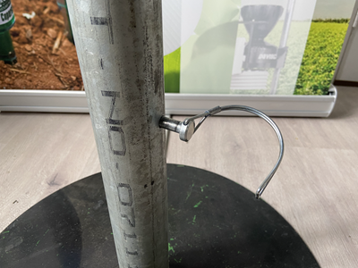
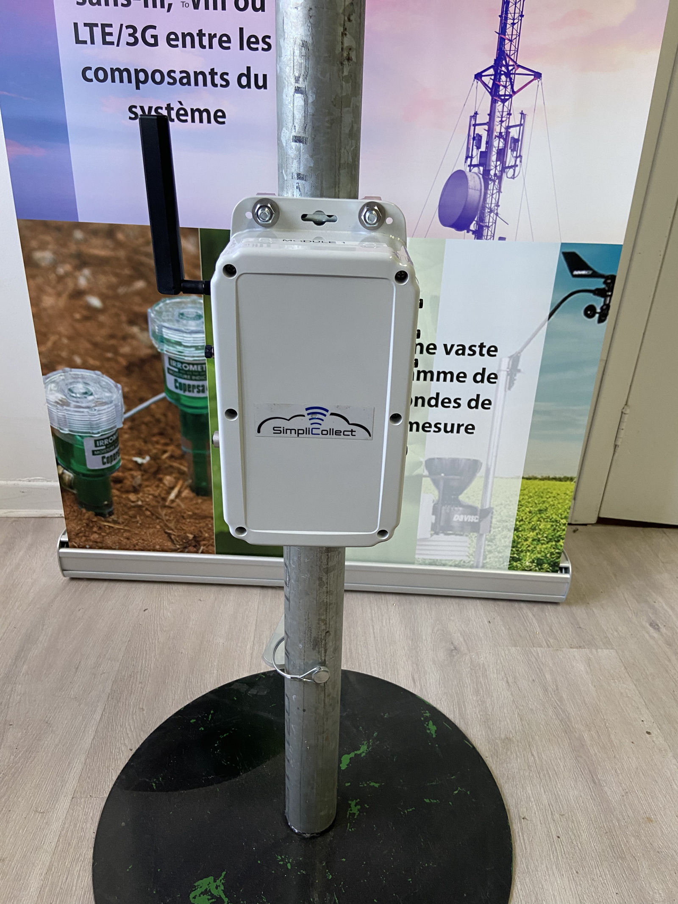
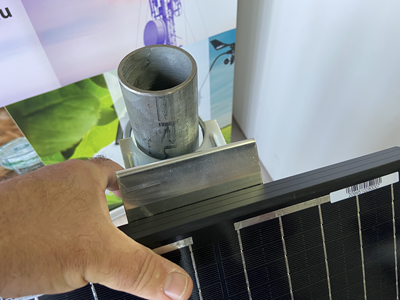
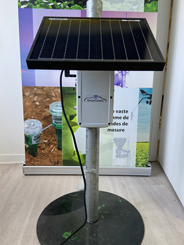
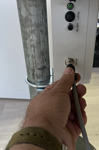
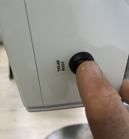
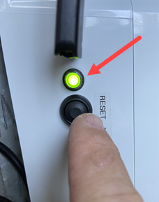

# Wireless Module - Solar Panel and Battery

The wireless module (4G cellular or Wifi) powered by a solar panel and a Li-Ion battery collects data from various types of sensors, such as tensiometers, temperature and humidity sensors, FDR, rain gauges and others.

This module is simple to install; just follow the instructions below.

## Installation Instructions

1.  Drive the base of the mast (1.75 in pipe) into the ground with a sledgehammer, making sure the hole for the mast locking pin faces up;

2.  Slide the mounting mast onto the base and lock it with the pin;

    { width=102 }

3.  Mount the 2 U-bolts on the Simplicollect module, leaving the nuts on the surface of the bolts loose;

4.  Slide the assembly onto the module's mounting mast:

    { width=102 }

5.  Leave at least 20 cm (8 in) free at the top of the mast;

6.  Tighten the U-bolt nuts, making sure the washers are on the upper side of the module's flange;

    { width=102 }

7.  The solar panel bracket has two clamping plates that are bolted to the bracket:

    { width=300 }

8.  Turn the bracket upside down on the back of the solar panel and position it "diagonally" so the clamping plates slide under the lip of the edge:

    { width=102 }

9.  Keeping the clamping plates in position, straighten the bracket and center it on the panel:

    { width=329 }

10. Tighten the nuts firmly (1/2 in wrench):

    { width=361 }

11. Mount the U-bolt on the solar panel bracket and slide it onto the mast above the module:

    { width=400 }

12. Leave at least 10 cm (4 in) below the bracket and tighten the nuts, making sure the washers are directly under the nuts:

    { width=300 }

13. Slide the temperature/humidity sensor above the solar panel bracket:

    { width=300 }

14. Tighten the nuts, making sure the washers are directly under the nuts:

15. Screw the antenna onto the antenna port located at the top of the module;

16. Screw the temperature/humidity sensor connector onto its connector labeled "T/H" on the right side of the enclosure:

    { width=274 }

17. Connect the other sensors (e.g., tensiometers) to the other ports on the right side, according to the labels on the enclosure;

18. Connect the solar panel to the port on the left side of the enclosure:

    { width=199 }

!!! info

    The solar panel connector also acts as a "switch". As long as the panel is not connected to the module, the module cannot start.

You are now ready to start up the module.

## Startup

1.  Each time the solar panel is reconnected, the module's charge controller must be started;

2.  To do so, press the "Solar Boot" button located on the left side of the enclosure:

    { width=255 }

3.  Then, press the "Reset" button located on the right side of the enclosure:

    { width=228 }

4.  The LED indicator will light up to show that the module has started. This starts communication and the sending of data to the Simplicollect Gateway:

5.  Check in Dataview that the data has been transmitted correctly;

!!! info

    The wireless module wakes up every 15 minutes, transmits its data and goes into sleep mode to save the batteries.

6\. Check that the module shuts off after 45 seconds;

You have completed the installation of the wireless data collection module.
