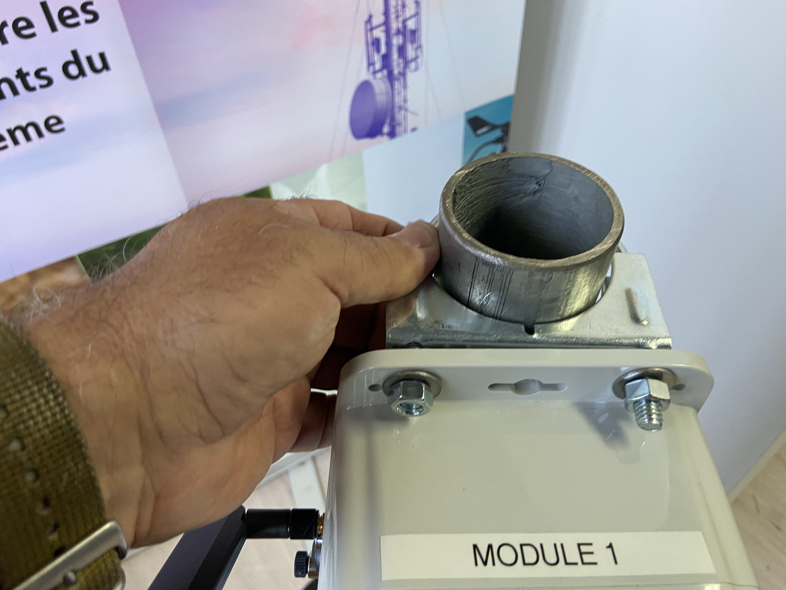
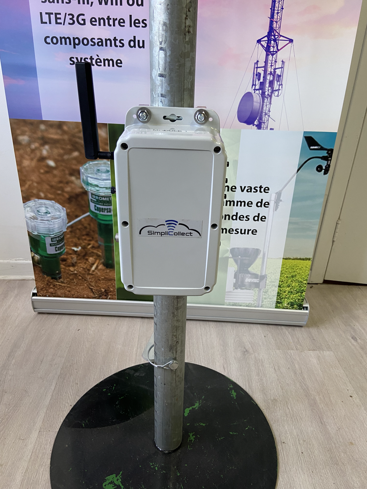
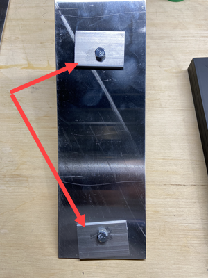
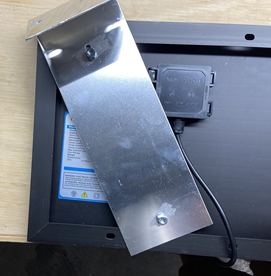
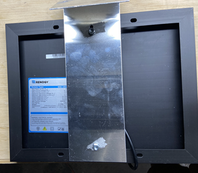
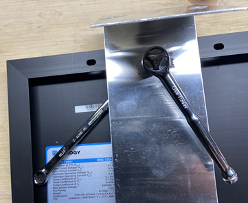
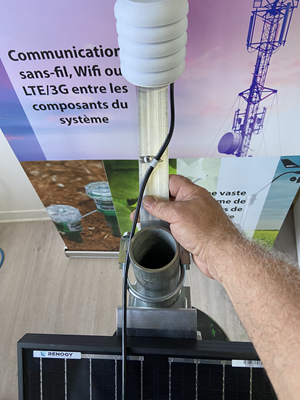
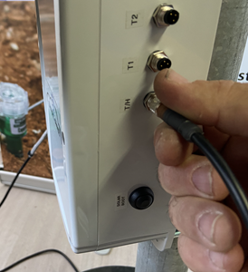

# Module sans fil- Panneau solaire et batterie

Le module sans fil (4G cellulaire ou Wifi) avec alimentation par panneau solaire et batterie Li-Ion permet de faire la collecte de données de différents types de sonde telle que tensiomètres, sonde température et humidité, FDR, pluviomètre et autres.

L’installation de ce module est simple et il suffit de suivre les instructions suivantes.

## Instructions d’installation

1.  Planter la base du mat (tuyau de 1.75 po) dans le sol à l’aide d’une masse en vous assurant que le trou pour la goupille de barrage du mat est vers le haut;

2.  Glisser le mat de montage sur la base et barrer à l’aide de la goupille;

    { width=102 }

3.  Monter les 2 boulons en U sur le module Simplicollect en laissant les écrous en surface des boulons non serrés;

4.  Glisser le tout sur le mat de montage du module:

    { width=102 }

5.  Laisser au moins 20 cm (8 po) de libre à la tête du mat;

6.  Serrer les écrous des boulons en U en vous assurant que les rondelles sont du côté supérieur de la bride du module;

    { width=102 }

7.  Le support du panneau solaire à deux plaques de serrage qui sont boulonnées au support:

    { width=300 }

8.  Renversez le support sur la base du panneau solaire et positionnez-le en “diagonale” afin de faire glisser les plaques de serrage sous le revers de la bordure:

    { width=102 }

9.  En laissant les plaques de serrage en position, redresser le support et le positionner au centre du panneau:

    { width=329 }

10. Serrer les écrous solidement (clé de ½ po):

    { width=361 }

11. Monter le boulon en U sur le support de panneau solaire et glisser sur le mat au-dessus du module:

    { width=400 }

12. Laisser au moins 10 cm (4 pouces) au-dessous du support et serrer les écrous en vous assurant que les rondelles sous directement sous les écrous:

    { width=300 }

13. Faire glisser la sonde de température/humidité au-dessus du support de panneau solaire:

    { width=300 }

14. Serrer les écrous en vous assurant que les rondelles sous directement sous les écrous:

15. Visser l’antenne sur le port d’antenne situé en haut du module;

16. Visser le connecteur de la sonde de température/humidité sur son connecteur identifié “T/H” sur le côté droit du boitier:

    { width=274 }

17. Connecter les autres sondes (ex.: tensiomètres) sur les autres ports du côté droit en accord avec les étiquettes sur le boitier;

18. Connecter le panneau solaire au port du côté gauche du boitier:

    { width=199 }

!!! info

    Le connecteur du panneau solaire sert également “d’interrupteur”. Tant que le panneau n’est pas connecté au module, ce dernier ne peut pas démarrer.

Vous êtes maintenant prêt à faire la mise en marche du module.

## Mise en marche

1.  À chaque fois qu’on reconnecte le panneau solaire, il faut démarrer le contrôleur de charge du module;

2.  Pour ce faire, appuyer sur le bouton “Solar Boot” situé sur le côté gauche du boitier:

    { width=255 }

3.  Par la suite, presser sur le bouton “Reset” situé sur le côté droit du boitier:

    { width=228 }

4.  Le voyant DEL s’allumera afin d’indiquer le démarrage du module. Ceci aura pour effet de démarrer la communication et l’envoi de données vers la passerelle Simplicollect:

5.  Aller vérifier sur Dataview que les données ont été transmises correctement;

!!! info

    Le module sans fil s’active tous les 15 minutes, transmet les données et tombe en dormance afin d'économiser les batteries.

6\. Vérifier que le module s'éteint au bout de 45 secondes;

Vous avez terminé l’installation du module de collecte de données sans fil.
