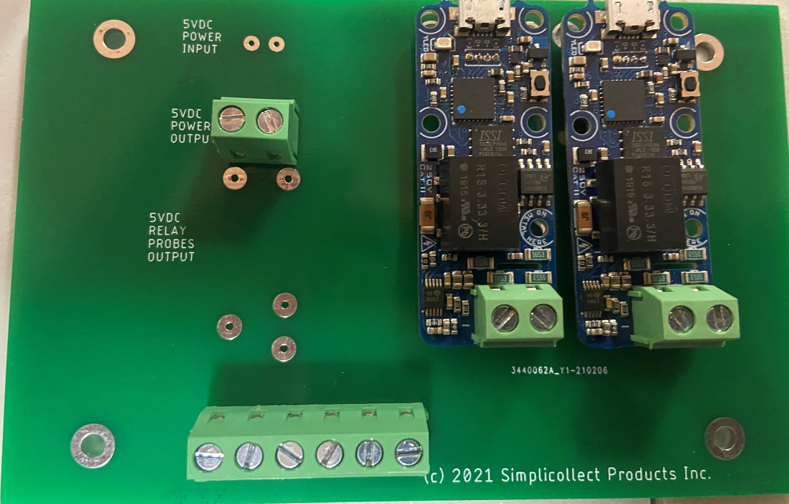
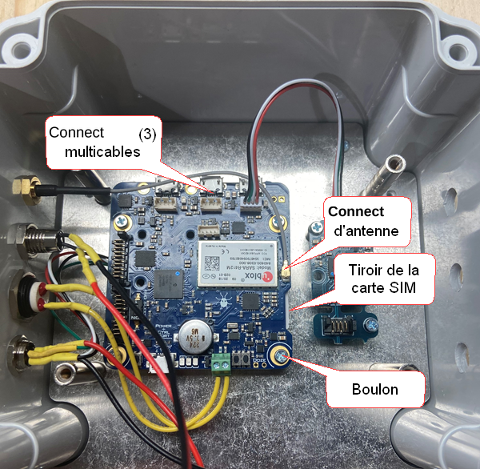
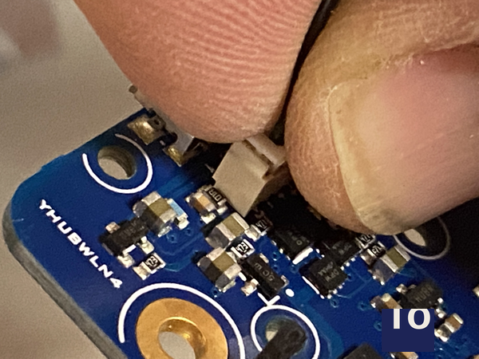
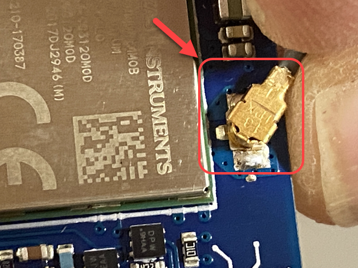
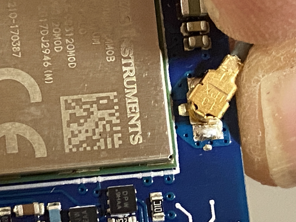
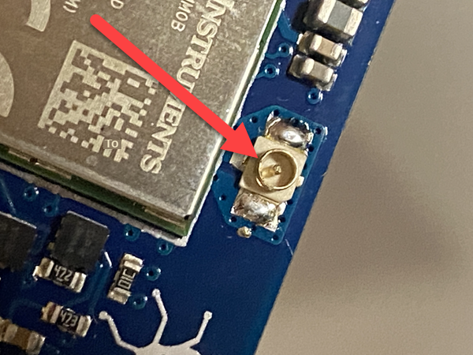

# SIM Replacement

Modules that use the cellular network to send their data to the Simplicollect Gateway use a SIM card to identify themselves. Simplicollect has standardized cellular communication on the Bell Mobility network because of its reliability and its coverage across the entire province of Quebec.

## Replacing the SIM

The steps to change the SIM card of a Simplicollect module are as follows:

1.  Remove the bolts from the module cover. If there is a protected bolt, see the section below.

2.  The cellular communication board is located in the "top" of the enclosure, under the board where the connections are made.

3.  Unbolt the "connection" board (4 bolts) and lift it **gently**

    { width=142 }

4.  Under this board, you will see the communication board, where 3 multi-cable connectors are attached to the board above.

    { width=204 }

5.  With your index finger and thumb, "pinch" the connector on the communication board and pull it out of its socket **gently**.

    { width=142 }{ width=142 }

    **<u>You need to apply "some force" because the connector does not come out easily. Be careful not to "tear" the socket off the communication board</u>**

6.  Once the 3 connectors are removed, **gently** remove the antenna connector:

    { width=142 }

7.  Next, unbolt the communication board... The SIM card tray is underneath.

8.  Once the communication board is "free", locate the SIM card on the right side of the communication board.

9.  Press **gently** on the SIM card and you will feel a "click" that pushes the card out.

10. Then remove the SIM card from the holder "tray" on the communication board.

11. Insert the new SIM card into the tray **in the same position as the card you just removed**.

    { width=142 }

12. Press on the SIM and you will feel the card "click". **If the card is inserted the wrong way, it will not click. The "printed circuit" portion of the SIM card must "face" the communication board.**

13. Bolt the communication board back to the bottom of the enclosure and reinstall the antenna connector **gently.**

14. Reconnect the antenna **gently**, taking care to align the coaxial connector properly in its socket. **This part is delicate and can be broken if you are not careful.**

    { width=217 }{ width=217 }

15. Stop the procedure here and proceed to configure the new SIM before closing the enclosure.

## Configuring the New SIM

You must now configure the new SIM in the communication board firmware.

Use one of the two procedures to change the APN configuration of the new SIM card.

- Simplified procedure: [Module Configuration Utility](../../manuel-d-utilisation/utilitaire-de-configuration-des-modules.md)

- Advanced procedure: [VirtualHub Configuration Utility](../../manuel-d-utilisation/utilitaire-de-configuration-virtualhub.md)

## Closing the Enclosure

Once you have correctly configured the SIM card, put all the components back:

1.  Reconnect the 3 multi-cables.

2.  Bolt the connection plate back on.

3.  Run a power test to make sure the LEDs of all components light up and everything is properly powered.

4.  Bolt the watertight cover back on.

## Protected Bolt

Some enclosures are protected with an asymmetric U10 bolt. You can get a U10 bit at the following link: <https://www.mcmaster.com/catalog/127/3277>

Navigate the web page to the following item:

{ width=204 }

## 📋 Related articles

- [Modules](../../manuel-d-utilisation/configuration/modules.md)
- [Configuration](../../manuel-d-utilisation/configuration/index.md)
- [Tags](../../manuel-d-utilisation/configuration/tags.md)
- [SIM Replacement on MaestrEau](../module-maestreau-et-irrigation/remplacement-sim-sur-maestreau.md)
- [Wifi Connection and IP Address Configuration](../module-maestreau-et-irrigation/configuration-de-la-connexion-wifi-et-de-l-adresse-ip.md)
