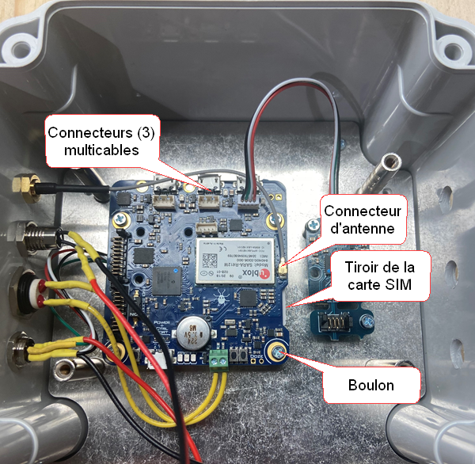
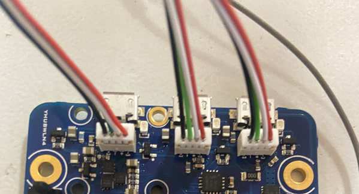
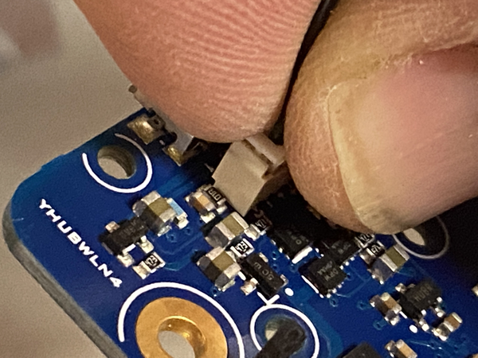
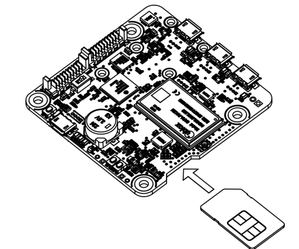
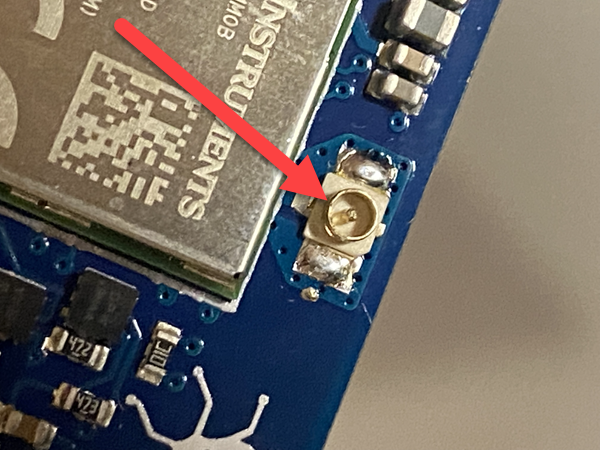
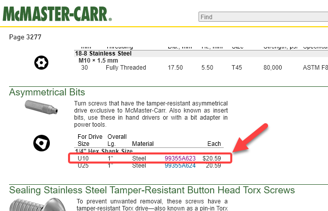

# Remplacement SIM

Les modules qui utilisent le réseau cellulaire pour communiquer leurs données à la passerelle Simplicollect utilisent une carte SIM pour s’identifier. Simplicollect a standardisé la communication cellulaire sur le réseau de Bell Mobilité en raison de sa fiabilité et de l'étendue de la couverture sur tout le territoire du Québec.

## Remplacement de la SIM

Les étapes pour changer la carte SIM d’un module Simplicollect sont les suivantes:

1.  Retirer les boulons du couvercle du module. S’il y a un boulong avec protection, voir la section ci-dessous.

2.  La carte de communication cellulaire est située dans le “haut” du boitier sous la carte où sont fait les raccordement.

3.  Il faut déboulonner la carte de “raccordement” (4 boulons) et soulevée cette dernière **délicatement**

    { width=142 }

4.  Sous cette carte, vous verrez la carte de communication où 3 connexions multi-câbles sont reliés à la carte du dessus.

    { width=204 }

5.  Avec votre index et votre pouce, “pincez” le connecteur sur la carte de communication et retirer le **délicatement** du réceptacle.

    { width=142 }{ width=142 }

    **<u>Il faut appliquer une “certaine force” car le connecteur ne se retire pas facilement. Faites attention de ne pas “arracher” le réceptable de la carte de communication</u>**

6.  Une fois que les 3 connecteurs sont retirés, retirer **délicatement** le connecteur de l’antenne:

    { width=142 }

7.  Par la suite, déboulonner la carte de communication… Le tiroir de la carte SIM se trouve en dessous.

8.  Une fois que la carte de communication est “libre”, repérer la carte SIM du coté droit de la carte de communication.

9.  Pressez **délicatement** sur la carte SIM et vous sentirez un “clic” qui repoussera la carte.

10. Retirez alors la carte SIM du “tiroir” de logement sur la carte de communication.

11. Entrez la nouvelle carte SIM dans le tiroir **dans la même position que la carte que vous venez de retirez**.

    { width=142 }

12. Pressez sur la SIM et vous sentirez le “clic” de la carte. **Si la carte est placée du mauvais coté, le clic ne se fera pas. La portion “circuit imprimé” de la carte SIM doit faire “face” à la carte de communication.**

13. Reboulonnez la carte de communication au fond du boitier et reposer le connecteur d’antenne avec **délicatesse.**

14. Reconnecter l’antenne avec **délicatesse** en reprenant soin de bien aligné le connecteur coaxial dans le socle. **Cette pièce est délicate et peu être brisée si on ne fait pas attention.**

    { width=217 }{ width=217 }

15. Arrêtez la procédure ici et procédez à la configuration de la nouvelle SIM avant de refermer le boitier.

## Configuration de la nouvelle SIM

Vous devez maintenant configurer la nouvelle SIM dans le micrologiciel de la carte de communication.

Utilisez l’une des deux procédure pour changer la configuration de l’APN de la nouvelle carte SIM.

- Procédure simplifiée: [Utilitaire de configuration des modules](../../manuel-d-utilisation/utilitaire-de-configuration-des-modules.md)

- Procédure avancée: [Utilitaire de configuration VirtualHub](../../manuel-d-utilisation/utilitaire-de-configuration-virtualhub.md)

## Fermeture du boitier

Une fois que vous avez correctement configurer la carte SIM, replacer tous les composants:

1.  Reconnectez les 3 multicâbles.

2.  Reboulonnez la plaque de connexion.

3.  Faites un test avec l’alimentation pour vous assurez que les LED de tous les composants s’alument et que tout est lien alimenté.

4.  Reboulonnez le couvercle étanche.

## Boulon avec protection

Certain boitier sont protégé avec un boulon asymétrique de type U10. Vous pouvez vous procurer une pointe U10 au lien suivant: <https://www.mcmaster.com/catalog/127/3277>

Naviguez sur la page web jusqu'à l’item suivant:

{ width=204 }

## 📋 Articles connexes

- [Modules](../../manuel-d-utilisation/configuration/modules.md)
- [Configuration](../../manuel-d-utilisation/configuration/index.md)
- [Tags](../../manuel-d-utilisation/configuration/tags.md)
- [Remplacement SIM sur MaestrEau](../module-maestreau-et-irrigation/remplacement-sim-sur-maestreau.md)
- [Configuration de la connexion Wifi et de l'adresse IP](../module-maestreau-et-irrigation/configuration-de-la-connexion-wifi-et-de-l-adresse-ip.md)
