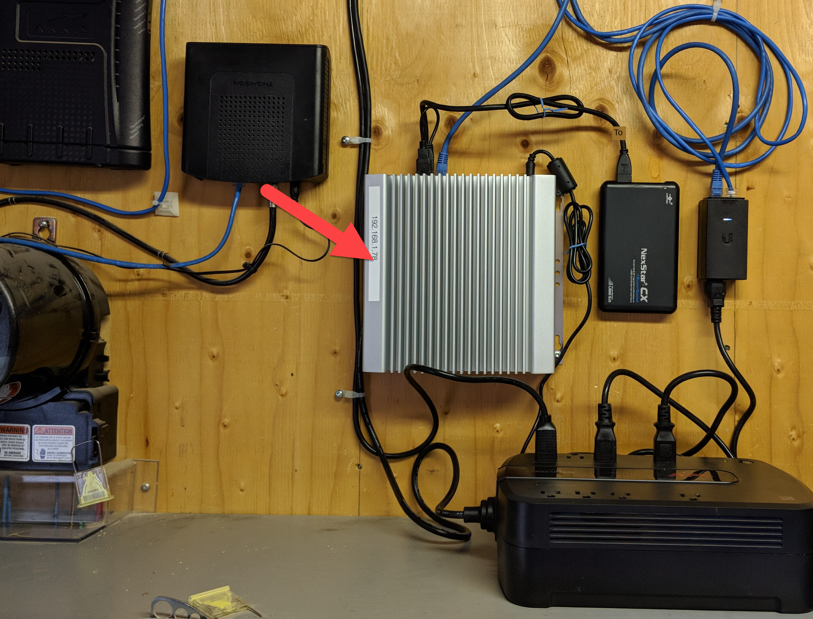
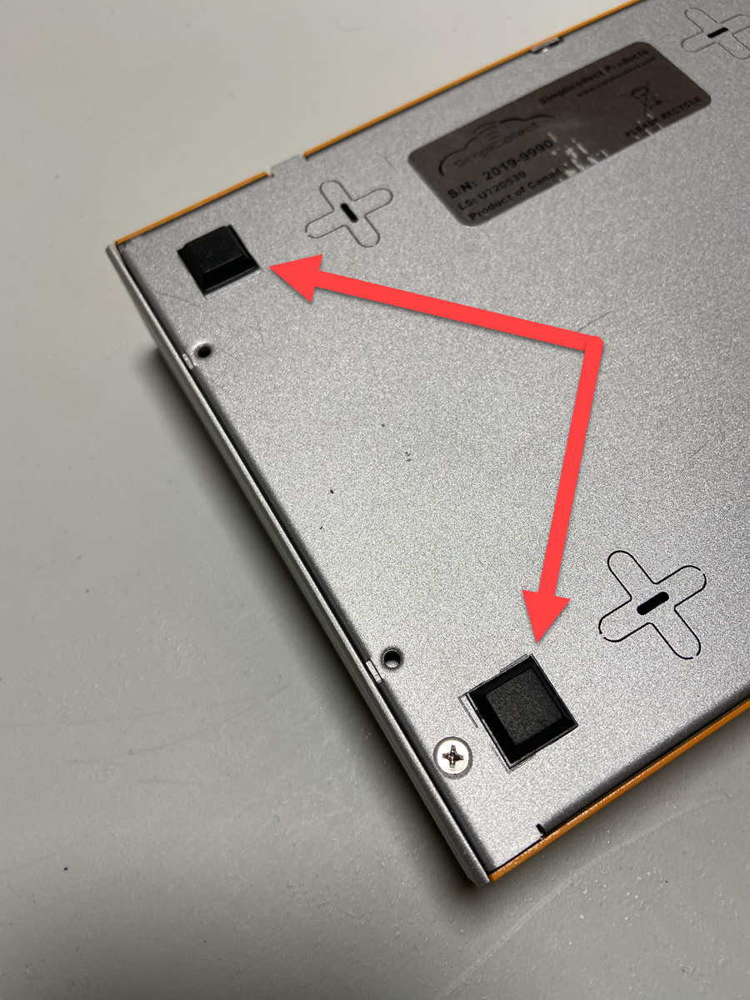
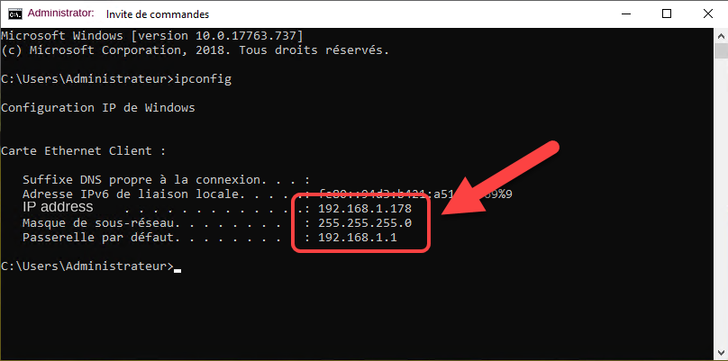
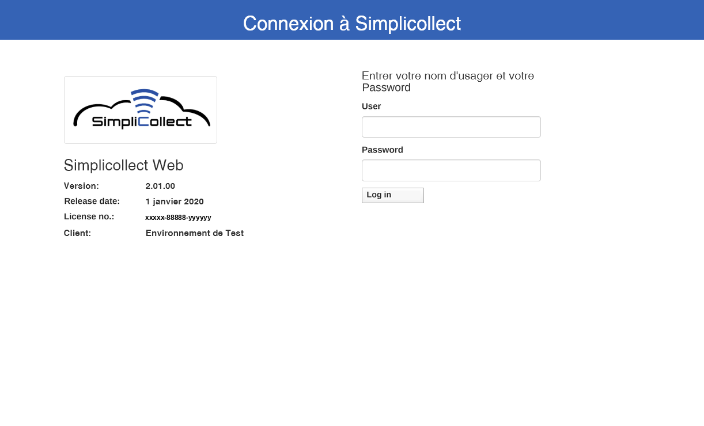
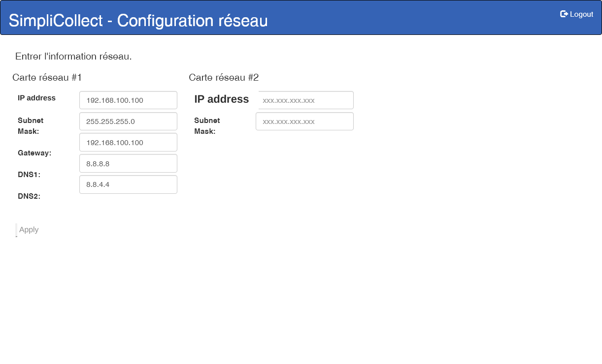
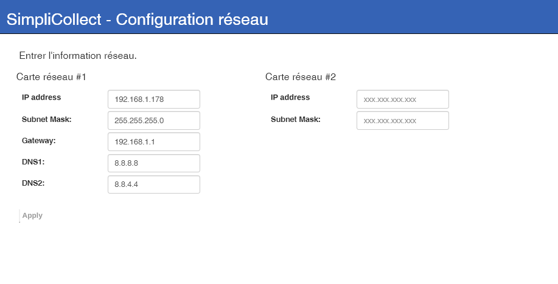
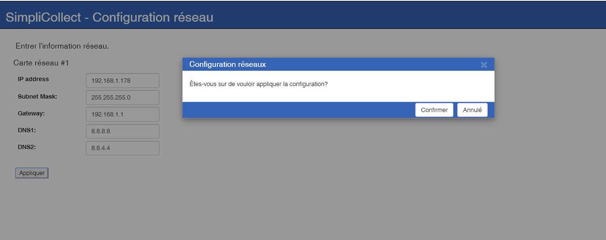
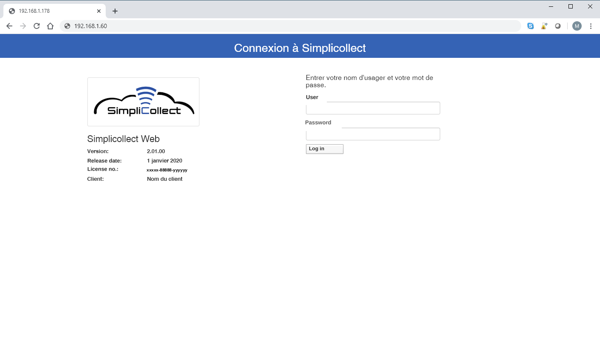

# Simplicollect Gateway

The Simplicollect Gateway is the "heart" of the system and is the control center for all components of the Simplicollect environment.

The following guidelines apply to the installation of the gateway:

- It is the first component of the system that must be installed;
- The gateway must be installed in a location that has access to:
    - The Internet
    - The computer network
    - 110/240 VAC power
- It must be installed in a dry, temperature-controlled location. For example, an electrical or computer room
- If the gateway must be installed in a "less clean" location, it is recommended to install it in a sealed cabinet larger than 40 cm x 40 cm

## Prerequisites

You must have the equipment needed to set up a computer network and have <u>basic knowledge</u> to carry out some configuration steps.

!!! info

    If you have no basic knowledge, you should ask a networking consultant for help.  You can often find technicians at low cost at retailers such as Staples or Best Buy who can come to your home or help you by phone.

The required equipment is:

- A configurable router with the option to open ports on the Internet ("Port Forwarding" option);
- Ethernet connection ports available on your router or on a network switch connected to your router;
- A PC or laptop running Windows 7/8/10 with an available Ethernet communication port;
- A Wi-Fi access point for connecting the Simplicollect Modules (if you have Wi-Fi Modules);

## Physical Installation of the Gateway

The Simplicollect Gateway comes with a wall-mount bracket that lets you screw it onto a plywood panel or inside a cabinet.

See the installation examples below:

      

You can also attach the rubber "feet" under the device and place it on a desk or shelf:

     

## Connecting the External Backup Disk

For some models, an external USB disk is supplied.  Connect this disk to a USB port on the back of the gateway and place it nearby.

## Connecting to the Computer Network

Following the "physical" installation of the gateway, proceed with connecting it to the computer network and to the Internet.  The following diagram gives an overview of the links that must be established: { width=800 }

The first step is to configure the gateway's "Ethernet" network ports in order to connect the gateway to your computer network.  

Each device (PC, printer, server, etc.) is connected to the network using a communication cable or Wi-Fi wireless access.  To be recognized, each device needs an "IP address" in the format XXX.XXX.XXX.XXX (e.g.: 192.168.1.145).  The addresses of the gateway's Ethernet ports must therefore be changed.

The first step is to establish what the gateway's IP address will be on your computer network:

1.  On your PC or laptop, while connected to your computer network, open a DOS command window. To do so, click the "magnifying glass" next to the Windows icon in the lower-left corner of the desktop, type "cmd" and press &lt;Enter&gt;... The DOS window appears;

2.  In the window, type the command **ipconfig **and press the &lt;Enter&gt; key.  The IP addresses of your network card will appear: { width=600 }

3.  This information gives you the "base" of the IP address sequence.  Note the "root", i.e. the first 3 sections of the address.  In our example, it is **192.168.1 **;

4.  Note the subnet mask (in our example, **255.255.255.0**) and the default gateway (in our example, **192.168.1.1**)... These will be used verbatim in the configuration of the gateway's IP address;

5.  You then need to choose an address that **is not already in use**.  Generally, addresses below **xxx.xxx.xxx.100** are free.  For example, you can test whether the address xxx.xxx.xxx.50 is available.

    !!! info

        You can also contact the IT consultant who configured your network environment. They can provide you with the right information.

6.  To do so, type the command **ping 192.168.1.60 **(our example) in the DOS window and note the result: { width=600 }

7.  If the command returns the message "Destination host unreachable", then this address is available and can be used to configure the gateway;

8.  If the command returns a message such as "Reply from 192.168.1.50: bytes=32 time=1ms TTL=128", then this address is in use. Try again with another address until you find one.  Remember that the last segment of the address cannot be higher than 254 (e.g.: 192.168.1.254);

    !!! info

        If you want to learn more about the TCP/IP standard, go to Wikipedia at the following address: [https://fr.wikibooks.org/wiki/R%C3%A9seaux_TCP/IP/Adressage_IP_v](https://fr.wikibooks.org/wiki/R%C3%A9seaux_TCP/IP/Adressage_IP_v4)

## Configuring the IP Address of Network Card \#1

Now that the IP address is known, you can configure network card \#1

1.  Connect the Ethernet cable supplied with the gateway to port \#1 of the gateway (the "red" dot) and to the Ethernet port of your PC or laptop:

    !!! info

        If your equipment does not have a network cable connector, you can get an "adapter" that plugs into a USB port on your PC or laptop.  For example, you can search Amazon for "USB Ethernet adapter".

2.  The default address of gateway port \#1 is **192.168.100.100**.  To connect, you must change the IP address of your PC or laptop's Ethernet connector to a compatible address (for example, 192.168.100.10). See the following procedure for Windows 10:

3.  When the connection is complete, start Chrome and type the following address in the address bar:  <http://192.168.100.100/ipsettings/>  and the following page appears: { width=700 }

4.  Use the administrator account that was assigned to you and click **Log in... **

5.  The following page appears: { width=700 }

6.  In the **IP address** field, enter the IP address you established earlier (in our example, 192.168.1.60);

7.  And enter the contents of the Subnet Mask and Gateway (default gateway) fields that you obtained earlier (in our example, 255.255.255.0 and 192.168.1.1); { width=700 }

    !!! info

        Unless otherwise advised, leave the DNS1 and DNS2 fields unchanged.

8.  Click the Apply button and confirm the entry  { width=700 }

9.  A success message will confirm the entry;

10. You must now change the IP address of your PC or laptop to be compatible with the gateway's new IP address (in our example, edit it again with the address 192.168.1.10);

11. Once the address is changed, enter the gateway's IP address in the Chrome browser (our example, 192.168.1.60) and check that the Simplicollect login screen appears: { width=700 }

12. If so, you have succeeded and can move on to the next step.

## Connecting to the Internet

Next, you must configure the Internet access "ports", which use the same IP address system as your local network (commonly called LAN for Local Area Network).  The IP address of "your site" on the Internet is assigned by your Internet service provider (e.g.: ExploreNet, Vidéotron, Bell, Xbox, etc.).  By comparison, your router sees the Internet as a "wide" network (commonly called WAN for Wide Area Network).

All the PCs, cell phones or tablets connected to your local network, each of which has a specific IP address, are seen on the Internet as having a single IP address, the one assigned to you by your provider.  So, if you want to access your data when you are away, communications must be "routed" to the Simplicollect Gateway.  To do this, you must access your router's configuration and open certain communication "ports".

!!! info

    Please note that the public IP address assigned to you is "temporary" and can be changed at any time, without notice, by your provider.  See the section below titled **Dynamic DNS**.

The first thing to do is to determine the IP address your provider has assigned to you:

1.  On your PC or laptop, open Chrome and type the following address: <http://www.mon-ip.com/> and the following screen will appear: { width=600 }
2.  This is the IP address of your router... You must now be able to "route" external access to the Simplicollect Gateway;
3.  To do so, in Chrome, type the IP address of your router and go to the "port forwarding" page (or IP Forwarding) and enter the ports defined in the table below;
4.  Once the configuration is done, connect using a Simplicollect application (e.g.: Dataview on iOS or Android) and enter the IP address of your router (as found above) and the port number defined below.  For example, the Dataview application would use port 53333 to access your gateway from the outside... See the following screenshot: { width=500 }
5.  In this example, click the Connect button... If the welcome message appears and you proceed to the application content, you have correctly configured the ports on your router.

#### Table of ports to open on your router, where xxx.xxx.xxx.xxx is the gateway's main IP address.

| Service             | Port on the Gateway    | Port on the Internet | Gateway IP Address          |
|---------------------|------------------------|-------------------|-----------------------------|
| Dataview Service    | 3333                   | 53333             | xxx.xxx.xxx.xxx             |
| DataREST Service    | 3334                   | 53334             | xxx.xxx.xxx.xxx             |
| MAEREST Service     | 3335                   | 53335             | xxx.xxx.xxx.xxx             |
| RDP                 | 3389                   | 53389             | xxx.xxx.xxx.xxx             |
| Web (unencrypted)   | 80                     | 8081              | xxx.xxx.xxx.xxx             |
| Web https (encrypted) | 443,4430             | 4430              | xxx.xxx.xxx.xxx             |
| FTP and SSH         | 22                     | 22                | xxx.xxx.xxx.xxx             |
| DATA                | 1433                   | 14333             | xxx.xxx.xxx.xxx             |

The difficulty in configuring external ports lies in the multitude of router brands and models on the market.  The most popular router brands are D-Link, Asus, Netgear, Linksys.  Ideally, buy this device from a supplier who can give you technical advice or even install it (e.g.: Staples, Best Buy, La Source, etc.).  **We advise against buying this device directly on the Internet, as you will not have the technical assistance you may need.**

!!! info

    **Simplicollect technical support does not provide technical assistance on your network equipment.  Be proactive and find a service provider in your area.**

## Gateway Security

The Simplicollect Gateway contains a complete operating system supplied by Simplicollect. This device is fully secured and can only be diagnosed or updated by Simplicollect technical support staff.  Simplicollect User accounts are maintained through the Security function, which you can consult at the following link: [Simplicollect Security](../../manuel-d-utilisation/configuration/securite.md)
