# Passerelle Simplicollect

La passerelle Simplicollect est le "coeur" du système et constitue le centre de contrôle de tous composants de l'environnement Simplicollect.

Les consignes suivantes s'appliquent à l'installation de la passerelle:

- C’est le premier composant du système qui doit être installé;
- On doit installer la passerelle dans un endroit qui à accès:
    - À Internet
    - Au réseau informatique
    - À du courant 110/240 VAC
- On doit l’installer dans un endroit sec avec un contrôle de température. Par exemple, une chambre électrique ou informatique
- Si on doit installer la passerelle dans un endroit « moins propre », il est recommandé de l’installer dans un cabinet hermétique d'une dimension supérieure à 40 cm x 40 cm

## Prérequis

Vous devez posséder les équiments nécessaires pour l'établissement d'un réseau informatique et posséder <u>les connaissances de base</u> pour faire certaines étapes de configuration.

!!! info

    Si vous n'avez aucune connaissance de base, vous devriez demander l'aide d'un conseiller en réseautique.  Souvent, on peut trouver à peu de frais des techniciens chez les concessionnaires tel que Bureau en gros ou Best Buy qui peuvent se rendre chez vous ou vous aider par téléphone.

Les équipements requis sont:

- Un routeur configurable avec option d'ouverture de ports sur Intenet (option "Ports Forwarding");
- Des ports de connexion Ethernet disponibles sur votre routeur ou sur un commutateur de réseau raccorder à votre routeur;
- Un PC ou un laptop fonctionnant avec Windows 7/8/10 et ayant un port de communication Ethernet disponible;
- Un point d'accès Wifi pour la connexion des modules Simplicollect (dans le cas où vous avez des modules Wifi);

## Installation physique de la passerelle

La passerelle Simplicollect vient avec une bride de support mural qui vous permet de le visser sur un panneau de contreplaqué ou à l'intérieur d'un cabinet.

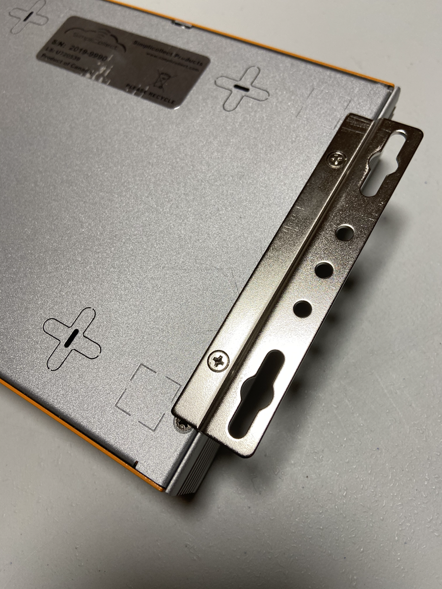

Voir les exemples d'installation ci-dessous:

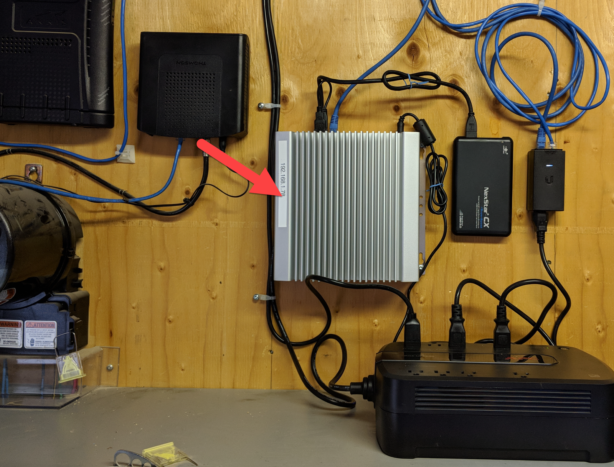      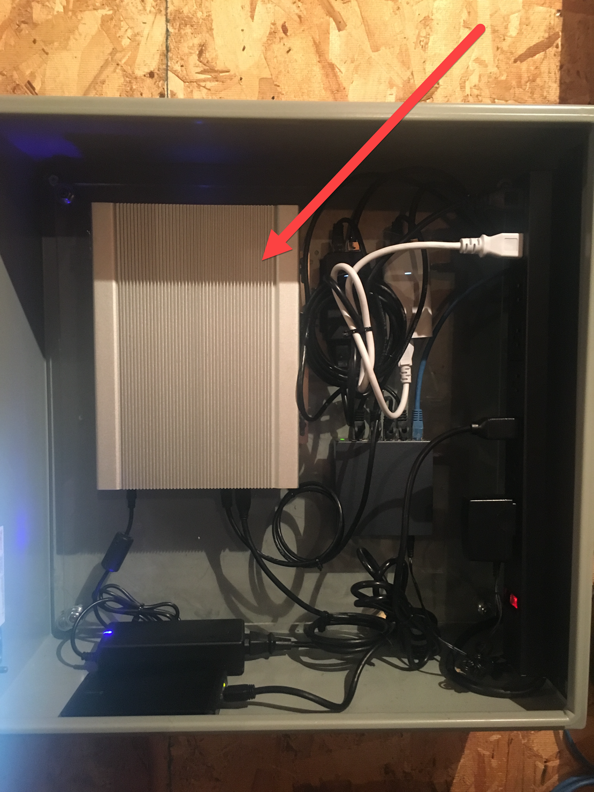

On peut également poser les "coussins" en caoutchouc sous l'appareil et la déposer sur un bureau ou une étagère:

     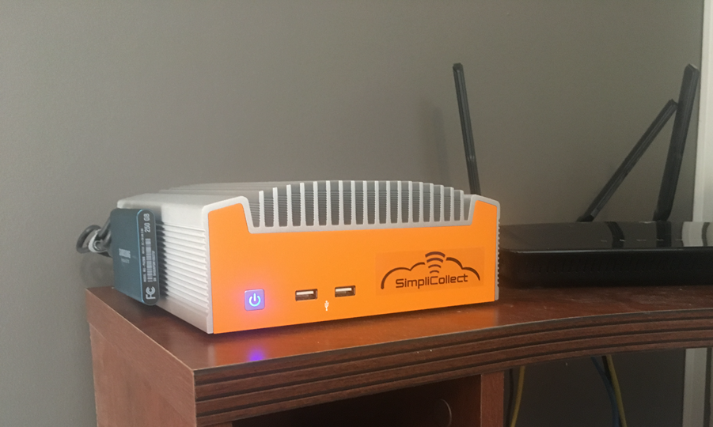

## Connexion du disque externe de sauvegarde

Pour certains modèle, un disque USB externe est fourni.  Connectez ce disque à un port USB à l'arrière de la passerelle et placez le à proximité.

## Raccordement au réseau informatique

Suite à l'installation "physique" de la passerelle, il procéder au raccordement au réseau informatique ainsi qu'à Internet.  Le schéma suivant donne un aperçu des liens qui doivent être établis: 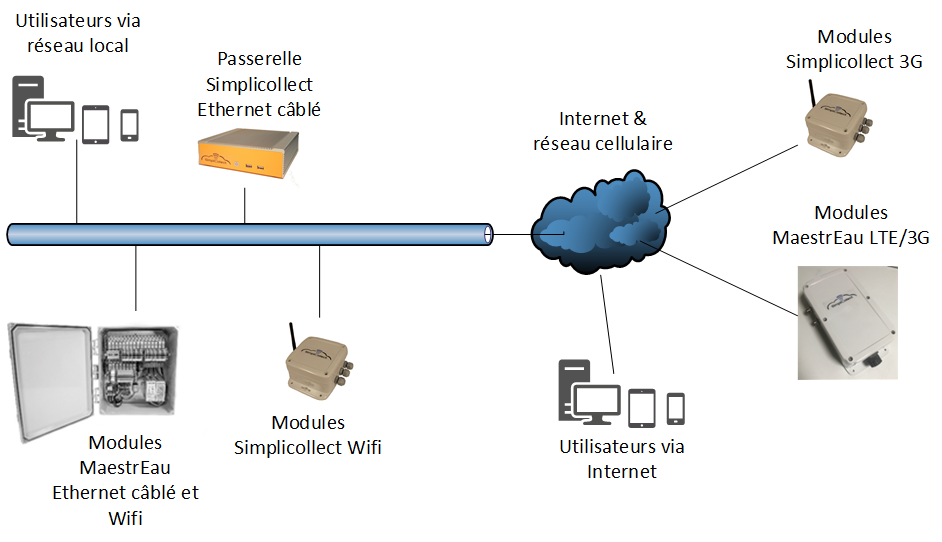{ width=800 }

La première étape est de configurer les ports de réseau "Ethernet" de la passerelle afin de se raccorder la passerelle à votre réseau informatique.  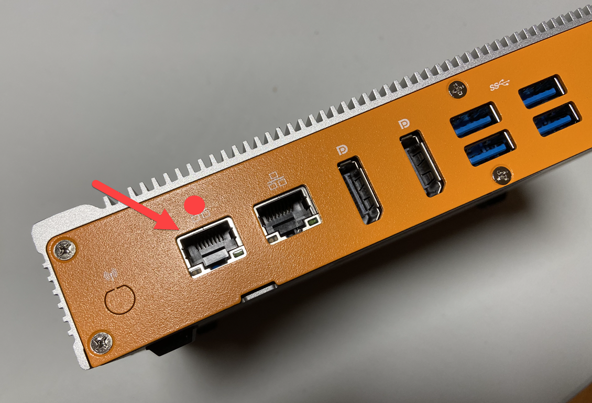

Chaque équipement (PC, imprimante, serveur, etc.) est connecté au réseau à l'aide d'un câble de communication ou d'un accès sans fil Wifi.  Pour être reconnu, chaque équipement à besoin d'une "adresse IP" qui a le format XXX.XXX.XXX.XXX (ex.: 192.168.1.145).  Il faut donc changer les adresses des ports Ethernet de la passerelle.

La première étape est d'établir quelle sera l'adresse IP de la passerelle sur votre réseau informatique:

1.  Sur votre PC ou laptop, tout en étant connecté à votre réseau informatique, ouvrez une fenêtre de commande DOS. Pour ce faire, faites un cliquez sur la "loupe" à côté de l'icône Windows située dans le coin inférieur gauche du bureau et taper "cmd" et pressez sur &lt;Enter&gt;... La fenêtre DOS apparait;

2.  Dans la fenêtre, tapez la commande **ipconfig **et pressez sur la touche &lt;Enter&gt;.  Les adresses IP de votre carte de réseau vont apparaitre: 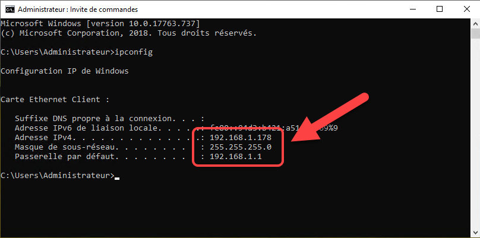{ width=600 }

3.  Ces informations vous donnent "la base" de la séquence d'adresse IP.  Prenez note de la "racine", soit les 3 premières sections de l'adresse.  Dans note exemple, il s'agit de **192.168.1 **;

4.  Prenez en note le masque de sous réseau (dans notre exemple, **255.255.255.0**) et de la passerelle par défaut (dans notre exemple, **192.168.1.1**)... Ceci sera utilisé textuellement dans la configuration de l'adresse IP de la passerelle;

5.  Il faut ensuite choisir une adresse qui **n'est pas déjà prise**.  Généralement, les adresse en dessous de **xxx.xxx.xxx.100** sont libres.  Par exemple, on peut tester si l'adresse xxx.xxx.xxx.50 est disponible.

    !!! info

        Vous pouvez aussi contacter vos conseillers en informatique qui a configuré votre environnement réseau. Il pourra vous fournir les bons renseignements.

6.  Pour ce faire, tapez la commande **ping 192.168.1.60 **(notre exemple), dans la fenêtre DOS et prenez note du résultat: 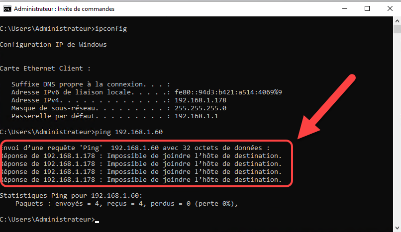{ width=600 }

7.  Si la commande retourne le message "Impossible de joindre l'hôte de destination", alors cela veut dire que cette adresse est disponible et pourra servir à configurer la passerelle;

8.  Si la commande retourne le message du genre "Réponse de 192.168.1.50 : octets=32 temps=1 ms TTL=128", alors cela veut dire que cette adresse est occupée. Réessayer avec une autre adresse jusqu'à ce que vous en trouviez une.  Rappelons que le dernier segment de l'adresse ne peut aller plus haut que 254 (ex.: 192.168.1.254);

    !!! info

        Si vous voulez en savoir plus sur le standard TCP/IP, allez sur Wikipédia à l'adresse suivante: [https://fr.wikibooks.org/wiki/R%C3%A9seaux_TCP/IP/Adressage_IP_v](https://fr.wikibooks.org/wiki/R%C3%A9seaux_TCP/IP/Adressage_IP_v4)

## Configuration de l'adresse IP de la carte réseau \#1

L'adresse IP étant connue, vous pouvez maintenant configurer la carte réseau \#1

1.  Connectez le câble Ethernet, fourni avec la passerelle, et raccordez-le au port \#1 de la passerelle (point "rouge") et au port Ethernet de votre PC ou laptop:

    !!! info

        Si votre équipement ne possède pas de connecteur de câble de réseau, vous pouvez vous procurer un "adaptateur" avec branchement sur un port USB de votre PC ou laptop.  Par exemple, vous pouvez faire une recherche sur Amazon avec la mention "adaptateur usb Ethernet".

2.  L'adresse par défaut du port \#1 de la passerelle est le **192.168.100.100**.  Afin de vous connecter, vous devez changer l'adresse IP du connecteur Ethernet de votre PC ou laptop pour une adresse compatible (par exemple, le 192.168.100.10). Voir la procédure suivante pour Windows 10:

3.  Lorsque le raccordement est complété, démarrer Chrome et taper la commande suivante dans l'adresse:  <http://192.168.100.100/ipsettings/>  et la page suivante apparait: 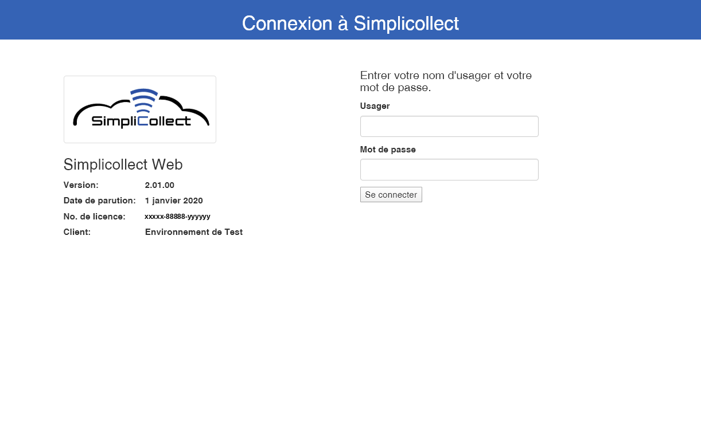{ width=700 }

4.  Utiliser le compte administrateur qui vous aura été assigné et cliquez sur **Se connecter... **

5.  La page suivante apparait: 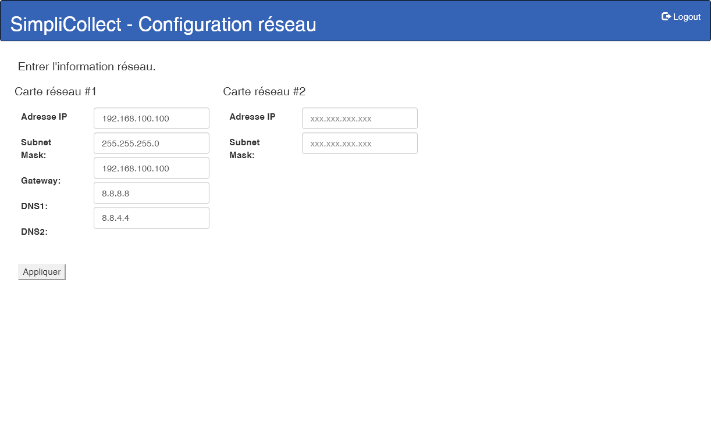{ width=700 }

6.  Dans le champ, **Adresse IP, **entrez l'adresse IP que vous avez établie précédemment (dans notre exemple, 192.168.1.60);

7.  Et tapez le contenu des champs Subnet Mask (masque de sous-réseau) et Gateway (passerelle de défaut) que vous avez obtenu précédemment ( dans notre exemple, 255.255.255.0 et 192.168.1.1); 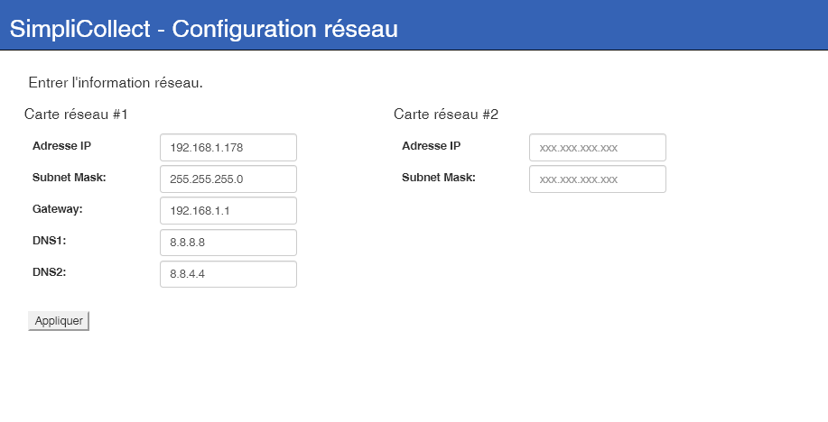{ width=700 }

    !!! info

        À moins d'avis contraire, laissez les champs DNS1 et DNS2 inchangés.

8.  Cliquez sur le bouton Appliquer et confirmer la saisie  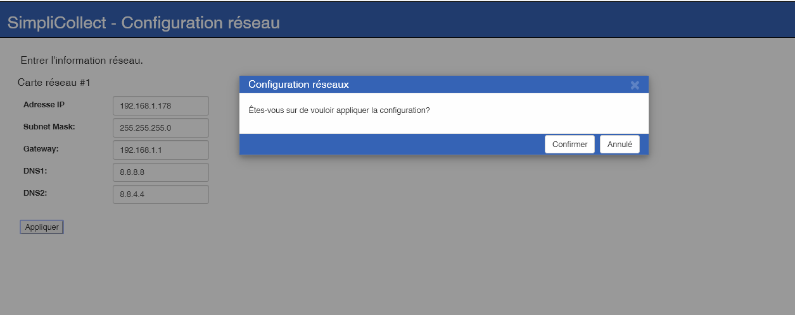{ width=700 }

9.  Un message de succès confirmera la saisie;

10. Il faut maintenant modifier l'adresse IP de votre PC ou laptop afin d'être compatible avec la nouvelle adresse IP de la passerelle (dans notre exemple, rééditer avec l'adresse 192.168.1.10);

11. Une fois l'adresse modifiée, entrer l'adresse IP de la passerelle dans le fureteur Chrome (notre exemple, 192.168.1.60) et vérifier que l'écran d'identification de Simplicollect vous apparait: 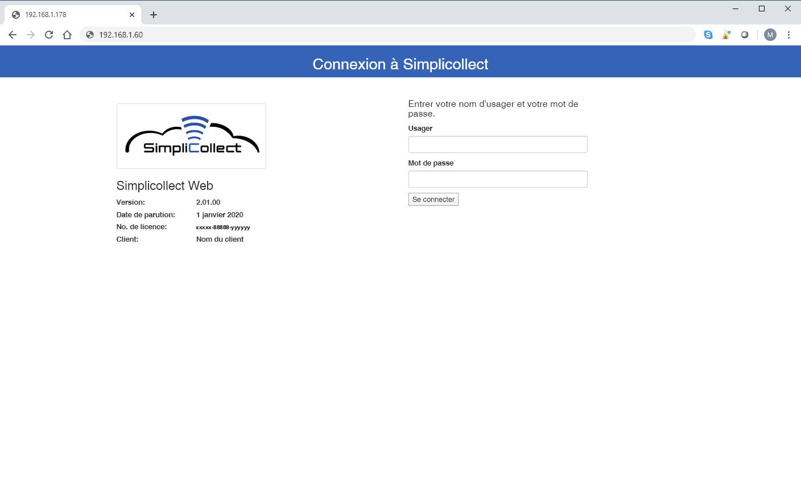{ width=700 }

12. Si tel est le cas, vous avez réussi et vous pouvez passer à la prochaine étape.

## Raccordement à Internet

Par la suite, vous devez configurer les "ports" d'accès Internet qui utilise le même système d'adresse IP que votre réseau local (couramment appelé LAN pour Local Area Network).  L'adresse IP de "votre site" sur Internet est assignée par votre fournisseur de services Internet (ex.: ExploreNet, Vidéotron, Bell, Xbox, etc.).  En comparaison, votre routeur voit réseau Internet comme un réseau "étendu" (couramment appelé WAN pour Wide Area Network).

Tous les PC, cellulaires ou tablettes raccordés à votre réseau local, et qui ont chacun une adresse IP spécifique, est vue sur Internet comme ayant une seule adresse IP, soit celle qui vous a été assignée par votre fournisseur.  Donc, si vous désirez accéder à vos données lorsque vous êtes à l'extérieur, il faut "router" les communications vers la passerelle Simplicollect.  Pour se faire, vous devez accéder à la configuration de votre routeur et ouvrir certains "ports" de communication.

!!! info

    Veuillez noter que l'adresse IP publique qui vous est assignée est "temporaire" et peut être changée en tout temps, sans avertissement, par votre fournisseur.  Voir la section ci-dessous intitulée **DNS Dynamique**.

La première chose à savoir est de déterminer l'adresse IP que votre fournisseur vous a assignée:

1.  Sur votre PC ou laptop, ouvrez Chrome et tapez l'adresse suivante: <http://www.mon-ip.com/> et l'écran suivant apparaitra: 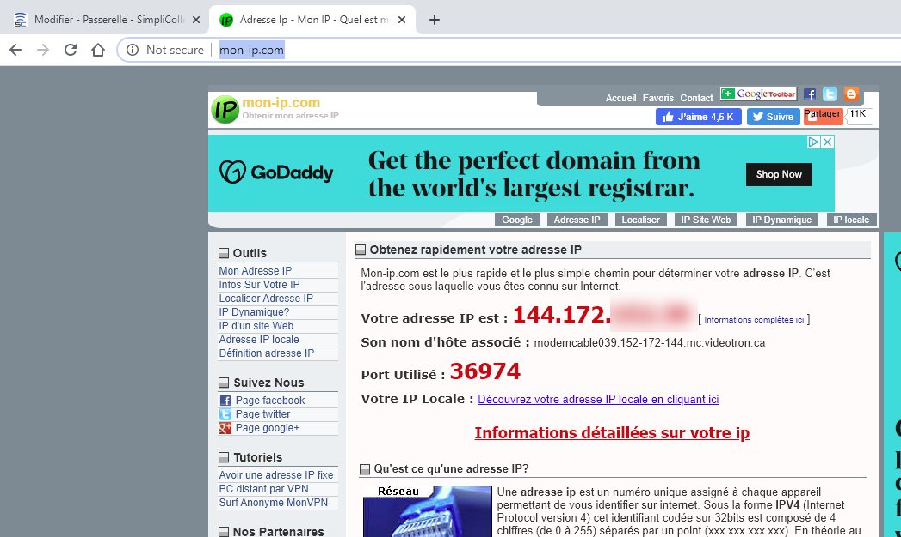{ width=600 }
2.  Ceci est l'adresse IP de votre routeur... Il faut maintenant être capable de "router" les accès externes vers la passerelle Simplicollect;
3.  Pour ce faire, sur Chrome, tapez l'adresse IP de votre routeur et accéder à la page de "transfert de ports" (ou IP Forwarding en anglais) et inscrire les ports définit dans le tableau ci-dessous;
4.  Une fois que la configuration est faite, branchez-vous à l'aide d'une application Simplicollect (ex.: Dataview sur iOS ou Android) et entrez l'adresse IP de votre routeur (tel que trouvé ci-dessus) et le numéro de port défini ci-dessous.  Par exemple, l'application Dataview utiliserait le port 53333 pour accéder à votre passerelle à partir de l'extérieur... Voir la capture suivante: 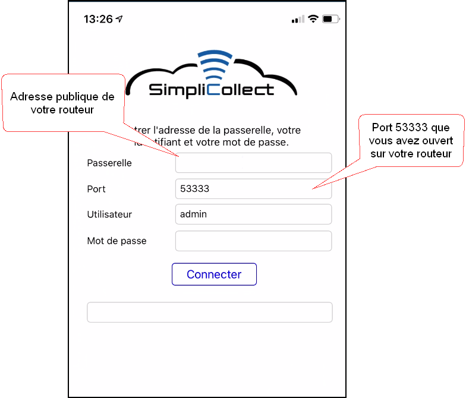{ width=500 }
5.  Sur cet exemple, cliquez sur le bouton Connecter... Si le message de bienvenue apparait et que vous passez au contenu de l'application, c'est que vous avez configuré correctement vos ports sur votre routeur.

#### Tableau des ports à ouvrir sur votre routeur où xxx.xxx.xxx.xxx est l'adresse IP principale de la passerelle.

| Service             | Port sur la passerelle | Port sur Internet | Adresse IP de la passerelle |
|---------------------|------------------------|-------------------|-----------------------------|
| Service Dataview    | 3333                   | 53333             | xxx.xxx.xxx.xxx             |
| Service DataREST    | 3334                   | 53334             | xxx.xxx.xxx.xxx             |
| Service MAEREST     | 3335                   | 53335             | xxx.xxx.xxx.xxx             |
| RDP                 | 3389                   | 53389             | xxx.xxx.xxx.xxx             |
| Web (non-chiffré)   | 80                     | 8081              | xxx.xxx.xxx.xxx             |
| Web https (chiffré) | 443,4430               | 4430              | xxx.xxx.xxx.xxx             |
| FTP et SSH          | 22                     | 22                | xxx.xxx.xxx.xxx             |
| DATA                | 1433                   | 14333             | xxx.xxx.xxx.xxx             |

La difficulté dans la configuration des ports externes réside dans la multitude des marques et modèle de routeur sur le marché.  Les marques les plus populaires de routeur sont D Link, Asus, Netgear, Linksys.  Idéalement, achetez cet appareil chez un fournisseur qui peut vous donner des conseils techniques ou même en faire l'installation (ex.: Bureau en gros, Best Buy, La Source, etc.).  **Nous vous déconseillons d'acheter cet appareil directement sur Internet, car vous n'aurez pas l'assistance technique dont vous auriez besoin.**

!!! info

    **Le service d'assistance technique de Simplicollect n'offre pas l'assistance technique sur vos équipements de réseau.  Soyez prévoyant de vous trouver un fournisseur de service dans votre région.**

## Sécurité de la passerelle

La passerelle Simplicollect contient un système d'exploitation complet fourni par Simplicollect. Cet appareil est pleinement sécurisé et ne peut être diagnostiqué ou mis à jour que par le personnel d'assistance technique de Simplicollect.  Les comptes d'utilisateur Simplicollect sont maintenus grâce à la fonction de sécurité que vous pouvez consulter au lien suivant: [Sécurité Simplicollect](../../manuel-d-utilisation/configuration/securite.md)
