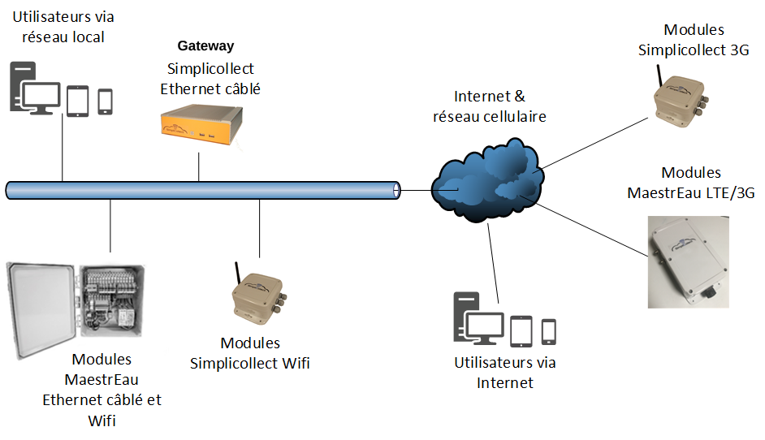

# Internet Connection

## Connecting to the Computer Network

{ width=942 }

Following the "physical" installation of the gateway, proceed with connecting it to the computer network and to the Internet.  The following diagram gives an overview of the links that must be established:

## Connecting to the Internet

Next, you must configure the Internet access "ports", which use the same IP address system as your local network (commonly called LAN for Local Area Network).  The IP address of "your site" on the Internet is assigned by your Internet service provider (e.g., ExploreNet, Vidéotron, Bell, Xbox, etc.).  By comparison, your router sees the Internet as a "wide" network (commonly called WAN for Wide Area Network).

All the PCs, cell phones or tablets connected to your local network, each of which has a specific IP address, are seen on the Internet as having a single IP address, the one assigned to you by your provider.  So, if you want to access your data when you are away, communications must be "routed" to the Simplicollect Gateway.  To do this, you must access your router's configuration and open certain communication "ports".

| Please note that the public IP address assigned to you is "temporary" and can be changed at any time, without notice, by your provider.  See the section below titled **Dynamic DNS**. |
|-------------------------------------------------------------------------------------------------------------------------------------------------------------------------------------------------------------------------|

The first thing to do is to determine the IP address your provider has assigned to you:

1.  On your PC or laptop, open Chrome and type the following address: <http://www.mon-ip.com>  and the following screen will appear:

    { width=1047 }

2.  This is the IP address of your router... You must now be able to "route" external access to the Simplicollect Gateway;

3.  To do so, in Chrome, type the IP address of your router and go to the "port forwarding" page (or IP Forwarding) and enter the ports defined in the table below;

4.  Once the configuration is done, connect using a Simplicollect application (e.g., Dataview on iOS or Android) and enter the IP address of your router (as found above) and the port number defined below.  For example, the Dataview application would use port 53333 to access your gateway from the outside... See the following screenshot:

5.  In this example, click the Connect button... If the welcome message appears and you proceed to the application content, you have correctly configured the ports on your router.

{ width=226 }

#### Table of ports to open on your router toward the gateway's IP address.

| Service             | Port on the Gateway    | Port on the Internet | Gateway IP Address          |
|---------------------|------------------------|-------------------|-----------------------------|
| Dataview Service    | 3333                   | 53333             |                             |
| DataREST Service    | 3334                   | 53334             |                             |
| MAEREST Service     | 3335                   | 53335             |                             |
| RDP                 | 3389                   | 53389             |                             |
| Web (unencrypted)   | 80                     | 8081              |                             |
| Web https (encrypted) | 443,4430             | 4430              |                             |
| FTP and SSH         | 22                     | 22                |                             |
| DATA                | 1433                   | 14333             |                             |

The difficulty in configuring external ports lies in the multitude of router brands and models on the market.  The most popular router brands are D-Link, Asus, Netgear, Linksys.  Ideally, buy this device from a supplier who can give you technical advice or even install it (e.g., Staples, Best Buy, La Source, etc.).  **We advise against buying this device directly on the Internet, as you will not have the technical assistance you may need.**

| **Simplicollect technical support does not provide technical assistance on your network equipment.  Be proactive and find a service provider in your area.** |
|--------------------------------------------------------------------------------------------------------------------------------------------------------------------------------------------------------|

## Gateway Security

The Simplicollect Gateway contains a complete operating system supplied by Simplicollect. This device is fully secured and can only be diagnosed or updated by Simplicollect technical support staff.  Simplicollect User accounts are maintained through the Security function, which you can consult at the following link: Simplicollect Security

- [Modules](../../manuel-d-utilisation/configuration/modules.md)
- [Configuration](../../manuel-d-utilisation/configuration/index.md)
- [Tags](../../manuel-d-utilisation/configuration/tags.md)
- [SIM Replacement on MaestrEau](../module-maestreau-et-irrigation/remplacement-sim-sur-maestreau.md)
- [Wi-Fi Connection and IP Address Configuration](../module-maestreau-et-irrigation/configuration-de-la-connexion-wifi-et-de-l-adresse-ip.md)
