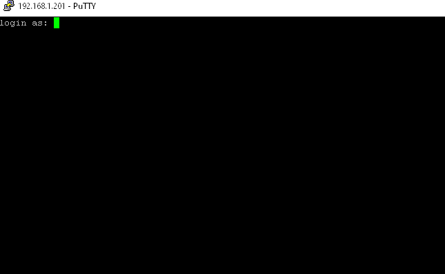
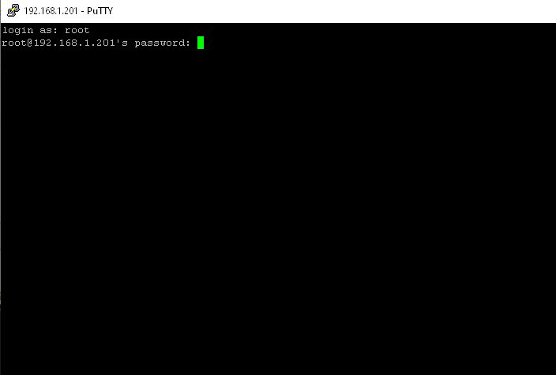
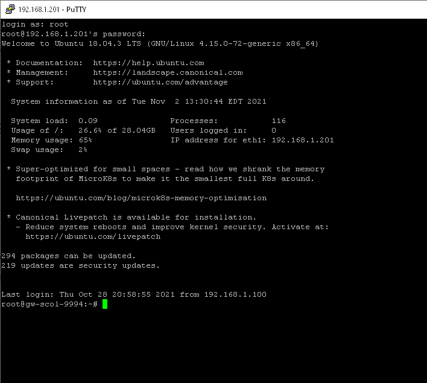

# Linux Session (SSH)

If you have a MINI gateway, the operating system is Linux and you can open a session on your gateway in 2 ways:

- Connect a monitor to the HDMI port and a keyboard to one of the USB ports to log in directly on the gateway.

- Use an SSH utility (for example, the PuTTY software) when the gateway is connected to your computer network.

## 📘 Instructions

To open a session on your MINI gateway with PuTTY, follow these instructions:

1.  Download and install PuTTY on your Windows PC. PuTTY is available at the following link: <https://www.chiark.greenend.org.uk/~sgtatham/putty/latest.html>

2.  Open PuTTY, click "Session", choose SSH, enter the IP address and the port (22) of your gateway and click the Open button:

    { width=502 }

3.  A window opens on your gateway with a prompt for your "Login" (account):

    { width=330 }

4.  Enter the account ***root*** , press Enter, enter the password that was given to you and press Enter:

    { width=330 }

5.  The session is now open on Ubuntu.

    { width=330 }

## Directory Structure on Ubuntu

The directory structure that contains Simplicollect is as follows:

scollect

\|\_\_\_\_\_\_bat ("batch" files)

\|\_\_\_\_\_\_bin (Python applications)

\|\_\_\_\_\_\_data (data files)

\|\_\_\_\_\_\_etc (miscellaneous files)

\|\_\_\_\_\_\_logs (logs other than Django)

\|\_\_\_\_\_\_RESTApps (REST application files on flask)

\|\_\_\_\_\_\_site (Django site)

\|\_\_\_\_\_\_ logs (Django logs)

\|\_\_\_\_\_\_ public (Django public directory)

\|\_\_\_\_\_\_ static (Django static files)

\|\_\_\_\_\_\_ scollect (Django for the SCollect site)

\|\_\_\_\_\_\_venv (virtual environment for Apache)

## 📋 Related articles

- [Modules](../../manuel-d-utilisation/configuration/modules.md)
- [Configuration](../../manuel-d-utilisation/configuration/index.md)
- [Tags](../../manuel-d-utilisation/configuration/tags.md)
- [SIM Replacement on MaestrEau](../module-maestreau-et-irrigation/remplacement-sim-sur-maestreau.md)
- [Wi-Fi Connection and IP Address Configuration](../module-maestreau-et-irrigation/configuration-de-la-connexion-wifi-et-de-l-adresse-ip.md)
