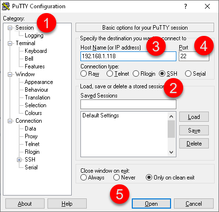

# Session Linux (SSH)

Si vous avez une passerelle MINI, le système d’exploitation est Linux et vous pouvez ouvrir une sessions sur votre passerelle à partir de 2 moyens:

- Branchez un écran sur le port HDMI et un clavier sur un des ports USB pour ouvrir une session directement sur la passerelle.

- Utiliser l’utilitaire de SSH ( par exemple le logiciel PuTTY”) lorsque la passerelle est connectée sur votre réseau informatique.

## 📘 Instructions

Pour ouvrir une session sur votre passerelle MINI avec PuTTY, suivre les instructions suivantes:

1.  Télécharger et installer PuTTY sur votre PC Windows. PuTTY est disponible au lien suivant: <https://www.chiark.greenend.org.uk/~sgtatham/putty/latest.html>

2.  Ouvrir PuTTY, cliquez sur “Session”, choisir SSH, saisir l’adresse IP ainsi que le port (22) de votre passerelle et cliquez sur le bouton Open:

    { width=502 }

3.  Une fenêtre s’ouvre sur votre passerelle avec une demande pour votre “Login” (compte):

    { width=330 }

4.  Entrer le compte ***root*** , pressez Enter, entrez le mot de passe qui vous a été donné et pressez Enter:

    { width=330 }

5.  La session est maintenant ouverte sur Ubuntu.

    { width=330 }

## Structure des répertoire sur Ubuntu

La structure des répertoires qui contient Simplicollect est la suivante:

scollect

\|\_\_\_\_\_\_bat (fichiers de "batch")

\|\_\_\_\_\_\_bin (applications Python)

\|\_\_\_\_\_\_data (fichier de données)

\|\_\_\_\_\_\_etc (fichiiers divers)

\|\_\_\_\_\_\_logs (journaux autres que Django)

\|\_\_\_\_\_\_RESTApps (fichiers d'applications REST sur flask)

\|\_\_\_\_\_\_site (site Django)

\|\_\_\_\_\_\_ logs (journaux Django)

\|\_\_\_\_\_\_ public (répertoire public Django)

\|\_\_\_\_\_\_ static (fichiers static Django)

\|\_\_\_\_\_\_ scollect (Django pour le site SCollect)

\|\_\_\_\_\_\_venv (environnement virtuel pour Apache)

## 📋 Articles connexes

- [Modules](../../manuel-d-utilisation/configuration/modules.md)
- [Configuration](../../manuel-d-utilisation/configuration/index.md)
- [Tags](../../manuel-d-utilisation/configuration/tags.md)
- [Remplacement SIM sur MaestrEau](../module-maestreau-et-irrigation/remplacement-sim-sur-maestreau.md)
- [Configuration de la connexion Wifi et de l'adresse IP](../module-maestreau-et-irrigation/configuration-de-la-connexion-wifi-et-de-l-adresse-ip.md)
