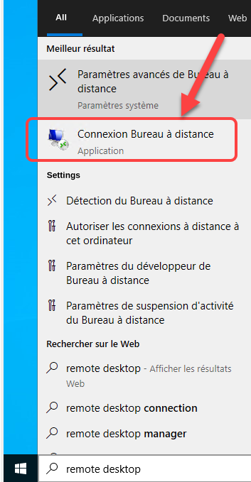
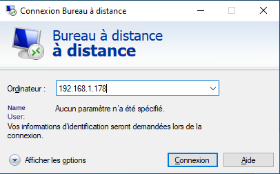
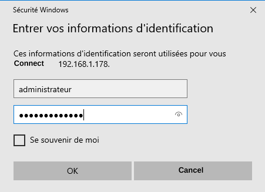
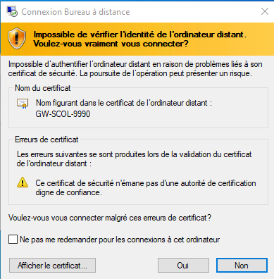
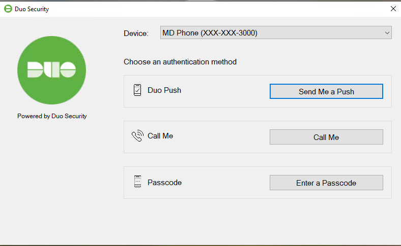

# Windows 10 Session

The PRO and PLUS gateways use Windows 10 as their operating system. If you have a MINI gateway, the operating system is Linux and this article does not apply.

You can open a session on your gateway in 2 ways:

- Connect a monitor to the HDMI port and a keyboard to one of the USB ports to log in directly on the gateway.

- Use the Windows remote session utility ("Remote Desktop") when the gateway is connected to your computer network.

## 📘 Using Windows Remote Desktop

On a Windows PC, follow these instructions:

1.  In Windows, click the "magnifying glass" located next to the Windows icon at the bottom left of the screen.

2.  Type *remote desktop* in the search field and the application icon will appear at the top of the list.

    { width=102 }

3.  Click the application icon.

4.  In the application, enter the IP address of your gateway, for example 192.168.1.178 in this example:

    { width=149 }

5.  Enter the account and password that were provided to you and click OK.

    { width=149 }

6.  The application will ask you to confirm the connection. Click Yes.

    { width=432 }

7.  Your Windows session will then be open.

## Removing DUO Protection

DUO is 2FA software that protects access to the gateway. If the DUO protection has not yet been removed from your gateway, you can bypass it in order to "uninstall" DUO.

{ width=170 }

1.  Connect a monitor to the HDMI port and a keyboard to one of the USB ports to log in directly on the gateway.

2.  Make sure to unplug the Ethernet network cable from your gateway in order to cut the connection to the Internet.

3.  Log in to the gateway with the account and password that were given to you.

4.  Open the Control Panel in Windows 10 and uninstall DUO:

    { width=272 }

5.  Reconnect the Ethernet network cable to your gateway.

6.  Reboot the gateway and make sure DUO is no longer loaded.

## 📋 Related articles

- [Modules](../../manuel-d-utilisation/configuration/modules.md)
- [Configuration](../../manuel-d-utilisation/configuration/index.md)
- [Tags](../../manuel-d-utilisation/configuration/tags.md)
- [SIM Replacement on MaestrEau](../module-maestreau-et-irrigation/remplacement-sim-sur-maestreau.md)
- [Wi-Fi Connection and IP Address Configuration](../module-maestreau-et-irrigation/configuration-de-la-connexion-wifi-et-de-l-adresse-ip.md)
