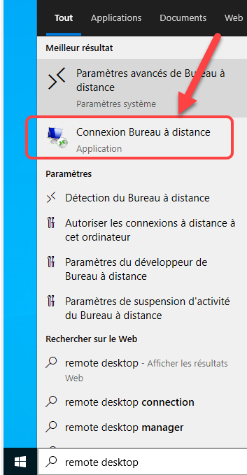
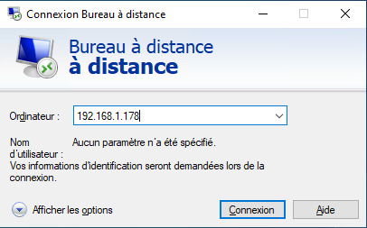
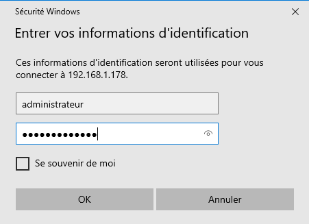
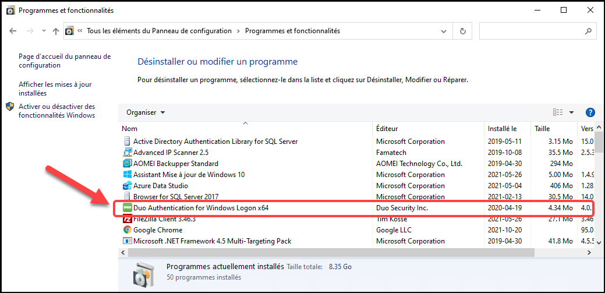

# Session Windows 10

Les passerelles PRO et PLUS utilisent Windows 10 comme système d’exploitation. Si vous avez une passerelle MINI, le système d’exploitation est Linux et le présent article ne s’applique pas.

Vous pouvez ouvrir une sessions sur votre passerelle à partir de 2 moyens:

- Branchez un écran sur le port HDMI et un clavier sur un des ports USB pour ouvrir une session directement sur la passerelle.

- Utiliser l’utilitaire de session distante de Windows (“Remote Desktop”) lorsque la passerelle est connectée sur votre réseau informatique.

## 📘 Utilisation de Windows Remote Desktop

Sur un PC avec Windows, suivez les instructions suivantes:

1.  Sur Windows, cliquez sur le “loupe” située à coté de l’icone WIndows en bas à gauche de l'écran.

2.  Tapez *remote desktop* dans le champ de recherche et l’icone de l’application apparaitra en tête de la liste.

    { width=102 }

3.  Cliquez sur l’icône de l’application.

4.  Sur l’applicatrion, entrez l’adresse IP de votre passerelle, par exemple 192.168.1.178 dans le cas de cet exemple:

    { width=149 }

5.  Entrez le compte et le mot de passe qui vous ont été fournis et cliquez sur OK.

    { width=149 }

6.  L’application va vous demander de confirmer la connexion. Cliquez sur Oui.

    { width=432 }

7.  Votre session Windows sera alors ouverte.

## Retirer la protection par DUO

DUO est un logiciel de 2FA qui permet de protéger les accès à la passerelle. Si jamais la protection DUO n’a pas encore été retirée de votre passerelle, vous pouvez outrepasser cette protection afin de “désinstaller” DUO.

{ width=170 }

1.  Branchez un écran sur le port HDMI et un clavier sur un des ports USB pour ouvrir une session directement sur la passerelle.

2.  Assurez-vous de débrancher le câble de réseau Ethernet de votre passerelle afin de couper la connexion vers Internet.

3.  Ouvrez une session sur la passerelle avec le compte et le mot de passe qui vous ont été donnés.

4.  Ouvrez le panneau de configuration sur Windows 10 et désinstaller DUO:

    { width=272 }

5.  Reconnecter le câble de réseau Ethernet sur votre passerelle.

6.  Rebootez la passerelle et assurez-vous que DUO n’est plus chargée.

## 📋 Articles connexes

- [Modules](../../manuel-d-utilisation/configuration/modules.md)
- [Configuration](../../manuel-d-utilisation/configuration/index.md)
- [Tags](../../manuel-d-utilisation/configuration/tags.md)
- [Remplacement SIM sur MaestrEau](../module-maestreau-et-irrigation/remplacement-sim-sur-maestreau.md)
- [Configuration de la connexion Wifi et de l'adresse IP](../module-maestreau-et-irrigation/configuration-de-la-connexion-wifi-et-de-l-adresse-ip.md)
