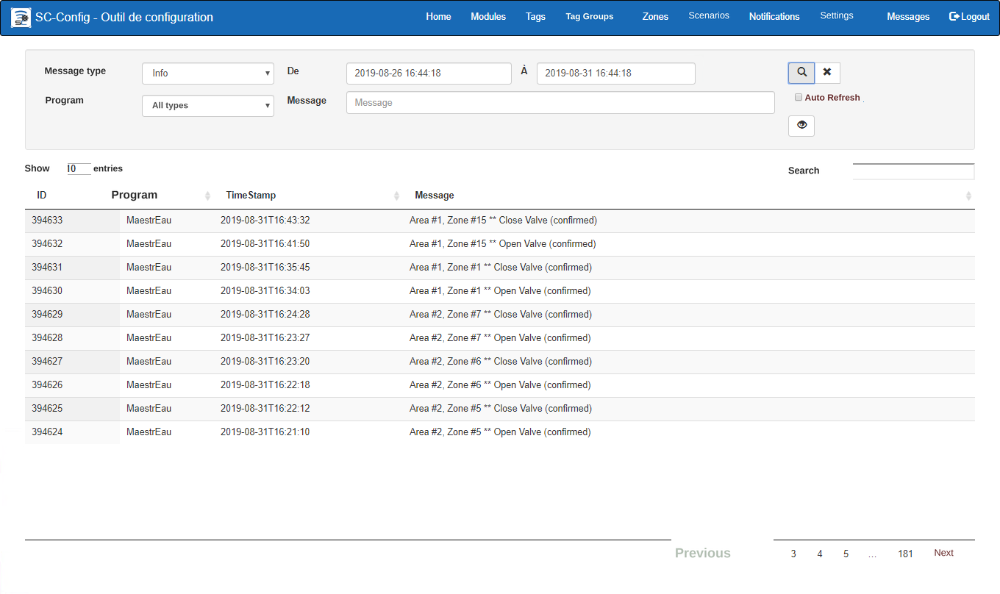
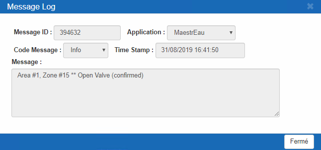

# Messages

All actions and events in SimpliCollect are recorded in a message log.  The display lets you search the messages recorded in the SimpliCollect log. { width=1024 } There are 3 types of messages in SimpliCollect:

- Information:  For example, the control actions of the MaestrEau system;
- Errors:  Contains the error messages issued by the system;
- Warnings:  Contains the warning messages issued by the system;

## Step-by-step guide

The message search functions are as follows:

## Navigation

The various fields of the display let you search the message log using search criteria.

1.  Message type:  Choose the message type from a drop-down list (i.e. Info, Error, Warning);

2.  Program:  You can choose which program recorded the message in the log;

    !!! info

        The different programs are Calculator, DataCollect, MaestrEau, Notification, RESTEngine and Watchdog. To search the messages of all programs, enter a \* in this field.

3.  Date range:  You can choose the range of dates between which the message was recorded;

4.  Message:  You can search by "*wild card*" in the message text.  Use the \* as the wild card for a search;

    !!! info

        For example, to get all the messages that mention Zone \#1, enter **\***Zone \#1\***** in the Message field

5.  Once the search criteria are filled in, click the **Search** button   to run the search in the message log; the results appear in the message table on the screen;

6.  You can also display the whole of a message in a dialog to read its content more easily. Choose the message in the message grid and click the **View** button : { width=800 }

7.  Check the **Auto Refresh** box so that the message list updates every 15 seconds without having to click the Refresh button. { width=200 }
