# Notifications

Notifications alert us when the value of a Tag (i.e. a value that is measured, calculated or obtained from an external system) exceeds specific conditions (e.g. the soil humidity is too low and the soil is too dry…).

For example, you may want to receive an SMS warning if the temperature in a greenhouse exceeds 40 C or if the soil humidity falls below 30%.

To do this, you can create a "Notification" in SimpliCollect that will monitor these values continuously and alert us when needed.

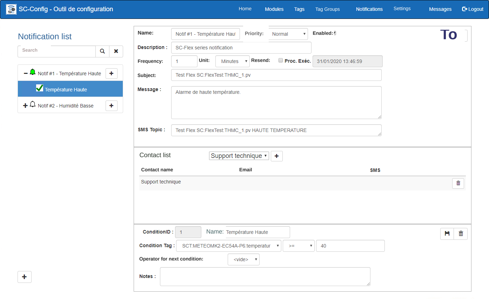{ width=1024 }

## Step-by-step guide

The functions for configuring a notification are as follows:

## Add a notification

1.  Click the **+** button located in the lower left corner of the screen; 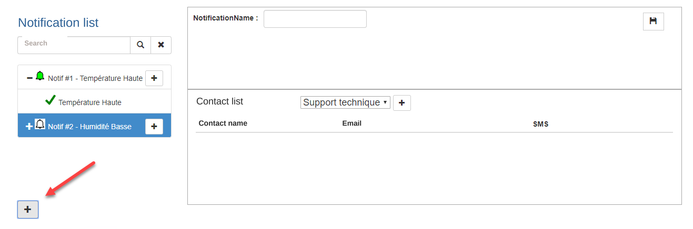{ width=800 }
2.  A new empty screen is displayed;
3.  Enter the name of the notification and click the **Save** button: 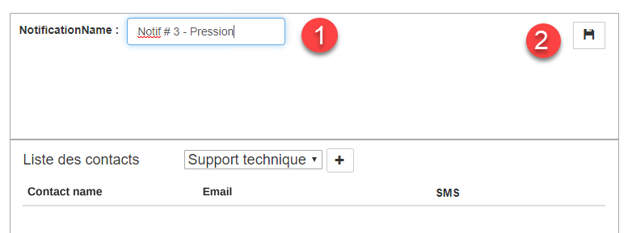{ width=676 }
4.  Once the notification is saved, it is automatically selected and ready for you to enter its parameters; 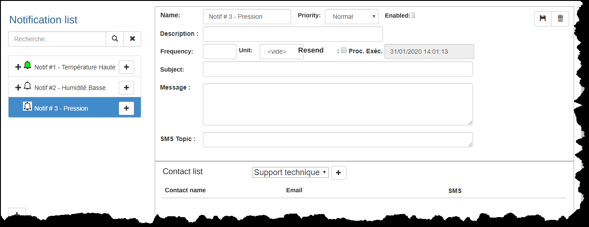{ width=1024 }
5.  The notification parameters include:
    1.  The name and description of the notification;

    2.  The validation frequency and the time units (minute, hour, day)

    3.  The Resend option, which resends a notification at every time interval (frequency) even if the threshold was already exceeded previously;

        !!! info

            For example, if a temperature condition has been exceeded, the notification can be sent **only once** (Resend box unchecked) **or every time the condition is validated** (Resend box checked). If the validation frequency is every minute, the notification is sent to the distribution list every minute for as long as the condition has not returned to normal. If the Resend box is not checked, the notification is sent only once.

6.  Once the parameters are entered, click the **Save** button.

### Add a condition

1.  A notification can contain one or more "conditions" that will be tested by the SimpliCollect monitoring engine.   Click the + button in the list for the new Notification and the Condition screen will display New Condition : 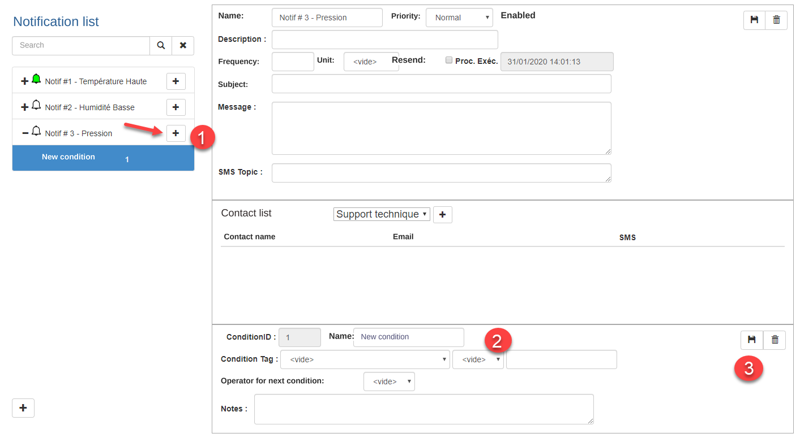{ width=1024 }

2.  Fill in the fields of the latter:

3.  The condition parameters are:
    1.  Condition name;

    2.  The Tag that is the subject of the condition, chosen from the drop-down list (click the arrow);

    3.  The mathematical operator used to compare with the condition value;

        !!! info

            The operators are **greater than or equal** (\>=), **less than or equal** (&lt;=), **greater than** (&gt;), **less than** (\<), **not equal to** (!=) or **equal to** (==).

    4.  The condition value;

    5.  The operator used to "chain" the next condition (OR or AND);

        !!! info

            When the OR operator is used, condition 1 **OR** condition 2 must be met. If the AND operator is chosen, condition 1 **AND** condition 2 must both be met to trigger the notification.

    6.  An explanatory note for the condition (optional);

    7.  You can enter other conditions within the same notification, remembering to choose the chaining operator OR or AND between the conditions. **The last condition has an empty chaining operator**

4.  Once finished, click the **Save** button; 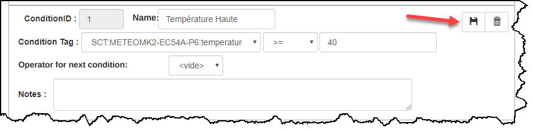 

5.  You can add as many conditions as you want;

    !!! info

        It is sometimes wise not to put too many conditions in the same notification. You can add another notification to cover other conditions for the same location.

### Email or SMS settings

1.  In the email and SMS section, enter the settings of the email and SMS that will be sent to the recipient: 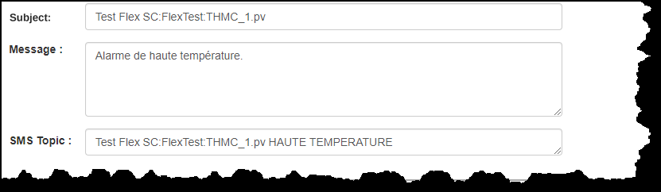 
    1.  Enter the subject of the email that will be sent;
    2.  Enter the message of the email that will be sent.  Note that the value of the Tags and of the conditions will be added to the text of the message;
    3.  Enter the content (*topic*) of the text message (SMS) that will be sent. Here too, the value of the Tags and of the conditions will be added to the text of the message;
2.  Once finished, click the **Save** button of the Notification;

### List of recipients

1.  You can enter the recipients of the notification by choosing the recipient's name from a drop-down list: The list of recipients comes from the Settings section, in which the recipients' names are managed: 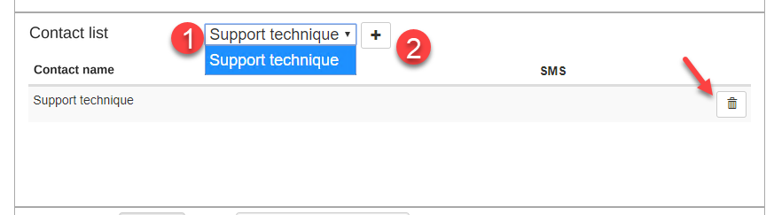{ width=800 } 
    1.  Choose a recipient in the list;
    2.  Click the **+** button next to the list;
2.  You can add as many recipients as desired.  Each recipient receives the notification by email and/or by SMS on a mobile phone;
3.  You can remove a recipient by clicking the **Delete** button on the row of the recipient in question.

### Activate the notification

For the notification to be put into service, it must be made active.

1.  Click the Active checkbox located in the section at the top of the screen: 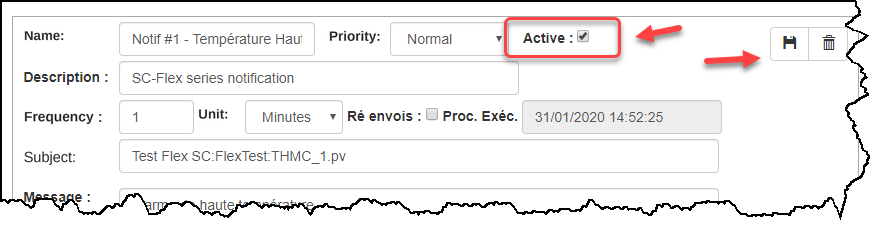
2.  Click the **Save** button to update the display;
3.  You will notice that the notification icon turns green, which indicates that the notification is active: 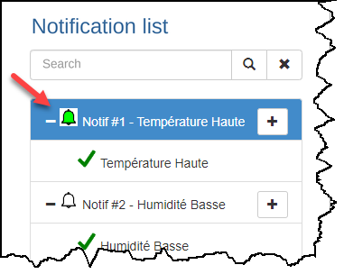

### Email and SMS examples

1.  Each time the notification is sent to a recipient, the email and the SMS look like the example below: **Email**: 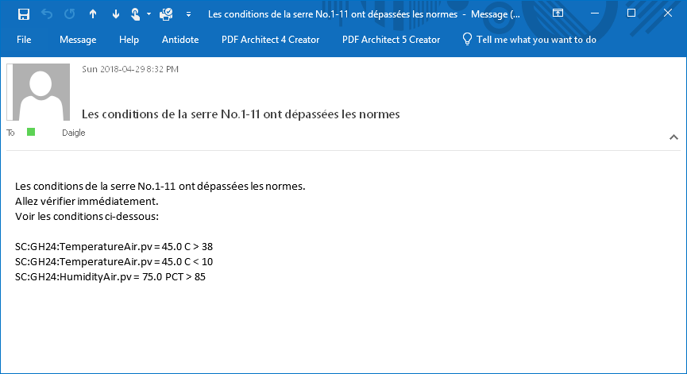{ width=600 } **SMS** 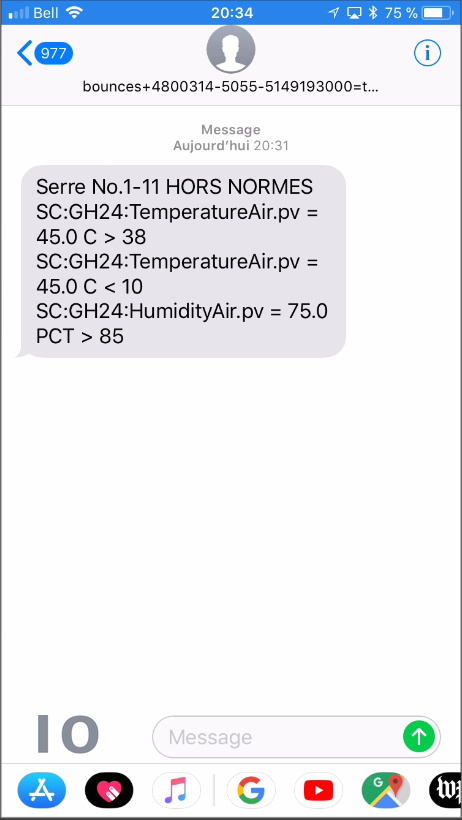{ width=200 }

## Edit a notification

1.  Choose a notification in the window on the left;

2.  In the sections on the right, make the desired changes;

3.  Click the **Save** button in the Notification section to update the display;

4.  To remove a condition, click the **Delete** button on the condition's row: 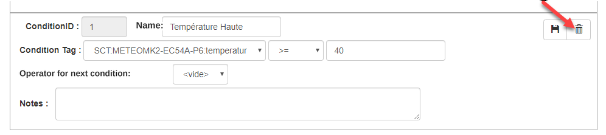{ width=800 }

5.  Confirm the deletion and the Condition will be removed from the Notification;

    !!! info

        Make sure to validate the chaining operators between the conditions, and remember that the **last Condition must have no chaining operator**.

## Delete a notification

1.  Choose a notification in the list on the left;
2.  Click the **Delete** button at the top right of the screen; 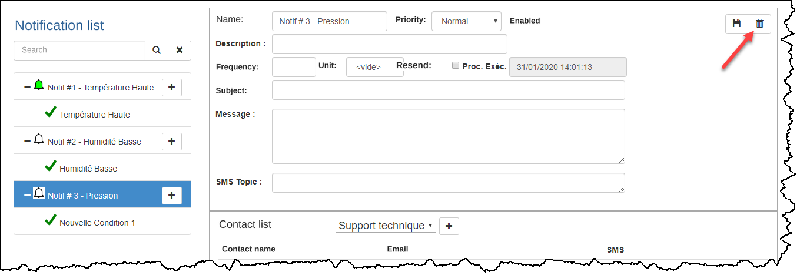{ width=1024 }
3.  A message asks you to confirm the deletion of the Notification;
4.  Click **Confirm** and the Notification is removed from the list.
