# Notifications

Les notifications nous avertissent si la valeur d’un Tag (c.-à-d. une valeur mesurée, calculée ou obtenue d'un système externe) dépasse des conditions spécifiques (ex.: l’humidité du sol est trop basse et ce sol est trop sec…).

Par exemple, on désire recevoir un avertissement par SMS si la température dans une serre dépasse 40 C ou que l'humidité du sol est moins que 30%.

Pour se faire, on peut créer une "Notifcation" dans SimpliCollect qui va surveiller ces valeurs en temps continu et nous alerter le cas échéant.

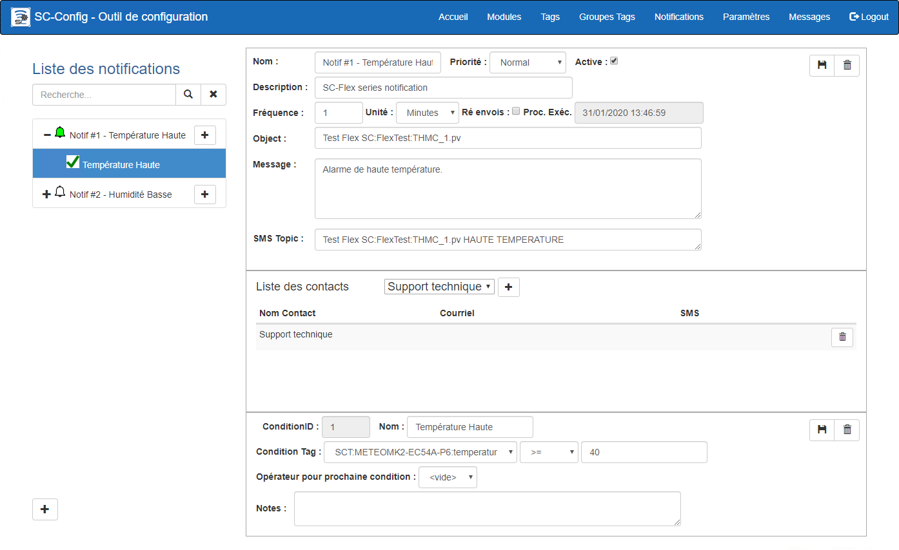{ width=1024 }

## Guide étape par étape

Les fonctions pour la configuration d'une notification sont les suivantes:

## Ajouter une notification

1.  Cliquer le bouton **+** situé dans le coin inférieur gauche de l'écran; 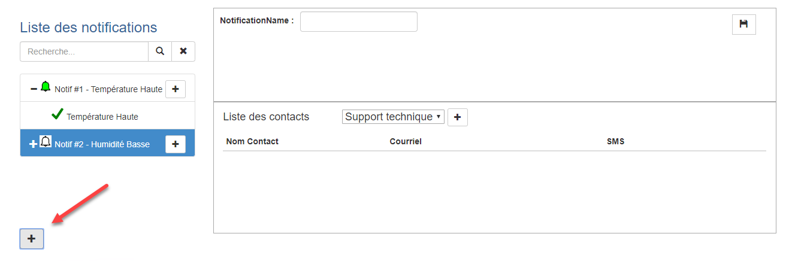{ width=800 }
2.  Un nouvel écran vide est affiché;
3.  Entrer le nom de la nodification et Cliquer sur le bouton **Sauvegarde**: 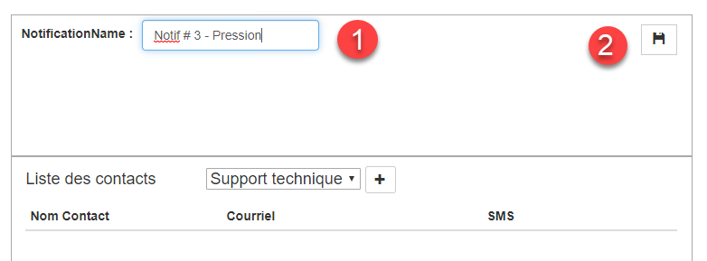{ width=676 }
4.  Une fois la notification sauvegardée, elle sera automatiquement sélectionnée et prêt pour entrer ses paramètres; 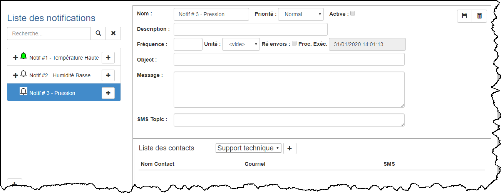{ width=1024 }
5.  Les paramètres de la notification inclus:
    1.  Le nom et la description de la notification;

    2.  La fréquence de validation ainsi que les unités de temps (minute, heure, jour)

    3.  L'option de Réenvoi qui consiste à renvoyer une notification à tous les intervalles de temps (fréquence) même si le dépassement a été activé précédemment;

        !!! info

            Par exemple, si une condition de température a été dépassée, la notification peut être envoyée **une seule fois** (case Réenvoi non cochée) **ou a toutes les fois que la condition est validée** (case Réenvoi cochée). Si la fréquence de validation est toutes les minutes, la notification est envoyée à la liste de distribution toutes les minutes tant que la condition n'est pas de retour à la normale. Si la case Réenvoi n'est pas cochée, la notification est envoyée une seule fois.

6.  Une fois les paramètres entrés, cliquer sur le bouton **Sauvegarder**.

### Ajouter une condition

1.  Une notification peut contenir une ou plusieurs "conditions" qui seront testées par l'engin de surveillance SimpliCollect.   Faire un clique sur le bouton + dans la liste pour la nouvelle Notification et l'écran de Condition afficheras Nouvelle Condition : 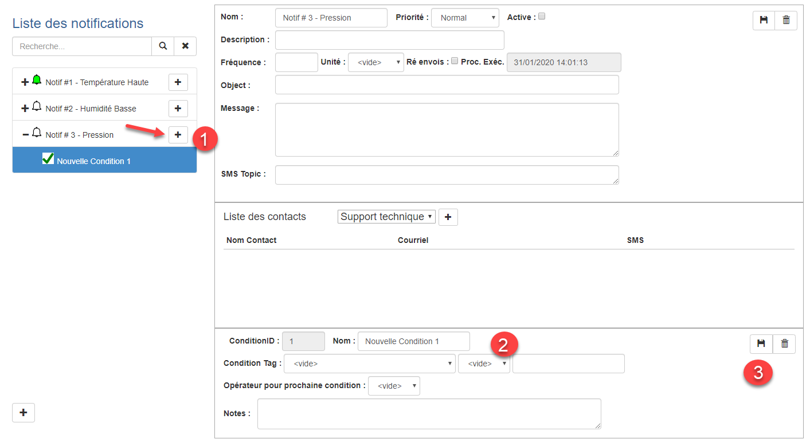{ width=1024 }

2.  Remplir les champs de cette dernière:

3.  Les paramètres de la condition sont:
    1.  Nom de la condition;

    2.  Le Tag qui fait l'objet de la condition qui est choisi dans la liste déroulante (cliquer sur la flèche);

    3.  L'opérateur mathématique qui permet la comparaison avec la valeur de la condition;

        !!! info

            Les opérateurs sont **plus grand ou égal** (\>=), **plus petit ou égale** (&lt;=), **plus grand** (&gt;), **plus petit** (\<), **différent que** (!=) ou **égale à** (==).

    4.  La valeur de la condition;

    5.  L'opérateur pour "chainer" la prochaine condition (OR ou AND);

        !!! info

            Lorsqu'on utilise l'opérateur OR, la condition 1 **OU** la condition 2 doit être remplie. Si l'opérateur AND est choisi, la condition 1 **ET** la condition 2 doivent être remplies pour déclencher la notification.

    6.  Une note explicative pour la condition (optionnel);

    7.  On peut entrer d'autres conditions au sein de la même notification en n'oubliant pas de choisir l'opérateur de chainage OR ou AND entre les conditions. **La dernière condition contient un opérateur de chainage vide**

4.  Une fois terminé, cliquer sur le bouton **Sauvegarder**; 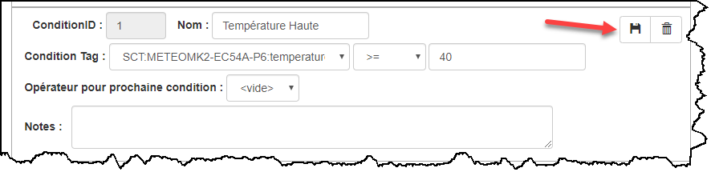 

5.  On peut ajouter autant de conditions que voulu;

    !!! info

        Il est parfois judicieux de ne pas mettre trop de conditions dans une même notification. On peut ajouter une autre notification pour couvrir d'autres conditions pour le même endroit.

### Paramètres de courriel ou de SMS

1.  Dans la section courriel et SMS, entrer les paramètres du courriel et du SMS qui sera envoyé au destinataire: 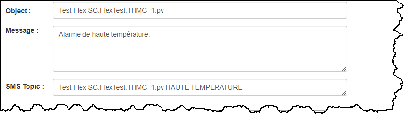 
    1.  Entrer le sujet du courriel qui sera envoyé;
    2.  Entrer le message du courriel qui sera envoyé.  Il est à noter que la valeur des Tags et des conditions seront ajoutés au texte du message;
    3.  Entrer le contenu (*topic*) du message texte (SMS) qui sera envoyé. Ici aussi,  la valeur des Tags et des conditions seront ajoutés au texte du message;
2.  Une fois terminé. cliquer sur le bouton **Sauvegarder** de la Notification;

### Liste des destinataires

1.  On peut entrer les destinataires de la notification en choisissant le nom du destinataire dans une liste déroulante: La liste des destinataires provient de la section Paramètres dans laquelle les noms des destinataires sont gérés: 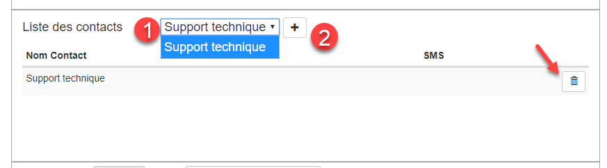{ width=800 } 
    1.  Choisir un destinataire dans la liste;
    2.  Cliquer sur le bouton **+** à côté de la liste;
2.  On peut ajouter autant de destinataires que désiré.  Chaque destinataire reçoit la notification par courriel et/ou par SMS sur un téléphone portable;
3.  On peut retirer un destinataire en cliquant sur le bouton **Effacer** sur la ligne du destinataire en question.

### Activation de la notification

Pour que la notification soit mise en service, il faut mettre cette en activité.

1.  Cliquer sur la case Actif située dans la section en haut de l'écran: 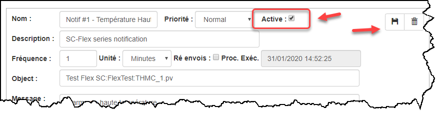
2.  Cliquer sur le bouton **Sauvegarder** pour mettre à jour l'affichage;
3.  On remarquera que l'icône de la notification change de couleur pour le vert qui indique que la notification est active: 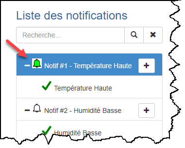

### Exemples de courriel et de SMS

1.  À chaque fois que la notification est expédiée à un destinataire, le courriel et le SMS ressemblent à l'exemple ci-dessous: **Courriel**: { width=600 } **SMS** 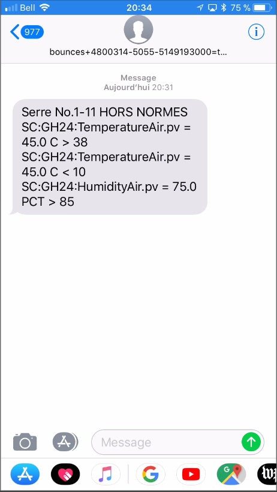{ width=200 }

## Éditer une notification

1.  Choisir une notification dans la fenêtre de gauche;

2.  Dans les sections de droite, apporter les modifications voulues;

3.  Cliquer sur le bouton **Sauvegarder** dans la section Notification pour mettre à jour l'affichage;

4.  Pour retirer une condition, cliquer sur le bouton **Effacer** sur la ligne de la condition: 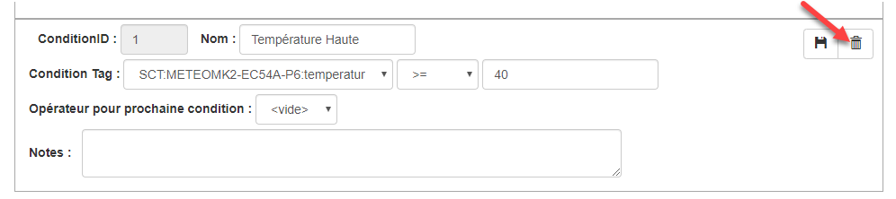{ width=800 }

5.  Confirmer l'effacement et la Condition sera retirer de la Notifications;

    !!! info

        Assurez-vous de bien valider les opérateurs de chainage entre les conditions et souvenez-vous que la **dernière Condition doit n'avoir aucun opérateur de chainage**.

## Effacer une notification

1.  Choisir une notification dans la liste de gauche;
2.  Cliquer sur le bouton **Effacer** supérieur droite de l'écran; 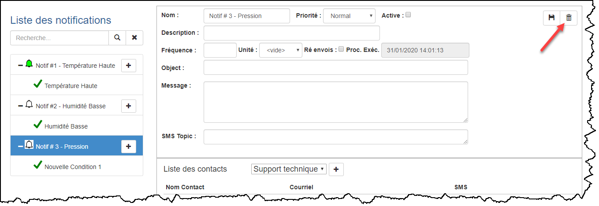{ width=1024 }
3.  Un message demande de confirmer l'effacement de la Notification;
4.  Cliquer sur **Confirmer** et la Notification sera retirée de la liste.
