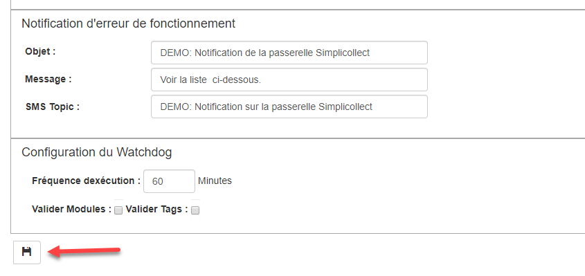
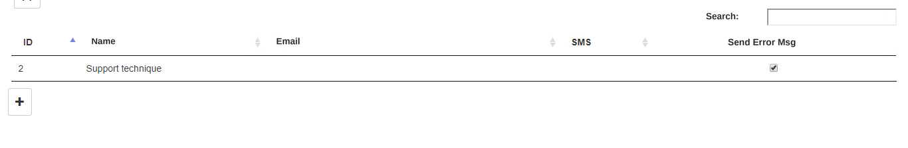
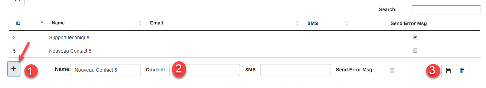

# Settings

The main purpose of this screen is to configure the communication settings and the system monitoring application (i.e. SC-Watchdog).

{ width=1024 }

## Step-by-step guide

The functions for configuring the communication settings are as follows:

## Email configuration

These fields contain the email sending settings.

1.  Email from:  The sender's email address.  Use an address that really exists, because some servers may reject the emails sent;

2.  SMTP Server:  The SMTP mail server that relays the emails sent;

    !!! info

        SimpliCollect offers free use of its SMTP server on the SendGrid platform. Please leave the SMTP User and SMTP Password settings unchanged. If you change them, access to the SMTP server will be compromised.

3.  SMTP Port:  The SMTP communication port;

4.  SMTP User:  The name of the SMTP user account;

5.  SMTP Password:  The password of the SMTP user;

6.  The Test Email button lets you test that the SMTP relay works by sending an email to the account(s) that receive the error messages (see the list of recipients section below);

## System operating error notifications

This section lets you configure the error notification utility (SC-Watchdog).  This function monitors system errors and sends an email to the recipients who are marked to receive error messages. In addition, the Watchdog function monitors communication with the SimpliCollect modules and sends an email when communication is lost with one or more modules. { width=800 }

1.  Subject:  Subject of the error message email sent by the Watchdog;

2.  Content:  Body of the error message email sent by the Watchdog;

3.  SMS Topic:  Text of the SMS text message;

4.  Execution frequency:  Frequency, in minutes, for monitoring the SimpliCollect Modules and Tags;

5.  Validate Modules:  Option for monitoring the Modules;

    !!! info

        You may want to stop monitoring the Modules if they are on the 3G cellular network or if no measurement module is installed in your SimpliCollect system.

6.  Validate Tags:  Option for monitoring the Tags.

    !!! info

         This monitoring consists of watching the value of the Tags... If a value has not been updated since the last Watchdog scan, an email is sent.

## List of recipients

The list of recipients contains all the possible recipients for sending notification emails or for sending Watchdog emails.

{ width=1024 }

1.  To enter a new recipient, click the **+** button; { width=1024 }

2.  Enter the recipient's email address.  **If the recipient does not want to receive messages by email, leave this field empty**;

3.  Enter the email address used to receive notifications or messages by SMS.  **If the recipient does not want to receive messages by SMS, leave this field empty**;

    !!! info

        Most cell phone companies allow SMS transmission through an email address. The format is generally *phonenumber@company.ca.* The list below shows the companies operating in Quebec:

        **Bell Mobility and Solo Mobile** <XXXXXXXXXX@txt.bell.ca>

        **Fido** <XXXXXXXXXX@fido.ca>

        **Koodo Mobile** <XXXXXXXXXX@msg.koodomobile.com>

        **Rogers** <XXXXXXXXXX@pcs.rogers.com>

        **TELUS Mobility** <XXXXXXXXXX@msg.telus.com>

        **Virgin Mobile** <XXXXXXXXXX@vmobile.ca>

4.  Check the Send Error Msg box if the recipient wants to receive the Watchdog emails;

5.  Once finished, click the Save button and the list of recipients will be refreshed.

## Remove a recipient

1.  To remove a recipient, select them in the list;
2.  Then click the **Delete** button (trash can) that appears in the recipient's edit section.
3.  A message will be displayed to confirm the deletion; click **Confirm** or **Close**.
4.  Confirm will delete the recipient.
5.  Close will cancel the deletion.
