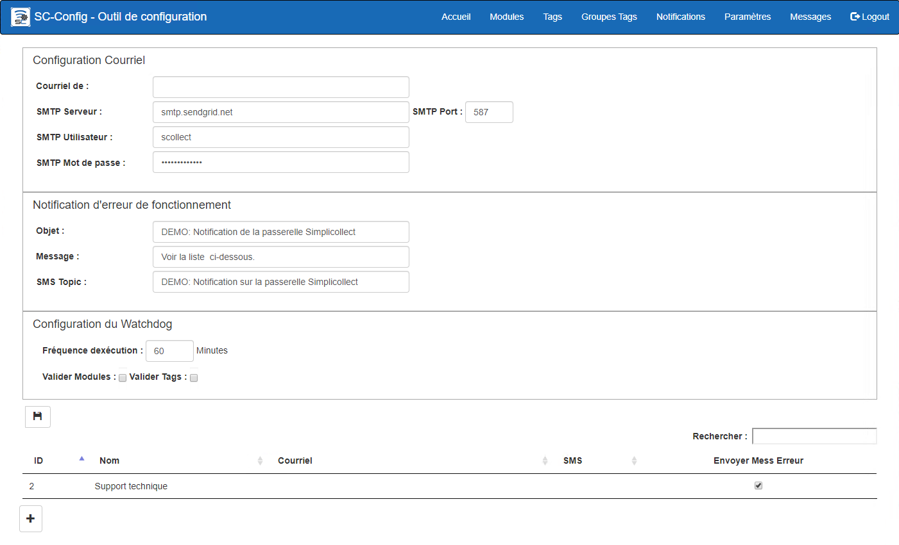
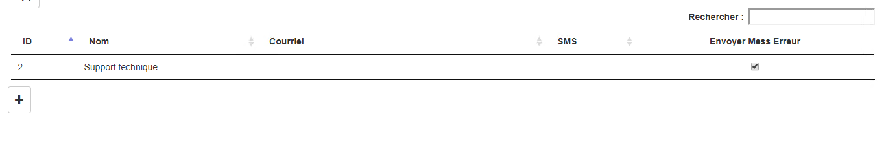
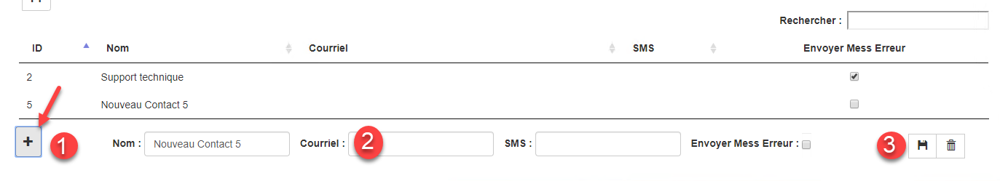

# Paramètres

Le but de l'écran est principalement de configurer les paramètres de communication ainsi que l'application de surveillance du système (c.-à-d. SC-Watchdog).

{ width=1024 }

## Guide étape par étape

Les fonctions pour la configuration des paramètres de communication sont les suivantes:

## Configuration courriel

Ces champs contiennent les paramètres d'envois de courriel.

1.  Courriel de:  L'adresse courriel de l'expéditeur.  Mettre une adresse qui existe réellement, car il se peut que certains serveurs rejettent les courriels envoyés;

2.  SMTP Serveur:  Serveur de courriel SMTP qui relai les courriels envoyés;

    !!! info

        SimpliCollect offre gratuitement l'utilisation de son serveur SMTP sur la plateforme SendGrid. Veuillez conserver les paramètres SMTP Utilisateur et SMTP Mot de passe intacte. Si vous les changez, l'accès au serveur SMTP sera compromis.

3.  SMTP Port:  Port de communication SMTP;

4.  SMTP Utilisateur:  Nom du compte utilisateur SMTP;

5.  SMTP Mot de passe:  Mot de passer de l'utilisateur SMTP;

6.  Le bouton Test Courriel permet de tester que le relais SMTP fonctionne par l'envoi d'un courriel au(x) compte(s) qui reçoit les messages d'erreur (voir la section liste des destinataires ci-dessous);

## Notifications des erreurs de fonctionnement

Cette section permet de configurer l'utilitaire de notifications des erreurs (SC-Watchdog).  Cette fonction surveille les erreurs de système et envoi un courriel aux destinataires qui sont marqués pour recevoir les messages d'erreur. De plus, la fonction Watchdog surveille la communication avec les modules SimpliCollect et envois un courriel lorsque la communication est compromise avec un ou plusieurs modules. { width=800 }

1.  Objet:  Sujet du courriel des messages d'erreur envoyé par le Watchdog;

2.  Contenu:  Message du courriel des messages d'erreur envoyé par le Watchdog;

3.  SMS Topic:  Message du message texte SMS;

4.  Fréquence d'exécution:  Fréquence en minutes pour la surveillance des Modules et des Tags SimpliCollect;

5.  Valider Modules:  Option pour la surveillance des Modules;

    !!! info

        On peut vouloir cesser la surveillance des Modules si ces derniers sont sur le réseau cellulaire 3G ou qu'aucun module de mesure n’est installé dans votre système SimpliCollect.

6.  Valider Tags:  Option pour la surveillance des Tags.

    !!! info

         Cette surveillance consiste à surveiller la valeur des Tags... Si une valeur n'a pas été mise à jour depuis le dernier balayage du Watchdog, alors un courriel est envoyé.

## Liste des destinataires

La liste des destinataires contient tous les destinataires possibles pour l'envoi de courriels de notifications ou pour l'envoi des courriels du Watchdog.

{ width=1024 }

1.  Pour entrer un nouveau destinataire, cliquer sur le bouton **+**; { width=1024 }

2.  Entrer l'adresse courriel du destinataire.  **Si le destinataire ne veut pas recevoir les messages par courriel, laisser ce champ vide**;

3.  Entrer l'adresse de courriel pour recevoir les notification ou message par SMS.  **Si le destinataire ne veut pas recevoir les messages par SMS, laisser ce champ vide**;

    !!! info

        La plupart des compagnies de cellulaire permettent la transmission de SMS via une adresse courriel. Le format est généralement, le format est *no <téléphone@compagnie.ca.>* La liste ci-dessous représente les compagnies en fonction au Québec:

        **Bell Mobilité et Solo Mobile** <XXXXXXXXXX@txt.bell.ca>

        **Fido** <XXXXXXXXXX@fido.ca>

        **Koodo Mobile** <XXXXXXXXXX@msg.koodomobile.com>

        **Rogers** <XXXXXXXXXX@pcs.rogers.com>

        **TELUS Mobilité** <XXXXXXXXXX@msg.telus.com>

        **Virgin Mobile** <XXXXXXXXXX@vmobile.ca>

4.  Coché la case Envoyer Mess Erreur si le dernataire désire recevoir les courriels du Watchdog;

5.  Une fois terminé, cliquer sur le bouton Sauvegarder et la liste des destinataires seras rafraîchie.

## Retirer un destinataire

1.  Pour retirer un destinataire, selectionnez le dans la liste;
2.  Ensuite cliquer sur le bouton **Effacer** (poubelle) qui apparaît dans la section d'édition du destinataire.
3.  Un message seras affiché pour confirmer l'effacement, cliquer sur **Confirmer** ou **Fermer**.
4.  Confirmer effaceras le destinataire.
5.  Fermer annuleras l'effacement.
