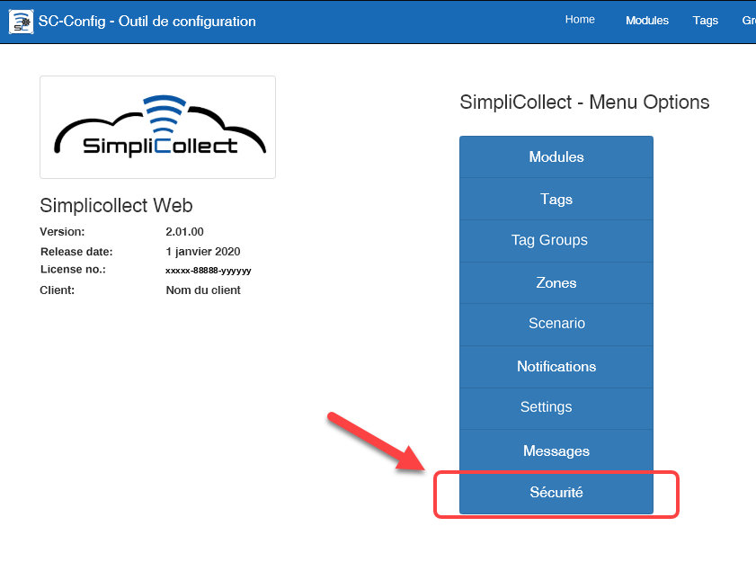
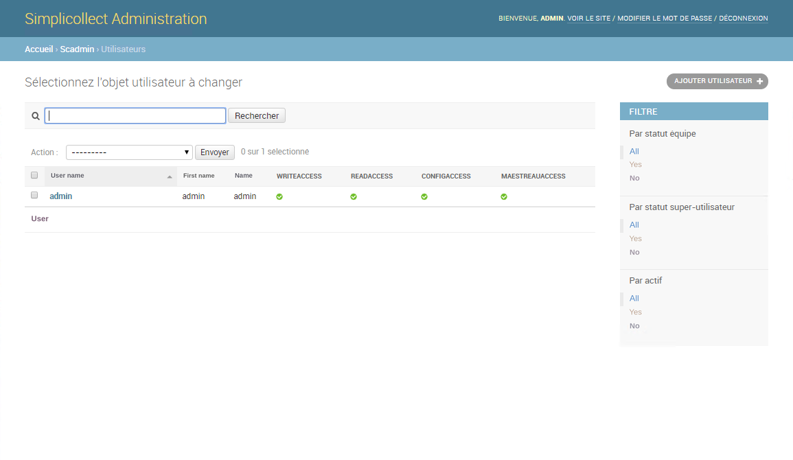
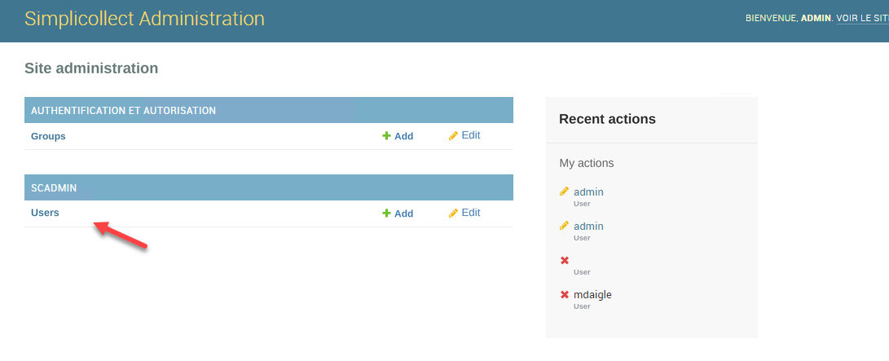
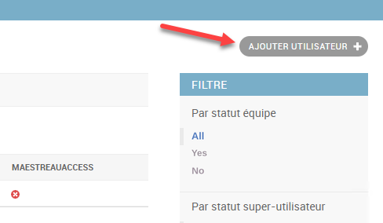
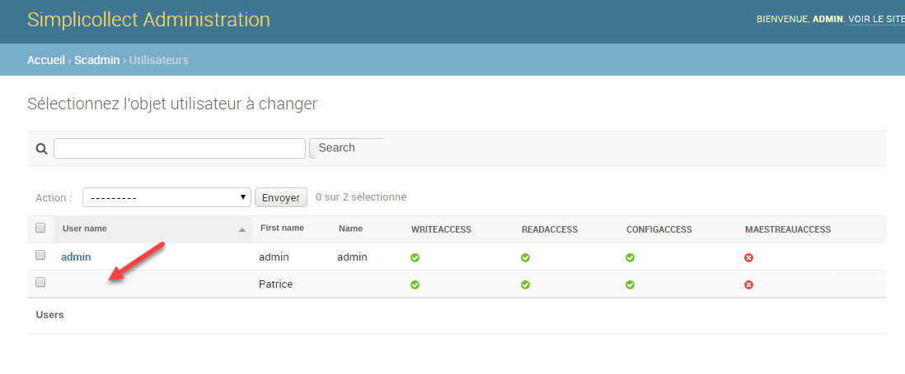
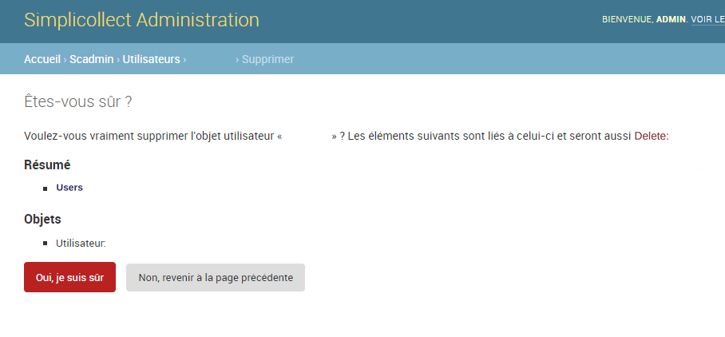

# Security

To access the function, click the Security button on the home page of the Configuration section. { width=600 }

Using SimpliCollect requires an account and a password in order to secure the use of the application.

{ width=850 }

## Step-by-step guide

The functions for configuring security are as follows:

## Navigation

1.  From the SimpliCollect main menu, click Security;
2.  Then click Users; the user management interface will appear; { width=800 }

## Create a user account

1.  Click the **Add User +** button; { width=500 }
2.  Enter the user's first name and last name; { width=1024 }
3.  Enter the user name (no French characters);
4.  Enter the password and its confirmation;
5.  Adjust the accesses that the user will have rights to;
6.  Save the new user by clicking the **Save** button.

## Deactivate a user account

You can deactivate a user's account so that they can no longer access the system, without destroying their account.

1.  Choose the user account in the list at the top of the display; { width=603 }
2.  Uncheck the Active box in the user's parameters; { width=500 }
3.  Click the **Save** button.

## Delete a user account

You can delete a user account completely.

1.  Choose the user account in the list at the top of the display;
2.  Click the **Delete** button and click Yes at the confirmation message;  { width=800 }
3.  The user will be completely removed from the system.
