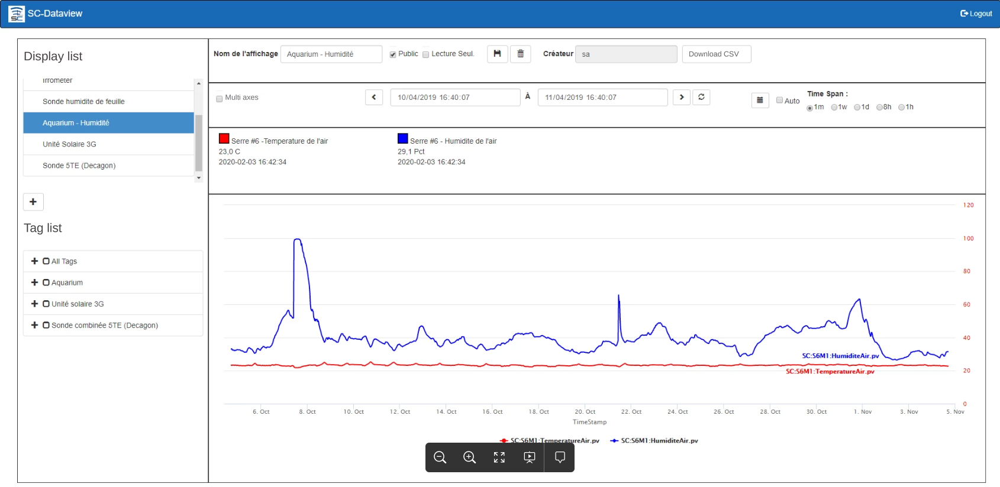
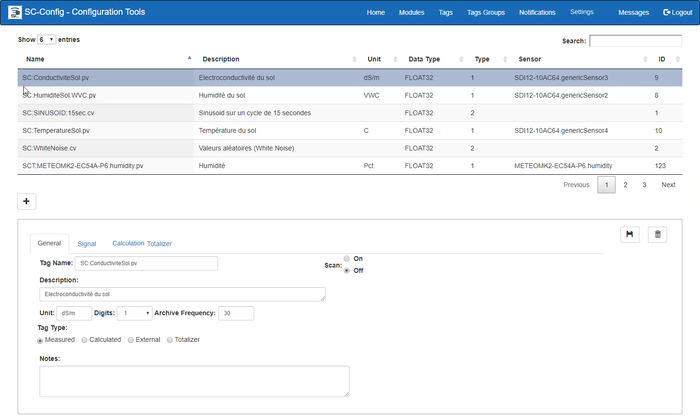
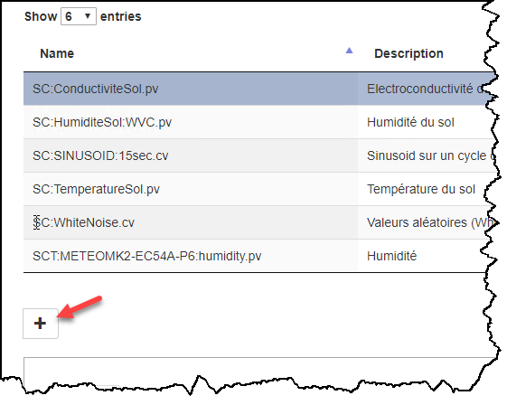
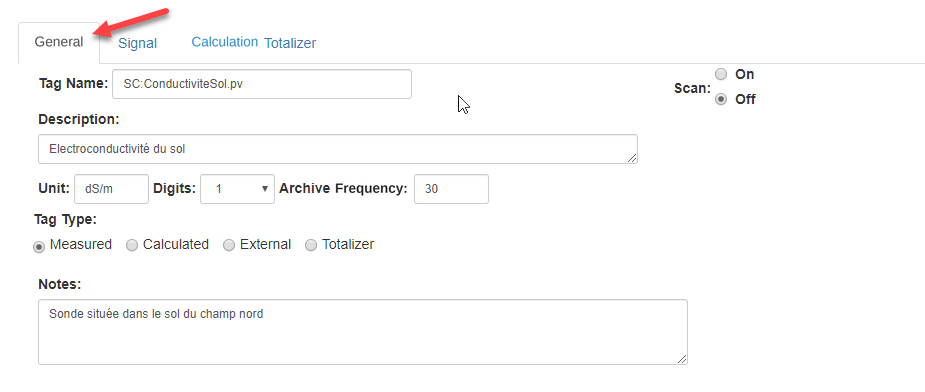
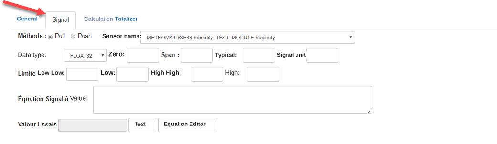
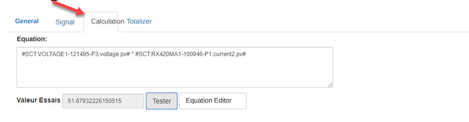
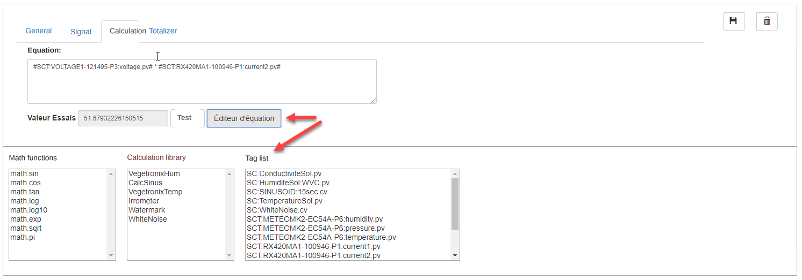
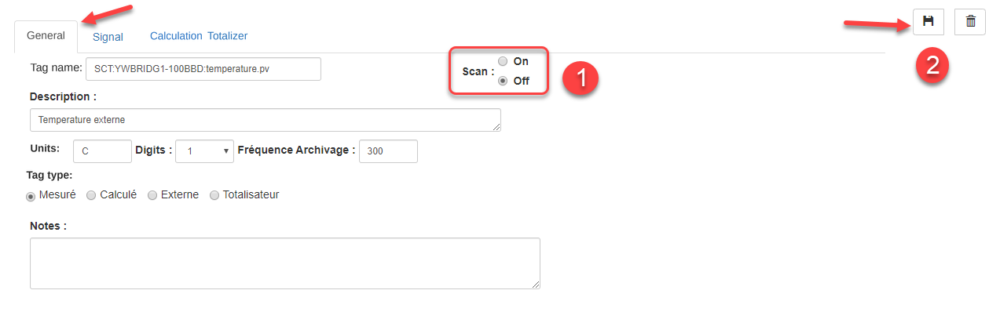
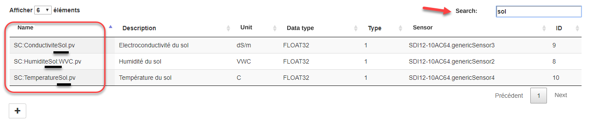

# Tags

The Tag is the entity that holds all the data collected by Simplicollect and forms data series (*time series*).  Each tag has an identifier (or name) that tells you which data it contains.  The data of a tag is collected at a frequency set by the administrator, and a value is sampled into the database at that frequency for a period that can span several consecutive years.  The data of a tag can be viewed from the [SC-Dataview](../dataview/dataview-sur-web.md) application, where it is shown as curves over a given time range.

{ width=1024 }

There are 3 types of Tag:

- **Measured** by a sensor through a Simplicollect module
- **Calculated** from other tags and linked by a formula or a program (Python language)
- **External**, coming from another data source (e.g. the Environment Canada weather site)
- **Totalizer**:  Computes the daily, monthly or yearly total of a tag (e.g. a water meter based on a water flow meter tag)

The data collected is used for several purposes:

- Values used for control (e.g. MaestrEau)
- To follow up on operations
- For analysis
- To feed various alarms and notifications

To access the configuration, click the Tag tab, which shows the list of the system's tags and their configuration fields:

{ width=1024 }

## Step-by-step guide

The functions for configuring a tag are as follows:

## Add a Tag

To add a tag, click the **+** button, which frees up the fields of the display.

{ width=400 }

When all the fields are filled in, click the **Save** button to complete the creation of the tag. 

### Tab: General

{ width=800 }

1.  On the General tab, enter a name for the tag that follows certain naming standards so that the content of the tag can be identified quickly; 
    - The tag name must be unique and should be entered following a naming "convention" such as: ***Prefix:Location code:Description.Suffix*** - Prefix:  Initials of your company

        - Suffix:  Tag type:  PV for measured value

2.  Enter a description and the engineering units;

3.  Enter the number of digits after the decimal point;

4.  Enter the archiving frequency at which the value is saved in the database;

5.  Specify whether the point is **measured**, **calculated** or **external**;

6.  Set whether the point is Scan On or Off, that is, whether or not Simplicollect records the values sent to the Tag;

### Tab: Signal

Lets you configure the signal parameters when the tag is of the type measured from a data collection module.  For some sensors, a voltage signal (e.g. 0-5 V) or a current signal (e.g. 4-20 mA) is read and must be converted into a "physical" value.  An equation is then used to convert the signal into a value, where the signal value is held in the variable SignalVal, which is used in the calculation.

### { width=859 }

1.  Choose the measurement sensor from the drop-down list.  The sensors in this list were configured in the Modules section of the application;

2.  Choose the value type;

3.  Enter the signal parameters:
    - Zero:  the lowest value that can be read
    - Span:  the highest value that can be read
    - Typical:  a value that is typical for this sensor
    - Signal unit:  for example, a signal in mA that is converted to a physical value

4.  Enter the equation that transforms the signal.  For example, a 4-20 mA signal converted to pressure.  You can enter the equation directly, using the usual mathematical operators (+ - \* /).  You can also use an equation editor, which lets you invoke equations as well as values from other tags;

    !!! info

        If the Equation field is left empty, the signal value is copied directly into the Tag, and an editor can be used to build the equation.

5.  If you entered an equation to process the signal, you can click the **Test** button to check the validity of the equation, and the result appears on screen

### Tab: Calculation

{ width=963 }

The parameters of this tab relate to calculated tags and let you enter the calculation formula.  You can enter a formula with

- the standard mathematical operators (+ - \* /);
- mathematical functions (log, sin, etc.);
- other tags;
- functions programmed within the SimpliCollect engine.

The content of the formula can be typed directly in the Equation field, and you can test it by clicking the **Test** button.

You can also use the equation editor by clicking the **Equation Editor** button.

The SimpliCollect calculation engine computes each tag of the calculated type every second, and the value is archived in the Simplicollect database at the frequency set in the General tab.

### Equation Editor

{ width=1024 }

1.  From the tag management screen, click the **Equation Editor** button; this simplifies the screen and displays three lists to help build a mathematical formula;
2.  The lists give:
    - the available mathematical functions
    - The calculation functions available in Simplicollect
    - The list of Tags
3.  Double-click one of the items to bring it into the equation;
4.  Functions are brought into the equation with their parameters, which must be replaced with the right values;
5.  Tags are brought into the equation between two \# signs
6.  Click the Test button to test the content of the equation;
7.  Click **Save** to save the content of the equation and return to the previous screen

!!! info

    The calculation functions are programmed in the Python language. If you want to create a new function, contact technical support and we will be glad to help you (support@simplicollect.com)

Edit a tag

You can edit the configuration parameters of a tag.

1.  Choose the tag in the list of tags;
2.  The tag's parameters will appear in the fields at the bottom of the screen;
3.  Make the desired changes;
4.  Click the **Save** button to keep the changes.

## Stop scanning

You can change the state of a tag so that the system stops sampling its values.  The values already saved are still kept in the database.  This function is particularly handy if you have to repair a sensor or if operations stop for the winter period.

1.  Choose the tag in the list of tags;
2.  In the General tab, click the Scan Off selector: { width=1024 }
3.  Click the **Save** button.

## Delete a tag

1.  Choose the tag in the list of tags;

2.  Click the **Delete ** button;

3.  A message asks you to confirm the deletion of the tag.  Click **Confirm** to delete the tag or **Close** to cancel the deletion; { width=600 }

## Search for a tag

1.  Enter characters in the Search box;

2.  The list of Tags will only show the Tags whose name contains the characters typed;

     { width=1024 }

3.  Remove the characters from the Search box to clear the search.

!!! info

    The data recorded in the database will be lost. However, if you ever want to recover data that was deleted by mistake, contact the technical support service (support@simplicollect.com)
