# Tags

Le Tag est l’entité qui contient toutes les données recueillies par Simplicollect et qui forment des séries de données (*time series*).  Chaque tag possède un identifiant (ou nom) qui permet de savoir quelle est la donnée qu'il contient.  Les données d'un tag sont recueillies à une fréquence établie par le gestionnaire et une valeur est échantillonnée dans la base de données à cette fréquence pour une durée pouvant aller à plusieurs années consécutives.  On peut visionner les données d'un tag à partir de l'application [SC-Dataview](../dataview/dataview-sur-web.md) où elles sont représentées sous forme de courbes pour une fourchette de temps donné.

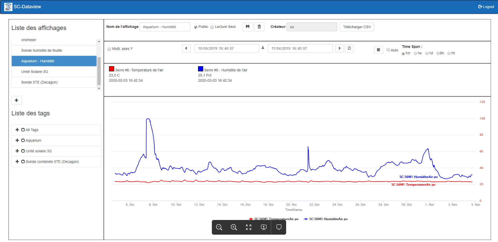{ width=1024 }

Il y a 3 types de Tag:

- **Mesuré** par une sonde via un module Simplicollect
- **Calculé** à partir d’autres tags et relié par une formule ou un programme (language Python)
- **Externe** qui provient d’une autre source de données (ex.: site météo d'environnement Canada)
- **Totalisateur**:  Fait le total, quotidien, mensuel, annuel, d'un tag (ex.: compteur d'eau sur un tag de débitmètre d'eau)

Les données recueillies sont utilisées pour plusieurs raisons:

- Valeurs utilisées pour fins de contrôle (ex.: MaestrEau)
- Pour faire un suivi des opérations
- Pour fins d'analyse
- Pour alimenter différentes alarmes et notifications

Pour avoir accès la la configuration, cliquer sur l'onglet Tag qui donne la liste des différents tags du système et les champs de configuration de ces derniers:

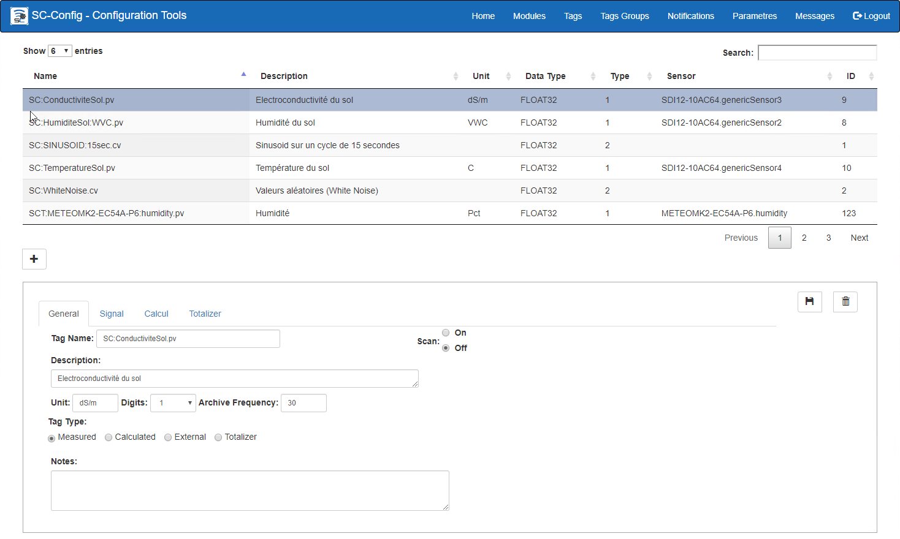{ width=1024 }

## Guide étape par étape

Les fonctions pour la configuration d'un tag sont les suivantes:

## Ajouter un Tag

Pour ajouter un tag, cliquer sur le bouton **+** qui libèrera les champs de l'affichage.

{ width=400 }

Lorsque tous les champs sont remplis, cliquer sur le bouton **Sauvegarder** pour compléter la création du tag. 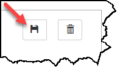

### Onglet: Général

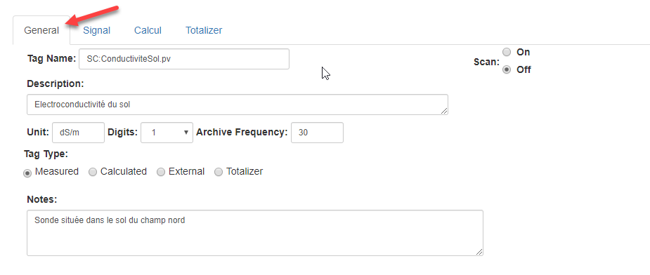{ width=800 }

1.  Sur l'onglet Général, entrer un nom pour le tag qui rencontre certaines normes de nomenclature afin d'identifier rapidement le contenu du tag; 
    - Nom du tag dois être unique et entrez-le selon une “convention” de nomenclature telle que: ***Préfixe:Code de location:Description.Suffixe*** - Préfixe:  Initiale de votre compagnie

        - Suffixe:  Type de Tag:  PV pour valeur mesurée

2.  Entrer une description et les unités d’ingénierie;

3.  Entrer le nombre de chiffres après le point;

4.  Entrer la fréquence la fréquence d'archivage à laquelle la valeur est sauvée dans la base de données;

5.  Spécifier si le point est **mesuré**, **calculé** ou **externe**;

6.  Établir sur le point est Scan On ou Off, c’est-à-dire que Simplicollect enregistre ou non les valeurs transmises au Tag;

### Onglet: Signal

Permets de configurer les paramètres du signal lorsque ce dernier est de type mesuré à partir d'un module de collecte de données.  Pour certaines sondes, on lit un signal en voltage (ex.: 0-5 V) ou en ampérage (ex.: 4-20 mA) et il faut transformer le signal en valeur “physique”.  Il y a alors une équation pour transformer le signal en valeur où la valeur du  signal est sous la variable SignalVal qui est utilisée dans le calcul.

### 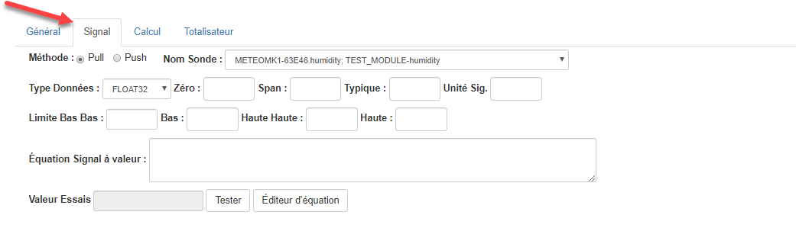{ width=859 }

1.  Choisir la sonde de mesure dans la liste défilente.  Les sondes sous cette liste ont été configurées dans la section Modules de l'application;

2.  Choisir le type de valeur;

3.  Entrer les paramètres du signal:
    - Zero:  consiste dans la valeur la plus basse qui peut être lue
    - Span:  consiste dans la valeur la plus haute qui peut être lue
    - Typique:  valeur qui est typique à cette sonde
    - Unité du signal:  par exemple, un signal en mA qui est transformé en valeur physique

4.  Entrer l'équation de transformation du signal.  Par exemple, un signal en 4-20 mA qui est transformé en pression.  On peut entrer directement l'équation avec les opérateurs mathématiques normalement utilisés (+ - \* /).  On peut également utiliser un éditeur d'équation qui permet d'invoquer des équations ainsi que des valeurs provenant d'autres tags ;

    !!! info

        Si on laisse le champ Équation vide, alors la valeur du signal est directement copiée dans le Tag et on peut utiliser un éditeur pour monter l’équation.

5.  Si on a entré une équation pour traiter le signal, on peut cliquer sur le bouton **Tester** pour tester la validité de l'équation et le résultat apparait à l'écran

### Onglet: Calcul

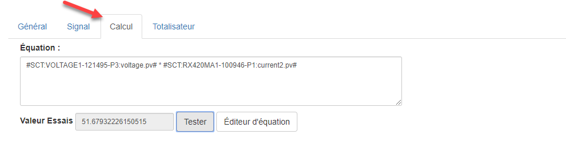{ width=963 }

Les paramètres de cet onglet sont reliés aux tags calculés et permettent de saisir la formule de calcul.  On peut y saisir une formule avec

- les opérateurs mathématiques standards (+ - \* /);
- des fonctions mathématiques (log, sin, etc.);
- d'autres tags ;
- des fonctions programmées au sein de l'engin SimpliCollect.

Le contenu de la formule peut être tapé directement dans le champ Équation et on peut en tester le contenu en cliquant sur le bouton **Tester**.

On peut également utiliser l'éditeur d'équation en cliquant sur le bouton **Éditeur d'équation**.

L'engin de calcul de SimpliCollect collecte effectue le calcul de chaque tag de type calculé toutes les secondes et la valeur est archivée dans la base de données Simplicollect à la fréquence établie dans l'onglet Général.

### Éditeur d'équation

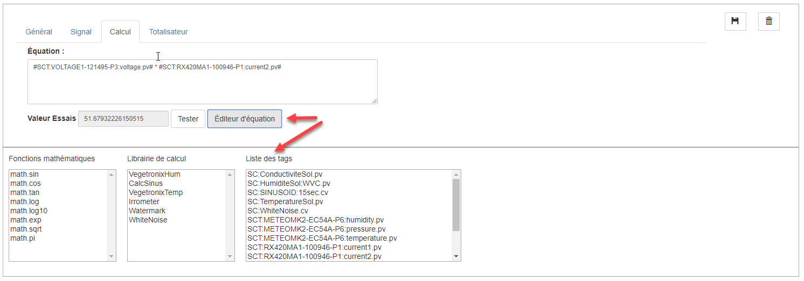{ width=1024 }

1.  De l’écran de gestion des tags, cliquer le bouton **Éditeur d'équation** simplifie l'écran et affiche trois list pour aider à créer une formule mathématique;
2.  Les listes donnent:
    - les fonctions mathématiques disponibles
    - Les fonctions de calcul qui sont disponibles dans Simplicollect
    - La liste des Tags
3.  Double cliquer sur un des éléments pour l’amener dans l’équation;
4.  Les fonctions sont amenées dans l’équation avec les paramètres de la fonction qu’il faut remplacer avec les bonnes valeurs;
5.  Les Tags sont amenés dans l’équation entre deux signes \#
6.  Cliquer sur le bouton Test pour tester le contenu de l’équation;
7.  Cliquer sur **Sauvegarder** pour sauvegarder le contenu de l’équation et retourner à l’écran précédent

!!! info

    Les fonctions de calcul sont programmées dans le langage Python. Si vous désirez créer une nouvelle fonction, contacter l’assistance technique et il nous fera plaisir de vous aider (support@simplicollect.com)

Éditer un tag

Il est possible d'éditer les paramètres de configuration d'un tag.

1.  Choisir le tag dans la liste des tags;
2.  Les paramètres du tag apparaitront dans les champs en bas de l'écran;
3.  Faire les changements désirés;
4.  Cliquer sur le bouton **Sauvegarder** pour conserver les changements.

## Cesser le balayage

On peut changer l'état d'un tag afin que le système cesse d'en échantillonner les valeurs.  Les valeurs déjà sauvegardées sont toujours conservées dans la base de données.  Cette fonction est particulièrement pratique si on doit réparer une sonde ou que l'on cesse les opérations pour la période hivernale.

1.  Choisir le tag dans la liste des tags;
2.  Dans l'onglet Général, cliquer sur le sélecteur Scan Off: 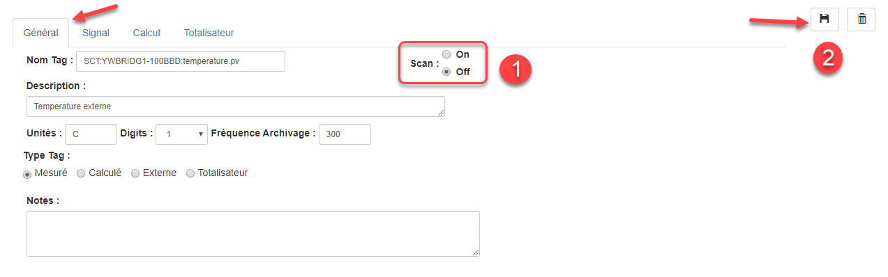{ width=1024 }
3.  Cliquer sur le bouton **Sauvegarder**.

## Effacer un tag

1.  Choisir le tag dans la liste des tags;

2.  Cliquer sur le bouton **Effacer 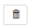**;

3.  Un message demande de confirmer l'effacement du tag.  Cliquer **Confirmer** pour effacer le tag ou **Fermer** pour annuler l'effacement; 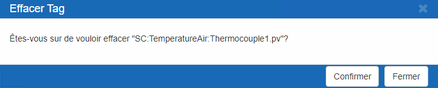{ width=600 }

## Rechercher un tag

1.  Entrer des caractères dans la case Rechercher;

2.  La liste des Tags afficheras seulement les Tags dont le noms contient les caractères tappés;

     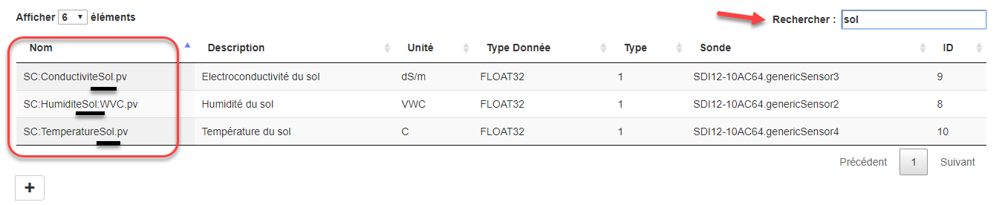{ width=1024 }

3.  Retirer les caractères de la case Rechercher pour effacer la recherche.

!!! info

    Les données enregistrées dans la base de données seront perdues. Toutefois, si jamais vous désirez récupérer les données effacées par erreur, contactez le service d'assistance technique (support@simplicollect.com)
