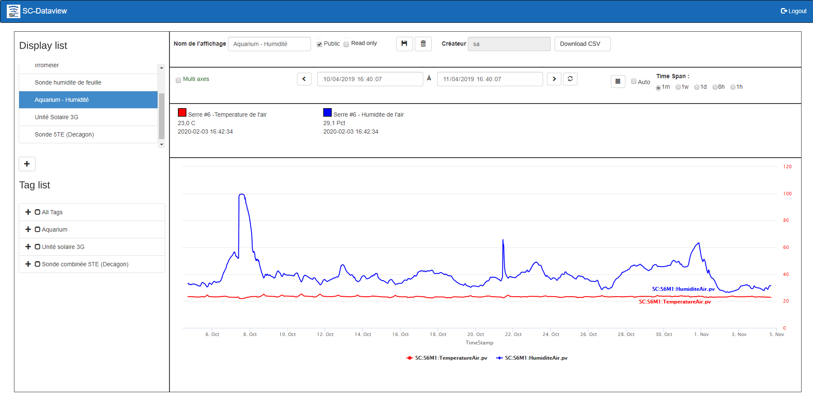
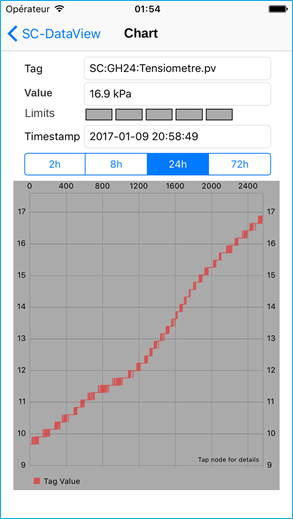

# Dataview

Dataview lets you view the data in the SimpliCollect database as graphs over several time intervals.  This way, you can take advantage of the data acquired in the SimpliCollect historian and analyze its content.

The Dataview application is available on Windows and on Apple's iOS.

{ width=600 }     
