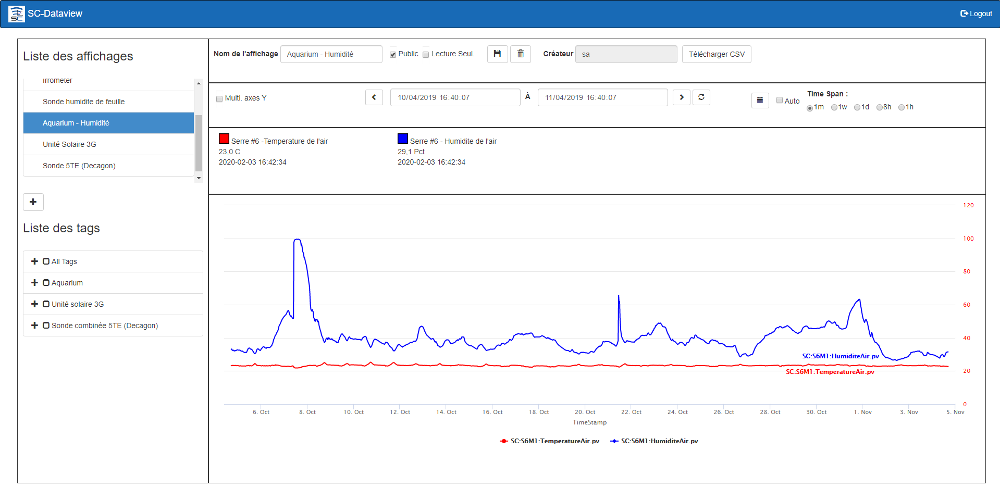
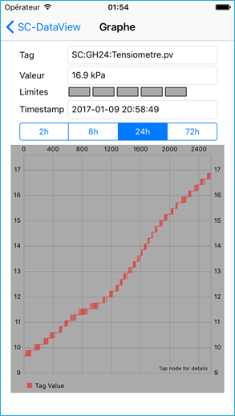

# Dataview

Dataview permet de consulter les données de la base de données SimpliCollect sous forme de graphique pour plusieurs intervales de temps.  Ainsi, vous pouvez tirer profit des données acquises dans l'historien de SimpliCollect et analyser leur contenu.

L'application Dataview est disponible sous l'environnement Windows et sur l'environnement iOS d'Apple.

{ width=600 }     
