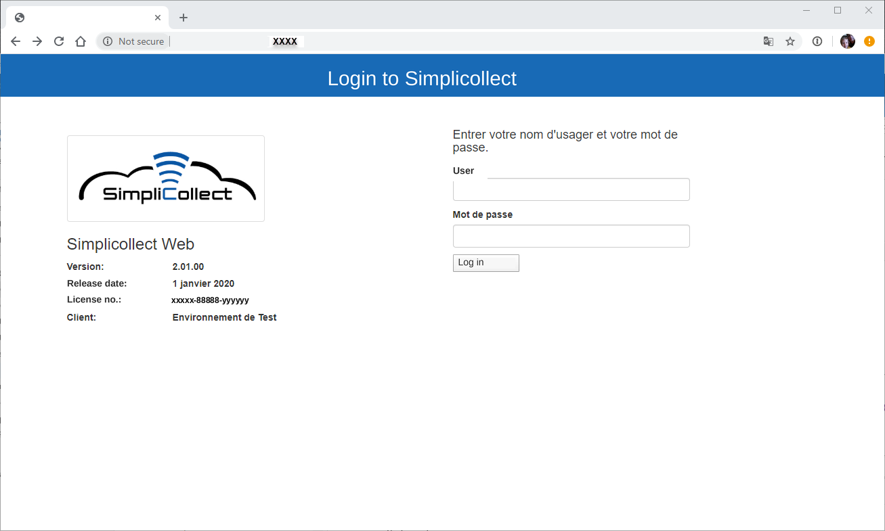
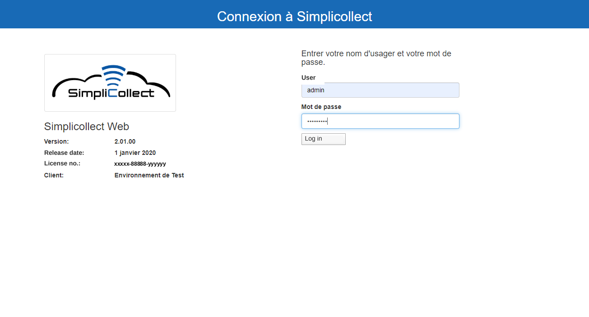
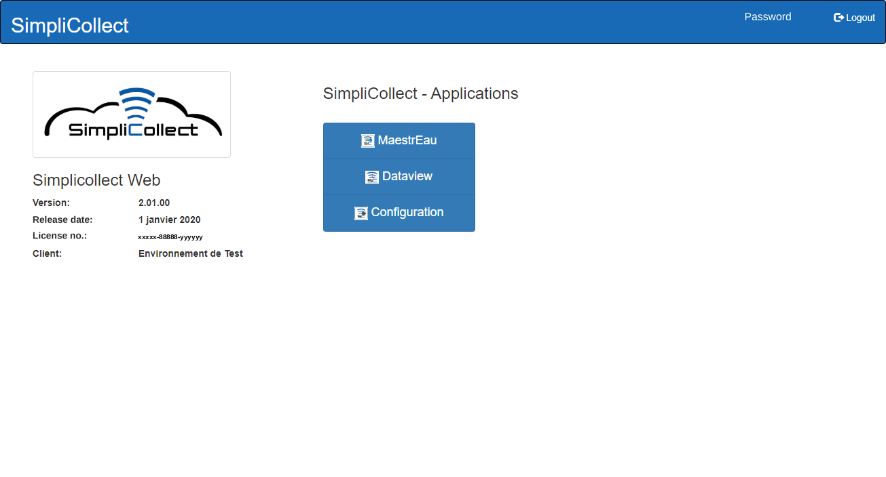

# User Manual

This section contains the various user guides for Simplicollect. Refer to the subsections for each function of the software.

The Simplicollect functions can be accessed from a web page using the Google Chrome browser, or from your smartphone.

## Accessing Simplicollect Web

1.  Open the Chrome browser;

2.  Type the IP address of the Simplicollect gateway or the URL used to access Simplicollect;

3.  The login page appears:

    { width=306 }

4.  Enter your user name and password and click **Log in:**

    { width=306 }

5.  The main navigation screen appears:

    { width=340 }

6.  Click MaestrEau to open the MaestrEau application: [MaestrEau - Utilisation](maestreau-utilisation/index.md) Note: The MaestrEau application is only available if you have a MaestrEau module or if your user has permission to use MaestrEau.

7.  Click Dataview to open the Dataview application: [Dataview](dataview/index.md)

8.  Click Configuration to open the SimpliCollect configuration applications: [Configuration](configuration/index.md) Note: The Configuration application is only available if your user has permission to change the SimpliCollect configuration.
