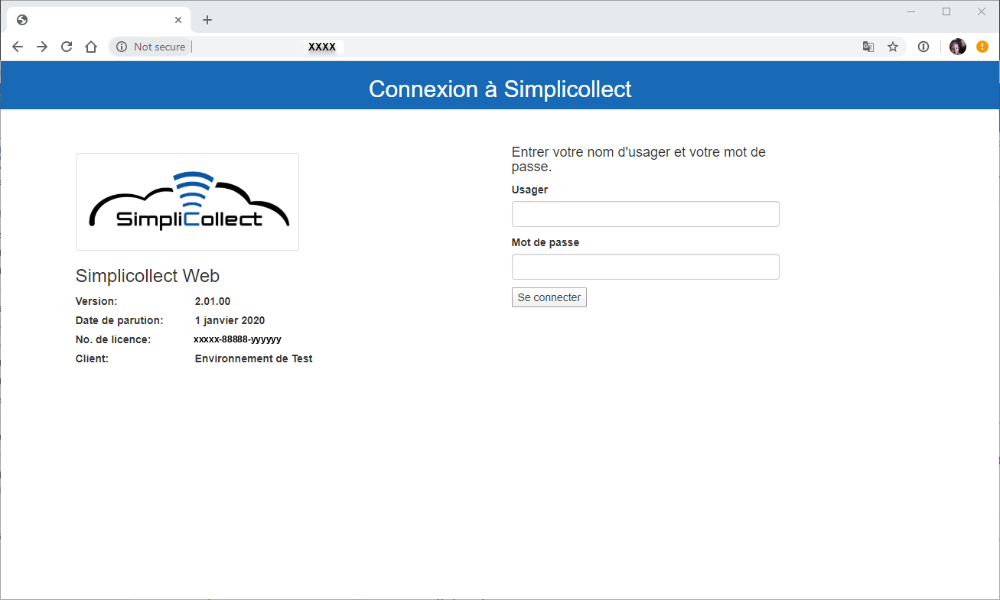
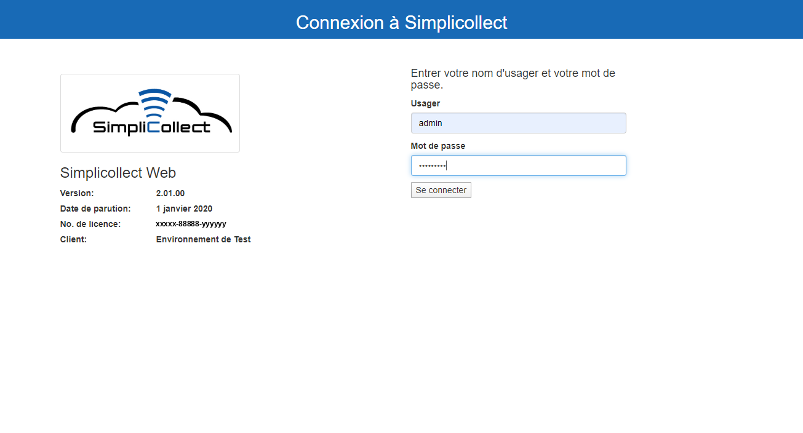
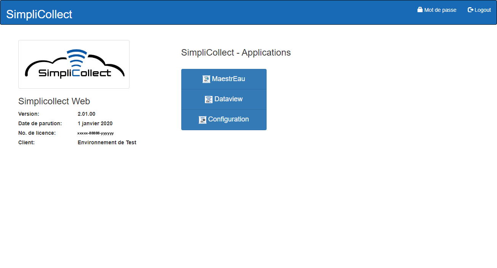

# Manuel d'utilisation

Cette section contient les différents guides d’utilisation de Simplicollect. Référez-vous aux sous-sections pour chaque fonction du logiciel.

On peut accéder aux fonctions de Simplicollect à partir d’une page web et du fureteur Google Chrome ou à partir de votre téléphone intelligent.

## Accès à Simplicollect Web

1.  Ouvrir le fureteur Chrome;

2.  Taper l’adresse IP de la passerelle Simplicollect ou l’url d’accès à Simplicollect;

3.  La page d’identification apparait:

    { width=306 }

4.  Entrez votre nom d’utilisateur et votre mot de passe et cliquez sur **Se connecter:**

    { width=306 }

5.  L'écran principal de navigation apparait:

    { width=340 }

6.  Cliquer sur MaestrEau pour accèder à l’application MaestrEau: [MaestrEau - Utilisation](maestreau-utilisation/index.md) Note: L'application MaestrEau seras disponible seulement si vous possèdez un module MaestrEau ou si votre utilisateur as la permission d’utiliser MaestrEau.

7.  Cliquer sur Dataview pour accèder à l’application Dataview: [Dataview](dataview/index.md)

8.  Cliquer sur Configuration pour accèder aux applications de configuration de SimpliCollect: [Configuration](configuration/index.md) Note: L’application Configuration seras disponible seulement si votre utilisateur as la permission de modifier la configuration de SimpliCollect.
