# Areas and Zones

A control Area contains several Zones that are linked to each other by the place where the control is performed and by how the Zones interact (e.g., irrigation on the same network of hydrants).  A control Area can also be thought of as a "group of control Zones".

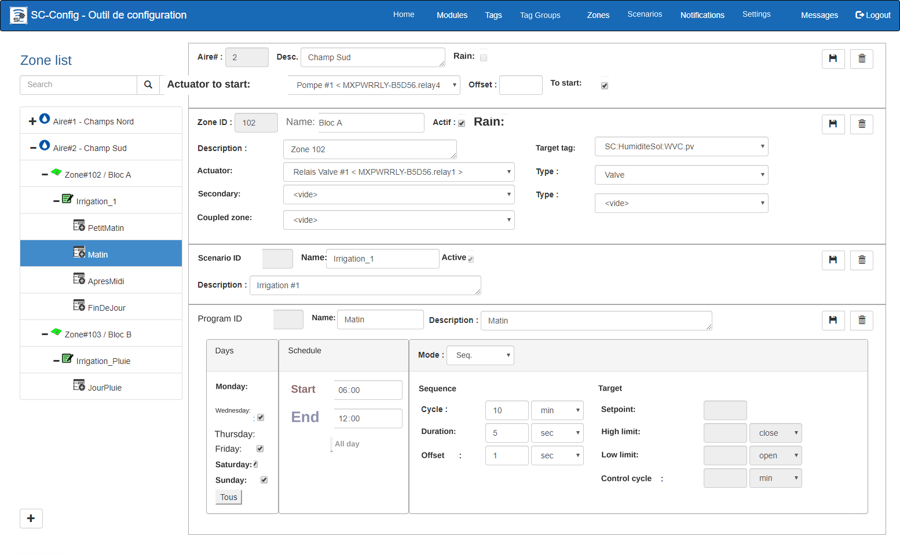{ width=1024 }

Each Zone contains one or more Scenarios, but only one can be active at a time. A Scenario is activated manually in the MaestrEau operations application, and the parameters of a Program are preconfigured in the Scenarios tab.  However, when the Scenario is added to a Zone, you can change the parameters of the Programs specific to the selected Zone.

## Step-by-Step Guide

The functions for configuring a zone are as follows:

## Add an Area

1.  Click the **+** button and the area settings section will be displayed;

    !!! info

        A SimpliCollect Gateway cannot host more than 20 control Areas. If you need more Areas, contact technical support (support@simplicollect.com).

    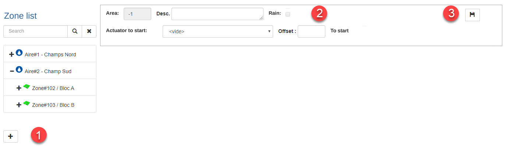{ width=1024 }

2.  Enter a new name for the Area;

3.  A common actuator can be assigned to a control Area, for example, to start an irrigation pump when a Program of a Zone in this Area is actuated.  If so, choose the relay from the drop-down list; 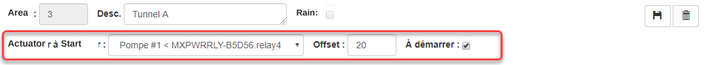{ width=1083 }

    !!! info

        For a relay to be available in this drop-down list, it must be identified under one of the MaestrEau modules configured in the Modules tab as shown below: 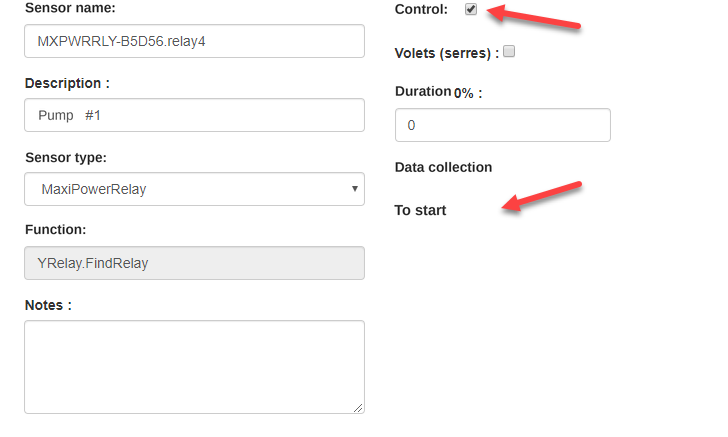{ width=600 }

4.  If an actuator has been chosen to be started, enter the "offset", in seconds, after the actuator has been activated before the first Zone of this Area is actuated.

5.  Finally, to activate the actuator to be started, check the **To Start** box (labelled *À démarrer* in the French interface).  This box can be unchecked to deactivate the actuator while keeping it associated with the Area (e.g., when the irrigation pump is being repaired);

6.  Once the area entry is complete, click the **Save** button.

## Add a Zone

1.  Select an Area in the list and the add-zone section will be displayed: 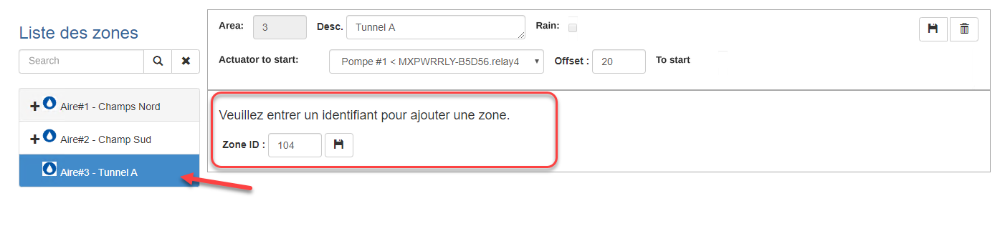{ width=1024 }

2.  Enter a Zone number and click the **Save** button. To cancel adding the zone, simply select another Area without saving.

    !!! info

        You can enter a 3-digit Zone number where the first digit identifies the control Area number. In fact, the Zone ID can be a number between 1 and 32000.

3.  Click the new Zone and fill in the fields in the window on the right: 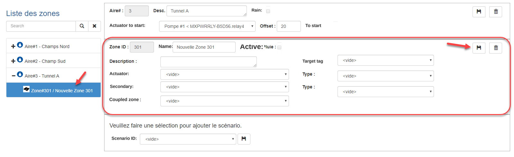{ width=1024 }

4.  Enter the name and description of the Zone;

5.  Choose the actuator (i.e., the corresponding relay in the MaestrEau module) and choose the actuator type (i.e., valve, damper, motor, etc.); 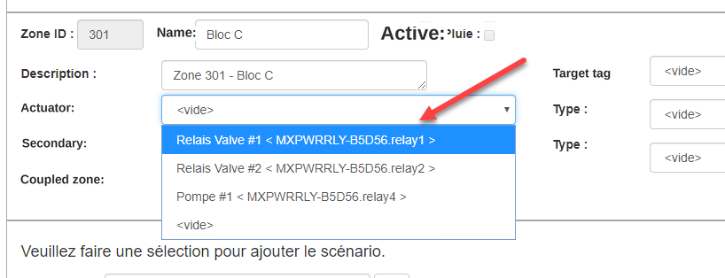{ width=800 }

    !!! info

        For the damper mode, you must choose the actuator that opens the damper in the Actuator field and the actuator that closes the damper in the Secondary field.

6.  For each actuator, choose the Actuator Type (optional);

7.  If the Zone is controlled with a Target, Sequence+Target or Damper mode, choose, from the drop-down list, a Tag that measures the targeted value; 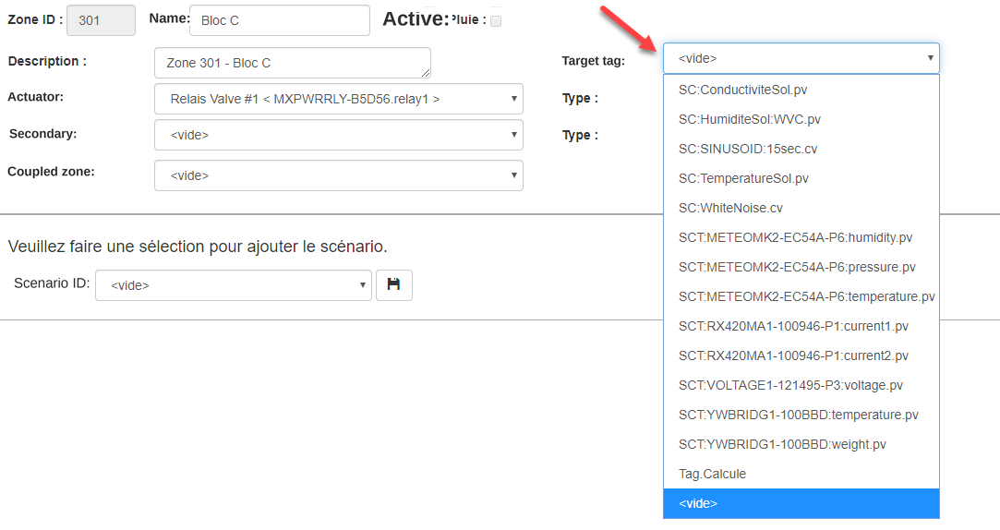{ width=800 }

8.  Click the **Save** button to save the changes.

    !!! info

        Remember that a zone must be activated for the MaestrEau control engine to take it into account. You can activate a zone in the MaestrEau application ([see the documentation on this](../maestreau-utilisation/maestreau-web/index.md)).

### Add a Scenario

1.  Select the desired Zone and the scenario selection section will be displayed on the right: 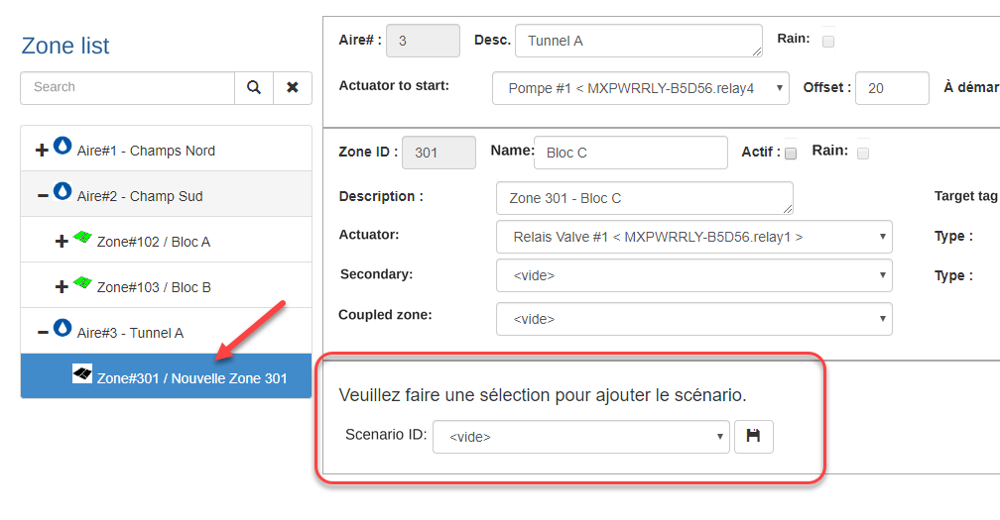{ width=800 }

2.  Choose a scenario from the drop-down list and click **Save**. To cancel the addition, simply select another zone without saving. 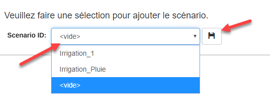{ width=544 }

3.  All the programs already configured in the scenario are found under the scenario inserted under the zone: 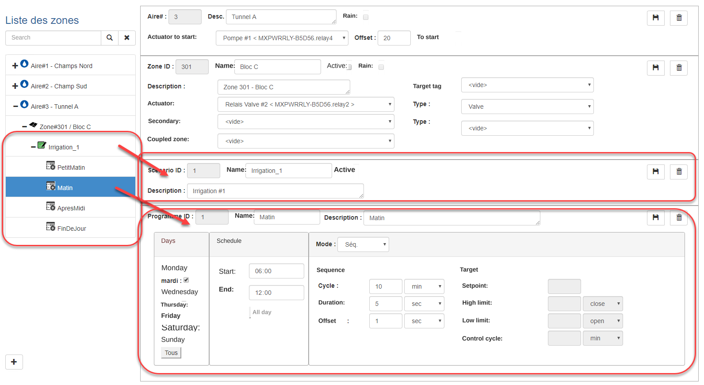{ width=1024 }

4.  You can modify the content of each program (click the program under the scenario) to adapt it to the context of the zone. For details on the program parameters, [see the scenario section of the documentation](scenarios.md);

5.  Add other scenarios that can apply to the zone... Remember that only one scenario at a time can be activated for a given zone.

    !!! info

        Remember that a scenario must be activated for a given zone. You can activate the scenario in the MaestrEau application ([see the documentation on this](../maestreau-utilisation/maestreau-web/index.md)).

### Add an *ad hoc* Program

You can add an additional program to a scenario of a given zone to complement what was configured in the scenario.

1.  Select the desired scenario in the list and the add-program section will be displayed; 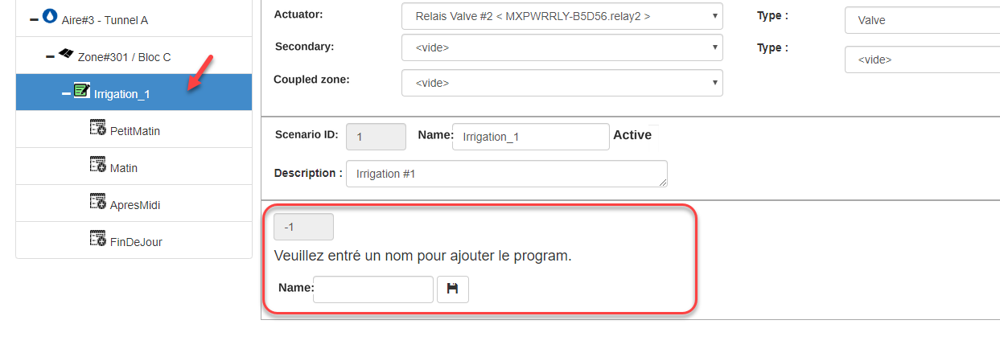{ width=800 }
2.  Enter the name of the new program:
3.  Click the **Save** button and the program will be saved.
4.  For details on configuring the parameters of a program, [see the Scenario section of the documentation](scenarios.md).

## Edit a Zone

1.  Choose a control area and a zone in the list on the left and make the changes in the windows on the right;
2.  You can also modify the content of a scenario or a program and make the desired changes in the windows on the right;
3.  Click the **Save** buttons according to the section modified to save the changes.

## Delete a Zone, a Scenario or a Program

1.  To delete a program, select the program in the list and click the **Delete** button (trash can) in the Program section;
2.  Respond to the confirmation message and the program will be removed;
3.  To delete a scenario, select the scenario in the list and click the **Delete** button (trash can) in the Scenario section;
4.  Respond to the confirmation message and the scenario will be removed;
5.  To delete a zone, make sure you have deleted all the scenarios under the zone to be deleted;
6.  Select the zone in the list and click the **Delete** button (trash can) in the Zone section;
7.  Respond to the confirmation message and the zone will be removed;
8.  To delete an area, make sure you have deleted all the zones under the area to be deleted;
9.  Select the area in the list and click the **Delete** button (trash can) in the Area section;
10. Respond to the confirmation message and the control area will be removed;
11. To cancel the deletion of an Area, a zone, a Scenario or a Program, do not confirm the deletion and go back using the browser button.

## Scenario Manager

The scenario manager allows MaestrEau to automatically change the active scenario for a zone according to the current value of a Tag.

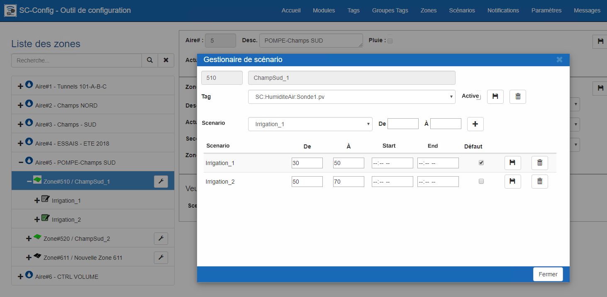{ width=800 }

1.  Click the button with the wrench at the level of the zone for which you want to configure scenario management 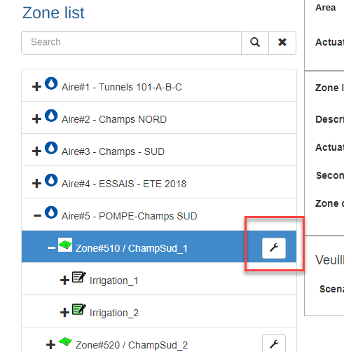{ width=300 }
2.  The screen will be empty when the manager is opened for the first time; 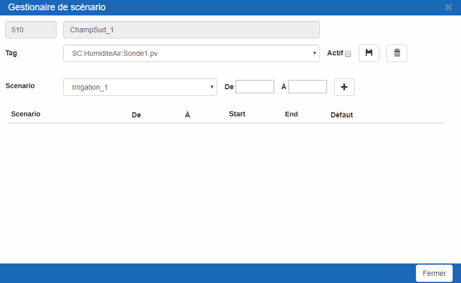{ width=800 }
3.  Next, select the Tag whose value will be used to change scenarios (1); 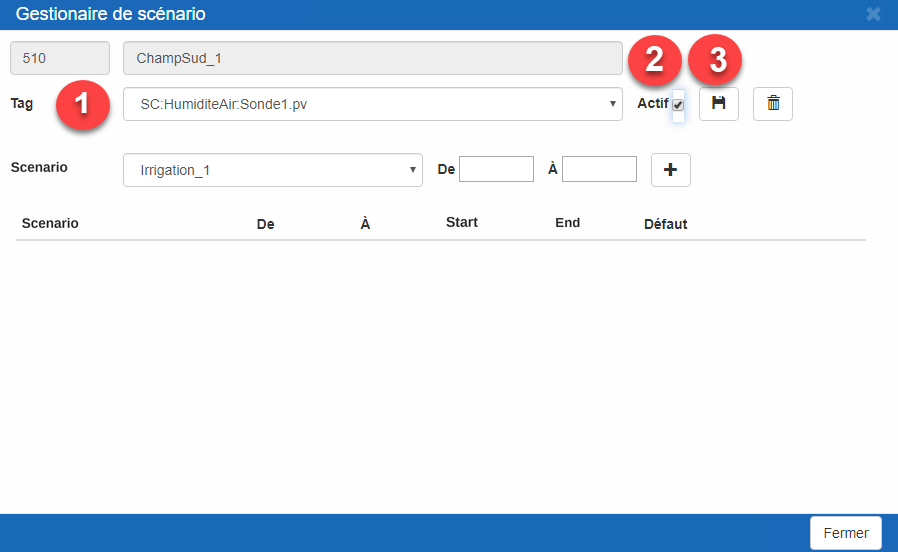{ width=800 }
4.  Check the Active box (2) to make sure the configuration will be used by the system;
5.  Click the Save button (3);

Once the Tag is selected, you must create the data ranges to allow MaestrEau to choose the right scenario;

1.  Click the list and select a scenario (1); 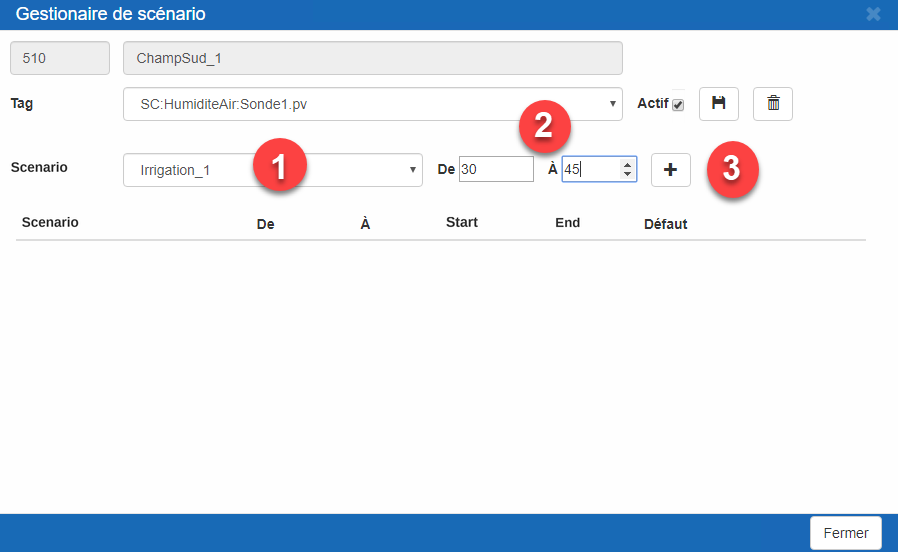{ width=800 }
2.  Then enter the data range with the From and To fields (2);
3.  And click the + button (3) and the scenario will be added to the table; 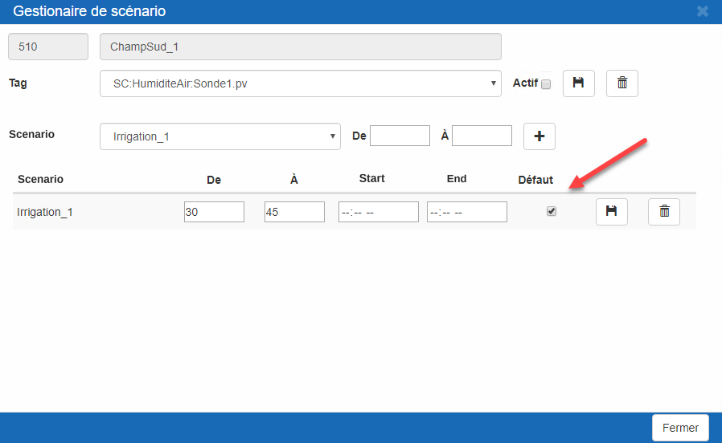{ width=800 }
4.  Once the scenario and the data range are entered, you can modify their values and/or enter a time range;
5.  When the values are correct, click the Save button;
6.  Or to remove the scenario, click the Delete button;
7.  Repeat steps 6 to 10 for all the scenarios the system must use. 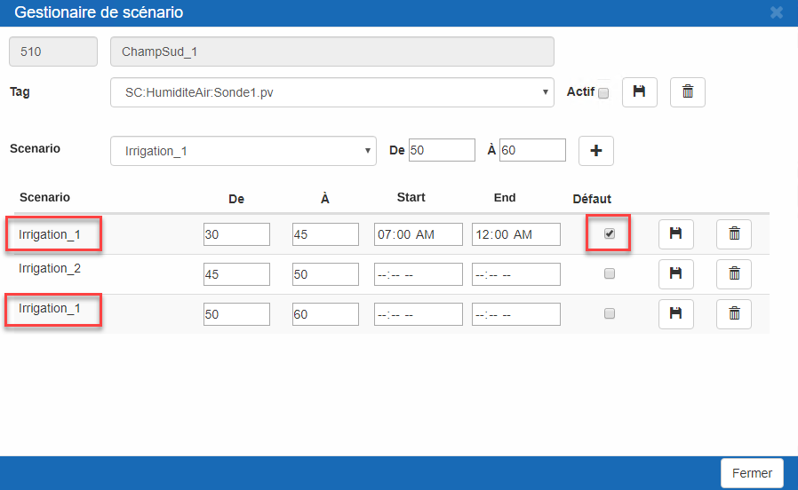{ width=800 } Important rules to know:
    1.  Only one scenario can be selected as Default.
    2.  For a data range, the From value must be smaller than the To value.
    3.  Ranges must not overlap.
    4.  The start time must be earlier than the End time.
    5.  The same scenario can be selected more than once.

To keep your configuration but stop scenario management for a zone, simply uncheck the Active box and Save.

To completely remove the configuration and stop scenario management, click the Delete button.
