# Aires et Zones

Une Aire de contrôle contient plusieurs Zones qui sont liées entre elles par rapport à l'endroit où le contrôle est fait et l'interaction des Zones (ex.: irrigation sur un même réseau d'hydrants).  On peut aussi comparer une Aire de contrôle à un "groupe de Zones de contrôle".

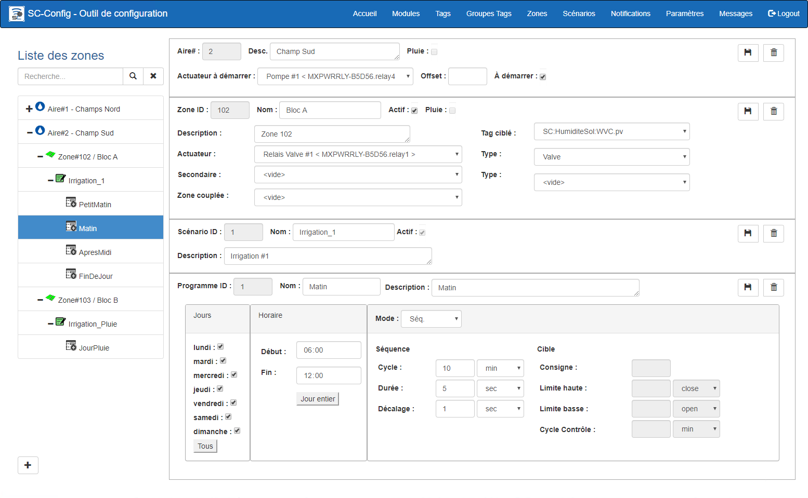{ width=1024 }

Chaque Zone contient un ou plusieurs Scénarios, mais un seul peut être actif à la fois. L’activation d’un Scénario se fait manuellement dans l’application d’opération de MaestrEau et les paramètres d’un Programme sont préconfigurés dans l’onglet Scénarios.  Cependant, lorsque le Scénario est ajouté à une Zone, on peut changer les paramètres des Programmes propres à la Zone sélectionnée.

## Guide étape par étape

Les fonctions pour la configuration d'une zone sont les suivantes:

## Ajouter une Aire

1.  Cliquer sur le bouton **+** et la section des paramètres de l'aire s'afficheras;

    !!! info

        Une passerelle SimpliCollect ne peut héberger plus de 20 Aires de contrôle. Si vous avez besoin d'un plus grand nombre d'Aire, contactez l'assistance technique (support@simplicollect.com).

    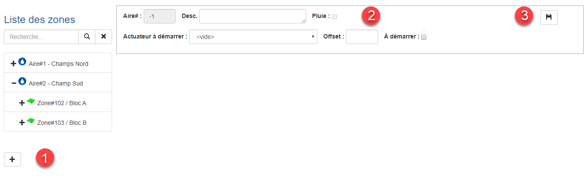{ width=1024 }

2.  Entrer un nouveau nom pour l'Aire;

3.  On peut assigner un actuateur commun à une Aire de contrôle, par exemple, pour démarrer une pompe d'irrigation lors qu'un Programme d'une Zone de cette Aire est actionné.  Si c'est le cas, choisir le relais dans la liste déroulante; 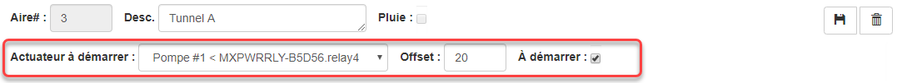{ width=1083 }

    !!! info

        Pour qu'un relais soit accessible dans cette liste déroulante, il faut identifier ce dernier sous un des modules MaestrEau configuré dans l'onglet Modules tel que ci-dessous: 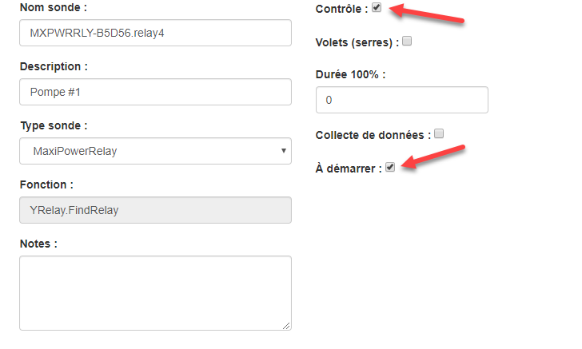{ width=600 }

4.  Dans le cas où un actuateur a été choisi pour être démarré, entrer le "décalage" (*offset*), en secondes, après l'actuateur a été activé avant d'actionner la première Zone de cette Aire.

5.  Finalement, pour activer l'actuateur à démarrer, cocher la case À démarrer.  On pourra décocher cette case pour désactiver l'actuateur tout en le conservant associé à l'Aire (ex.: dans le cas où la pompe d'irrigation est en réparation);

6.  Une fois la saisie de l'aire est terminé, cliquer sur le bouton **Sauvegarder**.

## Ajouter une Zone

1.  Sélectionner une Aire dans la liste et la section d'ajout de zone s'afficheras: 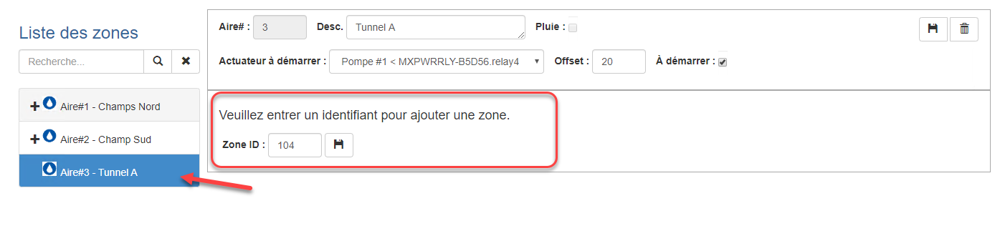{ width=1024 }

2.  Entrer un numéro de Zone et cliquer sur le bouton **Sauvegarder**. Pour annuler l'ajout de la zone, simplement sélectionné un autre Aire sans sauvegarder.

    !!! info

        On peut entrer un numéro de Zone à 3 chiffres où le premier chiffre identifie le numéro de l'Aire de contrôle. En fait, l'ID de la Zone peut avoir un nombre entre 1 et 32000.

3.  Cliquer sur la nouvelle Zone et aller remplir les champs dans la fenêtre de droite: 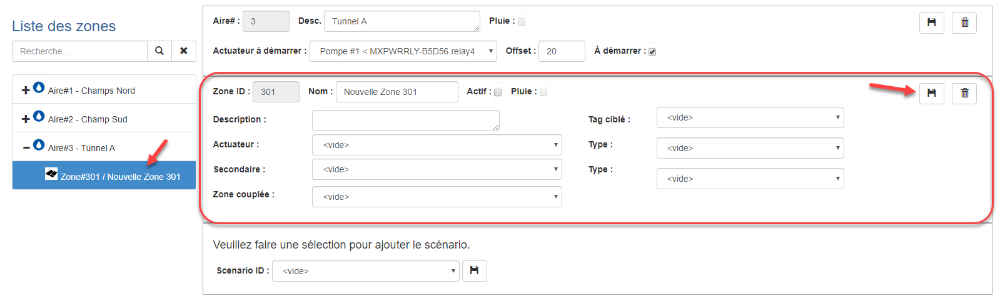{ width=1024 }

4.  Entrer le nom et la description de la Zone;

5.  Choisir l'actuateur (c.-à-d. le relais correspondant dans le module MaestrEau) et choisir le type d'actuateur (c.-à-d. valve, volet, moteur, etc.); 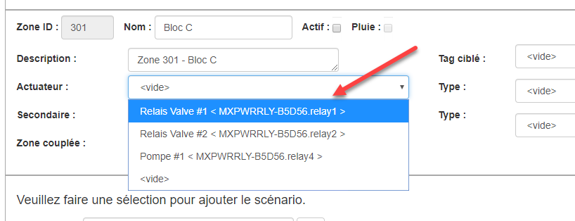{ width=800 }

    !!! info

        Pour le mode volet, il faut choisir l'actuateur pour ouvrir le volet dans le champ Actuateur et choisir l'actuateur pour fermer le volet dans le champs Secondaire.

6.  Pour chaque actuateur, choisir le Type d'actuateur (optionnel);

7.  Dans le cas où la Zone est contrôlée avec un mode Cible, Séquence+Cible ou Volet, choisir, dans la liste déroulante, un Tag qui mesure la valeur ciblée; 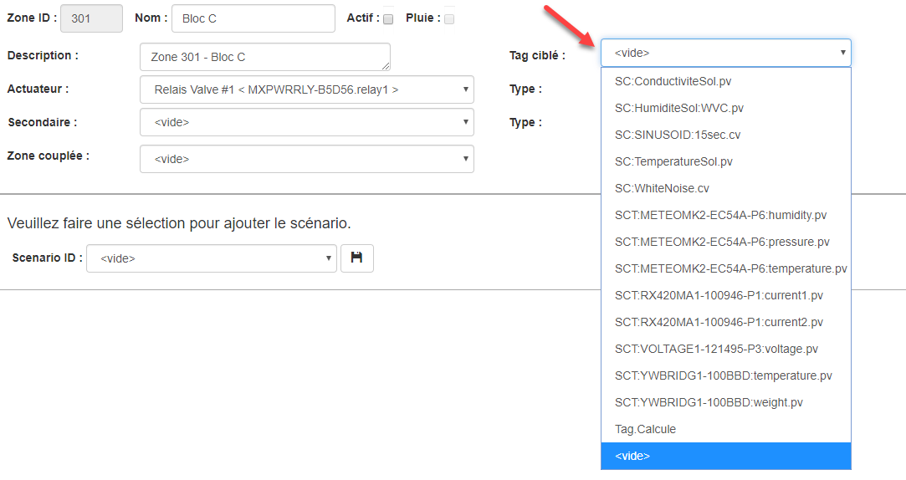{ width=800 }

8.  Cliquer sur le bouton **Sauvegarder** pour enregistrer les modifications.

    !!! info

        Rappelez-vous qu'une zone doit être activée pour que l'engin de contrôle MaestrEau en prenne compte. Vous pouvez activer une zone dans l'application MaestrEau ([voir la documentation à cet effet](../maestreau-utilisation/maestreau-web/index.md)).

### Ajouter un Scénario

1.  Sélectionner la Zone désirée et la section de sélection de scénario s'afficheras à droite: 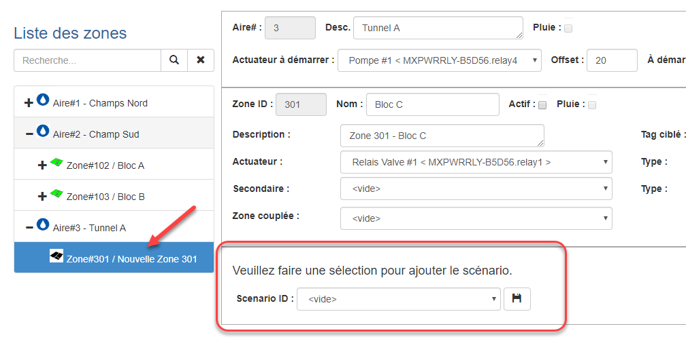{ width=800 }

2.  Choisir un scénario dans la liste déroulante et cliquer sur **Sauvegarder**. Pour annuler l'ajout, simplement sélectionner un autre zone sans sauvegarder. 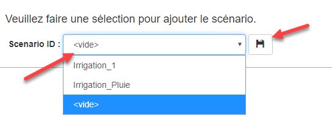{ width=544 }

3.  Tous les programmes, déjà configurés dans le scénario, se trouvent sous le scénario inséré sous la zone: 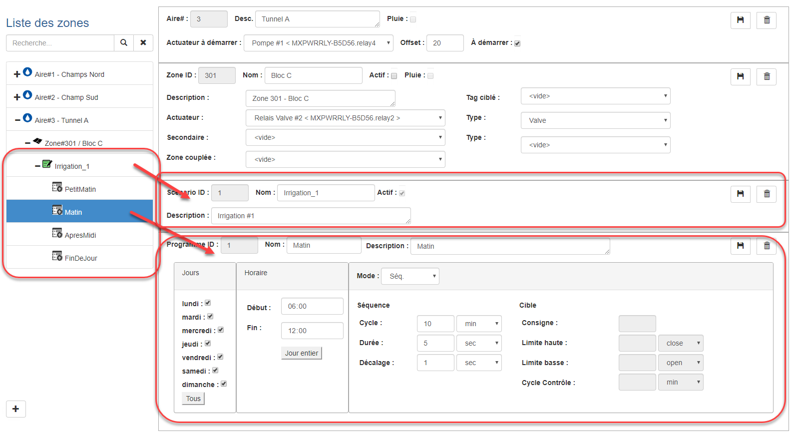{ width=1024 }

4.  On peut modifier le contenu de chaque programme (cliquer sur le programme sous le scénario) afin de s'adapter au contexte de la zone. Pour les détails concernant les paramètres des programmes, [voir la section scénario de la documentation](scenarios.md);

5.  Ajouter d'autres scénarios pouvant s'appliquer à la zone... Il faut se rappeler qu'un seul scénario à la fois peut être activé pour une zone donnée.

    !!! info

        Rappelez-vous qu'un scénario doit être activé pour une zone donnée. Vous pouvez activer le scénario dans l'application MaestrEau ([voir la documentation à cet effet](../maestreau-utilisation/maestreau-web/index.md)).

### Ajouter un Programme *ad hoc*

On peut ajouter un programme supplémentaire à un scénario d'une zone donnée afin de compléter ce qui avait été configuré dans le scénario.

1.  Sélectionner le scénario voulu dans la liste et la section d'ajout de programme s'afficheras; 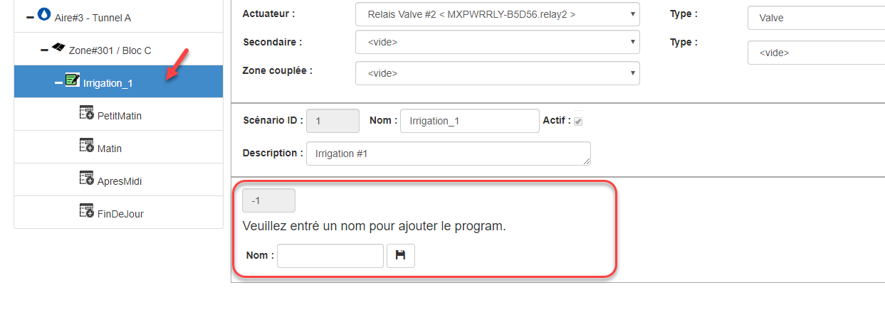{ width=800 }
2.  Entre le nom du nouveau programme:
3.  Cliquer sur le bouton **Sauvegarder** et le programme seras enregistrer.
4.  Pour les détails concernant la configuration des paramètres d'un programme, [voir la section Scénario de la documentation](scenarios.md).

## Éditer une Zone

1.  Choisir une aire de contrôle et une zone dans la liste de gauche et aller faire les modifications dans les fenêtres de droite;
2.  On peut également modifier le contenu d'un scénario ou d'un programme et apporter les changements désirés dans les fenêtres de droites;
3.  Cliquer sur les bouton **Sauvegarder** selon la section modifiée pour enregistrer les changements.

## Effacer une Zone, un Scénario ou un Programme

1.  Pour effacer un programme, sélectionné le programme dans la liste et cliquer sur le bouton **Effacer** (poubelle) de la section Programme;
2.  Répondre ou au message de confirmation et le programme sera retiré;
3.  Pour effacer un scénario, sélectionné le scénario dans la liste et cliquer sur le bouton **Effacer** (poubelle) de la section Scenario;
4.  Répondre ou au message de confirmation et le scénario sera retiré;
5.  Pour effacer une zone, assurez-vous d'avoir effacé tous les scénarios sous la zone à effacer;
6.  Sélectionné la zone dans la liste et cliquer sur le bouton **Effacer** (poubelle) de la section Zone;
7.  Répondre ou au message de confirmation et la zone sera retiré;
8.  Pour effacer une aire, assurez-vous d'avoir effacé toutes les zones sous l'aire à effacer;
9.  Sélectionné l'aire dans la liste et cliquer sur le bouton **Effacer** (poubelle) de la section Aire;
10. Répondre ou au message de confirmation et l'aire de contrôle sera retirer;
11. Pour annuler l'effacement dune Aire, une zone, un Scénario ou un Programme, nepas confirmer l'effacement et faire un retour en arrière avec le bouton du fureteur.

## Gestionnaire de scénario

Le gestionnaire de scénario permet à MaestrEau de changer de scénario actif automatiquement pour une zone selon la valeur courante d'un Tag.

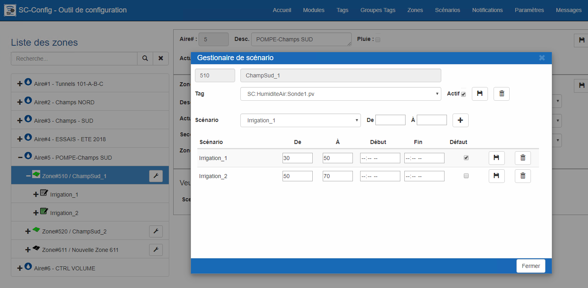{ width=800 }

1.  Cliquer sur le bouton avec la clé au niveau de la zone pour laquelle vous voulez configurer la gestion des scénarios 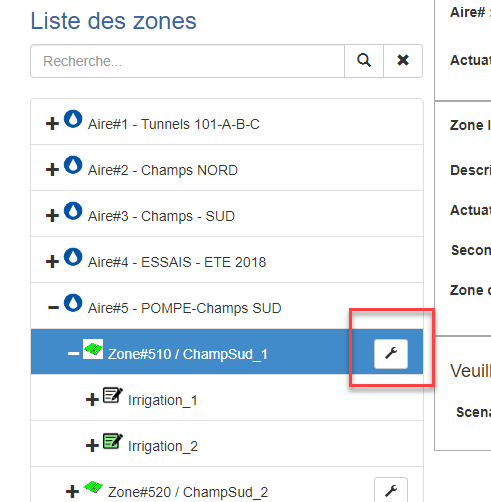{ width=300 }
2.  L'écran seras vide lorsque le gestionnaire est ouvert pour la première fois; 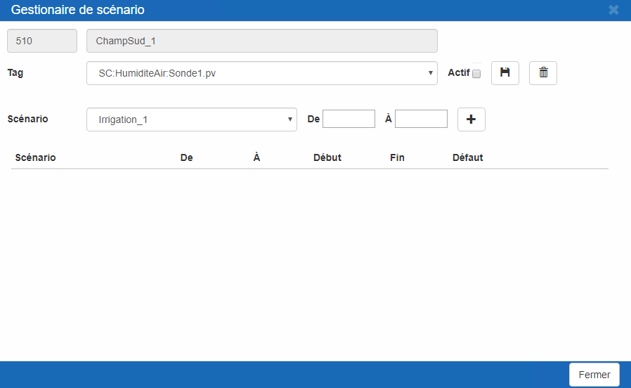{ width=800 }
3.  Il faut ensuite sélectionner le Tag dont la valeur serviras au changement de scénario (1); 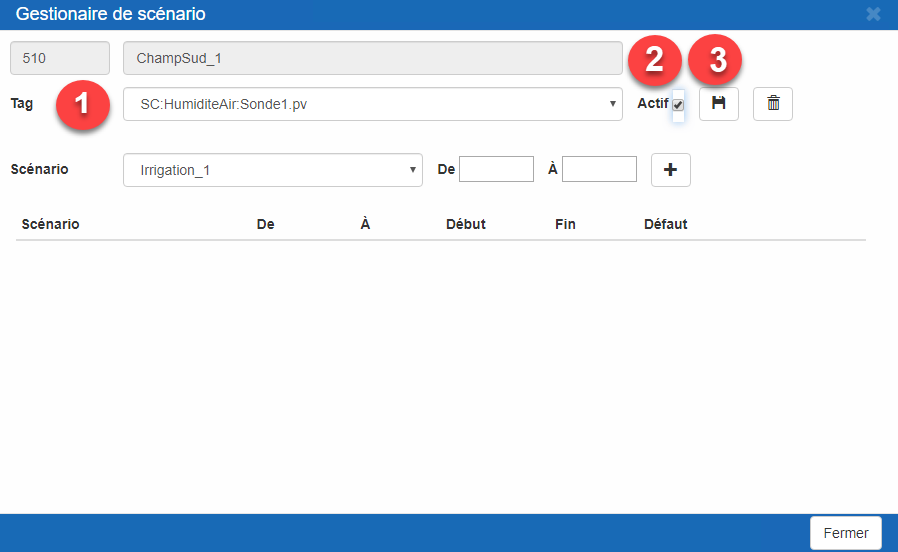{ width=800 }
4.  Cocher la case Actif (2) pour s'assurer que la configuration seras utilisé par le système;
5.  Cliquer sur le bouton Sauvegarde (3);

Une fois le Tag sélectionné, il faut créer les plages de données pour permettre à MaestrEau de choisir le bon scénario;

1.  Cliquer sur la liste et sélectionner un scénario (1); 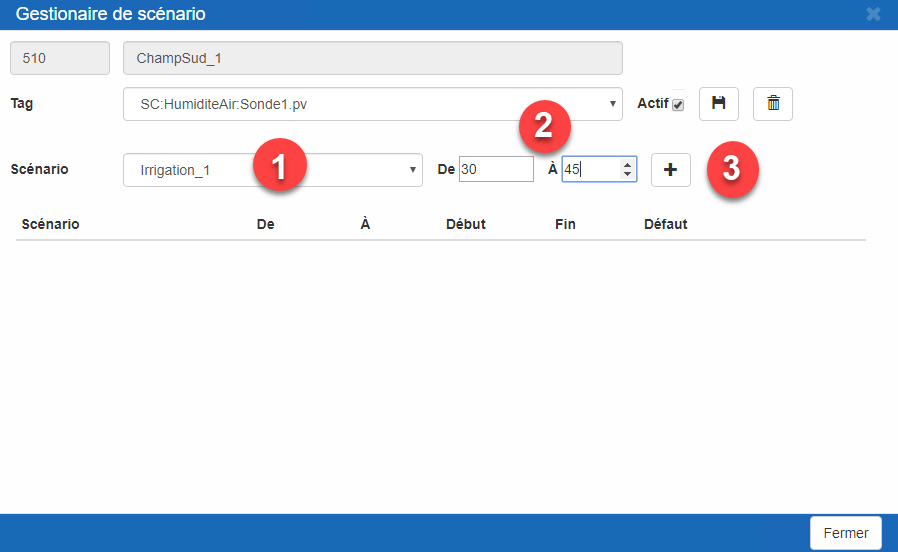{ width=800 }
2.  Ensuite entrer la plage de données avec le champs De et À (2);
3.  Et cliquer sur le bouton + (3) et le scénario seras ajouté dans la table; 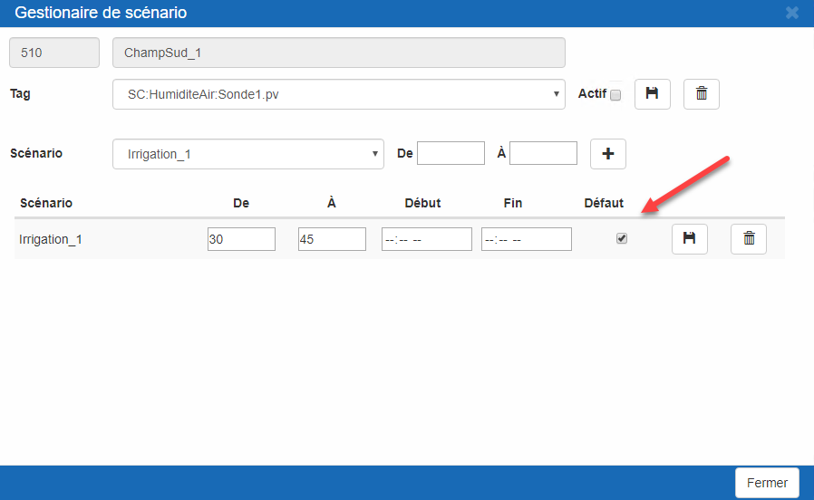{ width=800 }
4.  Un fois le scénario et la plage de données entrés, on peut modifier leurs valeurs et/ou entrer une plage d'heure;
5.  Lorsque les valeurs sont bonnes, cliquer sur le bouton Sauvegarde;
6.  Ou pour retirer le scénario, cliquer sur le bouton Effacer;
7.  Répèter les étapes 6 à 10 pour tous les scénarios dont le système doit utiliser. 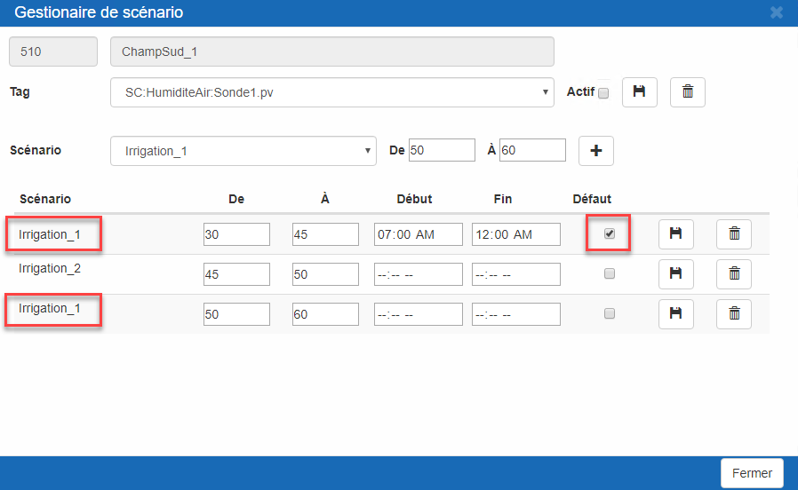{ width=800 } Règles importantes à savoir:
    1.  Un seul scénario peut être sélectionné comme par Défaut.
    2.  Pour une plage de donn.es, la valeur De doit être plus petite que la valeur À.
    3.  Les plages ne doivent pas ce chevaucher.
    4.  L'heure de début doit être plus petite que l'heure de Fin.
    5.  Un même scénario peut être sélectionner plus d'une fois.

Pour garder votre configuration mais arrêter la gestion des scénarios pour une zone, il suffit simplement de décocher la case Actif et Sauvegarder.

Pour retirer complètement la configuration et arrêter la gestion des scénarios, cliquer sur le bouton Effacer.
