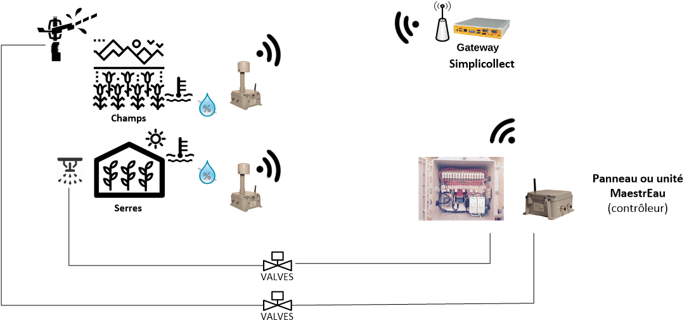

# MaestrEau - Configuration

MaestrEau is a plant growth management system for agriculture, whether in greenhouse production, market gardening or field crops. In fact, MaestrEau can manage a whole range of automation in a farm or greenhouse operation.

## Operating Principle

The MaestrEau system controls various components such as:

- Opening/closing of watering, irrigation and misting valves
- Starting/stopping of motors
- Turning lighting on/off
- Turning heating systems on/off

MaestrEau can control according to several modes, including different types of timers and feedback control (*feedback control*) based on a given target.  The diagram below shows the control cycle.

The MaestrEau control modules fit into the SimpliCollect architecture and take part in the orchestration of the various components of the SimpliCollect environment, as shown in the following diagram:

## { width=700 }MaestrEau Modules

MaestrEau panels are available in three formats:  1 zone, 5 zones and 16 zones.

For MaestrEau, a zone is a controlled element such as a valve, an actuator or a motor.  Zones can be grouped into control "areas" that make it possible to coordinate several zones together and run coordinated control sequences.  For example, all the zones of a same Area will start one after the other in an irrigation scenario so as not to cause a pressure drop.  Likewise, a pump can be started for a given Area as soon as a zone is started.  The diagram below shows an arrangement of areas and zones.

## Control Modes

Everything can be actuated according to five (5) modes:

- **Sequence **:  The component is activated repeatedly at a given time interval (Cycle) and for a given duration (Duration).  Everything is executed over a series  of time slots during the day, where each slot represents a control Program.  You can also choose the days of the week on which the Program is  executed.  This mode is mostly used for irrigation, but it can also be used for any other type of control that requires the same strategy.
- **Target**: Allows you to control a component, for example an electric heating element, with a setpoint that has upper and lower temperature limits... Just like a thermostat would.  The value being controlled comes from a SimpliCollect probe that measures it and stores it in the SimpliCollect Gateway database.
- **Sequence and Target **: The component is controlled both as a timer and with a control target.  The "master" element is the control target, and the timer ensures that  the action, for example watering, is performed "at least" at the specified time intervals.  This is particularly safe in case the measurement probes used for control were to fail.
- **ON/OFF**:  This mode is typically used for lighting functions where you want to turn the lighting on at the start of the time slot and turn it off at the end of the time slot.
- **Manual**:  This mode is only for switching an actuator on/off.  For example, to start or stop an irrigation pump.

All of the MaestrEau application configuration is done with the SC-Config application (see [MaestrEau - Configuration](index.md)) and the MaestrEau application is used to manage and monitor the processes.

## Related Articles.

- [MaestrEau on Android](../maestreau-utilisation/maestreau-sur-android.md)
- [Zone Status](../maestreau-utilisation/maestreau-web/etat-des-zones.md)
- [MaestrEau Web](../maestreau-utilisation/maestreau-web/index.md)
- [Operations](../maestreau-utilisation/maestreau-web/operations.md)
- [MaestrEau on iPhone](../maestreau-utilisation/maestreau-sur-iphone.md)
