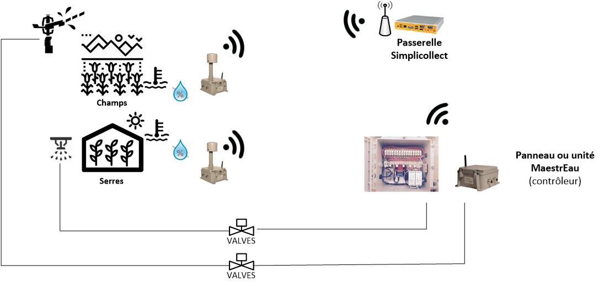

# MaestrEau - Configuration

MaestrEau est un système de gestion de la croissance des végétaux pour le domaine agricole soit en serriculture, en culture maréchaire ou en grande culture. En fait, MaestrEau peu gérer toute une gamme d'automatismes dans une exploitation agricole ou serricole.

## Principe de fonctionnement

Le système MaestrEau permet le contrôle de différents composants tel que:

- L'ouverture/fermeture de valve d'arrosage, d'irrigation, de brumisation
- Le démarrage/arrêt de moteur
- L'ouverture/fermeture d'éclairage
- L'ouverture/fermeture de système de chauffage

MaestrEau peut controler selon plusieurs mode incluant différents types de minuterie et du contrôle-action (*feedback control*) en fonction d'une cible donnée.  Le diagramme ci-dessous montre le cycle de contrôle.

Les modules de contrôle MaestrEau s'inserent dans l'architecture SimpliCollect et s'inscrivent dans l'orchestration des différents composant de l'environnement SimpliCollect tel que le démontre le diagramme suivant:

## { width=700 }Modules MaestrEau

Les panneaux MaestrEau sont offerts en trois formats:  1 zone, 5 zones et 16 zones.

Pour MaestrEau, une zone est un élément contrôlé telle qu'une valve, un actuateur ou un moteur.  Les zones peuvent être regroupées en "aires" de contrôle qui permettent de coordonnées plusieurs zones ensemble et faire des séquences coordonnées de contrôle.  Par exemple, toutes les zones d'une même Aire démarreront une après l'autre dans un scénario d'irrigation afin de ne pas causer de baisse de pression.  Au même titre, on pourra démarrer une pompe pour une Aire donnée aussitôt qu'une zone est déamrrée.  Le diagramme ci-dessous montre un agencement entre aires et zones.

## Modes de contrôle

Le tout peut être actionné selon quatre (5) modes:

- **Séquence **:  Le composant est activé de manière répétitive à un intervalle de temps donné (Cycle) et pour une durée donnée (Durée).  Le tout est exécuté une série  de plages de temps durant la journée où chaque plage représente un Programme de contrôle.  On peut également choisir les jours de semaines où le Programme est  exécuté.  Ce mode est surtout utilisé pour de l'irrigation, mais on peut aussi l'utiliser pour tout autre type de contrôle qui demande la même stratégie.
- **Cible**: Permets de contrôler un composant, par exemple un élément de chauffage électrique, avec un consigne possédant des limites de température supérieure et inférieure... Tout comme le ferait un thermostat.  La valeur qui est contrôlée provient d'une sonde SimpliCollect qui en fait la mesure laquelle est stockée dans la base de données de la passerelle SimpliCollect.
- **Séquence et Cible **: Le composant est contrôlé à la fois comme une minuterie, mais avec une cible de contrôle.  L'élément "maître" est la cible de contrôle et la minuterie s'assure que  l'action, par exemple un arrosage, est effectuée "au moins" aux intervalles de temps spécifiés.  Ceci est particulièrement sécuritaire dans le cas où les sondes de mesure pour le contrôle pourraient faire défaillance.
- **ON/OFF**:  Ce mode est typiquement utilisé pour les fonctions d'éclairage où on veut ouvrir l'éclairage au début de la plage horaire et le fermer à la fin de la plage horaire.
- **Manuel**:  Ce mode n'est que pour activer un actuateur en arrêt/départ.  Par exemple, pour démarrer ou arrêter une pompe d'irrigation.

Toute la configuration de l'application MaestrEau est faite avec l'application SC-Config (voir [MaestrEau - Configuration](index.md)) et l'application MaestrEau est utilisée pour gérer et surveiller les processus.

## Articles reliés.

- [MaestrEau sur Android](../maestreau-utilisation/maestreau-sur-android.md)
- [État des Zones](../maestreau-utilisation/maestreau-web/etat-des-zones.md)
- [MaestrEau Web](../maestreau-utilisation/maestreau-web/index.md)
- [Opérations](../maestreau-utilisation/maestreau-web/operations.md)
- [MaestrEau sur iPhone](../maestreau-utilisation/maestreau-sur-iphone.md)
