# Scenarios

A Scenario lets you create a set of programs that bring together different control conditions in the form of a "template".  This allows these conditions to be reused when creating Zones and makes the work easier.

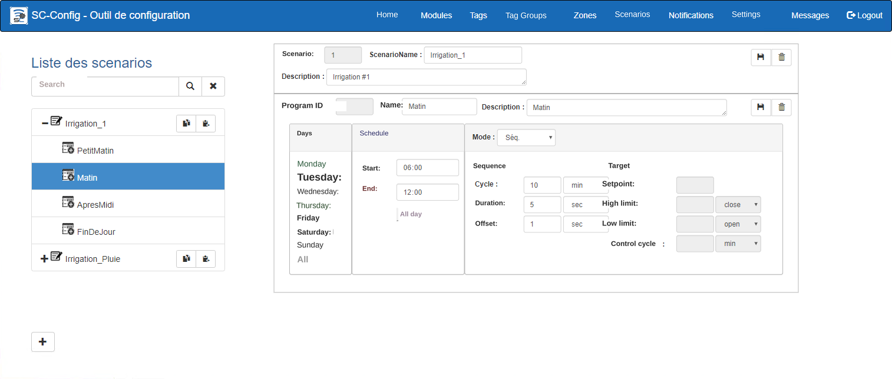{ width=1200 }

A scenario is made up of several Programs whose function is to gather the various parameters that will be used by the MaestrEau system controller.  Each program covers a time slot within a 24-hour day; you cannot have 2 programs that cover the same time slot.  Different types of programs can be applied by the MaestrEau controller:

- **Sequence **:  The component is activated repeatedly at a given time interval (Cycle) and for a given duration (Duration).  Everything is executed over a series  of time slots during the day, where each slot represents a control Program.  You can also choose the days of the week on which the Program is  executed.  This mode is mostly used for irrigation, but it can also be used for any other type of control that requires the same strategy.
- **Target**: Allows you to control a component, for example an electric heating element, with a setpoint that has upper and lower temperature limits... Just like a thermostat would.  The value being controlled comes from a SimpliCollect probe that measures it and stores it in the SimpliCollect Gateway database.
- **Sequence and Target **: The component is controlled both as a timer and with a control target.  The "master" element is the control target, and the timer ensures that  the action, for example watering, is performed "at least" at the specified time intervals.  This is particularly safe in case the measurement probes used for control were to fail.
- **ON/OFF**:  This mode is typically used for lighting functions where you want to turn the lighting on at the start of the time slot and turn it off at the end of the time slot.
- **Manual**:  This mode is only for switching an actuator on/off.  For example, to start or stop an irrigation pump.

## Step-by-Step Guide

The functions for configuring a scenario are as follows:

## Add a Scenario

1.  Click the **+** button at the bottom of the screen and the add-scenario section will appear; 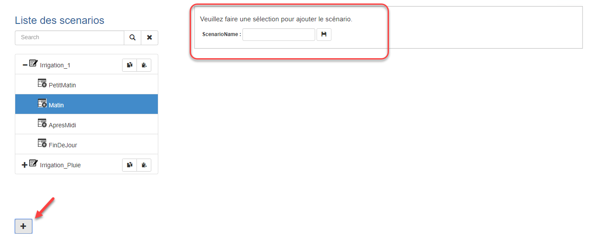{ width=800 }
2.  Enter the name of the new scenario and click the **Save** button. The section will change to let you enter a description; 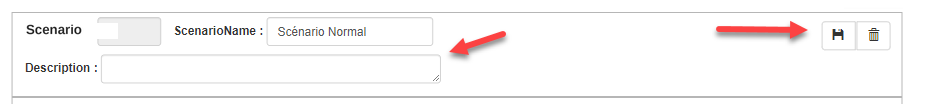{ width=926 }
3.  Once the scenario is created, programs can be inserted into it.

## Add a Program

1.  In the list on the left, select the scenario into which you want to insert a program. The add-program section will appear: 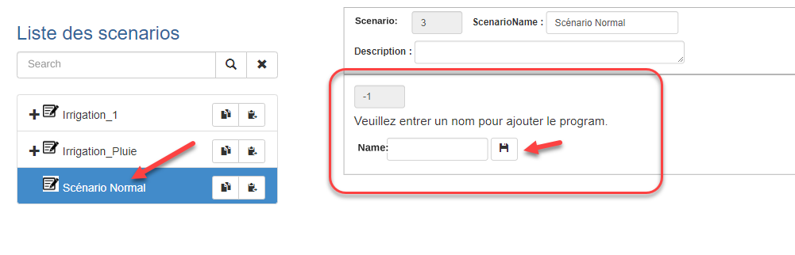{ width=800 }
2.  Enter a name for the program and click the **Save** button:
3.  The new program will be selected in the list and will let you enter the parameters of the new program: 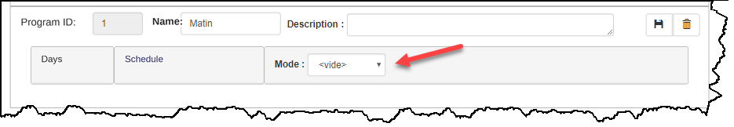
4.  Select a mode to display the different parameters. 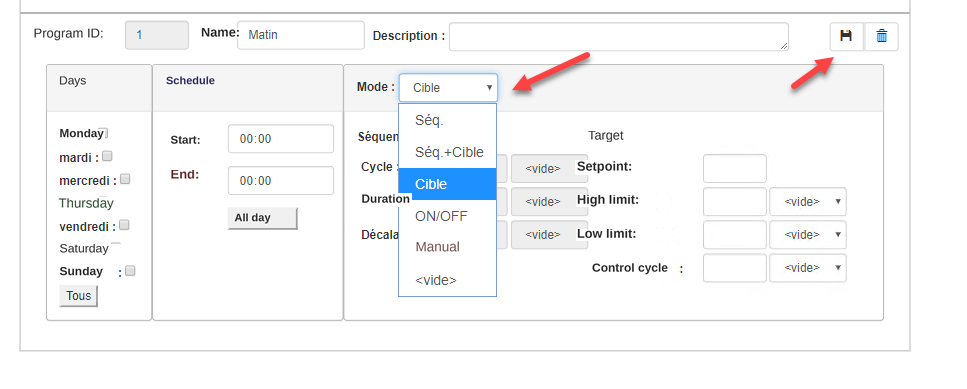{ width=800 }
5.  The various program parameters must be configured appropriately (see below);
6.  Click the Save button to save the configured parameters.

### Configuring a Program

Each program contains 3 sections:  The execution day, the schedule and the control mode.

1.  To configure the execution day, click the days on which the program must run or click the All button to choose every day;

2.  In the schedule section, enter the program start time and stop time.  Click the Full Day button to choose the whole day.  ****The stop time must be later than the start time;****

3.  Choose the control mode from the drop-down list:

    1.  **Sequence**:   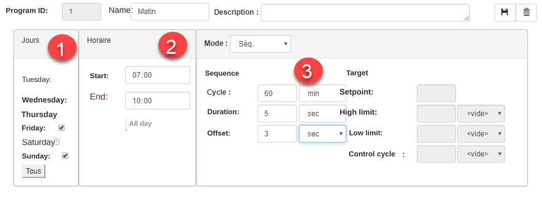{ width=800 }

        1.  Enter the **cycle duration**, which corresponds to the time between two openings of the control relay.  For example, if you want to mist every hour, enter 60 and choose the unit min to make one hour.

        2.  Enter the **opening duration** of the relay.  For example, if you want the misting to last 5 seconds, enter 5 and choose the time unit sec;

        3.  Enter the **offset duration** before the next zone of the control area is executed.  For example, this is meant to avoid causing "water hammer" in the piping between two valve openings;

            !!! info

                An important point to understand is that Zones that have scenarios with programs in sequence mode will be executed one after the other.

    2.  **Target**: 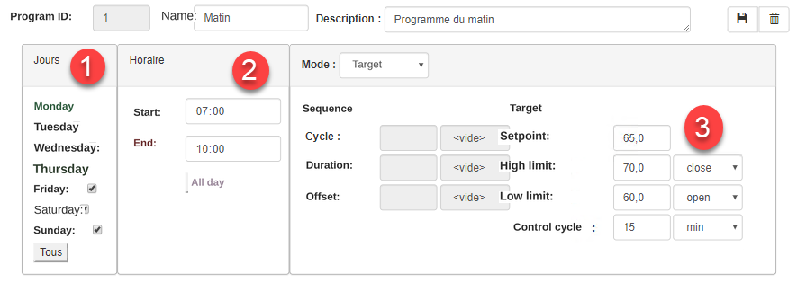{ width=800 } 
        1.  Enter the setpoint, which corresponds to the value targeted by the controller.  This value uses the same units of measure as the measured value;

            !!! info

                Understand that for the Target mode to be used, the control Zone ([see Zone configuration](aires-et-zones.md)) must be linked to a Tag that measures the value continuously, and this value is compared to the setpoint to perform the control.

        2.  Enter the high limit ("dead band") to actuate the control as well as the requested change on the relay (**close**= close the relay, i.e. "actuate" the actuator, **open**= open the relay, i.e. "deactuate" the actuator);

            !!! info

                The dead band corresponds to the tolerance the controller is allowed to drift from the control setpoint. This tolerance is essential, because otherwise the actuator would always be in action, which would cause premature wear of the mechanical components as well as "destabilize" the control strategy. Generally, you start with the widest possible dead band and can improve the value through successive trials.

        3.  Enter the low limit ("dead band") to actuate the control as well as the requested change on the relay (**close**= close the relay, i.e. "actuate" the actuator, **open**= open the relay, i.e. "deactuate" the actuator);

        4.  Enter the control cycle value, which corresponds to the frequency at which the Zone's Tag value is compared to the setpoint to trigger the control;

            !!! info

                This value must be properly "tuned". If the frequency is set too fast, control will occur at too high a frequency; if it is set too slow, the dead band values (high and low limits) will be exceeded and the value will drift away from the control setpoint. Generally, you start with the highest possible value and can improve the value through successive trials.

    3.  **Sequence + Target 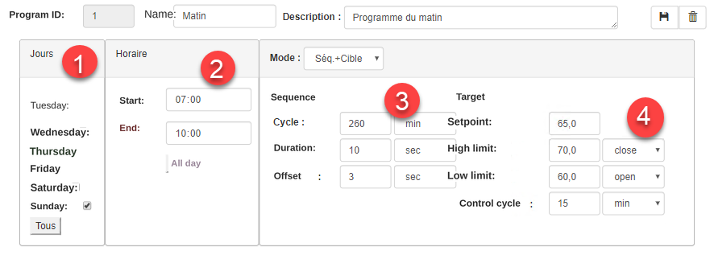{ width=800 }**
        1.  Enter the sequence and target parameters as in sections a) and b) above;

            !!! info

                The objective of this mode is to perform control using the targeted setpoint as a **priority** and to execute **at least one action** every sequence cycle duration in case target control has not been triggered. In addition, when target control occurs, the actuator is activated only for the period of time set in the **Duration** field of the sequence control.

            !!! info

                One of the benefits of this mode is that if the probe of the Tag associated with the Zone ever fails, the actuator will be activated **for at least** the cycle defined in the sequence. This is particularly handy for irrigation control.

    4.  **ON/OFF 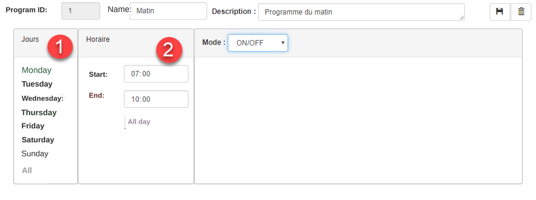{ width=800 }** 
        1.  Choosing the ON/OFF mode requires no parameters;

            !!! info

                The ON/OFF mode activates the actuator from the start of the period until the end. This mode is particularly handy for managing lighting or for starting the irrigation of a field for an extended period (e.g., from 7:00 to 7:30). This mode does not work in sequence, and each Zone that uses this mode is independent of the others.

    5.  **Manual** 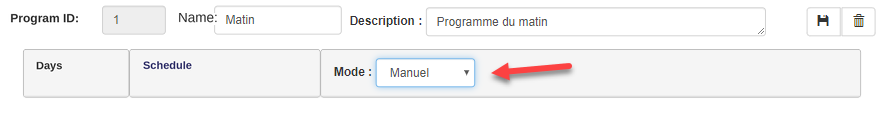{ width=883 } 
        1.  There is no schedule or control parameter for this mode.

            !!! info

                This mode is intended to associate a manual start/stop mode, from MaestrEau, with an actuator in a MaestrEau module (e.g., an irrigation pump).

4.  Click the **Save** button when the configuration is complete.

    !!! info

        A message will be displayed when program schedules overlap.

## Edit a Scenario

You can always edit the content of a scenario to change its name and description as well as the parameters of a program.  What you need to understand is that the main identifier of a scenario is its ID, which always remains the same in the database.

1.  Choose the scenario in the list on the left;
2.  Make the desired changes in the window on the right;
3.  Choose the programs under the scenario and go to the window on the right to change their parameters.

### Delete a Program

1.  Select the program under the desired scenario in the list on the left;

2.  Click the **Delete** button (trash can) for the program:

3.  Click **Confirm** on the confirmation message and the program will be removed from under the scenario.

    !!! info

        All the program's parameters will be deleted and this action is **irreversible.**

## Delete a Scenario

1.  Choose a scenario in the list on the left;

2.  Click the **Delete** button (trash can) in the scenario section on the right;

3.  Click **Confirm** on the confirmation message and the scenario will be removed from the list.

    !!! info

        All the programs and the scenario will be deleted and this action is **irreversible.**
