# Scénarios

Un Scénario permet de créer un ensemble de programmes réunissant différentes conditions de contrôle sous une forme de "gabarit".  Ceci permet de réutiliser ces conditions lorsqu'on crée des Zones et facilite le travail.

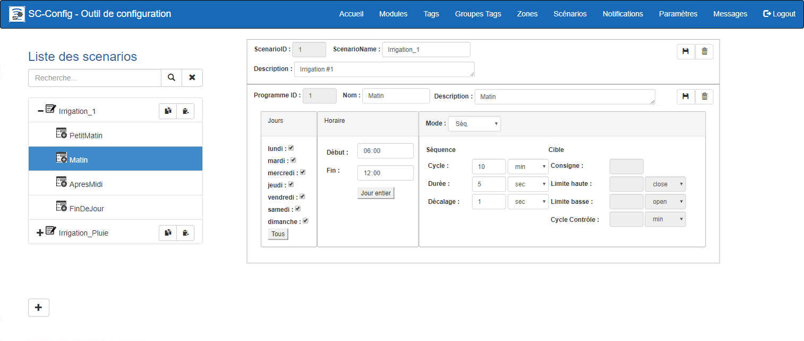{ width=1200 }

Un scénario est constitué de plusieurs Programmes qui ont pour fonction de réunir les différents paramètres qui seront utilisés par le contrôleur du système MaestrEau.  Chaque programme couvre une plage horaire dans une journée de 24 hrs on ne peut avoir 2 programmes qui couvre la même plage horaire.  Différents types de programmes peuvent être appliqués par le contrôleur MaestrEau:

- **Séquence **:  Le composant est activé de manière répétitive à un intervalle de temps donné (Cycle) et pour une durée donnée (Durée).  Le tout est exécuté une série  de plages de temps durant la journée où chaque plage représente un Programme de contrôle.  On peut également choisir les jours de semaines où le Programme est  exécuté.  Ce mode est surtout utilisé pour de l'irrigation, mais on peut aussi l'utiliser pour tout autre type de contrôle qui demande la même stratégie.
- **Cible**: Permets de contrôler un composant, par exemple un élément de chauffage électrique, avec un consigne possédant des limites de température supérieure et inférieure... Tout comme le ferait un thermostat.  La valeur qui est contrôlée provient d'une sonde SimpliCollect qui en fait la mesure laquelle est stockée dans la base de données de la passerelle SimpliCollect.
- **Séquence et Cible **: Le composant est contrôlé à la fois comme une minuterie, mais avec une cible de contrôle.  L'élément "maître" est la cible de contrôle et la minuterie s'assure que  l'action, par exemple un arrosage, est effectuée "au moins" aux intervalles de temps spécifiés.  Ceci est particulièrement sécuritaire dans le cas où les sondes de mesure pour le contrôle pourraient faire défaillance.
- **ON/OFF**:  Ce mode est typiquement utilisé pour les fonctions d'éclairage où on veut ouvrir l'éclairage au début de la plage horaire et le fermer à la fin de la plage horaire.
- **Manuel**:  Ce mode n'est que pour activer un actuateur en arrêt/départ.  Par exemple, pour démarrer ou arrêter une pompe d'irrigation.

## Guide étape par étape

Les fonctions pour la configuration d'un scénario sont les suivantes:

## Ajouter un scénario

1.  Cliquer au bas de l'écran sur le bouton **+** et la section pour ajouter un scénario apparaîtreras; 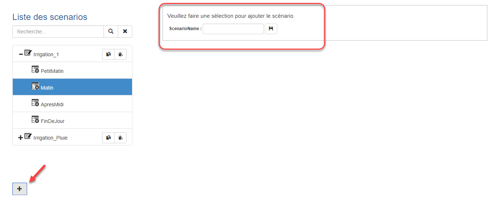{ width=800 }
2.  Entrer le nom du nouveau scénario et cliquer sur le bouton **Sauvegarder**. La section changeras pour vous permettre d'entrer une description; 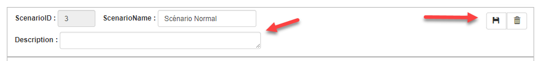{ width=926 }
3.  Une fois que le scénario est créé, on peut y insérer des programmes.

## Ajouter un programme

1.  Dans la liste de gauche, sélectionner le scénario dans lequel on veut insérer un programme. La section d'ajout de programme apparaîtreras: 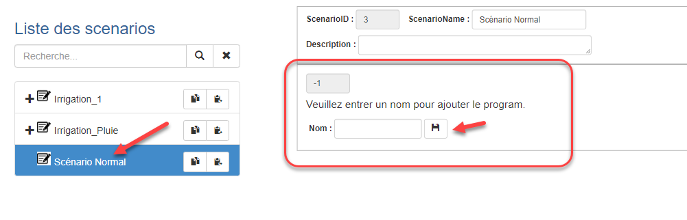{ width=800 }
2.  Entrer un nom pour le programme et cliquer sur le bouton **Sauvegarder:**
3.  Le nouveau programme seras sélectionné dans la liste et vous permettreras d'entrer les paramètres du nouveau programme: 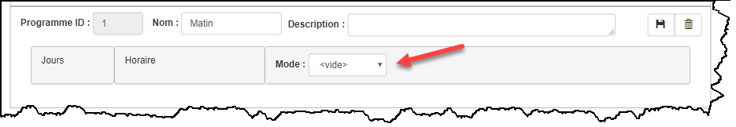
4.  Sélectionner un mode pour afficher les différent paramètres. 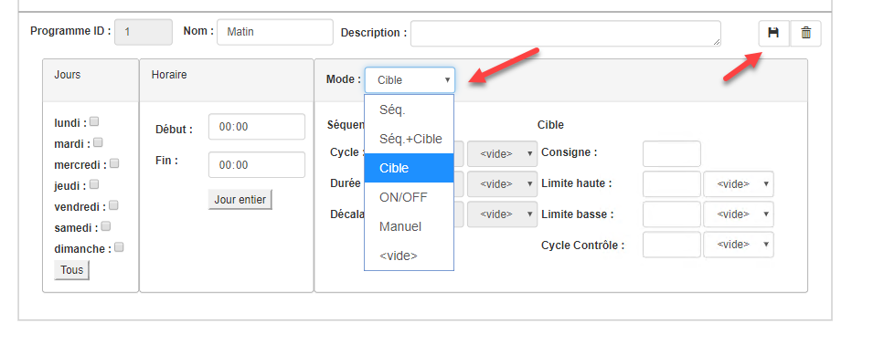{ width=800 }
5.  Les différents paramètres du programme doivent être configurés adéquatement (voir ci-dessous);
6.  Cliquer sur le bouton Sauvegarder pour enregistrer les paramètres configurés.

### Configuration d'un programme

Chaque programme contient 3 sections:  Le jour d'exécution, l'horaire et le mode de contrôle.

1.  Pour configurer le jour d'exécution, cliquer sur les jours où le programme doit s'exécuter ou cliquer sur le bouton Tous pour choisir tous les jours;

2.  Dans la section horaire, entrer l'heure de départ du programme et l'heure d'arrêt.  Cliquer sur le bouton Jour Entier pour choisir toute la journée.  ****Il faut que l'heure d'arrêt soit plus grande que l'heure de départ;****

3.  Choisir le mode contrôle dans la liste déroulante:

    1.  **Séquence**:   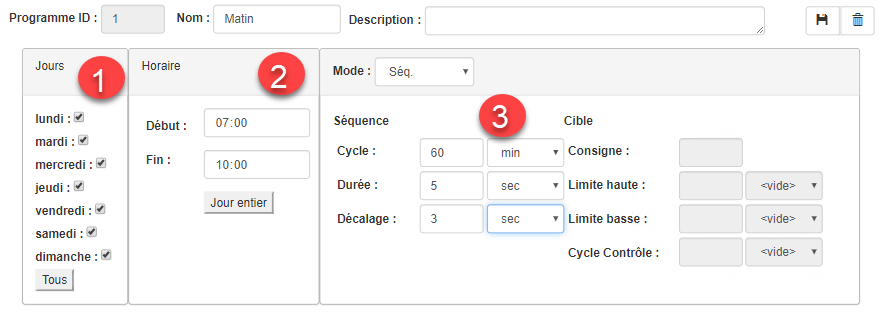{ width=800 }

        1.  Entrer la **durée d'un cycle** qui correspond au temps entre deux ouvertures du relais de contrôle.  Par exemple, si on veut faire une brumisation toutes les heures, entrer 60 et choisir l'unité min pour faire une heure.

        2.  Entrer la **durée de l'ouverture** du relais.  Par exemple, si on veut que la brumisation dure 5 secondes, entrer 5 et choisir l'unité de temps sec;

        3.  Entrer la **durée du décalage** avant que la prochaine zone de l'aire de contrôle soit exécutée.  Par exemple, ceci a pour but de ne pas donner de "coup de bélier" dans la tuyauterie entre deux ouvertures de valves;

            !!! info

                Un point important à comprendre est que les Zones qui ont des scénarios avec programmes en mode séquence seront effectuées un après l'autre.

    2.  **Cible**: 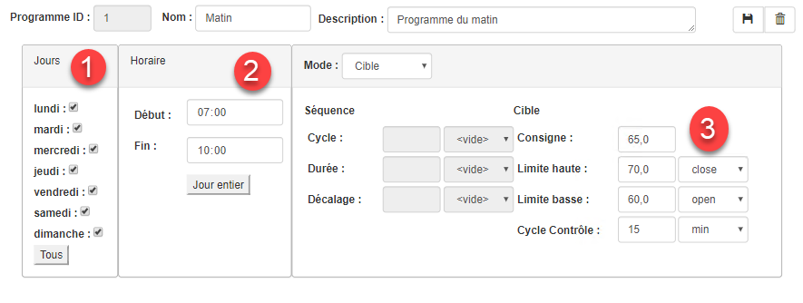{ width=800 } 
        1.  Entrer la consigne qui correspond à la valeur ciblée par le contrôleur.  Cette valeur correspond aux mêmes unités de mesure que la valeur mesurée;

            !!! info

                Il faut comprendre que pour que le mode Cible soit utilisé, il faut que la Zone ([voir configuration d'une Zone](aires-et-zones.md)) de contrôle soit rattachée à un Tag qui mesure la valeur en temps continu et cette valeur se comparée à la consigne pour effectuer le contrôle.

        2.  Entrer la limite haute ("bande morte") pour actionner le contrôle ainsi que le changement demandé sur le relais (**close**= fermer le relais soit "actionner"  l'actuateur, **open**= ouvrir le relais soit "désactionner" l'actuateur);

            !!! info

                La bande morte correspond à la tolérance que l'on permet au contrôleur de s'éloigner de la consigne de contrôle. Cette tolérance est essentielle, car l'actuateur serait toujours en action ce qui provoquerait une usure prématurée des composantes mécaniques ainsi que de "déstabiliser" la stratégie de contrôle. Généralement, on commence avec la bande morte la plus large possible et on pourra en améliorer la valeur avec des essais successifs.

        3.  Entrer la limite basse ("bande morte") pour actionner le contrôle ainsi que le changement demandé sur le relais (**close**= fermer le relais soit "actionner"  l'actuateur, **open**= ouvrir le relais soit "désactionner" l'actuateur);

        4.  Entrer la valeur du cycle de contrôle qui correspond à la fréquence où la valeur du Tag de la Zone est comparée à la consigne pour activer le contrôle;

            !!! info

                Il faut correctement "ajuster" cette valeur. Si on met une fréquence trop rapide, le contrôle va se faire à une fréquence trop élevé, si on le met trop lent, on va dépasser les valeurs de bande morte (limites haute et basse) et s'éloigner de la consigne de contrôle. Généralement, on commence avec la valeur la plus élevée possible et on pourra en améliorer la valeur avec des essais successifs.

    3.  **Séquence + Cible 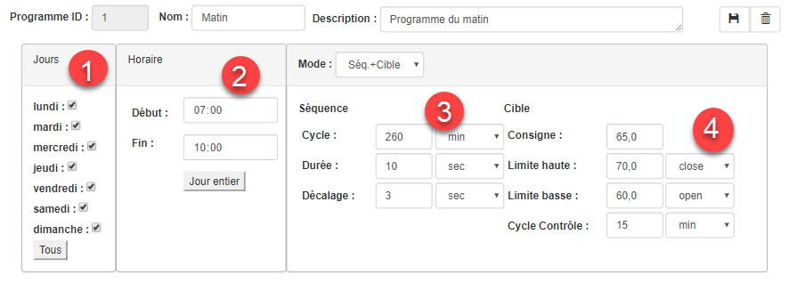{ width=800 }**
        1.  Entrer les paramètres de séquence et de cible tel que les sections a) et b) ci-dessus;

            !!! info

                L'objectif de ce mode est de faire un contrôle à l'aide de la consigne ciblé en **priorité** et d'exécuter **au moins une action** toutes les durées du cycle de séquence au cas où le contrôle par cible n'a pas été actionné. De plus, lorsque le contrôle par cible se fait, l'actuateur n'est activé que pour la période de temps établie dans le champ **Durée** du contrôle par séquence.

            !!! info

                Un des bénéfices de ce mode est que si jamais la sonde du Tag associé à la Zone fait défaut, l'actuateur sera activé **pour au moins** le cycle défini dans la séquence. Ceci est particulièrement pratique dans le cas de contrôle d'irrigation.

    4.  **ON/OFF 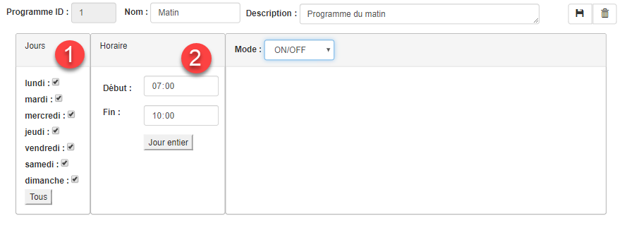{ width=800 }** 
        1.  Le choix du mode ON/OFF ne demande pas de paramètres;

            !!! info

                Le mode ON/OFF active l'actuateur au départ de la période jusqu'à la fin. Ce mode est particulièrement pratique pour la gestion de l'éclairage ou pour partir l'irrigation d'un champ pour une période prolongé (ex.: de 7h00 à 7h30). Ce mode ne fonctionne pas en séquence et chaque Zone qui invoque ce mode est indépendante l'une de l'autre.

    5.  **Manuel** 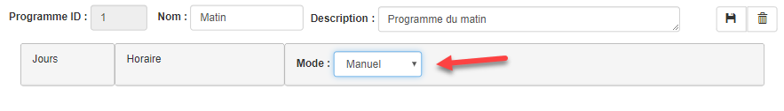{ width=883 } 
        1.  Il n'y a aucun horaire ou paramètre de contrôle pour ce mode.

            !!! info

                Ce mode a pour but d'associer un mode de départ/arrêt manuel, à partir de MaestrEau, associé à un actuateur dans un module MaestrEau (ex.: une pompe d'irrigation).

4.  Cliquer sur le bouton **Sauvegarder** lorsque la configuration est terminé.

    !!! info

        Un message seras affiché lorsque les horaires des programmes se chevauche.

## Éditer un scénario

On peut toujours éditer le contenu d'un scénario afin d'en changer le nom et la description ainsi que les paramètres d'un programme.  Ce qu'il faut comprendre c'est que l'identifiant principal d'un scénario est l'ID de ce dernier qui reste toujours le même dans la base de données.

1.  Choisir le scénario dans la liste de gauche;
2.  Apporter les changements désirés dans la fenêtre de droite;
3.  Choisir les programmes sous le scénario et aller dans la fenêtre de droite pour en changer les paramètres.

### Effacer un programme

1.  Sélectionner le programme sous le scénario voulu dans la liste de gauche;

2.  Cliquer sur le bouton **Effacer** (poubelle) le programme:

3.  Cliquer sur **Confirmer** sur le message de confirmation et le programme sera retiré sous le scénario.

    !!! info

        Tous les paramètres du programme seront effacés et cette action est **irréversible.**

## Effacer un scénario

1.  Choisir un scénario dans la liste de gauche;

2.  Cliquer sur le bouton **Effacer** (poubelle) de la section de droite du scénario;

3.  Cliquer sur **Confirmer** sur le message de confirmation et le scénario sera retiré de la liste.

    !!! info

        Tous les programmes et le scénario seront effacés et cette action est **irréversible.**
