# MaestrEau sur Android

SC-MaestrEau est disponible sur la plate forme iPhone d'Apple.  L'application fonctionne en mode "léger" et permet de faire certaines fonctions dont l'activation/désactivation, la configuration du mode Pluie, l'ouverture, la fermeture ou le cyclage d'un Programme donné ainsi qu ela visualisation des données d'un Tag attaché à une Zone.

## Guide étape par étape

Les fonctions de l'application sont les suivantes:

## Installation à partir de Google Play Store

La première étape dans l'utilisation de MaestrEau sur votre Cellulaire Android est l'installation à partir du Google Play Store.

1.  Cliquer l'icône Google Play Store; 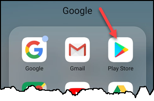{ width=250 }
2.  cliquer sur la zone Rechercher et taper "simplicollect maestreau" pour trouver l'application: 
3.  Cliquer sur le bouton Installer afin de charger et installer l'application: 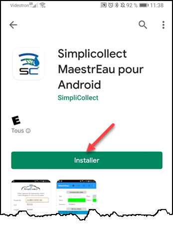{ width=250 }
4.  Lorsque l'installation est terminée, cliquer sur le bouton **Ouvrir** pour exécuter l'application; 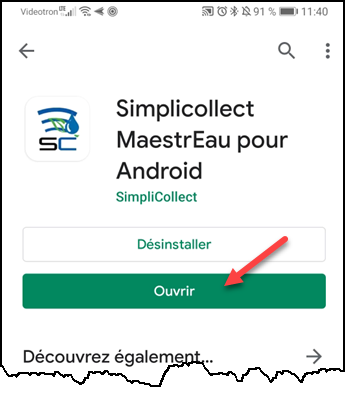{ width=250 }
5.  Ou trouver l'icône de MaestrEau sur votre cellulaire et cliquer dessus pour démarrer MaestrEau. { width=90 }

## Paramètres de connexion

La première fois que vous actionner l'application, il faut remplir les champs qui vous permettront  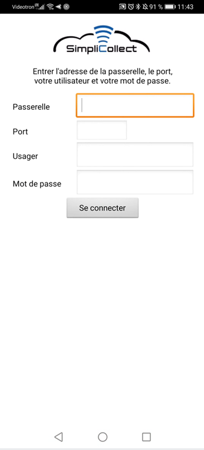{ width=250 }

1.  Entrez l'adresse url de la passerelle SimpliCollect dans le champ Passerelle.  Cette adresse vous sera donnée par l'administrateur SimpliCollect;

    !!! info

        On peut avoir deux types de connexion: locale ou via Internet. Dans le cas de la connexion locale, on va insérer l'adresse IP de la passerelle ainsi que le numéro du port d'accès. Dans le cas d'une connexion via Internet, on va entrer le nom du site pour se connecter à la passerelle SimpliCollect. Ces renseignements vous seront donnés par votre administrateur de système.

2.  Entrez le numéro du port d'accès de données de la passerelle (4 ou 5 chiffres) qui vous est donné par l'administrateur Simplicollect;

3.  Dans le champ suivant, entrez votre code d'utilisateur qui vous a été attribué par l'administrateur SimpliCollect;

4.  Finalement, entrez votre mot de passe qui vous a également été attribué par l'administrateur SimpliCollect;

5.  Lorsque tous les champs sont entrés, vous êtes prêt à vous connecter;

6.  cliquez sur le bouton **Se Connecter** et l'application établira la connexion à la passerelle (délais de 2 à 10 secondes);

7.  Un message de bienvenue apparait en dessous du bouton Login et vous dirigera vers l'affichage principal de l'application;

8.  Un message d'erreur peut également apparaitre sur l'affichage de connexion.  Dans ce cas, lire attentivement le message et suivre les instructions.  Dans la plupart des cas, une erreur s'est glissée dans les paramètres de connexion.  Corrigez l'erreur et cliquez de nouveau sur le bouton Login.  Si l'erreur persiste, faite à appel à votre administrateur SimpliCollect.

    !!! info

        Tous les paramètres de connexion sont sauvegardés sur votre iPhone et vous n'aurez pas besoin de les entrer de nouveau la prochaine fois que vous exécutez l'application.

## Navigation

Lorsque l'application est connectée à la passerelle SimpliCollect, vous aurez accès à l'affichage principal de l'application.   La première étape est de choisir une Zone. 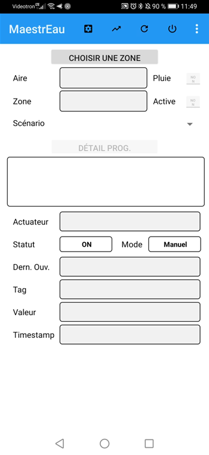{ width=250 }

1.  Cliquer sur le bouton Choisir Zone qui fera apparait la liste des Zones disponible triée par numéro de Zone; 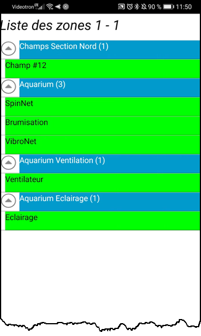{ width=250 }

2.  Naviguez dans la liste et cliquez sur la Zone que vous désirez observer (peut prendre quelques secondes);

    !!! info

        Les zones en vert indiquent que la zone est active, les zones en rouges indiquent qu'elles sont en mode "pluie" et les zones en blanc sont inactives.

3.  L'application charge les paramètres de la Zone et vous retourne à l'écran principal qui vous montre tous les paramètres de la Zone, le Scénario actif et ses Programmes; 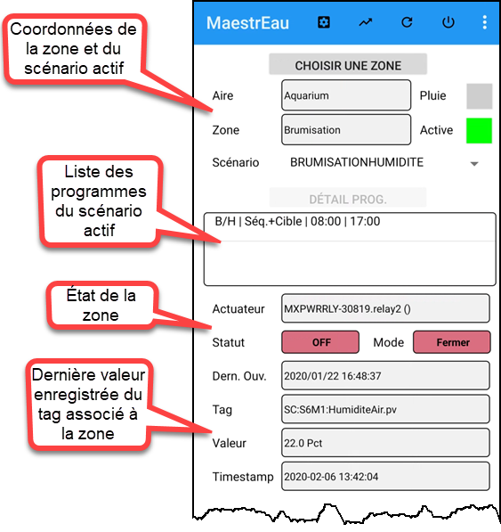{ width=300 }

4.  On peut choisir un Programme (1) et cliquer sur le bouton Détail Prog. (2) afin de visualiser les paramètres de ce Programme: 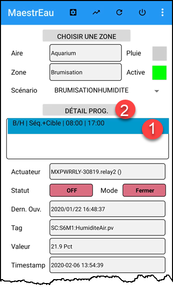{ width=250 }

5.  Cet écran donne tous les détails de configuration du Programme (Type, début, arrêt, etc.).  On peut changer la valeur des champs du programme de contrôle et cliquant dans le champ et en inscrivant la nouvelle valeur: 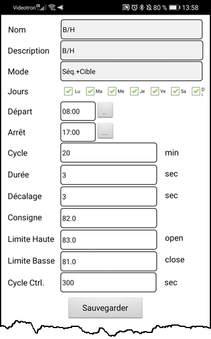{ width=250 }

6.  Pour changer les jours d'application du Programme, cliquer sur les jours (1) pour voir apparaitre/disparaitre le X de la case.  Cliquer sur **Sauvegarder** et/ou la flèche Arrière (2) pour retourner à l'écran précédent: 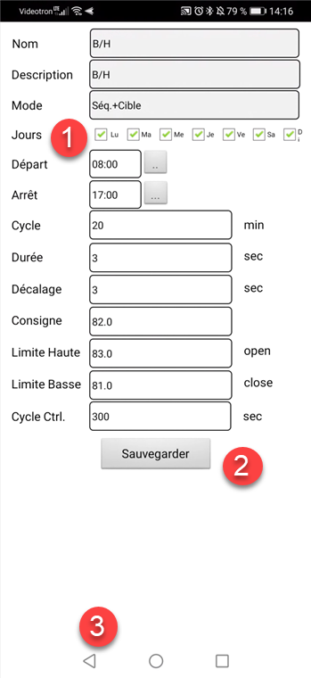{ width=250 }

7.  Dans les paramètres de la Zone, on peut également voir le numéro de l'actuateur (i.e. le relais qui contrôle la valve, le commutateur, etc.) et sont mode: 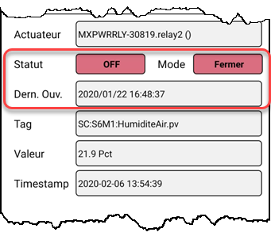{ width=250 } 
    1.  Rouge:  L'actuateur est toujours fermé
    2.  Vert:  L'actuateur est toujours ouvert
    3.  Turquoise: L'actuateur est en mode automatique et répond aux commandes de MaestrEau

8.  On peut également voir l'état actuel de l'actuateur (ouvert=vert /fermé=rouge) ainsi que le temps de la dernière action sur l'actuateur; { width=250 }

9.  On peut voir le Tag, la valeur de ce dernier et l'horodatage de la dernière valeur lue dans le cas où un Tag est attaché à la Zone; 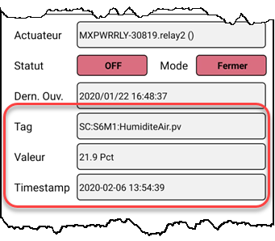{ width=250 }

## Visualisation

Dans le cas des types contrôle par cible, un tag est associé à la zone et la valeur courante du tag est comparée à la consigne de contrôle afin d'activer l'actuateur.  On peut visualiser les données du tag pour les dernières heures à partir de l'application mobile afin de constater ce qu'il en est:

1.  Cliquer sur le bouton Graphique de données situé en base de l'écran: 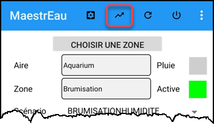{ width=250 }
2.  Un graphique apparaît et donne les données des deux dernières heures: { width=300 }
3.  On peut changer la fenêtre de temps en choisissant une des trois plages:  2h, 8h et 24h: 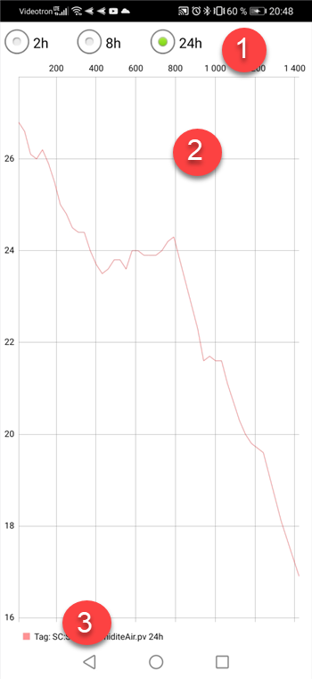{ width=300 }
4.  Les données apparaissent dans le graphique (2);
5.  Cliquer sur la flèche (3) pour retourner à l'écran principal.

## Activer une Zone

Il est possible d'activer ou de désactiver une zone afin que les programmes de contrôle soit actif ou en suspens.

1.  Dans l'écran principal de la zone, cliquer le bouton **Activé** afin de désactiver la zone. Le bouton passe au Gris: 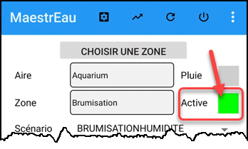{ width=250 }
2.  La zone est désactivée au plus aucune opération de contrôle n'est faite sur la zone;
3.  Pour activer la zone, cliquer le bouton **Activé** afin d'activer la zone:
4.  La zone est alors active et le bouton passe au vert;
5.  La zone est activée et les programmes du scénario actif seront appliqués:

## Mode Pluie

L'application du mode Pluie à une zone, surtout utilisé en irrigation, "suspend" les opérations de contrôle sur la zone pour une période de temps donnée.  Lorsque la période établie est à échéance (c.-à-d. lorsque la période de pluie est terminée), les opérations de contrôle de la zone reprennent.

1.  Dans l'écran principal de la zone, cliquer le bouton **Pluie** afin d'activer le mode: 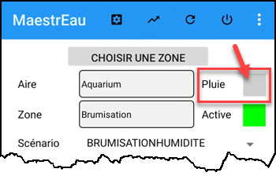{ width=250 }
2.  Un affichage apparait et demande d'indiquer le moment de la reprise des opérations de contrôle sur la zone.  Inscrire la date et l'heure de la reprise: 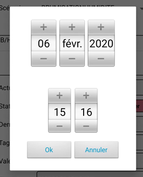{ width=200 }
3.  Lorsque choisi, cliquer sur le bouton **Ok** pour retourner à l'écran principal et le mode Pluie est activé sur cette zone.  Le bouton **Pluie** passe au vert: 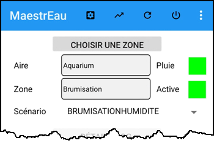{ width=250 }
4.  La zone reprendra ses activités à l'échéance de la date/heure spécifiée;
5.  On peut annuler en tout temps le mode Pluie... Pour ce faire, cliquer sur le bouton afin de désactiver le mode:
6.  Un message confirme que le mode Pluie sur cette zone est désactivé.

## Changer de scénario actif

Une zone peut avoir plusieurs scénarios de contrôle pour appliquer différents modes de contrôle et **un seul scénario peut être actif**.  On peut changer de scénario actif à partir de l'application.

1.  Dans l'écran principal de la zone, cliquer dans le champ Scénario et une liste déroulante des scénarios configurés à la zone apparait: 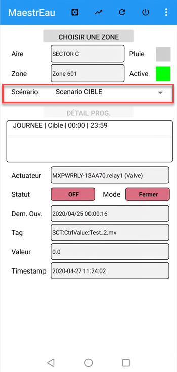{ width=300 }
2.  Choisir dans la liste déroulante le scénario voulu; 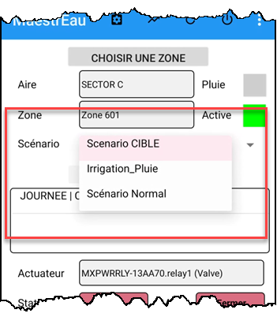{ width=300 }
3.  Le nouveau scénario apparait dans le champ et un message permet de confirmer le changement de scénario; 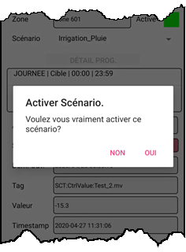{ width=300 }
4.  Cliquer sur Oui pour activer le scénario sélectionné ou Non pour annuler le changement;
5.  Si vous cliquer sur Oui pour activé le scénario sélectionné, le scénario sera affiché dans la liste et la liste des programmes seras mise à jour. 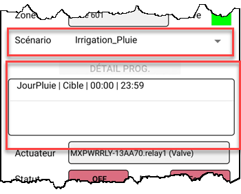
6.  Si vous cliquer sur Non, le scénario actif resteras le même et le scénario seras remis dans la liste; 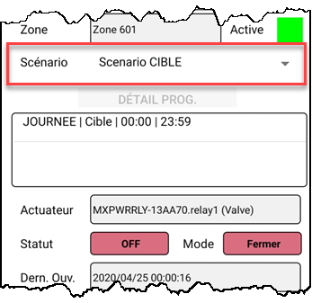{ width=300 }

## Opérations Manuelles sur la Zone

L'application permet également de faire des opérations manuelles sur une zone **active **tel qu'**ouvrir**, **fermer**, **arrêter** et remettre en mode **automatique**.

1.  Dans l'écran principal de la zone, cliquer sur l'icône d'engrenage en bas à gauche de l'affichage ou cliquer directement dans le champ mode de l'écran: 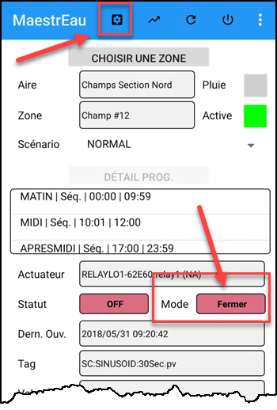{ width=250 }

2.  Un dialogue apparait et propose les différentes options qui peuvent s'appliquer à contrôle: 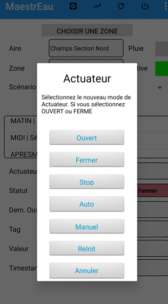{ width=250 }

3.  Choisir une des options pour activer l'actuateur selon le mode de contrôle de la zone (c.-à-d. Séquence, Séquence+Cible, Cible, ON/OFF, Volet, Manuel);

    !!! info

        Pour les différentes options sur les modes de contrôle, voir la documentation de MaestrEau pour Windows en cliquant sur ce lien.

## Déconnexion

Lorsque vous avez terminé avec l'application:

1.  Cliquer sur le bouton déconnexion situé dans le coin inférieur droit de l'écran: 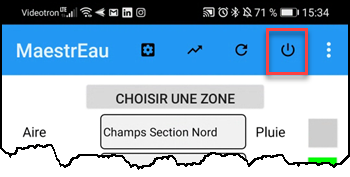
2.  Un message vous demande de confirmer la sortie, cliquer **OUI** pour sortir ou **NON** pour rester dans MaestrEau: 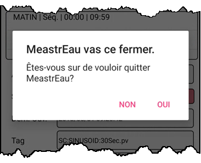{ width=250 }
