# MaestrEau on iPhone

SC-MaestrEau is available on Apple's iPhone platform.  The application runs in "lite" mode and provides certain functions, including activating/deactivating a Zone, configuring Rain mode, opening, closing or cycling a given Scenario Program, as well as viewing the data of a Tag attached to a Zone.

## Step-by-step guide

The application's functions are as follows:

## Installing from the App Store

The first step in using MaestrEau on your iPhone is to install it from Apple's App Store.

1.  Tap the App Store icon on your iPhone, tap the Search tab and type "simplicollect maestreau" to find the application: 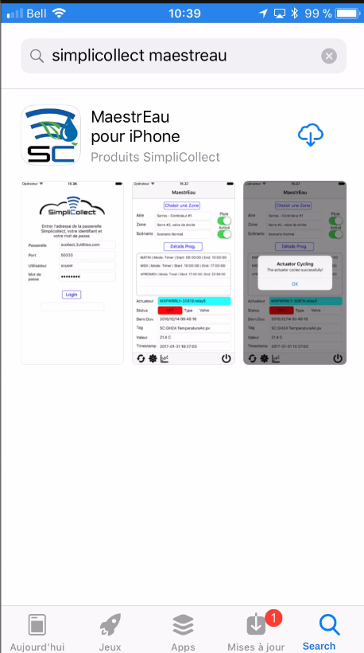{ width=250 }
2.  Tap the Install button to download and install the application:
3.  When the installation is complete, tap the Open button to run the application:

## Connection settings

The first time you run the application, you must fill in the fields that will allow you  { width=250 }

1.  Enter the URL of the SimpliCollect Gateway in the Gateway field.  This address will be provided by the SimpliCollect administrator;

    !!! info

        There are two types of connection: local or over the Internet. For a local connection, enter the Gateway's IP address along with the access port number. For a connection over the Internet, enter the site name used to connect to the SimpliCollect Gateway. This information will be provided by your system administrator.

2.  Enter the Gateway's data access port number (4 or 5 digits) provided by the Simplicollect administrator;

3.  In the next field, enter your user code assigned to you by the SimpliCollect administrator;

4.  Finally, enter your password, which was also assigned to you by the SimpliCollect administrator;

5.  Once all the fields are filled in, you are ready to log in: { width=250 }

6.  Tap the Login button and the application will establish the connection to the Gateway (2 to 10 second delay);

7.  A welcome message appears below the Login button and takes you to the application's main display;

8.  An error message may also appear on the login display.  In that case, read the message carefully and follow the instructions.  In most cases, a mistake has slipped into the connection settings.  Correct the error and tap the Login button again.  If the error persists, contact your SimpliCollect administrator.

    !!! info

        All connection settings are saved on your iPhone and you will not need to enter them again the next time you run the application.

## Navigation

When the application is connected to the SimpliCollect Gateway, you will have access to the application's main display.   The first step is to choose a Zone.

1.  Tap the Choose Zone button, which brings up the list of available Zones sorted by Zone number; 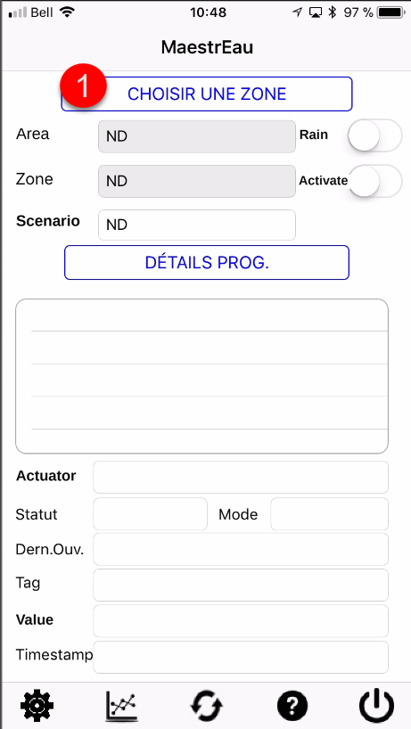{ width=250 }

2.  Scroll through the list and tap the Zone you want to view (this may take a few seconds); 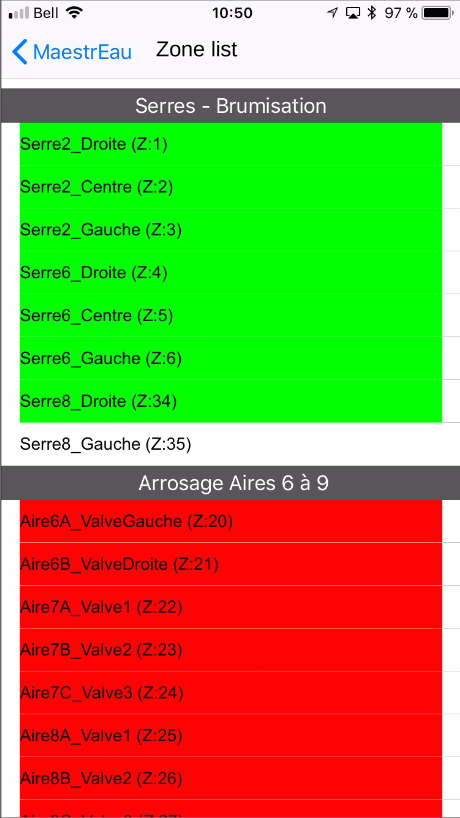{ width=250 }

    !!! info

        Green zones are active, red zones are in "rain" mode, and white zones are inactive.

3.  The application loads the Zone's settings and returns you to the main screen, which shows all of the Zone's settings, the active Scenario and its Programs; 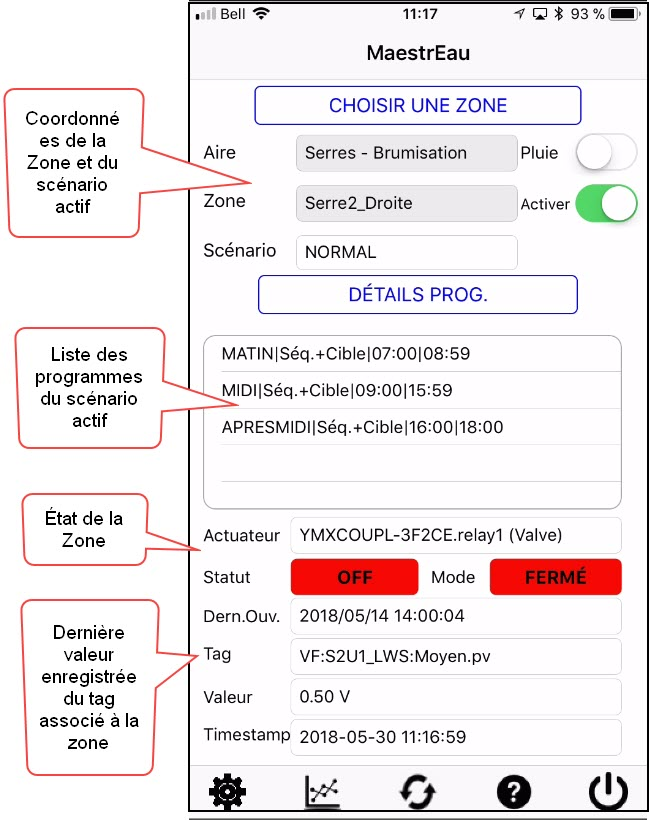{ width=350 }

4.  You can select a Program (1) and tap the Prog. Details button (2) to view the settings of that Program: 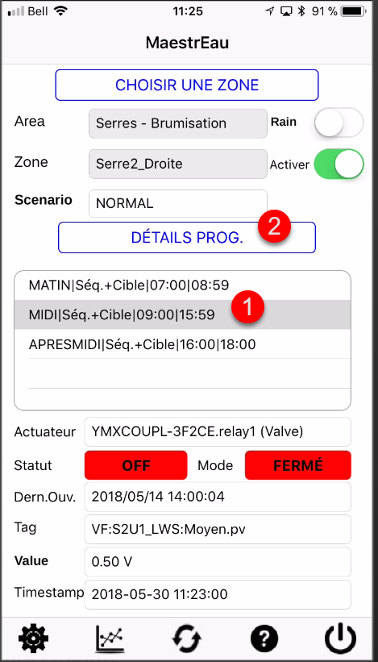{ width=250 }

5.  This screen gives all the configuration details of the Program (Type, start, stop, etc.).  You can change the value of the control program's fields by tapping in the field and entering the new value: 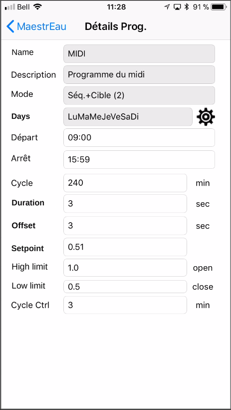{ width=250 }

6.  To change the days on which the Program applies, tap the icon next to the Days field to display the days of the week to select from

7.  On the screen, tap the days (1) to make the X in the box appear/disappear.  Tap the Back arrow (2) to return to the previous screen: 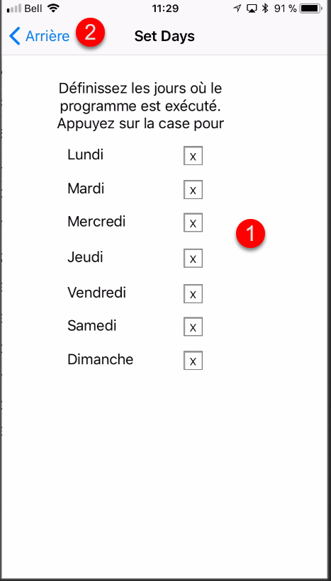{ width=250 }

8.  Tap the MaestrEau arrow to return to the main screen;

9.  In the Zone's settings, you can also see the actuator number (i.e. the relay that controls the valve, the switch, etc.) and its mode: 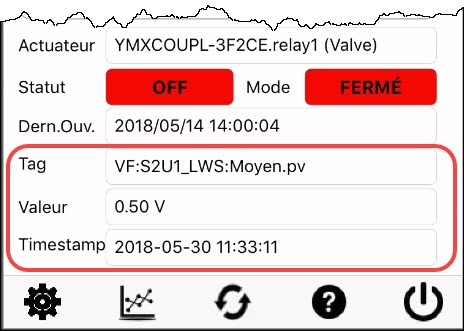 
    1.  Red:  The actuator is always closed
    2.  Green:  The actuator is always open
    3.  Turquoise: The actuator is in automatic mode and responds to MaestrEau commands

10. You can also see the actuator's current state (open=green /closed=red) as well as the time of the last action on the actuator; 

11. If a Tag is attached to the Zone, you can see the Tag, its value and the timestamp of the last value read; 

## Viewing data

For target-based control types, a tag is associated with the zone and the tag's current value is compared to the control setpoint in order to actuate the actuator.  You can view the tag's data for the last few hours from the mobile application to see what is happening:

1.  Tap the Data Graph button at the bottom of the screen: 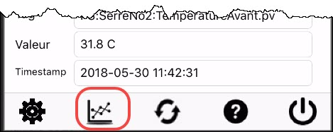{ width=350 }
2.  A graph appears and shows the data for the last two hours: 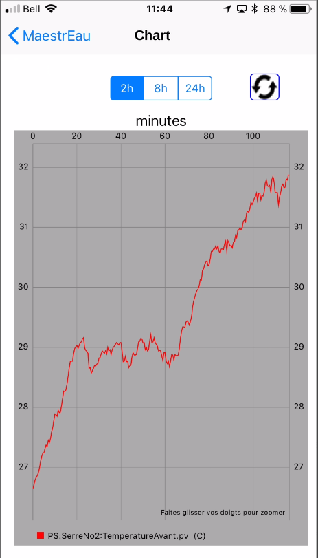{ width=250 }
3.  You can change the time window by choosing one of the three ranges:  2h, 8h and 24h: 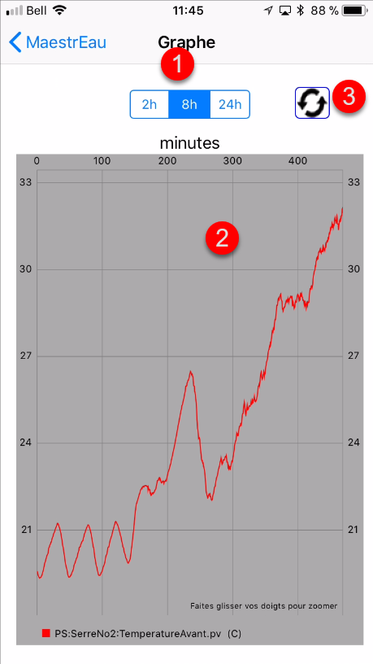{ width=250 }
4.  The data appear in the graph (2) and you can refresh its content by tapping the Refresh button (3);
5.  Tap the MaestrEau arrow to return to the main screen.

## Activating a Zone

You can activate or deactivate a zone so that the control programs are active or suspended.

1.  On the zone's main screen, slide the **Enabled** switch to the left to deactivate the zone: 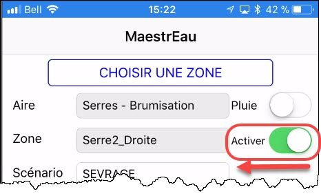{ width=350 }
2.  The application asks you to confirm the action... Answer Yes to proceed;
3.  The zone is deactivated and no control operation is performed on the zone;
4.  To activate the zone, slide the **Enabled** switch to the right to deactivate the zone: 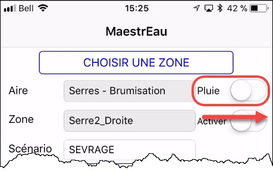{ width=350 }
5.  The zone is then active and the switch turns green:
6.  The application asks you to confirm the action... Answer Yes to proceed;
7.  The zone is activated and the programs of the active scenario will be applied: 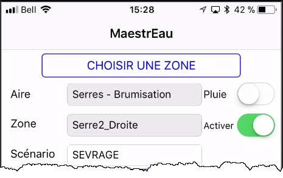{ width=350 }

## Rain mode

Applying Rain mode to a zone, mainly used in irrigation, "suspends" control operations on the zone for a given period of time.  When the set period expires (i.e. when the rain period is over), the zone's control operations resume.

1.  On the zone's main screen, slide the **Rain** switch to the right to activate the mode: { width=350 }
2.  The application asks you to confirm the action... Answer Yes to proceed;
3.  A display appears asking you to specify when control operations on the zone should resume.  Enter the date and time of resumption: 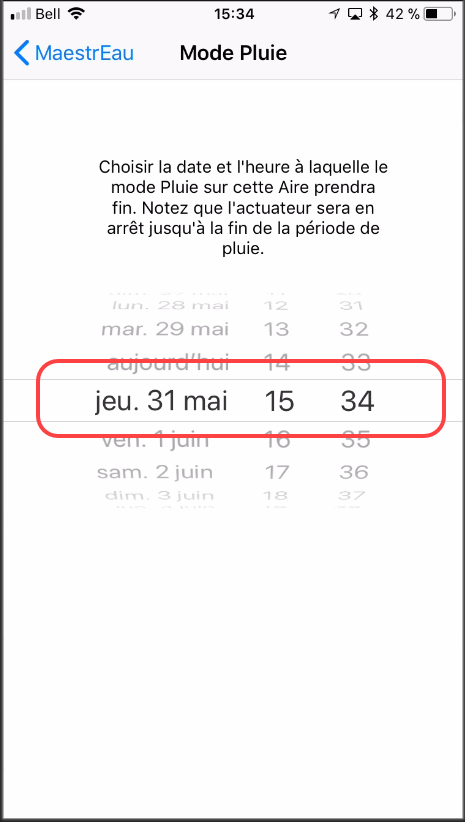{ width=250 }
4.  Once selected, tap the MaestrEau arrow to return to the main screen and Rain mode is activated on this zone.  The Rain switch turns green: 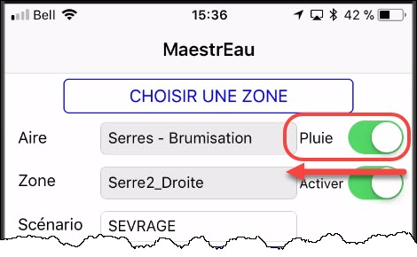{ width=350 }
5.  The zone will resume its activities when the specified date/time is reached;
6.  You can cancel Rain mode at any time... To do so, slide the switch to the left to deactivate the mode: { width=350 }
7.  The application asks you to confirm the action... Answer Yes to proceed;
8.  A message confirms that Rain mode on this zone is deactivated.

## Changing the active scenario

A zone can have several control scenarios to apply different control modes, and **only one scenario can be active**.  You can change the active scenario from the application.

1.  On the zone's main screen, tap the Scenario field and a drop-down list of the scenarios configured for the zone appears at the bottom of the page: 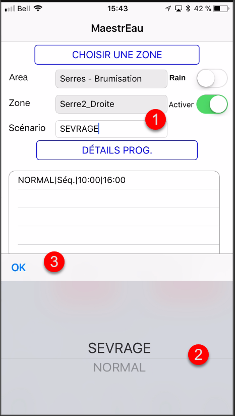{ width=250 }
2.  Choose the desired scenario (2) from the drop-down list and tap OK (3);
3.  The new scenario appears in the field and a message confirms the scenario change;
4.  The programs of the new active scenario appear on the main screen and are put into action: 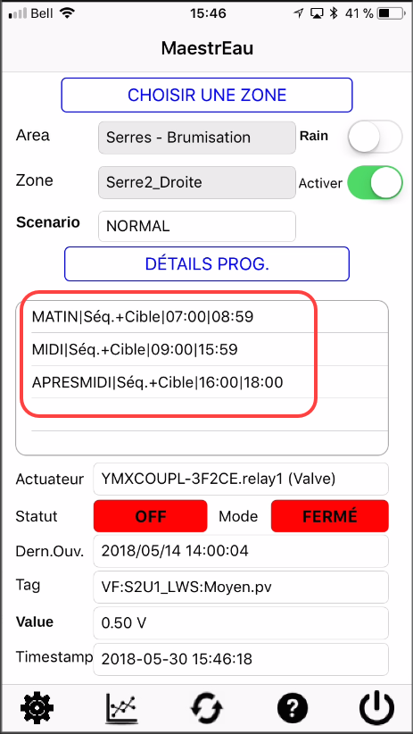{ width=250 }

## Manual operations on the Zone

The application also allows you to perform manual operations on an **active** zone such as **open**, **close**, **stop** and return to **automatic** mode.

1.  On the zone's main screen, tap the gear icon at the bottom left of the display or tap directly in the mode field of the screen: 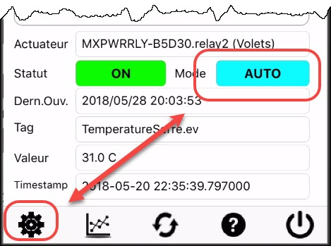{ width=300 }

2.  A dialog appears and offers the various options that can apply to control: 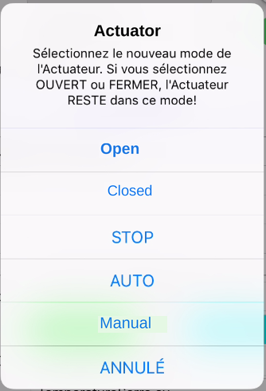

3.  Choose one of the options to actuate the actuator according to the zone's control mode (i.e. Sequence, Sequence+Target, Target, ON/OFF, Damper, Manual);

    !!! info

        For the various control mode options, see the MaestrEau documentation for Windows by [clicking this link.](maestreau-web/operations.md)

## Logging out

When you have finished with the application:

1.  Tap the logout button located in the lower right corner of the screen: 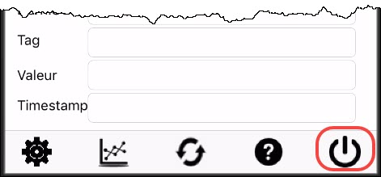{ width=250 }
2.  You are back at the home screen to log in to the system again: { width=200 }
