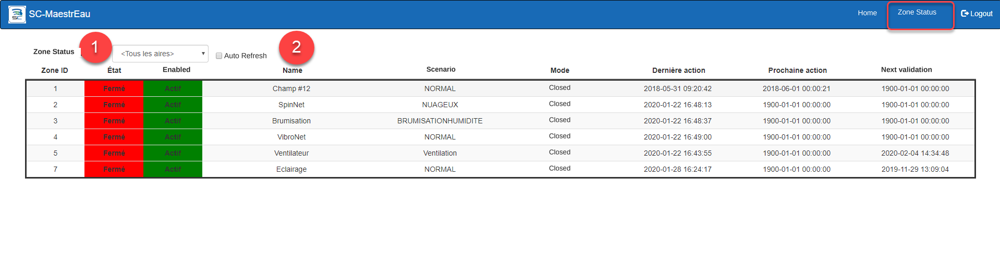

# Zone Status

This display lets you view the status of the Zones for a given control Area.

{ width=1024 }

## Step-by-Step Guide

The functions of the Zone Status tab are as follows:

## Monitoring Zone Status

1.  Choose an Area from the drop-down list and the list will be refreshed to display the Zones of the chosen Area;
2.  You can check the Auto Refresh box so that the display refreshes every 15 seconds;
3.  The display contains the following information:
    1.  The Zone ID
    2.  The Zone state:  Green= Running, Red= Stopped;
    3.  The Zone status:  Green= Active, Red= Inactive
    4.  The Zone name;
    5.  The Zone's currently active scenario;
    6.  The current mode;
    7.  The timestamp of the last action;
    8.  The timestamp of the next scheduled action;
    9.  The timestamp of the next control cycle (Target and Sequence+Target modes);
