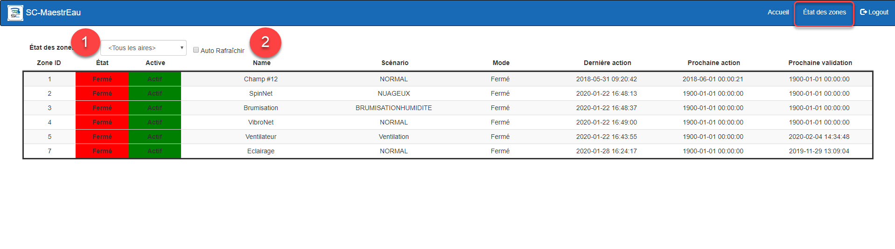

# État des Zones

Cet affichage permet de visualiser l'état des Zones pour une Aire de contrôle donnée.

{ width=1024 }

## Guide étape-par-étape

Les fonctions de l'onglet État des Zones  sont les suivants:

## Suivi de l'état des Zones

1.  Choisir une Aire dans la liste déroulante et la liste seras rafraichît pour afficher les Zones de l'Aire choisie;
2.  On peut cocher la case Auto Rafraichir pour que l'affichage se rafraichisse toutes les 15 secondes;
3.  L'affichage contient les informations suivantes:
    1.  L'ID de la Zone
    2.  L'état de la Zone:  Vert= En marche, Rouge= En arrêt;
    3.  Status de la Zone:  Vert= Actif, Rouge= Innactif
    4.  Nom de la Zone;
    5.  Le scénario actuellement actif de la Zone;
    6.  Le mode actuel;
    7.  L'horodatage de la dernière action;
    8.  L'horodatage de la prochaine  action prévue;
    9.  L'horodatage du prochain cycle de contrôle (mode Cible et Séquence+Cible);
