# Operations

MaestrEau opens on the main tab, which displays the various Areas, Zones and Scenarios that cover all of your operations.  The application lets you change certain operating parameters of a Program as well as activate/deactivate Areas, Zones and Scenarios. Fields that are locked can be changed using the SC-Config application, which is managed by your site administrator.

## Step-by-Step Guide

The functions of the main tab are as follows:

## Navigation

MaestrEau opens on the main screen and lets you navigate through the various Zones grouped into Areas.  Each Zone has one or more Scenarios of which only one is active, and each Scenario can have one or more Programs.  A program lets you set the control parameters (irrigation, misting, lighting, etc.) for a given time slot.

The following figure gives a general overview.

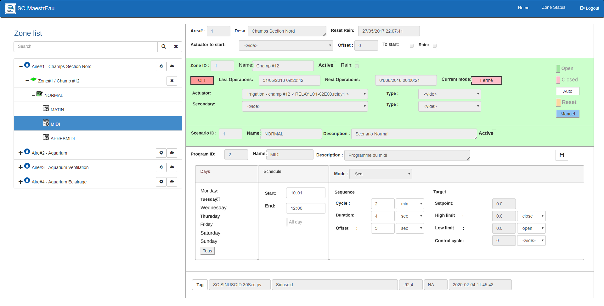{ width=1024 }

Navigation is done in the tree on the left of the screen and works like a directory and file structure on Windows.

1.  To access the Zones of an Area, click the "+" sign next to the chosen Area and the list of Zones of that Area appears, sorted by Zone number: 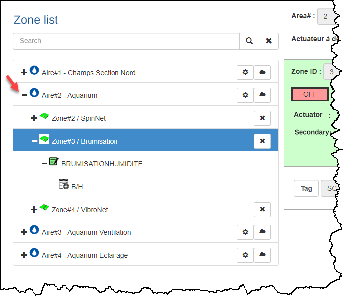{ width=500 }

2.  When you click a Zone, its data fields appear in the top-right panel of the screen and contain the characteristics of this Zone as well as the functions attached to it; 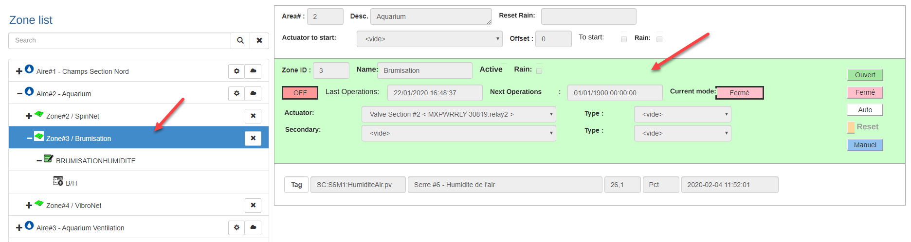{ width=1024 }

3.  To access the Scenarios of a Zone, click the "+" sign next to the chosen Zone and the list of Scenarios of that Zone appears, sorted by Scenario number.  The icon of the active Scenario appears in green and the other scenarios are on a white background: 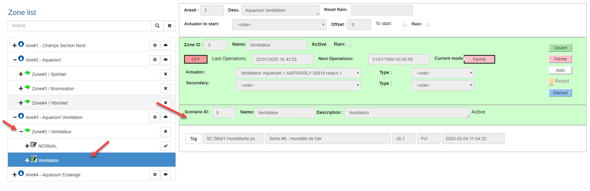{ width=1024 }

4.  To access the Programs of a Scenario, click the "+" sign next to the chosen Scenario and the list of Programs of that Scenario appears, sorted by the Program's start time.

5.  When you click a Program, its data fields appear in the panel below the Scenario panel on the right of the screen and contain the characteristics of this Program as well as the functions attached to it;

    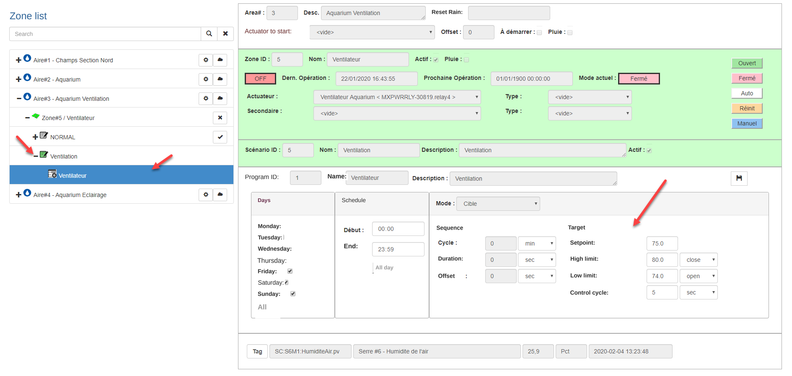{ width=1024 }

6.  You can access the functions for each entity (Area, Zone, Scenario) by choosing the desired entity.  You can then click the function you want to run.  For example, you can activate a Scenario by clicking the **Activate** button  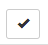.  A message will appear to confirm the activation:

    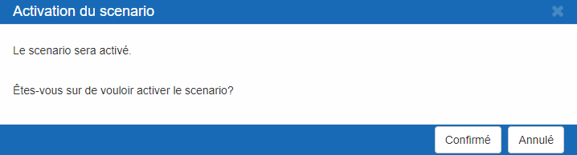{ width=600 }

7.  Each entity is identified by an icon that represents it and has a color that defines the state of the entity (e.g., the active Scenario is green).  The following table lists the icons for each entity and the definition of the state for each color.

    | Entities  |   Icons     | Green                 | Red                                          | White                    |
    |-----------|:-----------:|-----------------------|----------------------------------------------|--------------------------|
    | Area      |  |                       |                                              | Default color            |
    | Zone      |  | The Zone is active    | The Zone is in "rain" mode or in error       | The Zone is inactive     |
    | Scenario  |  | The Scenario is active |                                             | The Scenario is inactive |
    | Program   | 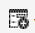 |                       |                                              | Default color            |

## Restart an Area

The MaestrEau control engine has a calculation "instance" for each control Area.  If problems occur or if a failure happens, you can manually restart the MaestrEau service from this display.

1.  Select the area for which you want to restart the MaestrEau service and click the **Restart** option 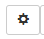; 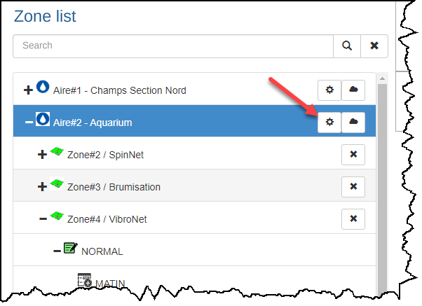{ width=400 }
2.  A message will confirm the service restart; { width=600 }
3.  Click **Confirm** to restart the service or Close to cancel.

## Activate a Zone or a Scenario

1.  To activate a zone, select the desired Zone and choose the **Activate** option ... A message will ask you to confirm the action;

2.  If the zone was active, the **Deactivate** option   will be displayed ... Click it and a message will ask you to confirm the action;

3.  The panel occupied by the zone in the window on the right turns green when the zone is active, as does the zone icon in the tree on the left: 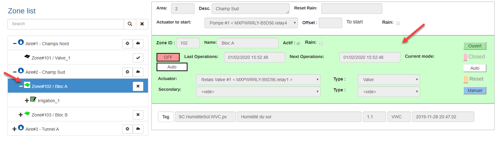{ width=1024 }

4.  To activate a scenario, select a scenario that is inactive and click the **Activate** option : 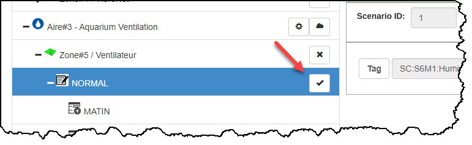{ width=600 }

5.  A message will ask you to confirm the action and the icon of the activated scenario turns green;

    !!! info

        Remember that only one scenario can be active for a given zone.

## Rain Mode

Rain mode lets you suspend the automation of a Zone for a given period of time.  This is particularly handy if rain is forecast and you want to suspend irrigation or other control actions.

Rain mode is applied to all the zones of a same control area.

1.   Select the desired control area and click the **Rain Mode** option 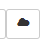: 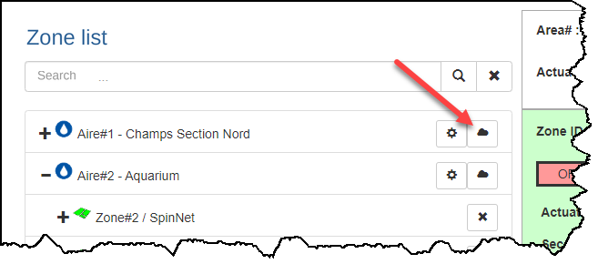{ width=600 }
2.  If the zones of the area were already in rain mode, they will all be returned to normal mode;
3.  If the zones were in normal mode, a dialog appears asking you to set how long rain mode will last;
4.  You can enter the number of hours the mode will last (1) or directly enter the date and time at which the mode will end (2): { width=482 }
5.  Click the **Confirm** button for the mode to take effect;
6.  A message confirms the action and indicates when service will resume;
7.  The zone panels turn red, as do the icons in the tree on the screen: 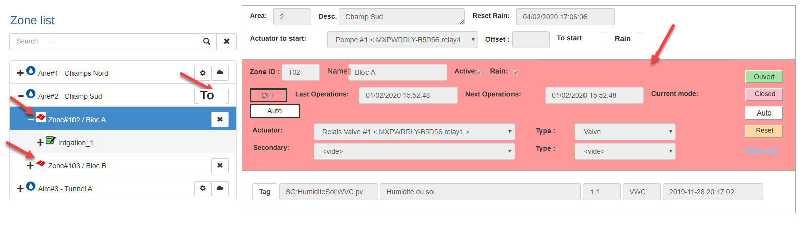{ width=870 }
8.  As soon as the pause duration has expired, rain mode will end and control of the zone will resume with the parameters configured under the active scenario;
9.  You can cancel rain mode by repeating the actions of this procedure (click rain mode ). { width=718 }

## Manually Actuate a Zone

An actuator is configured for each zone of a given control area.  MaestrEau automatically controls this actuator, but it can also be actuated manually when you want to perform a temporary action ("manual" activation) or a prolonged one (the actuator is always open or closed).

1.  Choose the desired zone and go to the panel in the window on the right where the activation buttons are located; 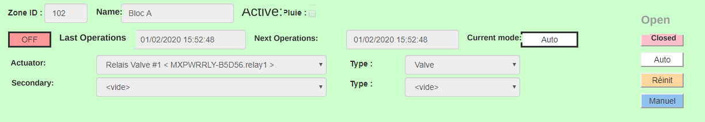{ width=800 }

2.  Click the "Manual" button to start the actuator for the period corresponding to the "duration" field for the sequence or sequence+target modes, or for a period of 5 seconds for the other modes;

3.  Click the "Open" button to keep the actuator open;

    !!! info

        ****The actuator** will stay open until the user clicks the Closed or Auto button.**

4.  Click the "Closed" button to keep the actuator closed;

    !!! info

        **The actuator will stay closed until the user clicks the Open or Auto button.**

5.  In the case of the Damper mode, you can click the Stop button to stop the closing or opening of the damper.

    !!! info

        **The actuator will stay stopped until the user clicks the Open, Closed or Auto button.**

6.  Click the Auto button to return to automatic control of the zone's actuator.

## Change a Program's Parameters

You can change the parameters of a program to adjust operations in real time for a given zone.  These changes are applied as soon as the display refreshes.

1.  Choose a program under the scenario and edit the fields in the program panel in the window on the right: 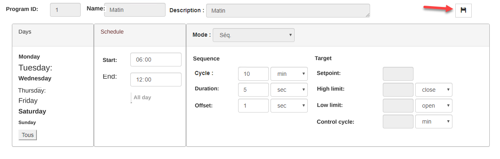{ width=800 }

2.  Make the desired changes and click the **Save** button  located at the top of the section;

    !!! info

        Almost all parameters can be changed from the MaestrEau application except the name, the description and the control mode.

    !!! info

        An error message may appear when trying to save your changes (e.g., the stop time is earlier than the start time). Follow the instructions and modify the values to comply. If you want to "cancel" your change, simply select another program or scenario without saving.

3.  The changes are saved and take effect at the next execution of the program.

    !!! info

        Make sure to choose the active scenario if you want the changes to take effect on the zone, and be careful to choose the right program.

## Related Articles

- [MaestrEau on Android](../maestreau-sur-android.md)
- [Zone Status](etat-des-zones.md)
- [MaestrEau Web](index.md)
- [Operations](operations.md)
- [MaestrEau on iPhone](../maestreau-sur-iphone.md)
