# Opérations

MaestrEau s'ouvre sur l'onglet principal qui affiche les différents Aires, Zones et Scénarios qui couvrent l'ensemble de vos opérations.  L'application vous permet de changer certains paramètres de fonctionnement d'un Programme ainsi que d'activer/désactiver des Aires, Zones et Scénarios. Les champs qui sont bloqués peuvent être changés à l'aide de l'application SC-Config qui est gérée par l'administrateur de votre site.

## Guide étape par étape

Les fonctions de l'onglet principal sont les suivants:

## Navigation

MaestrEau s'ouvre sur l'écran principal et vous permettent de naviguer au travers les différentes Zones regroupées sous forme d'Aires.  Chaque Zone possède un ou plusieurs Scénarios dont un seul est actif et chaque Scénario peut posséder un ou plusieurs Programmes.  Un programme permet d'établir les paramètres de contrôle (irrigation, brumisation, éclairage, etc.) pour une plage de temps donnée.

La figure suivante donne un aperçu général.

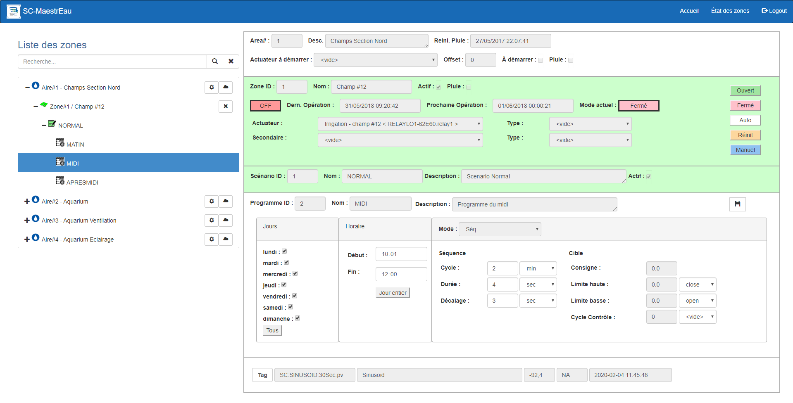{ width=1024 }

La navigation se fait dans l'arborescence située à la gauche de l'écran et fonctionne comme une structure de répertoires et fichiers sur Windows.

1.  Pour accéder aux Zones d'une Aire, cliquer sur le signe "+" vis-à-vis l'Aire choisie et la liste des Zones de cet Aire apparait triée par numéro de Zone: 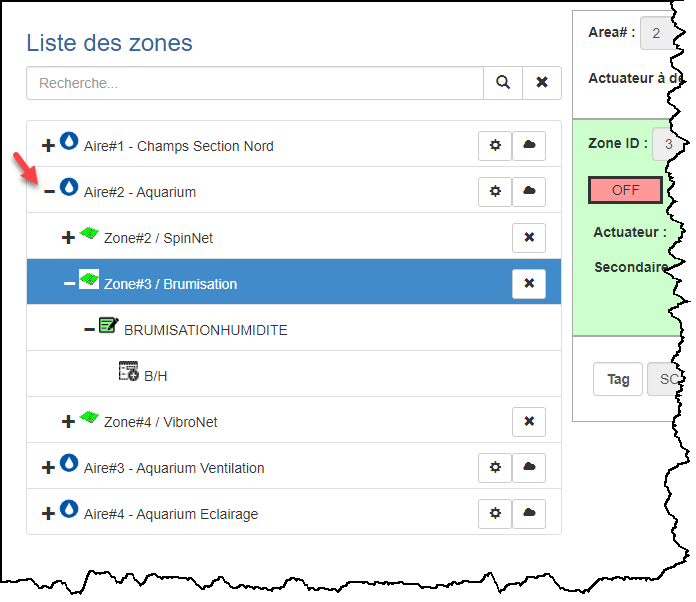{ width=500 }

2.  Lorsque vous cliquez sur une Zone, les champs de données de celle-ci apparaissent dans le panneau en haut à droite de l'écran et contiennent les caractérisques de cette Zone ainsi que les fonctions qui s'y rattachent; 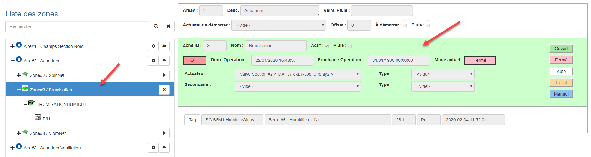{ width=1024 }

3.  Pour accéder aux Scénarios d'une Zone, cliquer sur le signe "+" vis-à-vis la Zone choisie et la liste des Scénarios de cette Zone apparait triée par numéro de Scénario.  L'icône du Scénario actif apparait en vert et les autres scénarios sont sur fond blanc: 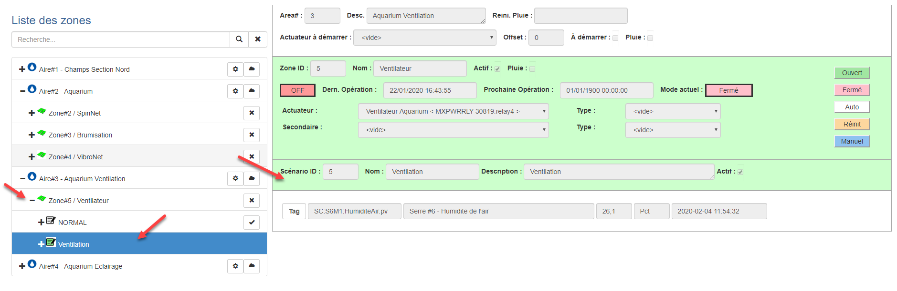{ width=1024 }

4.  Pour accéder aux Programmes d'un Scénario, cliquer sur le signe "+" vis-à-vis le Scénario choisi et la liste des Programmes de ce Scénario apparait triée par l'heure de début du Programme.

5.  Lorsque vous cliquer sur un Programme, les champs de données de celui-ci apparaissent dans le panneau en dessous du panneau du Scénario à droite de l'écran et contiennent les caractérisques de ce Programme ainsi que les fonctions qui s'y rattachent;

    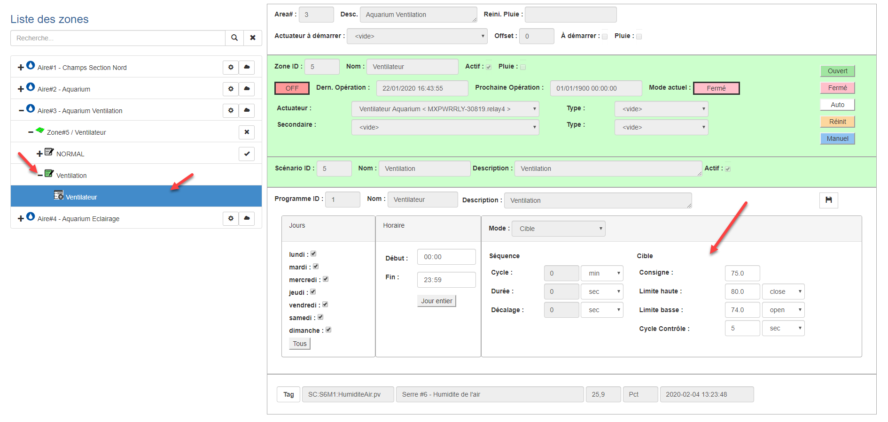{ width=1024 }

6.  On peut accéder aux fonctions pour chaque entité (Aire, Zone, Scénario) en choisissant l'entité voulue.  Vous pouvez alors cliquer la fonction que vous désirez exécuter.  Par exemple, on peut activer un Scénario en faisant un clique sur le bouton **Activer**  .  Un message apparaitra pour confirmer l'activation:

    { width=600 }

7.  Chaque entité est identifiée par un icône qui la représente et qui a une couleur qui définit l'état de l'entité (ex.: le Scénario actif est vert).  Le tableau suivant donne la liste des icônes pour chaque entité et la définition de l'état pour chaque couleur.

    | Entités   |   Icones    | Vert                  | Rouge                                        | Blanc                    |
    |-----------|:-----------:|-----------------------|----------------------------------------------|--------------------------|
    | Aire      |  |                       |                                              | Couleur par défaut       |
    | Zone      |  | La Zone est active    | La Zone est en mode "pluie" ou est en erreur | La Zone est innactive    |
    | Scénario  |  | Le Scénario est actif |                                              | Le Scénario est innactif |
    | Programme |  |                       |                                              | Couleur par défaut       |

## Redémarrer une Aire

L'engin de contrôle MaestrEau possède une "instance" de calcul pour chaque Aire de contrôle.  Si des problèmes se présentent ou si une panne survient, on peut redémarrer manuellement le service de MaestrEau à partir de cet affichage.

1.  Sélectionner l'aire pour laquelle on veut redémarrer le service MaestrEau et cliquer l'option **Redémarrer** ; 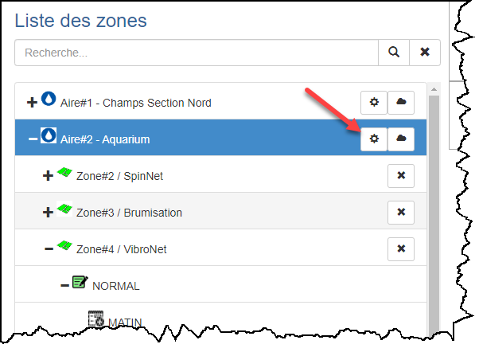{ width=400 }
2.  Un message confirmera le redémarrage du service; 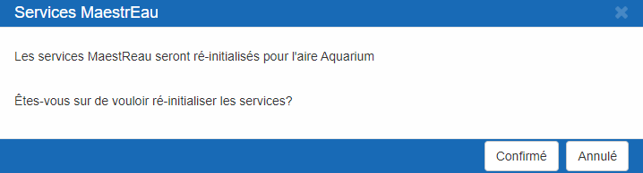{ width=600 }
3.  Cliquer sur **Confirmer** pour redémarrer le service ou sur Fermer pour annuler.

## Activer une Zone ou un Scénario

1.  Pour activer une zone, sélectionné la Zone désirée et choisir l'option **Activer** ... Un message demanderas de confirmer l'action;

2.  Si la zone était active, l'option **Désactiver**   seras affiché ... Faire un clique et un message demanderas de confirmer l'action;

3.  Le panneau qu'occupe la zone dans la fenêtre de droite change de couleur pour le Vert lorsque la zone est active ainsi que l'icône de la zone dans l'arborescence de gauche: 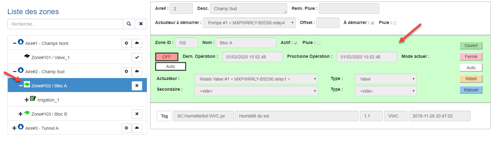{ width=1024 }

4.  Pour activer un scénario, sélectionner un scénario qui est inactif et cliquer sur l'option **Activer** : 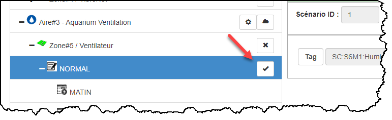{ width=600 }

5.  Un message demanderas de confirmer l'action et l'icône du scénario activé change au vert;

    !!! info

        Il faut rappeler qu'un seul scénario ne peut être actif pour une zone donnée.

## Mode de pluie

Le mode de pluie permet de suspendre l'automatisation d'une Zone pour une période de temps donnée.  Ceci est particulièrement pratique si de la pluie est prévue et qu'on veut suspendre l'irrigation ou d'autres actions de contrôle.

On applique le mode pluie à toutes les zones d'une même aire de contrôle.

1.   Sélectionner l'aire de contrôle désirée et cliquer sur l'option **Mode pluie** : 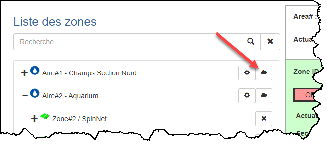{ width=600 }
2.  Si les zones de l'aire étaient déjà en mode de pluie, elles seront toutes remises en mode normal;
3.  Si les zones étaient en mode normal, un dialogue apparait pour demander de déterminer la durée que prendra le mode pluie;
4.  On peut entrer le nombre d'heures que durera le mode (1) ou entrer directement la date et l'heure où le mode prendra fin (2): 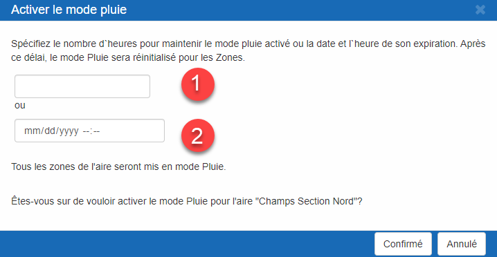{ width=482 }
5.  Cliquer sur le bouton **Confirmé** pour que le mode prenne effet;
6.  Un message confirme l'action et indique le moment de la reprise du service;
7.  Les panneaux des zones changent pour le rouge ainsi que les icônes dans l'arborescence de l'écran: 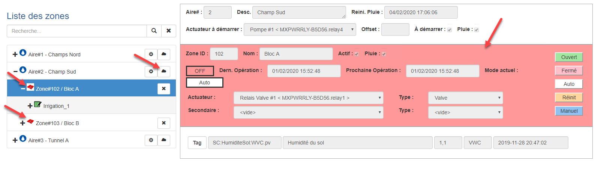{ width=870 }
8.  Dès que la durée de l'intermission sera expirée, le mode de pluie cessera et le contrôle de la zone reprendra avec les paramètres configurés sous le scénario actif;
9.  Vous pouvez annuler le mode pluie en répétant les actions de cette procédure (clique sur le mode pluie ). 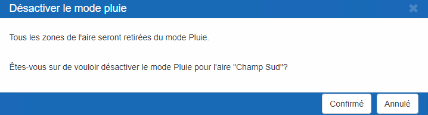{ width=718 }

## Actionner manuellement une Zone

Un actuateur est configuré pour chaque zone d'une aire de contrôle donnée.  MaestrEau contrôle automatiquement cet actuateur, mais il est également possible de l'actionner manuellement dans le cas où on désire faire une action temporaire (activation "manuelle") ou prolongée (l'actuateur est toujours ouvert ou fermé).

1.  Choisir la zone désirée et aller sur le panneau de la fenêtre de droite où se trouvent les boutons d'activation; 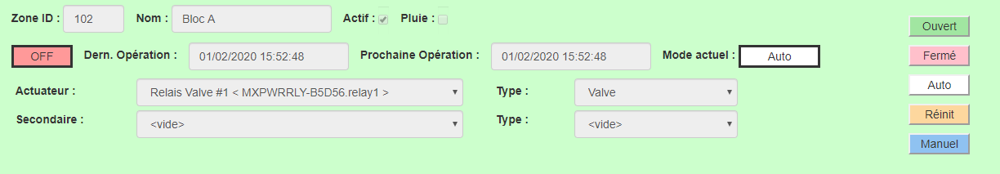{ width=800 }

2.  Cliquer sur le bouton "Manuel" pour démarrer l'actuateur pour la période correspondant au champ "durée" pour les modes séquence ou séquence+cible ou a une période de 5 secondes pour les autres modes;

3.  Cliquer sur le bouton "Ouvert" pour garder l'actuateur ouvert;

    !!! info

        ****L'actuateur** restera ouvert tant que l'utilisateur n'aura pas cliqué sur le bouton Fermé ou Auto.**

4.  Cliquer sur le bouton "Fermé" pour garder l'actuateur fermé;

    !!! info

        **L'actuateur restera fermé tant que l'utilisateur n'aura pas cliqué sur le bouton Ouvert ou Auto.**

5.  Dans le cas du mode Volet, on peut cliquer sur le bouton Stop pour arrêter la fermeture ou l'ouverture du volet.

    !!! info

        **L'actuateur restera stopé tant que l'utilisateur n'aura pas cliqué sur le bouton Ouvert, Fermé ou Auto.**

6.  Cliquer sur le bouton Auto pour le retour au contrôle automatique de l'actuateur de la zone.

## Changer les paramètres d'un Programme

On peut changer les paramètres d'un programme afin d'ajuster les opérations en temps réel pour une zone donnée.  Ces changements sont appliqués dès que l'affichage se rafraichit.

1.  Choisir un programme sous le scénario et éditer les champs dans le panneau du programme dans la fenêtre de droite: 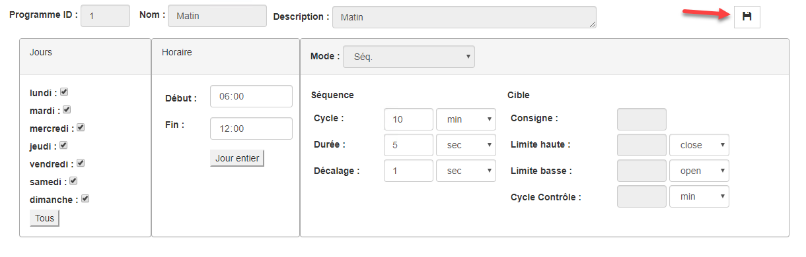{ width=800 }

2.  Apporter les changements désirés et cliquer sur le bouton **Sauvegarder** 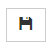 situé en haut de la section;

    !!! info

        On peut changer presque tous les paramètres à partir de l'application MaestrEau sauf le nom, la description et le mode de contrôle.

    !!! info

        Il se peut qu'un message d'erreur surgisse en essayant de sauvegarder vos changements (ex.: l'heure d'arrêt est plus petit que l'heure de départ). Suivez les instructions et modifier les valeurs pour vous y conformer. Si vous voulez "annuler" votre changement, simplement sélectionner un autre programme ou scénario sans sauvegarder.

3.  Les changements sont sauvegarder et prennent effet à la prochaine exécution du programme.

    !!! info

        Assurez-vous de bien choisir le scénario actif si vous désirez que les changements prennent effet sur la zone et faites attention de choisir le bon programme.

## Articles reliés

- [MaestrEau sur Android](../maestreau-sur-android.md)
- [État des Zones](etat-des-zones.md)
- [MaestrEau Web](index.md)
- [Opérations](operations.md)
- [MaestrEau sur iPhone](../maestreau-sur-iphone.md)
