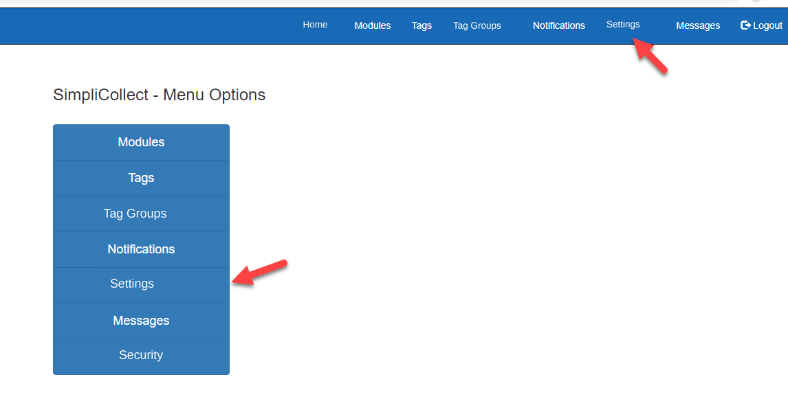
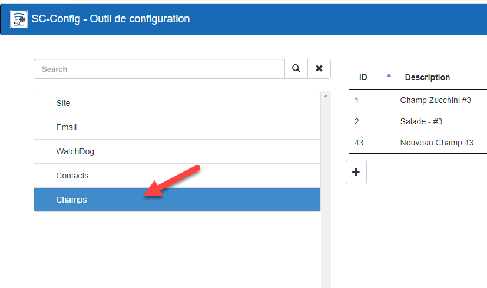
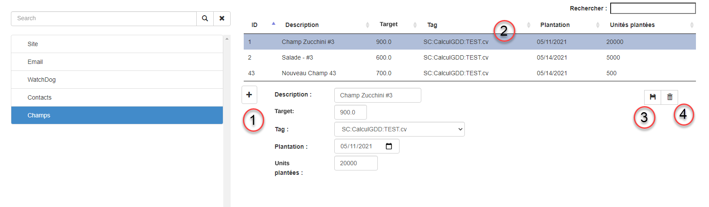
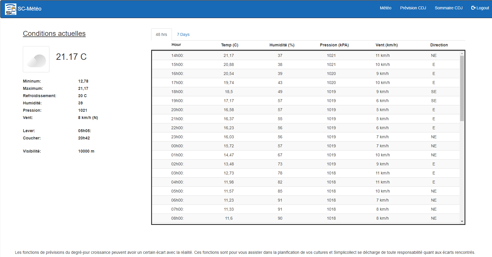
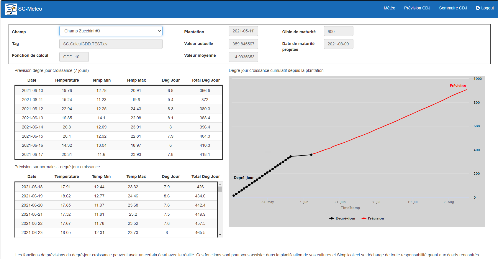
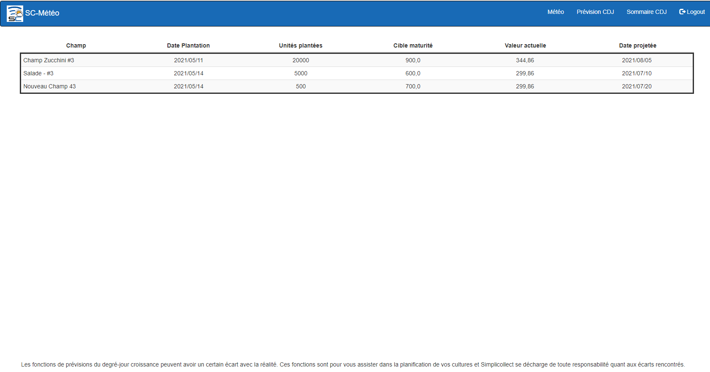

# SimpliWeather

SimpliWeather loads weather data into Simplicollect "tags".  This lets you compare this data with your other data acquired by the sensors of the SimpliCollect modules.

Other forecasting functions are available, including:

·         48-hour hourly forecasts

·         7-day daily forecasts

·         Growing degree-day forecasts and harvest date

{ width=340 }

## Configuration

The fields must be configured in order to use the SimpliWeather function;

1.  Open the configuration module;

    { width=258 }

2.  Open the Settings option;

    { width=272 }

3.  Select the Fields item;

    { width=272 }

4.  Once the Fields item is selected, the panel for adding or editing fields appears;

    { width=442 }

#### Navigation options

1.  The "+" button **(1)** lets you add a field.

2.  To modify an existing field, select it in the table **(2)** to display the edit section.

3.  Once the data has been entered or modified for the field, click the Save button **(3)**.

4.  To delete a field, select it in the table, click the Delete button **(4)** and confirm that you want to delete it.

## Explanation of the data to configure

1.  The Description must contain text that clearly identifies the field that will be used for SimpliWeather.

2.  The Target is the amount in Degree-Days that you want to reach.

3.  The Tag is the measurement in Degree-Days that comes from your field.

4.  The Planting is the date your plants were planted.

5.  Units planted is the number of plants planted in your field.

## Navigation

1.  Once connected to SimpliCollect Web, click the **Weather** icon to start the application;

    { width=136 }

2.  Once the application is launched, the current conditions, the 48-hour forecasts and the next 7 days are displayed;

    { width=306 }

3.  You then have access to the Degree-Day Forecasts and the Summaries by field by clicking the menu items;

    { width=367 }

4.  If you click GDD Forecast, the forecast window appears;

    { width=374 }

5.  If you click GDD Summary, the summary window appears;

    { width=374 }
