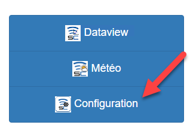
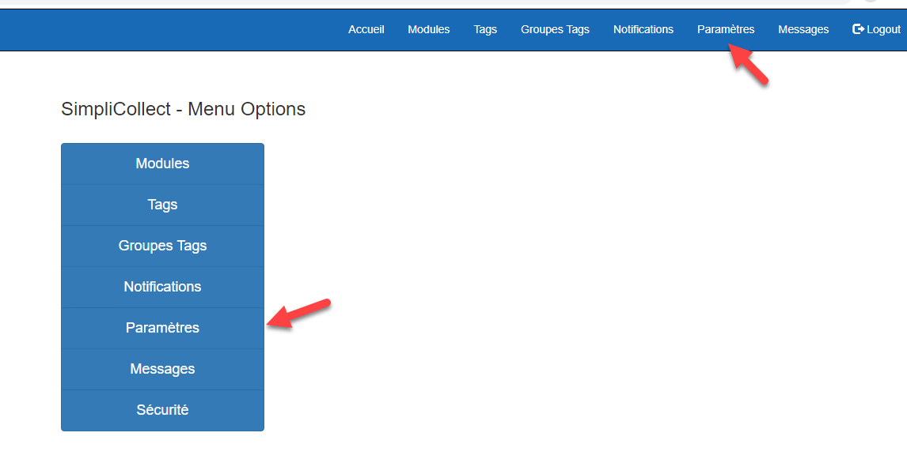
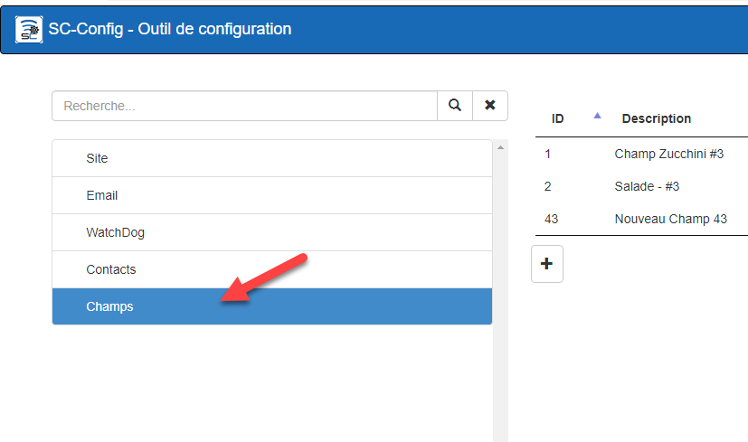
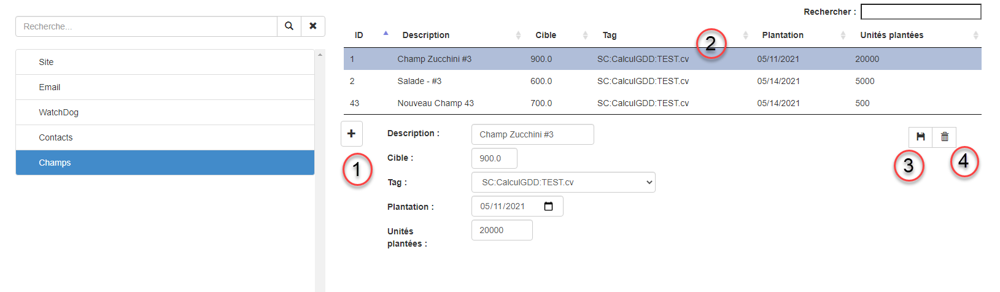
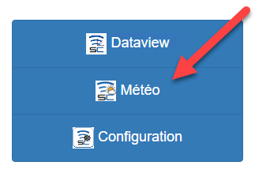
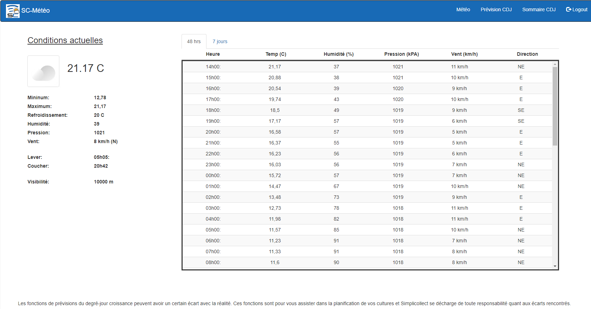
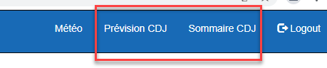

# SimpliMétéo

SimpliMétéo permet le chargement de données météorologiques dans des « tags » Simplicollect.  Ainsi, vous pouvez comparer ces données avec vos autres données acquises par les sondes des modules SimpliCollect.

D’autres fonctions de prévisions sont disponibles incluant:

·         Prévisions horaires 48 heures

·         Prévisions quotidiennes 7 jours

·         Prévisions de degré-jours et date de récolte

{ width=340 }

## Configuration

Il faut configurer les champs pour pouvoir utiliser la Fonction SimpliMétéo;

1.  Ouvrir le module de configuration;

    { width=258 }

2.  Ouvrir l’option Paramètres;

    { width=272 }

3.  Sélectionner l’item Champs;

    { width=272 }

4.  Une fois l’item Champs sélectionné, le panneau permettant d’ajouter ou éditer les champs apparaît;

    { width=442 }

#### Options de navigation

1.  Le bouton “+” **(1)** permet d’ajouter un champ.

2.  Pour modifier un champ existant, il faut le sélectionner dans le tableau **(2)** pour faire afficher la section d'édition.

3.  Une fois les données entré ou modifié pour le champ Il faut cliquer sur le bouton de Sauvegarde **(3)**.

4.  Pour effacer un champ, on le sélectionne dans le tableau et on clique sur le bouton Effacer **(4)** et on doit confirmer que l’on veut efffacer.

## Explication des données à configurer

1.  La Description doit contenir un text qui identifie bien le champ qui servira pour SimpliMétéo.

2.  La Cible est la quantité en Degrée-Jour que vous voulez atteindre.

3.  Le Tag est la mesure en Degrée-Jour qui provient de votre champ.

4.  La Plantation est la date de plantation de vos plants.

5.  Unités plantées est le nombre de plants plantés dans votre champ.

## Navigation

1.  Une fois connecter à SimpliCollect Web, Cliquer sur l'icône **Météo** pour démarrer l'application;

    { width=136 }

2.  Une fois l’application lancée, les conditions actuelles, les prévisioins pour 48 heures et les 7 prochains jours vous sont affichées;

    { width=306 }

3.  Vous avez ensuite accès aux Prévisions Degée-Jour et aux Sommaires par champs en cliquant sur les items du menu;

    { width=367 }

4.  Si vous cliquez sur Prévision CDJ la fenêtre de prévision apparaîtra;

    { width=374 }

5.  Si vous cliquez sur Sommaire CDJ la fenêtre du sommaire apparaîtra;

    { width=374 }
