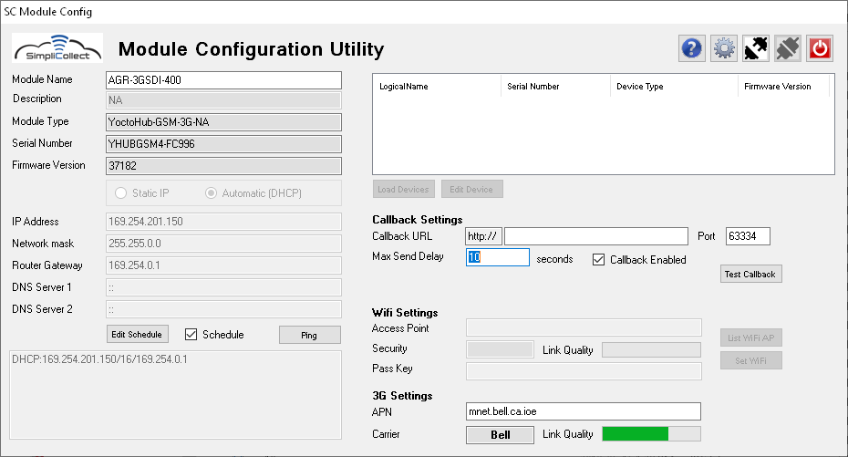
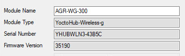
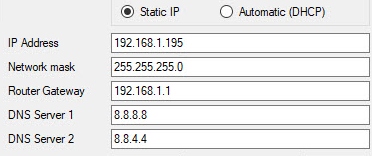
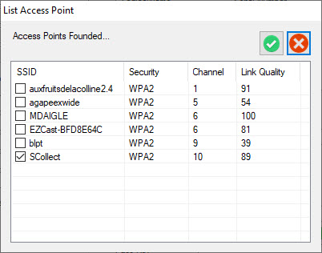
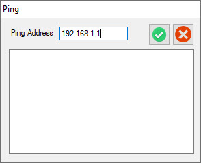
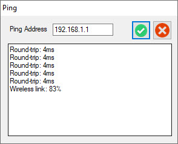
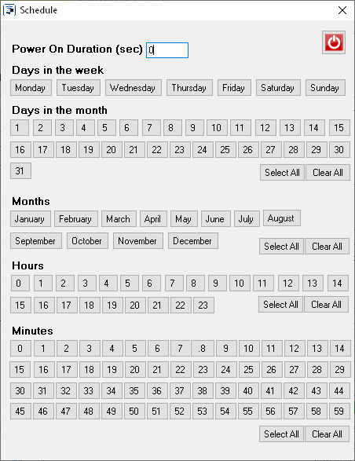
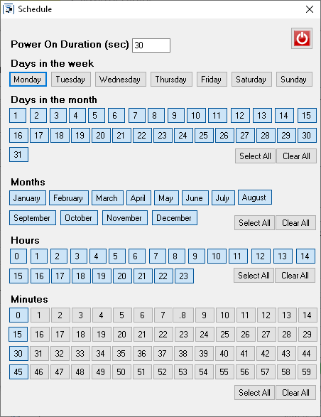

# Module Configuration Utility

SC-ModuleConfig is the configuration tool for Simplicollect modules.

Several module parameters must be configured for the module to be functional, so that it connects to your communication network and can transfer data to the Simplicollect Gateway.

These parameters include:

- Connection to the Wifi network or connection parameters for the 3G cellular network
- Connection to the REST service of the Simplicollect Gateway
- IP network attributes
- Operating schedule

In addition, the utility lets you view the list of Sensors that are available on the module.

## Step-by-step guide

The functions of the application are as follows:

## Installation

Download the installation file below (click the link) and run it on your Windows PC.  Follow the instructions displayed while the installation kit runs.

 Module Configurator.msi (file not included in this repository)   (version 1.2.111, April 2020)

The software is compatible with Windows 7 through Windows 10.

## Connecting to the module

1.  Connecting to any module requires the use of a 4-pin M8 male to USB cable as shown below. 

2.  Plug the M8 male connector into the M8 female connector of the module

    !!! info

        Pay attention to the pins of the connector.  There is a correct orientation to respect.

3.  Screw in the male connector by hand

    !!! info

        Never tighten the connector too hard and never use pliers to tighten it.

4.  Connect the USB end to your computer.  A beep from Windows should confirm that a new USB connection has been recognized

    !!! info

        If nothing happens, click the "RESET" button located on the left side of the enclosure

5.  Start the SC-ModuleConfig application using the icon    on Windows  (on the desktop or from the Simplicollect\>SC-ModuleConfig menu)  and the following screen appears: { width=700 }

6.  Click the connection icon  to connect the application to the module.  The screen will fill with the module's parameters: { width=700 }

    !!! info

        A message tells you not to <u>UNPLUG</u> the cable <u>BEFORE</u> clicking the Disconnect and Save button. Doing so could cause your changes not to be saved.

        In addition, the connect button  is disabled and the disconnect and save button  is enabled to avoid any error.

## Module identification

1.  The basic identification of the module is located in the upper left corner of the main display; 
2.  It lists:
    1.  The module name
    2.  The module type
    3.  Its serial number
    4.  The firmware version
3.  This information may be requested of you during a technical support call.

## IP network attributes

1.  The IP attributes are displayed on the left side of the main screen: 
2.  Although the module can connect to a DHCP server, it is strongly recommended to assign a fixed IP address to the module so that the signal can be monitored continuously;
3.  To do so, choose the Static IP selector and enter the IP parameters specific to the module;
4.  You will be able to test the IP address after the connection to the Wifi network has been established.

## Connecting to the Wifi network

1.  Click the List Wifi AP button to obtain the list of Wifi access points reachable by the module.  The following dialog appears: 

    !!! info

        The list of access points can take up to 30 seconds to appear, depending on the number of devices and the quality of the signals.

2.  Choose an access point and click the accept button  to complete the command.  A message prompts you to enter the access point's security code in the field provided for that purpose;

3.  Back on the main screen, enter the security code and click the Set Wifi button to connect the module to the access point.  A success or error message will be displayed;

4.  If the connection is made correctly, a bar displays the signal strength;

## Connecting to the 3G/4G cellular network

As a general rule, modules with a cellular connection are preconfigured with the SIM card supplied by the customer.  If you connect the application to a cellular module, the 3G/4G section will display the module's APN as well as the presence of the signal.

Your cellular service provider will assign you an APN, for example: pda.bell.ca (Bell Mobility), ltemobile.apn (Rogers), spn.telus.com (Telus), etc.

You can change the APN (the address of your cellular provider) and save it.  You can test the connection (next section) using the address 8.8.8.8 (Google DNS address).

## Testing the network connection (Ping)

1.  Click the Ping button and the following dialog appears: 
2.  Enter the "target" address for the test (e.g. the address of the network router) in the field;
3.  Click the run button  to start the test;
4.  The dialog gives the ping response time as well as the recorded signal strength: 
5.  Click the close button  to close the dialog.

## Web Callback service (Web Callback)

When the module is in "continuous" service, the Simplicollect Gateway continuously extracts data coming from the module.  The other communication mode is initiated by the module toward the Simplicollect Gateway by connecting to the REST service of the Gateway.

1.  Enter the IP address of the server or its URL (if over the Internet) as well as the port that was assigned to the REST service;

2.  Enter the frequency at which data is sent to the Gateway in the field ;

    !!! info

        If you use this function together with the execution schedule, set a fast execution frequency, for example every 10 seconds, to make sure the data is transmitted for as long as the module is running.

3.  Once set, click the Test Callback button and a dialog appears and displays the success of the connection

## Execution schedule

It is possible to start the module using an execution schedule.  The purpose of this function is to run the module during certain periods in order, for example, to conserve the energy of the module's power batteries or to limit the use of expensive cellular bandwidth. The rest of the time, the module is in "sleep" mode and does not consume any energy.

1.  Click the Edit Schedule button and the following dialog will appear: { width=375 }

2.  Click the various buttons that let you set the execution schedule precisely at the level of the months, days, hours and minutes at which the module will run... For example, if you want to run the module every 15 minutes on every day of every month: { width=375 }

    !!! info

        It is very important that all sections be filled in and that the Power Duration field be greater than 30 seconds.  This field is the length of time the module stays on after waking up, and a minimum of 30 seconds is required to establish communication and send the data.

        If you want to **disable** the execution schedule without losing your configuration, set the Power Duration field to zero (0).  This will cause the module to stay on at all times.

        **<u>Never leave a module permanently on if you are using a battery as the power source.  This would drain the battery too quickly and could even fully drain the battery overnight.</u>**

3.  Click the button   to save the data and exit the dialog.

## List of measurement devices

!!! info

    This procedure does not work with devices using 3G communication.

You can display the list of the module's various measurement boards.

1.  Click the Load Devices button to load the list of measurement devices installed in the module 

## Saving the parameters

1.  Do not forget to click the disconnect and save button  before exiting the application 
