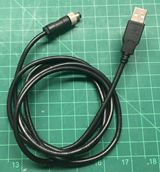
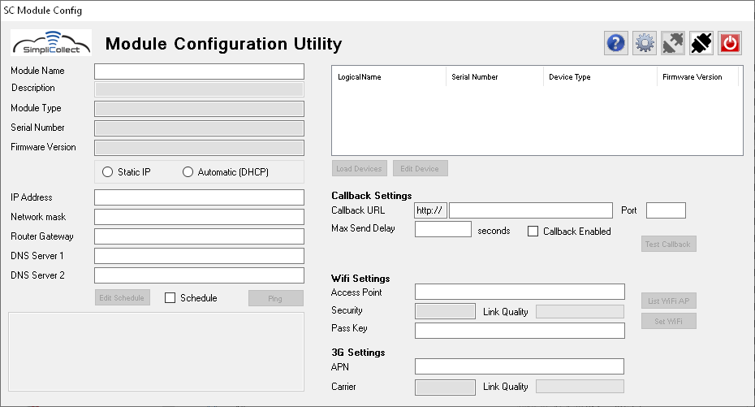
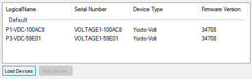
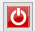

# Utilitaire de configuration des modules

SC-ModuleConfig est l'outil de configuration des modules Simplicollect.

Plusieurs paramètres d'un module doivent être configurer afin que ce dernier soit fonctionnel afin de se raccorder à votre réseau de communication et pouvoir transférer des données vers la passerelle Simplicollect.

Ces paramètre inclus:

- Raccordement au réseau Wifi ou paramètre de raccordement au réseau cellulaire 3G
- Raccordement au service RESTde la passerelle Simplicollect
- Attributs de réseau IP
- Cédule d'opération

De plus, l'utilitaire permet de visualiser la liste des sondes qui sont disponibles sur le module.

## Guide étape par étape

Les fonctions de l'application sont les suivantes:

## Installation

Télécharger le fichier d'installation ci-dessous (cliquez sur le lien) et exécutez le sur votre PC Windows.  Suivre les instructions affichées lors de l'exécution du kit d'installation.

 Module Configurator.msi (fichier non inclus dans ce dépôt)   (version 1.2.111, Avril 2020)

Le logiciel est compatible avec Windows 7 jusqu'à WIndows 10.

## Connexion au module

1.  La connexion à tous les modules demande l'utilisation d'un câble M8 4 pins mâle vers USB tel que ci-dessous. 

2.  Brancher le connecteur M8 mâle dans le connecteur M8 femelle du module

    !!! info

        Porter attention aux pins du connecteur.  Il y a un sens à respecter.

3.  Viser le connecteur mâle à la main

    !!! info

        Ne jamais serrer trop fort le connecteur et ne jamais utiliser de pince pour le serrer.

4.  Connecter la partie USB à votre ordinateur.  Un bip sonore émis par Windows devrait confirmer la reconnaissance d'une nouvelle connexion USB

    !!! info

        Si rien ne se produit, cliquer sur le bouton "RESET" situé sur le coté gauche du boitier

5.  Démarrer l'application SC-ModuleConfig à l'aide de l'icône    sur Windows  (sur le bureau ou à partir du menu Simplicollect\>SC-ModuleConfig)  et l'écran suivant apparait: { width=700 }

6.  Cliquer sur l'icone de connexion  afin de raccorder l'application au module.  L'écran se remplira des paramètres du module: { width=700 }

    !!! info

        Un message vous indique de ne pas <u>DÉBRANCHER</u> le câble <u>AVANT</u> de cliquer sur le bouton Déconnecter et Sauvegarder. Ceci pourrait faire en sorte que vos changement ne seront pas sauvegarder.

        De plus, le bouton connecter  est désactivé et le bouton déconnecter et sauvegarder  est activé afin d'éviter toute erreur.

## Identification du module

1.  L'identification de base du module se trouve dans le coin supérieur gauche de l'affichage principal; 
2.  On y liste:
    1.  Le nom du module
    2.  Le type de module
    3.  Son numéro de série
    4.  La version du micrologiciel (firmware)
3.  Ces renseignements peuvent vous être demandé lors d'un apppel de support technique.

## Attributs réseau IP

1.  Les attributs IP sont affichés dans la partie gauche de l'écran principal: 
2.  Bien que le module peut se connecter sur un serveur DHCP, il est fortement recommandé d'assigner une adresse IP fixe au module afin de pouvoir faire la surveillance en continu du signal;
3.  Pour ce faire, choisir le sélecteur Static IP et entrer les paramètes IP propre au module;
4.  Vous pourrez tester l'adresse IP après que la connexion au réseau Wifi sera établie.

## Connexion au réseau Wifi

1.  Cliquer sur le bouton List Wifi AP afin d'obtenir la liste des points d'accès Wifi accessibles au module.  Le dialogue suivant apparait: 

    !!! info

        La liste des points d'accès peut prendre jusqu'à 30 secondes avant d'apparaitre dépendant du nombre d'appareil et de la qualité des signaux.

2.  Choisir un point d'accès et cliquer sur le bouton d'acceptation  pour compléter la commande.  Un message vous avertie d'entrer le code de sécurité du point d'accès dans le champ prévu à cet effet;

3.  De retour à l'écran principal, entrer le code de sécurité et cliquer sur le bouton Set Wifi pour connecter le module au point d'accès.  Un message de succès ou d'erreur sera affiché;

4.  Si la connexion se fait correctement, un barre affiche la force du signal;

## Connexion au réseau cellulaire 3G/4G

En règle général, les modules en connexion cellulaire sont préconfiguré avec la carte SIM fournie par le client.  Si vous raccordez l'application à un module cellualire, la section 3G/4G affichera l'APN du module ainsi que la présence du signal.

Votre fournisseur de services cellulaires vous attribura un APN comme par exemple: pda.bell.ca (Bell Mobilité), ltemobile.apn (Rogers), spn.telus.com (Telus), etc.

Vous pouvez changer l'APN (adresse de votre fournisseur de cellulaire) et la sauvegarder.  Vous pouvez tester la connexion (prochaine section) en utilisant l'adresse 8.8.8.8 (adresse de Google DNS).

## Tester la connexion au réseau (Ping)

1.  Cliquer sur le bouton Ping et le dialogue suivant apparait: 
2.  Entrer l'adresse "cible" pour le test (ex.: l'adresse du routeur du réseau) dans le champ;
3.  Cliquer sur le bouton d'exécution  pour démarrer le test;
4.  Le dialogue donne le temps de réponse du ping ainsi que la force du signal enregistré: 
5.  Cliquer sur le bouton de fermeture  pour fermer le dialogue.

## Service Web d'appel (Web Callback)

Lorsque le module est en service "continu", la passerelle Simplicollect extrait les données en continu en provenance du module.  L'autre mode de communication est lancé par le module vers la passerelle Simplicollect en se raccordant au service REST de la passerelle.

1.  Entrer l'adresse IP du serveur ou son URL (si à travers l'Internet) ainsi que le port qui a été assigné au service REST;

2.  Entrer la fréquence d'envois des données vers la passerelle dans le champ ;

    !!! info

        Si vous utilisez cette fonction avec l'horaire d'exécution, établir une fréquence d'exécution rapide, par exemple au 10 secondes, afin de s'assurer que les données soient acheminées pour la durée que le module est en fonction.

3.  Lorsque qu'établie, cliquer sur le bouton Test Callback et un dialogue apparait et affiche le succès de la connexion

## Horaire d'exécution

Il est possible de démarrer le module à l'aide d'un horaire d'exécution.  Le but de cette fonction est de faire fonctionner le module durant certaines périodes afin, par exemple, de conserver l'énergie des batteries d'alimentation du module ou afin de limiter l'utilisation de la bande passante cellulaire qui est couteuse. Le reste du temps, le module est en "veille" et ne consomme pas d'énergie.

1.  Cliquer sur le bouton Edit Schedule et le dialogue suivant apparaitra: { width=375 }

2.  Cliquer sur les différents boutons qui permettent d'établir précisément l'horaire d'exécution au niveau des mois, des jours, des heures et des minutes auxquels le module va s'exécuter... Par exemple, si on veut exécuter le module aux 15 minutes à tous les jours de tous les mois: { width=375 }

    !!! info

        Il est très important que toutes les section soient remplies et que le champs Power Duration soit plus grand que 30 secondes.  Ce champ est la durée que le module reste en fonction suite au réveil et un minimum de 30 secondes et nécessaire pour établir la communication et envoyer les données.

        Si vous désirez **désactiver** l'horaire d'exécution sans perdre votre configuration, mettre le champ Power Duration à zéro (0).  Ceci aura pour effet que le module restera toujours allumé.

        **<u>Ne jamais laisser une module toujours allumé si vous utiliser une batterie comme source d'énergie.  Ceci aurait pour effet de décharger la batterie trop rapidement et même décharger complètement la batterie la nuit.</u>**

3.  Cliquer sur le bouton   pour sauvegarder les données et quitter le dialogue.

## Liste des dispositifs de mesure

!!! info

    Cette procédure ne fonctionne pas avec les appareils utilisant la communication 3G.

On peut afficher la liste des différentes cartes de mesure du module .

1.  Cliquer sur le bouton Load Devices afin de charger la liste des dispositifs de mesure installés dans le module 

## Sauvegarde des paramètres

1.  N'oubliez pas de cliquer sur le bouton déconnecter et sauvegarder  avant de quitter l'application 
