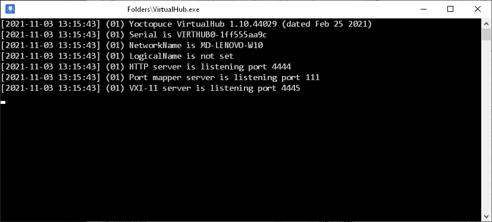
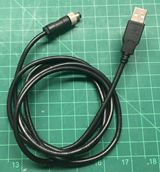
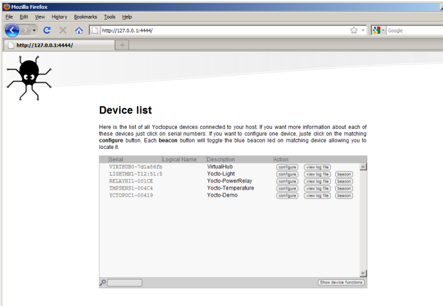
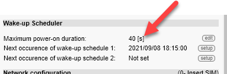
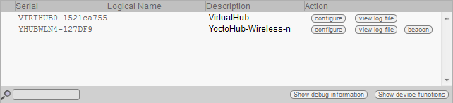
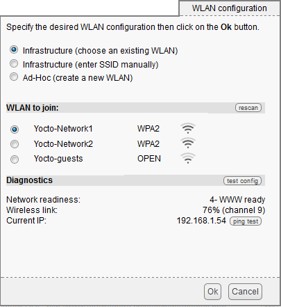
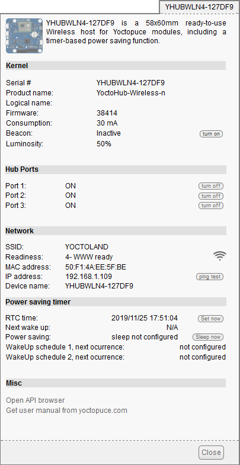
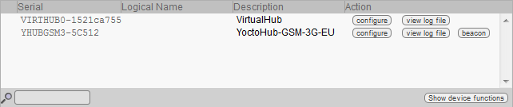
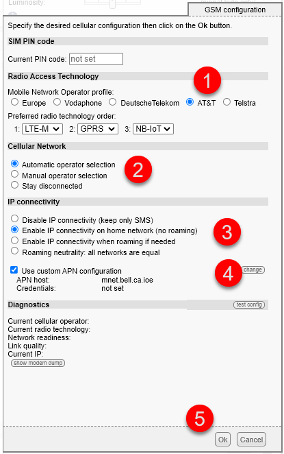
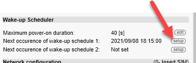

# VirtualHub Configuration Utility

The VirtualHub (Yoctopuce) configuration utility lets you modify every configuration detail of a Yoctopuce board.

!!! warning

    WARNING: Using this utility requires firmware qualifications and may affect the operation of the Yoctopuce board.

The sections of the procedure are:

## Installing VirtualHub

VirtualHub does not really need to be installed. It is a simple executable file. Copy it wherever you like and launch it from a command line. No driver is required. On Windows, if you do not want to have to launch VirtualHub explicitly every time you need it, you can install it as a service: just launch it once with the -i option and VirtualHub will start automatically every time the computer boots.

VirtualHub needs to save a few settings; these settings are saved in a .virtualhub.dat file placed in the user's AppData directory on Windows, and in the user's home directory on Linux and Mac OS X. This behavior can be changed with a command-line option.

To use it on Windows, download the program from the following link: <https://www.yoctopuce.com/FR/downloads/VirtualHub.windows.46854.zip>

Copy the program to your Windows Desktop and run it. A window with the execution controls will appear. Keep this window open for as long as you need the application.

{ width=272 }

## Starting VirtualHub

Just like the Simplicollect Configuration Utility, connecting to any of the modules requires a 4-pin M8 male to USB cable as shown below.

1.  Plug the M8 male connector into the module's M8 female connector

    { width=102 }

2.  **WARNING**: Pay attention to the connector pins. There is a correct orientation.

3.  Screw in the male connector by hand

4.  **WARNING**: Never overtighten the connector and never use pliers to tighten it.

5.  Connect the USB end to your computer.  A beep from Windows should confirm that a new USB connection has been recognized.

!!! warning

    If you see no reaction from the module, press the "RESET" button on the left side of the enclosure.

VirtualHub lets you test and configure your Yoctopuce modules. To do so, make sure a VirtualHub is running on the machine the modules are connected to, then open your favorite web browser. Connect over HTTP to port 4444 of the machine running VirtualHub. If it is the local machine, use the address <http://127.0.0.1:4444>. The list of your modules should appear.

{ width=272 }

Then launch your favorite browser on the URL of your VirtualHub. It is generally http://127.0.0.1:4444. You will get the list of Yoctopuce modules connected over USB, including your communication board.

Click the configure button corresponding to your YoctoHub, and you will get the module's configuration window.

!!! warning

    If your module is powered by batteries, a wake-up timer is probably enabled. See the procedure below to disable the wake-up mode.

## Wake-up Mode

When the module is powered by batteries, the "wake-up" mode must be enabled to limit battery usage. In this mode the module "wakes up" at regular intervals and then "goes back to sleep". The Maximum power-on duration parameter sets the awake time required for communication to be established with the Simplicollect gateway and for the data to be transferred.

You will need to "suspend the wake-up mode manually so that you have time to make the configuration changes.

!!! info

    After you have finished making the changes, make sure to set the wake-up mode timer back to the correct number of seconds.

On the main screen, go to the **Wake-up Scheduler** section and check that the **Maximum power-on duration** is set to **no limit**. Otherwise, the display shows the number of seconds before the "sleep" mode is activated.

{ width=383 }

1.  Click the Edit button and the following display appears:

    { width=377 }

2.  Replace the value with 0 and click the Ok button.

3.  Back on the main screen, click the Save button to save the new setting.

4.  Return to the main screen to continue the configuration.

## Configuring a Wi-Fi Module

Then launch your favorite browser on the URL of your VirtualHub. It is generally http://127.0.0.1:4444. You will get the list of Yoctopuce modules connected over USB, including your YoctoHub-Wireless-n.

{ width=642 }

Click the configure button corresponding to your YoctoHub-Wireless-n, and you will get the module's configuration window. This window contains a Network configuration section.

{ width=426 }

### Connecting to the Wireless Network

The first thing to do is to configure your YoctoHub-Wireless-n so that it connects to your Wi-Fi network. To do so, click the edit button corresponding to WLAN settings in the Network configuration section, and the wireless network configuration window appears:

{ width=405 }

You can then choose whether to connect your YoctoHub-Wireless-n to an existing network, or to manually enter the SSID of the network you want to use.

You can also configure the YoctoHub-Wireless-n to generate its own wireless network in Software enabled Access Point (SoftAP) mode. You can then connect directly to the YoctoHub-Wireless-n without going through an infrastructure server (access point). Be aware, however, that this SoftAP mode of operation has limitations compared to a real Wi-Fi network. In particular, it is not possible to have more than four clients connected to the network at the same time.

After entering the wireless network settings and optionally testing them, you can click the Ok button to close this configuration window and return to the general configuration window.

If needed, you can also configure which IP address should be assigned to the YoctoHub-Wireless-n. To do so, click the edit button next to the ip adressing line.

You can choose whether the IP address of your YoctoHub-Wireless-n should be assigned by DHCP or be static. The DHCP option is recommended since this feature is supported by most ADSL boxes (it is the default configuration). If you do not know what a DHCP server is but are used to plugging devices into your network and seeing them work without problems, do not change anything.

You can also choose the network name of your YoctoHub-Wireless-n. You will then be able to reach your YoctoHub-Wireless-n using this name rather than its IP address. Once the network part is configured, click the Save button. This saves your changes and closes the configuration window. Since these changes are saved in the YoctoHub-Wireless-n's persistent memory, it will remember them even after being deprived of power.

Click the serial number corresponding to your YoctoHub-Wireless-n. This opens your module's details window:

{ width=405 }

This window contains a section describing the state of the YoctoHub-Wireless-n's network part. There you will find its MAC address, current IP address and network name. This section also gives the state of the network connection. These states can be:

- 0- search for link: The module is searching for a network link. If this state persists, the Wi-Fi network being looked for is probably not nearby.

- 1- network exists: the Wi-Fi network being looked for has been detected

- 2- network linked: the YoctoHub-Wireless-n was able to connect to the network.

- 3- LAN ready: the local network is operational (IP address obtained)

- 4- WWW ready: the module was able to verify Internet connectivity by connecting to a time server (NTP).

After verifying that your module has a valid IP address, you can close the details window, stop your VirtualHub and unplug the USB control cable from your computer: the module only needs to be powered to be used.

You can now access your YoctoHub-Wireless-n by typing its IP address directly into the address bar of your favorite browser. The module responds on the standard HTTP port, but also on port 4444 used by VirtualHub. If your module's IP address is 192.168.0.10, you can therefore reach it with the URL http://192.168.0.10.

You will then directly get the YoctoHub-Wireless-n interface. This interface is identical in every respect to that of VirtualHub. You will find the YoctoHub-Wireless-n on the first line and the modules connected to the YoctoHub-Wireless-n on the following ones.

The YoctoHub-Wireless-n interface is identical to that of a VirtualHub.

If you have assigned a name to your YoctoHub-Wireless-n, you can also use this name on the local network. For example, if you used the network name yoctohub, you can contact the module with the URL http://yoctohub on Windows and with the URL http://yoctohub.local on Mac OS X and Linux. Note that this technique is limited to the YoctoHub-Wireless-n's subnet. If you want to contact the module by name from another network, you must use a conventional DNS infrastructure.

### Yoctopuce Documentation for the Wi-Fi Board

See the complete documentation in PDF format below:

YHUBWLN4.usermanual-FR.pdf (file not included in this repository)

## Configuring a Cellular Module

Launch your favorite browser on the URL of your *VirtualHub*. It is generally [*http://127.0.0.1:4444*](http://127.0.0.1:4444). You will get the list of Yoctopuce modules connected over USB, including your YoctoHub-GSM-4G.

{ width=642 }

Click the **configure** button corresponding to your YoctoHub-GSM-4G, and you will get the module's configuration window. This window contains a **Network configuration** section.

{ width=433 }

The first step is to configure the cellular network connection by clicking the GSM Settings Edit button:

{ width=493 }

### Connecting to the Cellular Network

The first thing to do is to configure your YoctoHub-GSM-4G so that it connects to your cellular network. To do so, click the **edit** button corresponding to **GSM Settings** in the **Network configuration** section, and the cellular network configuration window appears:

{ width=461 }

It is important to understand that the usage is on the North American network, and the steps are:

1.  In the Mobile Network Operator profile section, click the AT&T button, which corresponds to the North American profile;

2.  In the Cellular Network section, choose Automatic operator selection;

3.  In the IP Connectivity section, choose Enable IP connectivity on home network (no roaming);

4.  Check the Use custom APN configuration box and click the Change button:

    1.  Enter the APN that corresponds to your cellular service provider, for example, [pda.bell.ca](http://pda.bell.ca) for Bell Mobility;

5.  Click OK to close the screen and click Save on the main screen to save your configuration.

Go back to the configuration screen and click the GSM Settings Edit button. Click the Test config button to make sure the communication board is properly connected to the cellular network.

!!! info

    In case of problems, refer to the detailed instruction manuals below and contact Yoctopuce technical support for assistance.

### Yoctopuce Documentation for the GSM Board

See the documentation below for the 4G and 3G modules:

YHUBGSM5.usermanual-FR.pdf (file not included in this repository)YHUBGSM4.usermanual-FR.pdf (file not included in this repository)

## Configuring the Wake-up Schedule

When the module is powered by batteries, the "wake-up" mode must be enabled to limit battery usage. In this mode the module "wakes up" at regular intervals and then "goes back to sleep". The Maximum power-on duration parameter sets the awake time required for communication to be established with the Simplicollect gateway and for the data to be transferred.

The first step is to configure the wake-up schedule.

1.  On the main screen, click the Setup button in the **Next occurrence of wake-up scheduler 1** section:

    { width=383 }

2.  For battery-powered modules, we recommend waking up every 15 minutes. This amply covers the amount of sunshine from April 1 to October 31... As shown below:

    { width=362 }

3.  When finished, click the Ok button.

4.  On the main screen, click the Edit button and the following display appears:

    { width=377 }

5.  Replace the value with 40, which is the recommended period, and click the Ok button.

6.  Back on the main screen, click the Save button to save the new setting.

7.  Return to the main screen to continue the configuration.

Once your configuration is complete, wait 40 seconds and the module will go into "sleep" mode. When this happens, the green LED on the left side of the enclosure will turn off and the module will be asleep. Wait 15 minutes to see the module "wake up" and run for 40 seconds.

Naturally, you can make whatever changes you want to the wake-up parameter settings and adjust them to your needs.

At any time, you can press the "RESET" button to restart your module, which will wake up for a period of 40 seconds. See the procedure above for when you want to remove the wake-up mode from your module. The detailed documentation of the Yoctopuce modules will give you more details about configuring the wake-up mode.

## 📋 Related Articles

- [Modules](configuration/modules.md)
- [Configuration](configuration/index.md)
- [Tags](configuration/tags.md)
- [Replacing the SIM in MaestrEau](../manuel-d-installation-et-de-mise-en-service/module-maestreau-et-irrigation/remplacement-sim-sur-maestreau.md)
- [Configuring the Wi-Fi Connection and IP Address](../manuel-d-installation-et-de-mise-en-service/module-maestreau-et-irrigation/configuration-de-la-connexion-wifi-et-de-l-adresse-ip.md)
