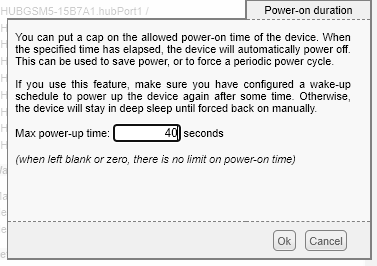
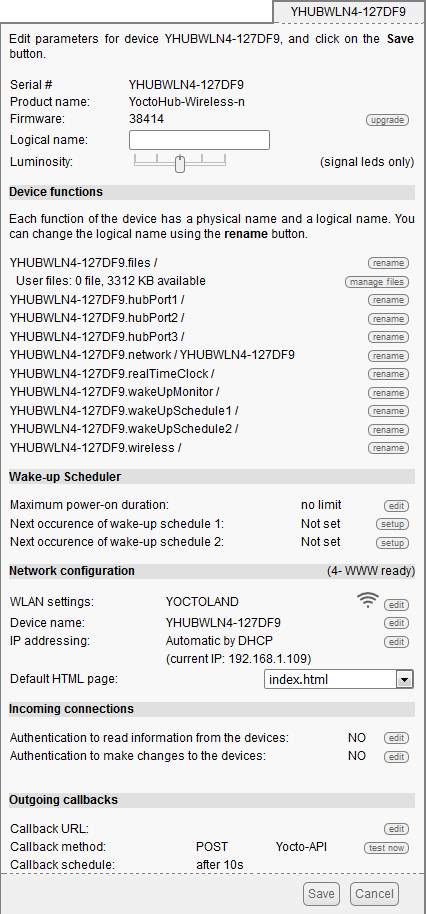
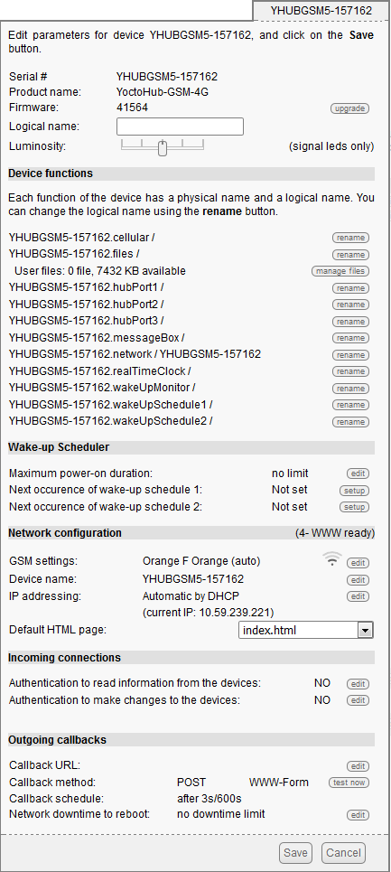
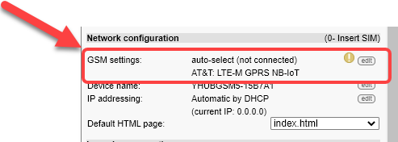
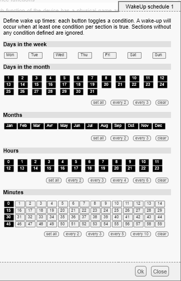

# Utilitaire de configuration VirtualHub

L’utilitaire de configuration VirtualHub (Yoctopuce) permet de modifier tous les détails de configuration d’une carte Yoctopuce.

!!! warning

    ATTENTION: L’utilisation de cet utilitaire demande des qualifications en micrologiciel et ceci peut altérer l’utilisation de la carte Yoctopuce.

Les sections de la procédure sont:

## Installation de VirtualHub

Le VirtualHub ne nécessite pas véritablement d'installation. C'est un simple fichier exécutable. Copiez-le où bon vous semble, et lancez-le depuis une ligne de commande. Aucun driver n'est nécessaire. Sous Windows, si vous ne souhaitez pas devoir lancer explicitement leVirtualHub à chaque fois que vous en avez besoin, vous pouvez l'installer en service: il vous suffit de le lancer une fois avec l'option -i et le VirtualHub se lancera automatiquement à chaque fois que l'ordinateur démarrera.

Le VirtualHub a besoin de sauvegarder quelques paramètres, ces paramètres seront sauvés dans un fichier .virtualhub.dat qui sera placé dans le répertoire AppData de l'utilisateur sous Windows, et dans le homedir de l'utilisateur sous Linux et Mac OS X. Ce comportement peut être modifié à l'aide d'une option sur la ligne de commande modifiée à l'aide d'une option sur la ligne de commande.

Pour l’utilisation sur Windows, télécharger le programme au lien suivant: <https://www.yoctopuce.com/FR/downloads/VirtualHub.windows.46854.zip>

Copiez le programme sur votre Bureau Windows et exécutez-le. Une fenêtre va apparaitre avec les commandes d’exécution. Conservez cette fenêtre ouverte tant que vous avez besoin de l’application.

{ width=272 }

## Démarrage de VirtualHub

Tout comme l’Utilitaire de configuration Simplicollect, la connexion à tous les modules demande l'utilisation d'un câble M8 4 pins mâle vers USB tel que ci-dessous.

1.  Brancher le connecteur M8 mâle dans le connecteur M8 femelle du module

    { width=102 }

2.  **ATTENTION**: Porter attention aux pins du connecteur. Il y a un sens à respecter.

3.  Viser le connecteur mâle à la main

4.  **ATTENTION**: Ne jamais serrer trop fort le connecteur et ne jamais utiliser de pince pour le serrer.

5.  Connecter la partie USB à votre ordinateur.  Un bip sonore émis par Windows devrait confirmer la reconnaissance d'une nouvelle connexion USB.

!!! warning

    Si vous constatez aucune réaction du module, pressez le bouton “RESET” sur le coté gauche du boitier.

Le VirtualHub permet de tester et configurer vos modules Yoctopuce. Pour ce faire, assurez-vous qu'un VirtualHub tourne sur la machine à laquelle sont connectés les modules, puis ouvrez votre navigateur internet favori . Connectez-vous en HTTP au port 4444 de la machine sur laquelle tourne le VirtualHub. S'il s'agit de la machine locale, utilisez l'adresse <http://127.0.0.1:4444>. La liste de vos modules devrait apparaître.

{ width=272 }

Lancez alors votre browser favori sur l'url de votre VirtualHub. Il s'agit généralement http://127.0.0.1:4444. Vous obtiendrez la liste des modules Yoctopuce connectés par USB, dont votre carte de communication.

Cliquez sur le bouton configure correspondant à votre YoctoHub, votre obtiendrez la fenêtre de configuration du module.

!!! warning

    Si votre module est monté avec batteries, il est probable qu’une minuterie de réveil soit activée. Voir la procédure ci-dessous pour désactiver le mode de réveil.

## Mode de réveil

Lorsque le module est alimenté à partir de batteries, on doit activer le mode de “réveil” afin de limiter l’usage des batteries. Ce mode fait en sorte que le module se “réveille” à intervalles réguliers et “s’endort” par la suite. Le paramètre Maximum power-on duration établie la durée d'éveil requis pour que la communication s'établisse avec la passerelle Simplicollect et que les données soient transférées.

Vous devrez “suspendre le mode de réveil manuellement afin d’avoir le temps de faire les changements de configuration.

!!! info

    Après avoir terminé les changements, assurez-vous de remettre la minuterie du mode de réveil au bon nombre de secondes.

Sur l'écran principal, allez à la section **Wake-up Scheduler** et vérifier que le **Maximum power-on duraction** est à **no limit**. Dans le cas contraire, l’affichage montre le nombre de secondes avant que le mode de “dormance” soit activé.

{ width=383 }

1.  Cliquez sur le bouton Edit et l’affichage suivant apparait:

    { width=377 }

2.  Remplacez la valeur par 0 et cliquez sur le bouton Ok.

3.  De retour sur l'écran principal, cliquez sur le bouton Save pour sauvegarder le nouveau réglage.

4.  Revenez dans l'écran principal pour poursuivre la configuration.

## Configuration d’un module Wifi

Lancez alors votre browser favori sur l'url de votre VirtualHub. Il s'agit généralement http://127.0.0.1:4444. Vous obtiendrez la liste des modules Yoctopuce connectés par USB, dont votre YoctoHub-Wireless-n.

{ width=642 }

Cliquez sur le bouton configure correspondant à votre YoctoHub-Wireless-n, votre obtiendrez la fenêtre de configuration du module. Cette fenêtre comporte une section Network configuration.

{ width=426 }

### Connexion au réseau sans fil

La première chose à faire consiste à configurer votre YoctoHub-Wireless-n pour qu'il se connecte à votre réseau WiFi. Pour cela cliquez sur le bouton edit correspondant à WLAN settings dans la section Network configuration, la fenêtre de configuration du réseau sans fil apparaît:

{ width=405 }

Vous pouvez alors choisir si vous souhaitez connecter votre YoctoHub-Wireless-n à un réseau existant, ou si vous préférez entrer manuellement le SSID du réseau que vous voulez utiliser.

Vous pouvez aussi configurer le YoctoHub-Wireless-n pour qu'il génère son propre réseau sans fil en mode Software enabled Access Point (SoftAP). Vous pourrez alors vous connecter directement sur le YoctoHub-Wireless-n sans avoir a passer par un serveur d'infrastructure (point d'accès). Soyez toutefois conscients que ce mode de fonctionnement SoftAP a des limitations par rapport à un vrai réseau WiFi. En particulier il n'est pas possible d'avoir plus que quatre clients connectés au réseau en même temps.

Après avoir entré les paramètres de réseau sans fil et éventuellement les avoir testés, vous pouvez cliquer sur le bouton Ok pour fermer cette fenêtre de configuration et retourner à la fenêtre de configuration générale.

Vous pouvez aussi, en cas de besoin, configurer quelle adresse IP doit être attribuée au YoctoHub-Wireless-n. Pour ce faire, cliquez sur le bouton edit en face de la ligne ip adressing.

Vous pouvez choisir si l'adresse IP de votre YoctoHub-Wireless-n doit être attribuée par DHCP ou si elle doit être fixe. L'option DHCP est recommandée dans la mesure où cette fonctionnalité est supportée par la plupart des boîtiers ADSL (c'est la configuration par défaut). Si vous ne savez pas ce qu'est un serveur DCHP mais avez l'habitude de brancher des appareils sur votre réseau et de les voir marcher sans problème, ne touchez à rien.

Vous pouvez aussi choisir le nom réseau de votre YoctoHub-Wireless-n. Vous pourrez ainsi accéder à votre YoctoHub-Wireless-n en utilisant ce nom plutôt que son adresse IP. Une fois la partie réseau configurée, cliquez sur le bouton Save. Cela qui aura pour effet de sauver vos modifications et de fermer la fenêtre de configuration. Ces modifications étant sauvées dans la mémoire persistante du YoctoHub-Wireless-n, il s'en rappellera même après avoir été privé de courant.

Cliquez sur le numéro de série correspondant à votre YoctoHub-Wireless-n. Cela ouvrira la fenêtre détails de votre module:

{ width=405 }

Cette fenêtre comporte une section qui relate l'état de la partie réseau du YoctoHub-Wireless-n. Vous y trouverez son adresse MAC, adresse IP courante et nom de réseau. Cette section donne aussi l'état de la connexion réseau. Ces états peuvent être:

- 0- search for link: Le module cherche une liaison réseau. Si cet état persiste, il est probable que le réseau wifi recherché n'est pas à proximité.

- 1- network exists: le réseau wifi recherché a été détecté

- 2- network linked: le YoctoHub-Wireless-n a pu se connecter au réseau.

- 3- LAN ready: le réseau local est opérationnel (adresse IP obtenue)

- 4- WWW ready: le module a pu vérifier la connectivité à Internet en se connectant à un serveur de temps (NTP).

Après avoir vérifié que votre module a bien une adresse IP valide, vous pouvez fermer la fenêtre détails, arrêter votre VirtualHub et débrancher le câble USB de contrôle de votre ordinateur: il suffira que le module soit alimenté pour l'utiliser.

Vous pouvez désormais accéder à votre YoctoHub-Wireless-n en tapant directement son adresse IP dans la barre d'adresse de votre browser favori. Le module répond au port HTTP standard, mais aussi au port 4444 utilisé par le VirtualHub. Si l'adresse IP de votre module est 192.168.0.10, vous pourrez donc le joindre avec l'URL http://192.168.0.10.

Vous obtiendrez alors directement l'interface du YoctoHub-Wireless-n. Cette interface est en tout point identique à celle du VirtualHub. Vous retrouvez le YoctoHub-Wireless-n sur la première ligne et les modules connectés au YoctoHub-Wireless-n sur les suivantes.

L'interface du YoctoHub-Wireless-n est identique à celle d'un VirtualHub.

Si vous avez attribué un nom à votre YoctoHub-Wireless-n, vous pouvez aussi utiliser ce nom sur le réseau local. Par exemple, si vous avez utilisé le nom réseau yoctohub, vous pouvez contacter le module avec l'URL http://yoctohub sous Windows et avec l'URL http://yoctohub.local sous Mac OS X et Linux. Notez que cette technique est limitée au sous-réseau du YoctoHub-Wireless-n. Si vous voulez contacter le module par nom depuis un autre réseau, vous devez utiliser une infrastructure DNS classique.

### Documentation Yoctopuce pour carte Wifi

Voir la documentation complète en format PDF ci-dessous:

YHUBWLN4.usermanual-FR.pdf (fichier non inclus dans ce dépôt)

## Configuration d’un module cellulaire

Lancez votre browser favori sur l'url de votre *VirtualHub*. Il s'agit généralement [*http://127.0.0.1:4444*](http://127.0.0.1:4444). Vous obtiendrez la liste des modules Yoctopuce connectés par USB, dont votre YoctoHub-GSM-4G.

{ width=642 }

Cliquez sur le bouton **configure** correspondant à votre YoctoHub-GSM-4G, votre obtiendrez la fenêtre de configuration du module. Cette fenêtre comporte une section **Network configuration**.

{ width=433 }

La première étape est de configurer la connexion au réseau cellulaire en cliquant sur le bouton GSM Settings Edit:

{ width=493 }

### Connexion au réseau cellulaire

La première chose à faire consiste à configurer votre YoctoHub-GSM-4G pour qu'il se connecte à votre réseau cellulaire. Pour cela cliquez sur le bouton **edit** correspondant à **GSM Settings** dans la section **Network configuration**, et la fenêtre de configuration du réseau cellulaire apparaît:

{ width=461 }

Il est important de comprendre que l’utilisation est sur le réseau nord-américain dont les étapes sont:

1.  À la section Mobile Network Operator profile, cliquez sur le bouton AT&T qui correspond au profile nord-américain;

2.  À la section Cellular Network, choisir Automatic operator selection;

3.  À la section IP Connectivity, choisir Enable IP connectivity on home network (no roaming);

4.  Cochez la case Use custom APN configuration et cliquez sur le bouton Change:

    1.  Entrez l’APN qui correspond à votre fournisseur de service cellulaire, par exemple, [pda.bell.ca](http://pda.bell.ca) pour Bell Mobilité;

5.  Cliquez sur OK pour fermer l'écran et cliquez sur Save sur l'écran principal afin de sauvegarder votre configuration.

Revenez dans l'écran de configuration et cliquez sur le bouton GSM Settings Edit. Cliquez sur le bouton Test config afin de vous assurez que la carte de communication est bien branchée au réseau cellulaire.

!!! info

    En cas de problème, référez-vous aux manuels d’instructions détaillé ci-dessous et contacter l’assistance technique de Yoctopuce pour de l’assistance.

### Documentation Yoctopuce pour carte GSM

Voir la documentation ci-dessous pour les modules 4G et 3G:

YHUBGSM5.usermanual-FR.pdf (fichier non inclus dans ce dépôt)YHUBGSM4.usermanual-FR.pdf (fichier non inclus dans ce dépôt)

## Configuration de l’horaire de réveil

Lorsque le module est alimenté à partir de batteries, on doit activer le mode de “réveil” afin de limiter l’usage des batteries. Ce mode fait en sorte que le module se “réveille” à intervalles réguliers et “s’endort” par la suite. Le paramètre Maximum power-on duration établie la durée d'éveil requis pour que la communication s'établisse avec la passerelle Simplicollect et que les données soient transférées.

La première étape est de configurer l’horaire de réveil.

1.  Sur l'écran principal, cliquez le bouton Setup de la section **Next occurance of wake-up scheduler 1**:

    { width=383 }

2.  Nous vous recommandons, pour les modules à batteries, de faire le réveil aux 15 minutes. Cela couvre amplement le degré d’ensoleillement du 1er avril au 31 octobre… Tel que montré ci-dessous:

    { width=362 }

3.  Lorsque terminé, cliquez sur le bouton Ok.

4.  Sur l'écran principal, cliquez sur le bouton Edit et l’affichage suivant apparait:

    { width=377 }

5.  Remplacez la valeur par 40, qui est la période recommandée, et cliquez sur le bouton Ok.

6.  De retour sur l'écran principal, cliquez sur le bouton Save pour sauvegarder le nouveau réglage.

7.  Revenez dans l'écran principal pour poursuivre la configuration.

Une fois que vos configurations sont complétées, attendez 40 secondes et le module se mettra en “dormance”. À cet effet, le voyant LED vert sur le coté gauche du boitier va s'éteindre et le module sera en dormance. Attendez 15 minutes afin de constater que le module se “réveille” et fonctionne pendant 40 secondes.

Naturellement, vous pourrez apporter les changements que vous désirez sur la configuration des paramètres de réveil et les ajuster selon vos besoins.

En tout temps, vous pouvez presser sur le bouton “RESET” afin de redémarrer votre module qui va se réveiller pour une période de 40 secondes. Voir la procédure ci-haut quand vous désirez retirer le mode de réveil de votre module. La documentation détaillée des modules Yoctopuce vous donnera plus de détails quant à la configuration du mode de réveil.

## 📋 Articles reliés

- [Modules](configuration/modules.md)
- [Configuration](configuration/index.md)
- [Tags](configuration/tags.md)
- [Remplacement SIM sur MaestrEau](../manuel-d-installation-et-de-mise-en-service/module-maestreau-et-irrigation/remplacement-sim-sur-maestreau.md)
- [Configuration de la connexion Wifi et de l'adresse IP](../manuel-d-installation-et-de-mise-en-service/module-maestreau-et-irrigation/configuration-de-la-connexion-wifi-et-de-l-adresse-ip.md)
